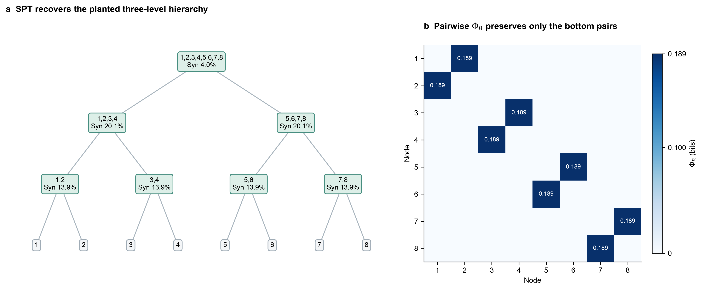
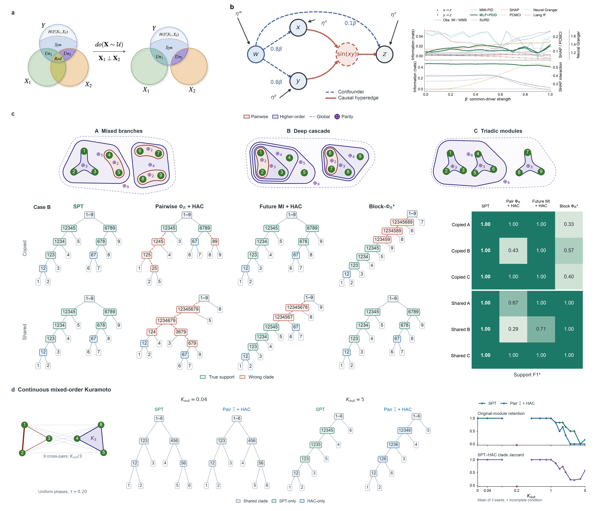

# SPT 层级比较：Kuramoto 转变定位、对比算法与已知动力学案例

日期：2026-10-12。已完成当前 Zotero 附件重读、对比方法定位、双轨 Kuramoto pilot，以及六节点、八节点和九节点异阶嵌套精确离散比较。pilot 共 328 条记录，309 条有效，计算 89.61 分钟；结果见 [扫描与比较报告](../reports/spt_kuramoto_transition_pilot.md)。大规模社区算法比较尚未执行。

## 1. 当前能支持的判断

当前图直接支持：$K_{\mathrm{out}}=0$ 和 $0.04$ 的根划分相同，$5$ 时变为链状树。旧筛选缓存进一步提示三个不同事件：子树内的分支变化、原模块根划分丢失、整棵树变成链状。这些事件不应合并成一个“临界点”。旧缓存把原模块根划分丢失的候选区间缩到 $1.5$–$3$，但特征上下文的记录存在歧义，不能把它当作当前主图协议下已经测定的临界区间。

最有价值的比较问题是：**在相同动力学数据与计算预算下，SPT 能否保留成对表示丢失的分组信息，并在独立评价上产生更好的层级？** 同时比较仅成对方法、可读取完整变量组的方法，以及高阶超图方法。后两类可能与 SPT 一样恢复结构，必须如实报告。

已有一个精确结果：在十种六节点双三元 parity 动力学中，SPT 恢复根模块 10/10，全部成对 $\Phi_R$ 和成对 PEID 矩阵均严格为零。它说明成对表示的可辨识边界；尚不证明 SPT 在连续动力学或所有层级算法上更优。

当前协议下，图中 seed 0 的首次任意 clade 变化在 $(0.2,0.25]$，首次原模块根划分丢失在 $(1.5625,1.59375]$，首次链状树在 $(4.625,4.65625]$。后两类区间另两个 seed 明显不同，且存在回返；它们是采样网格上的树选择变化定位，不是物理相变或置信区间。完整六维 TM 在三个 $K_{\mathrm{out}}=0$ 条件全部非负审计失败，不能用这一轨道确认弱耦合起点。

## 2. 方法依据和版本边界

本次通过 Zotero 本地 API 重新核验父项 `P6UJCVG8`，题名为 *Emergent hierarchical organization of causal interactions in complex systems*。重新列出附件后，读取当前唯一正文 `DXGC7JEA`（19/19 页）和补充 `MWIWKSVG`（28/28 页）的相关全文。

正文与补充均无明确稿件日期或修订号。正文附件入库于 2026-10-02，补充入库于 2026-10-04；这些附件元数据不证明稿件修订先后。本报告采用当前可用的这一组全文，保留版本歧义。

依据位置：正文第 3 页式（1）–（3），Methods 第 15–17 页式（5）–（12）；补充 S1.2 第 3–4 页、S5/Algorithm S1 第 8–9 页、S7 第 11–12 页。具体约束如下。

- 所有子集 EI 来自同一个独立干预联合分布，保持支持、target、时距和边缘化协议一致。
- 标准 SPT 在每个节点最大化子块 $\Xi$ 之和，等价于最小化原始 Syn residual；不默认采用规模归一化。
- 六源完整树枚举每个节点的全部合法二分，并递归到单节点。根节点有 31 个候选二分。
- SPT 节点贡献是依赖分解路径的层级 Syn，不能解释成纯阶数的 PID atom 或动力学方程中的同阶力项。
- 连续 EI 优先使用 TM。以下离散例子用精确有限概率求和，避免不必要的连续估计近似。

## 3. Kuramoto 的已有证据

主图来源是 [现有运行脚本](../../scripts/run_mixed_order_kuramoto_kout_main.py) 和 [主图结果](../../results/mixed_order_kuramoto_kout_main/summary.json)。固定设置为：六源独立均匀相位干预 $(-\pi,\pi)^6$；4,800 条训练转移；4,000 条学习通道读出；$\tau=0.20$；积分步长 $0.01$；过程噪声 $0.08$；MLP 800 epochs；TM 100 epochs；512 个 EI 评价点；256 个边缘积分样本；seed 0。跨模块每条边权重为 $K_{\mathrm{out}}/3$。

下表只读取已有结果。信息量由 bits 乘 $\ln 2$ 转为 nats。树形变化列保留节点标签，不把叶子绘图顺序当成变化。

| $K_{\mathrm{out}}$ | 根划分 | 根 Syn（nats） | 根 Syn / 总 $\Xi$ | 树形观察 | 证据 |
|---:|---|---:|---:|---|---|
| 0 | 123 \| 456 | 0 | 0% | 两个三元子树；下层为 12、56 | 主图及旧筛选 |
| 0.04 | 123 \| 456 | 0 | 0% | 与 0 同拓扑 | 主图及旧筛选 |
| 1.5 | 123 \| 456 | 1.0104 | 12.89% | 原根模块保留，三元子树内由 56 换为 45 | 旧筛选 |
| 3 | 126 \| 345 | 0.8685 | 11.58% | 原模块丢失，但仍为两个三元子树 | 旧筛选 |
| 5 | 12345 \| 6 | 1.2235 | 21.84% | 链状；依次保留 12345、1235、125、12 | 主图及旧筛选 |
| 8 | 12356 \| 4 | 1.0905 | 25.20% | 链状，剥离次序改变 | 旧筛选 |

旧筛选文件：[较弱耦合筛选](../../results/mixed_order_kuramoto_kout_main/learned_component025_regime_screen.json)、[较强耦合筛选](../../results/mixed_order_kuramoto_kout_main/strong_regime_screen.json)。它们的样本量、训练预算、噪声、时距、EI 评价规模和 seed 与主图相同，而且 0、0.04、5 的树及数值与主图完全相同。不过，旧合同把 TM context 写为 compact circular features，主图合同写为 circular 加机制 Fourier 项；旧合同也没有完整记录 component rule。数值重合支持结果复用，不能补足未保存的生成代码与配置出处。

**扫描前必须处理的三项实现边界：**

1. 当前 EI 通道由 MLP permutation effect 在 **0.25 输出标准差**处阈值化，随后按连通分量分别拟合 TM、加和 EI。0 与 0.04 的最大跨模块 effect 分别约为 0.1871、0.1904，故两者均被近似成独立通道；根 Syn = 0 来自这一近似。物理动力学在任意正 $K_{\mathrm{out}}$ 下已有跨模块边，不能将 0.04 的数值零解释成严格解耦。补充 S7 已明确这一点。
2. 实际 target 是完整六维 **wrapped phase increment**。运行合同部分措辞写成“reconstruct future state”，但代码直接使用 sampled increment。补充 S7 与实际代码一致，正文一般定义使用完整 future state；两种 target 的 EI 不等价。复现主图应固定 increment target，并明确其与正文一般状态读出的差别。
3. TM context 含已知 pairwise、triadic 和候选跨边 Fourier 项。这是固定机制字典下的实验。若主张未知结构恢复，需要增加通用、与植入标签无关的字典对照，并让比较方法共享学习通道。不能把带机制特征的 SPT 与只给原始观测的基线混成同信息条件下的比较。

另一个支持近似：训练增量通过相位包裹得到，但 MLP 读出加实值高斯残差后没有再次包裹，条件 TM 也是实值密度模型。故“wrapped increment”是训练目标的含义，估计通道没有严格限制在圆周增量支持上。本次沿用这一读出近似以复现当前协议，未把它替换为严格周期信道，也不声称估计 EI 等于物理信道的精确 EI。

此外，历史 summary 没有保存完整 63 项 EI 表和根候选分数，故无法从现有树反推出最佳划分与次佳划分的 margin。

## 4. 怎样定位“开始定性变化”

### 4.1 分开报告四个事件

| 事件 | 操作定义 | 已有缓存的探索性定位 |
|---|---|---|
| 估计通道连通变化 | 学习 component 数由 2 变为 1 | 0.04 与 1.5 之间 |
| 任意子树拓扑变化 | 去掉左右顺序后的内部 clade 集合改变 | 0.04 与 1.5 之间；可能涉及近似平局 |
| 原模块根划分丢失 | 根不再为 123 \| 456 | 1.5 与 3 之间 |
| 链状结构出现 | 六叶树的 Sackin index 达到链状最大值 20 | 3 与 5 之间 |

这些区间没有更细网格，且没有多 seed 或连续性保证。它们不保证区间内只有一次变化，也不能排除早先发生变化后又恢复。六节点含噪系统中的树选择变化称为“层级重组”或“regime crossover”，不能直接称为热力学相变。

### 4.2 固定协议，粗扫后局部加密

首轮固定网格为：0、0.04、0.1、0.2、0.4、0.6、0.8、1、1.25、1.5、1.75、2、2.5、3、4、5。先记录完整曲线，再对全部观察到划分变化的相邻区间**批量增加中点**，每轮重新检查全部变更区间，优先完成首次事件的候选边界，目标宽度不超过 0.05。根最佳/次佳 gap ≤ 0.02 bits 仅作为额外加密触发器，不作为显著性或估计误差门槛。剩余加密服从 90 分钟总计算预算，未达到目标的区域明确保留。

这不是只追踪一个根交叉的单次二分搜索；保留所有已观察到的变化和回返。端点状态相同的区间仍可能存在未观察到的重入，因此报告的是网格上的候选边界，不能证明连续参数域的唯一首次临界点。

同时保留两条明确定义的轨道：

- **图 1d 复现轨道**：完全保留当前 0.25 component 规则及 increment target，回答现有管线的输出在哪里改变。
- **完整通道对照**：对所有 $K_{\mathrm{out}}$ 一律拟合六维 conditional TM，不按学习阈值丢弃弱跨分量联系，保持相同 source、target、学习模型和预算。这个估计器对照可能在零耦合下出现有限样本误差，应提高估计精度或报告失败，不能再用阈值因子化强制归零。

首轮用三个配对数据/模型种子。每个条件保存 63 个 EI、全部根候选分数、全树、component effects、样本/配置出处和非负审计；重复值来自独立数据/模型种子，而非把 512 个积分点当成独立实验。所有方法共享实际 source、过程噪声和读出样本，而不只是共享 seed 数字。

在节点 $A$，记录标准目标分数和 margin：

$$
S_A(L,R;K)=\Xi_K(L\to B)+\Xi_K(R\to B),\qquad
g_A(K)=S_A^{(1)}(K)-S_A^{(2)}(K).
\tag{4.1}
$$

式（4.1）的上标表示第一、第二名候选。仅有拓扑不同且 margin 小于估计误差时，标为未分辨候选；不宣称定性重组已确定。记录原模块划分相对所有其他根二分的分数差：

$$
\Delta_P(K)=S_V(P,T;K)-\max_{(L,R)\ne(P,T)}S_V(L,R;K).
\tag{4.2}
$$

式（4.2）过零定位原模块根划分失去最优性的候选位置。报告逐 seed 的交叉区间和划分频率；三个 seed 只用于 pilot，不把它们包装成精确的总体置信区间。多个交叉区间全部保留。

Syn 原生容差沿用 0.1 bits = 0.0693147 nats，并保存最小值、容差内负值数量、显著违规数量与 closure error。低于负容差时明确失败，报告最小值、阈值和数量。容差不是转变显著性阈值，也不能作为忽略弱正 Syn 的理由。

## 5. 已定位的比较方法

### 5.1 优先实现的比较集

| 方法 | 输入与输出 | 对比目的 | 原文或实现依据 |
|---|---|---|---|
| Mean pairwise MMI-$\Phi_R$ | 所有节点对的跨时联合边缘；输出均值曲线 | 对应用户提出的成对计算取平均；比较量变/重组信号，不给它分配树恢复分数 | [Mediano et al., PNAS 2025](https://doi.org/10.1073/pnas.2423297122)，Zotero `26Q48H8Y` / `UU9QDQXU`，全文 12/12 页 |
| Pairwise $\Phi_R$ + average linkage | 同一成对矩阵；输出 dendrogram | 让 $\Phi_R$ 表示也产生 hierarchy，检验它是否丢失分组信息 | [作者 Python 包](https://github.com/Imperial-MIND-lab/integrated-info-decomp)、[SciPy average linkage](https://docs.scipy.org/doc/scipy/reference/generated/scipy.cluster.hierarchy.linkage.html)；树构造是本实验的适配 |
| Future-MI + average linkage | 完整节点未来读出的 $I(\mathbf{y}_i;\mathbf{y}_j)$ 图；输出 dendrogram | 检验读出复制是否给一般成对聚类提供额外层级线索；已在第 7.2 节运行 | 精确干预联合，SciPy average linkage；本实验适配 |
| Pairwise PEID + average linkage | $W_{ij}=\Xi(\{i,j\}\to B)$，使用同一 EI 联合与完整 target | 区分成对压缩与高阶子集查询的贡献，减少分布/target 差异 | 当前稿件补充 S5.2 的 affinity；链接聚类规则同上 |
| HCD-Spec | 同一 affinity 的递归谱二分和停止规则；输出社区树 | 直接比较自顶向下二分机制，适合与 SPT 对齐 | [Li et al., JASA, DOI 10.1080/01621459.2020.1833888](https://doi.org/10.1080/01621459.2020.1833888)、[全文 §2.2–2.3](https://arxiv.org/html/1810.01509v6) |
| Hierarchical Infomap | 同一加权图上的随机游走流；输出多层社区树 | 原生层级方法，比较 flow-based organization | [Rosvall & Bergstrom, PLOS ONE 2011](https://journals.plos.org/plosone/article?id=10.1371/journal.pone.0018209)，全文 |
| Block-$\Phi_R$ recursive partition | 直接读取变量组跨时联合，不限于成对矩阵 | 较强的信息论基线，检验 SPT 相对完整组指标的差异 | 依据 PNAS 2025 二块 $\Phi_R$ 公式扩展变量块；递归树是本实验提出的适配，不称作原文已有算法 |

首轮 graph hierarchy 默认使用同一成对 PEID 图，再对关键方法加入 $\Phi_R$ 图版本。这样能区分 affinity 的变化和树构造算法的变化，不做无解释的全部排列组合。

### 5.2 保留的补充基线

- **Nested stochastic block model（nSBM）**：原生多层 block hierarchy，且可表达非 assortative 结构。[Peixoto, PRX 2014](https://arxiv.org/html/1310.4377v2) 已读相关模型全文；加权版本见 [Peixoto, arXiv:1708.01432](https://arxiv.org/abs/1708.01432)（摘要）。实现入口为 [graph-tool inference](https://graph-tool.skewed.de/static/docs/stable/demos/inference/inference.html)。建议用于 24/48 节点复制模型，六节点的统计支持不足以担任唯一主对照。
- **Markov Stability / PyGenStability**：输出随扩散尺度变化的划分。[Delvenne et al., PNAS 2010](https://doi.org/10.1073/pnas.0903215107) 已核对相关方法正文；[作者实现](https://github.com/barahona-research-group/PyGenStability)。不同扩散时间的最优划分不必严格嵌套，保存原始多尺度结果，不强行包装成一棵树。扩散时间也不等同于物理预测时距 $\tau$。
- **Recursive Leiden-CPM**：Leiden 原生结果是划分；递归或多分辨率路径是本实验适配。[Traag et al., Scientific Reports 2019](https://doi.org/10.1038/s41598-019-41695-z) 通过摘要与作者预印本核验；本次期刊全文访问遇到登录重定向。不要把一般 Leiden 输出直接称作具有已验证真实层级的树。
- **高阶超图强对照**：采用 [Hy-MMSBM / Ruggeri et al., Science Advances 2023](https://doi.org/10.1126/sciadv.adg9159)，及其 [作者代码](https://github.com/nickruggeri/Hy-MMSBM)。已核对摘要与实现说明。它支持高阶与重叠 community，但原生并非完整二叉 hierarchy；可比较同分辨率划分、超边预测及重叠恢复。若递归调用，必须把递归规则写成实验适配。

高阶超图输入先从同一数据用通用高阶机制字典估计；另给真实超边的 oracle 版本作为信息充足对照。真实超边不能只供给某个方法却声称所有方法使用相同信息。超图 similarity matrix 本身也可能在某些模型下保留 community 真值，不能笼统宣称所有矩阵方法都失效：[Gaudio & Joshi, COLT 2023](https://proceedings.mlr.press/v195/gaudio23a.html)（摘要）。

建议阅读顺序：PNAS 2025 $\Phi_R$ 定义与分布解释 → HCD §2 → hierarchical Infomap → nSBM → Markov Stability → Hy-MMSBM。

## 6. $\Phi_R$ 比较的具体定义

令 $\mathbf{x}_i$ 为第 $i$ 个节点的源状态向量，$\mathbf{y}_i$ 为对应未来读出向量。在同一个跨时联合分布上定义 MMI 版本：

$$
\Phi^{R}_{ij}=I(\mathbf{x}_i,\mathbf{x}_j;\mathbf{y}_i,\mathbf{y}_j)-I(\mathbf{x}_i;\mathbf{y}_i)-I(\mathbf{x}_j;\mathbf{y}_j)
+\min_{a,b\in\{i,j\}}I(\mathbf{x}_a;\mathbf{y}_b),\qquad
\overline{\Phi^{R}}=\frac{2}{n(n-1)}\sum_{i<j}\Phi^{R}_{ij}.
\tag{6.1}
$$

式（6.1）来自选定的 MMI-$\Phi_R$ 定义，其最小项在 PNAS 2025 的 *Why Whole-Minus-Sum Phi Can Be Negative* 小节给出。$\Phi_R$ 包含 synergistic 与 unique-transfer 信息，不能把它直接重命名为 SPT Syn。用户提出的均值只回答整体强度；层级比较使用保留下来的 $\mathbf{W}^{R}$。

average linkage 的组间 affinity 为两组所有跨组 $\Phi_R$ 的算术平均。对有限非负 affinity 可设 $d_{ij}=1-W_{ij}/\max_{p<q}W_{pq}$；全零矩阵标为无可辨识 affinity。平局时记录策略并检验标签置换，不用默认叶序制造恢复成功。该距离不保证欧氏性，因此不默认使用 Ward linkage。显著负数需按所选 $\Phi_R$ 定义与估计器诊断，不能无说明裁剪为非负图权。

Block-$\Phi_R$ 对节点 $A$ 的二分 $(L,R)$ 计算：

$$
\Phi_R(L,R)=I(\mathbf{x}_A;\mathbf{y}_A)-I(\mathbf{x}_L;\mathbf{y}_L)
-I(\mathbf{x}_R;\mathbf{y}_R)+\min_{U,V\in\{L,R\}}I(\mathbf{x}_U;\mathbf{y}_V).
\tag{6.2}
$$

这里粗体小写表示相应变量组向量。采用未归一化式（6.2）最小值作为该基线首轮比较的递归切分规则，并报告规模偏好；若加入 minimum-information-partition 的归一化，作为单独预先声明的版本。它读取高阶组联合，能够在 parity 例子中看到成对方法遗漏的信息。其 target 随递归节点变成 $\mathbf{y}_A$，与 SPT 全树固定完整 $B$ 不同，需明确报告这一方法差异。

对连续模型，均匀相位不是 Gaussian；不能只用协方差估计的 Gaussian-MMI 当作 nonlinear-$\Phi_R$ 的唯一实现。主比较使用共同 TM 联合的非线性边缘，Gaussian 版本仅作估计器对照。若只拟合 conditional target density，查询 group-target 边缘还需要积分其他 target；不能用 SPT 的 63 项 source-to-full-target EI 表替代这些互信息。

独立干预与自然轨迹各保留一个协议。原生 $\Phi_R$ 可以用于干预联合，不能预设它必然受观测混杂影响。[PNAS 2025](https://doi.org/10.1073/pnas.2423297122) Discussion 明确区分两种联合分布的解释；当前本地全文为主要依据。SPT 主比较采用因子化干预，natural-$\Phi_R$ 作为行为尺度补充，两个协议的性能差异不单独归因于树算法。

## 7. 已完成的最小已知动力学案例

### 7.1 两个三元 parity 模块

六个源比特独立均匀分布。任选两个互补三元组 $H_1,H_2$，定义一阶 Markov 转移：

$$
Z_m=\left(\bigoplus_{i\in H_m}X_i\right)\oplus E_m,\qquad
Y_i=Z_m\quad(i\in H_m),\quad E_m\sim\mathrm{Bernoulli}(0.1).
\tag{7.1}
$$

两个噪声位相互独立且独立于源。target 为完整六维未来状态 $\mathbf{y}$，没有使用局部模块 target 替代全状态。节点 1 固定在第一个组时，共有十种不同的无序 3 \| 3 模块划分。本次枚举全部十种，没有筛选“最有利”的标签。

任意两个源都缺少恢复任一三元 parity 所必需的比特。因此，即使给成对源完整 target，其互信息也为零；完整模块才有非零 EI。具体数值由 64 个 source 状态和 4 个 noise 状态的精确有理概率求和得到，再调用仓库 canonical SPT。

| 指标 | 全部十种划分的结果 |
|---|---:|
| SPT 正确根划分 | 10/10 |
| 系统 $\Xi$ | 1.0620088128 bits = 0.7361284143 nats |
| 每个真实三元节点 Syn | 0.5310044064 bits |
| 根 Syn | 0 |
| 最佳根二分领先次佳候选 | 0.5310044064 bits |
| 全部 15 个 pairwise MMI-$\Phi_R$ | 严格为 0 |
| 全部 15 个 pairwise PEID $\Xi$ | 严格为 0 |
| 每个条件审计的所有子集二分 | 301 |
| Syn 容差内负值 / 显著负值 | 0 / 0 |
| closure error | 0 |

精确脚本：[spt_pairwise_parity_case.py](../../scripts/spt_pairwise_parity_case.py)。原生容差 $10^{-10}$ bits，无 clipping。复算仅需数秒，未增加机器可读缓存。

```bash
.venv/bin/python scripts/spt_pairwise_parity_case.py
```

只输入这张成对零矩阵的任何算法，对十种动力学收到完全相同的输入；在真模块先验均匀且没有其他信息时，正确识别根模块的概率至多为 1/10。这是矩阵信息不足的界，不是已运行十个 clustering 软件得到的性能表。完整联合的 Block-$\Phi_R$、已知超边方法或其他高阶方法不受此界限制。

这个界只针对上述成对跨时信息矩阵。未来读出的组内复制会使 $I(Y_i;Y_j)$ 图显出模块，因此不支持“所有成对社区算法都失败”的结论。

三元内部的二分没有可辨识偏好。SPT 输出中的零质量分支只为完成二叉树，应折叠或标为平局；不能把这两条任意细分计入 planted hierarchy 恢复成功。

### 7.2 已验证的三层 Markov 案例与实际基线

新增八节点有限状态 Markov 模型，每个节点的状态 $\mathbf{x}_i$ 含四个比特：第一位是 driver，后三位是上一时刻的底层、父层和根读出。对全部 32 个源比特做独立均匀干预。固定四个底层节点对 $H_1=12,H_2=34,H_3=56,H_4=78$；将四个底层组两两组合为两个父层组，共枚举三种不同组合，全部执行。

令 $b_i$ 为节点第一位，父层的底层组索引集合为 $\mathcal G_g$，$m(i),g(i)$ 为节点所属组。每步从当前 driver 构造各层 parity，并更新完整节点状态：

$$
\begin{aligned}
P_m&=\bigoplus_{i\in H_m}b_i,\quad Q_g=\bigoplus_{m\in\mathcal G_g}P_m,\quad R=\bigoplus_{m=1}^4P_m,\\
\mathbf{x}_i(t+1)&=\bigl(U_i,\;P_{m(i)}\oplus E^P_{m(i)},\;Q_{g(i)}\oplus E^Q_{g(i)},\;R\oplus E^R\bigr).
\end{aligned}
\tag{7.2}
$$

式（7.2）的右侧 driver 均取时刻 $t$；$U_i\sim\mathrm{Bernoulli}(1/2)$ 每步独立刷新。底层噪声 $E^P_m\sim\mathrm{Bernoulli}(0.25)$，父层和根噪声均为 $\mathrm{Bernoulli}(0.1)$。七个读出噪声相互独立，同一祖先的带噪读出复制给其所有后代。这是 **copied** 读出版本。完整未来 target 为八个四比特向量，共 32 比特；未来 driver 也在 target 内。对比指标读取完整节点向量，不只输入 driver 一位。

保留 copied 为阳性对照：未来读出的成对互信息能恢复它的上层。另加入 **secret-shared** 版本，保持底层读出不变，把父层与根读出分配为 XOR shares。令父层的后代节点集合为 $D_g$，定义：

$$
\bigoplus_{i\in D_g}s_i=Q_g\oplus E^Q_g,\qquad
\bigoplus_{i=1}^{8}r_i=R\oplus E^R,\qquad
\mathbf{x}_i(t+1)=\bigl(U_i,P_{m(i)}\oplus E^P_{m(i)},s_i,r_i\bigr).
\tag{7.3}
$$

每个四节点父层先抽三个独立均匀 shares，再由式（7.3）确定第四个；根先抽七个，再确定第八个。全部 13 个 mask 相互独立，且独立于源和读出噪声。任何真子集的 shares 都是独立于相应祖先读出的均匀噪声；完整组可无损解码。三种父层组合与两个读出版本构成六个开发案例，全部运行。secret-shared 是在发现 copied 可被未来互信息聚类恢复后加入的模型设计，属于存在性证据，不能当作未经观察的确认性测试。

精确计算可解析积分掉未使用的当前读出位、独立的未来 driver、输入 gauge 位与独立分享 masks。令 $J(S)=\{m:H_m\subseteq S\}$，$\mathbf{p}=(P_1,\ldots,P_4)$，$\widetilde{\mathbf{z}}$ 为七个解码后的带噪祖先读出，则两个版本都满足：

$$
\operatorname{EI}(S\to\mathbf{y})=I\bigl(\mathbf{p}_{J(S)};\widetilde{\mathbf{z}}\bigr).
\tag{7.4}
$$

式（7.4）是完整信道互信息的等式，不是更换 target 的估计近似：未完整选取的底层对，其未选 driver 均匀地掩蔽 parity；当前其余位不影响未来；未来 driver 与源及带噪读出独立；重复坐标或完整 shares 均可无损解码，且剩余 masks 独立。枚举四个独立 parity 的 16 种状态和七个噪声位的 128 种状态，使用有理数概率。全部 255 项 EI 由此计算，再交给无约束 canonical SPT。

| 指标 | 六个案例的结果 |
|---|---:|
| SPT 正确根划分 | 6/6 |
| 六个真实非根、非叶 clade 的 precision / recall / F1 | 全部为 1 |
| 总 $\Xi$ | 2.0845974009 bits |
| 根 Syn | 0.0833715447 bits |
| 根最佳/次佳分数差 | 0.4101725165 bits |
| 成对 $\Phi_R$ 均值 | 0.0269602679 bits，六例完全相同 |
| 两种成对矩阵跨例最大差 | 0 |
| 每例全部二分非负审计 | 3,025 项；最小值 0，违规 0，容差内负数 0 |

成对 $\Phi_R$ 与成对 PEID 都能显示四个底层节点对，但三种上层组织的矩阵完全相同。在 secret-shared 中，未来互信息矩阵也只显示底层节点对，对三种父层组合完全相同。只给这些相同矩阵、没有额外标签或超边信息、要求输出单一根二分时，在三种真值均匀的先验下正确识别根的概率至多为 1/3。读取完整组联合或真实超边的方法不受此界限制。

实际运行的基线均读取同一精确干预联合。HAC 使用 average linkage，距离按第 6 节定义，固定节点标签 1–8 与 SciPy 默认平局策略；Block-$\Phi_R$ 使用式（6.2）的未归一化递归最小值。每个版本包含三种父层组合，表中 F1 是三例均值：

| 算法 | copied：正确根 / Clade F1 | secret-shared：正确根 / Clade F1 |
|---|---|---|
| SPT | 3/3 / 1.000 | 3/3 / 1.000 |
| 成对 $\Phi_R$ + HAC | 0/3 / 0.722 | 0/3 / 0.722 |
| 未来互信息 $I(\mathbf{y}_i;\mathbf{y}_j)$ + HAC | 3/3 / 1.000 | 0/3 / 0.722 |
| Block-$\Phi_R$ 递归适配 | 3/3 / 0.667 | 3/3 / 1.000 |

HAC 的 0/3 是这一固定平局策略的实际结果，不能当作所有图算法的性能上界；1/3 才是上述相同输入条件的识别上界。Block-$\Phi_R$ 的 copied 细层失败只针对当前未归一化、随节点改变 target 的适配，不能推广为原论文方法普遍劣于 SPT。未来需要加入归一化 MIP 版本作为敏感性比较。

这比式（7.1）的零矩阵案例进一步展示了层级：成对跨时表示保留底层分组，却丢失父层归属；SPT 使用高阶子集查询恢复三层，并在两个读出版本均保持完整恢复。它与 copied 的未来互信息 HAC、secret-shared 的 Block-$\Phi_R$ 打平。真 clade 来自生成机制的作用支持，分数差确认所选参数下的唯一性；这不是以 SPT 自身目标当恢复评分。相同精确联合不代表相同查询成本或有限样本精度；未证明任意噪声、任意动力学或相同预算下的普遍优势。

精确脚本：[spt_multilevel_parity_case.py](../../scripts/spt_multilevel_parity_case.py)。原生容差 $10^{-10}$ bits，无 clipping。图中展示 secret-shared 的固定第一种父层组合；六个案例均已检查。



```bash
.venv/bin/python scripts/spt_multilevel_parity_case.py --figure docs/reports/assets/kuramoto_hierarchy/spt_multilevel_parity.png
```

后续再扩展到 16 节点、多噪声因素和带单源 copy 的模型族。新参数先检查全部已知层次的 score gap；确认性比较另用未筛选的模型/噪声组合，并纳入完整组与高阶强对照。

大规模比较还必须审计 SPT 的候选覆盖：补充 S5 对超过 exact 阈值的节点采用成对 affinity 引导的谱分割、HAC 和原序 prefix 候选。八节点精确恢复不能证明 24/48 节点近似搜索同样有效；若上层信息在成对图中不可辨识，近似候选本身可能遗漏真划分。应报告候选是否含真分割、EI 查询预算和近似损失。

### 7.3 九节点异阶嵌套超边：3 ⊂ 5，与 4 节点分支并存

按新的结构要求，保留四个 primitive parity 的精确信道，但把微观作用支持改成异质大小：

$$
\begin{aligned}
&H_1=\{1,2,3\},\quad H_2=\{4,5\},\quad H_3=\{6,7\},\quad H_4=\{8,9\},\\
&G_5^{(a)}=H_1\cup H_a,\quad
G_4^{(a)}=\bigcup_{m\in\{2,3,4\}\setminus\{a\}}H_m,\quad a=2,3,4.
\end{aligned}
\tag{7.5}
$$

式（7.5）的三个 $a$ 分别是 case A/B/C。每例有三节点超边 $H_1$、三个二节点作用、五节点超边 $G_5^{(a)}$、四节点超边 $G_4^{(a)}$，以及覆盖两大社团的九节点作用。三节点超边严格嵌在五节点超边中；四节点分支包含两个二节点作用。三个模型使用相同节点位置和编号，只有上层超边支持变化。区域表示一次联合 parity 作用，不是额外的成对 clique。

动力学仍按式（7.2）构造 primitive、父层与根 parity，但底层支持和父层后代改为式（7.5）；每节点仍有 driver 和三个读出字段。所有 **36 个当前状态位**独立均匀干预，固定完整 **36 比特未来状态**为 target，时距一步。primitive 噪声为 0.25，父层与根噪声为 0.1，不依超边大小重新调噪声。copied 与 secret-shared 均执行三个上层组合。secret-shared 的五节点、四节点、九节点读出分别用 4、3、8 个独立 mask，共 15 个；底层读出仍复制给对应节点。

完整 target 可无损解码同样七个带噪 parity；均匀缺失 driver 掩蔽未完整选取的 primitive block。式（7.4）因此继续适用，只需按式（7.5）更新 $J(S)$。使用相同的 16 × 128 项有理数 latent 联合，得到全部 511 项 EI；SPT 自由枚举合法二分，**没有把真实超边作为分割约束**。

三元内部不存在唯一的二叉细分。评分先对所有方法一致地删除 primitive 三元组的严格真子集 clade（例如 12、13、23），再对六个已知非根支持计算 precision/recall/F1；不会删除跨 primitive 的错误合并。这个依据来自生成模型，而非算法输出或 Syn 阈值。完整二叉树继续保留这些平局分支，以灰色显示；大图的 F1* 使用上述统一规则。

| 方法 | copied：正确根 / 平均 F1* | secret-shared：正确根 / 平均 F1* |
|---|---|---|
| SPT | 3/3 / 1.000 | 3/3 / 1.000 |
| 成对 $\Phi_R$ + HAC | 0/3 / 0.722 | 0/3 / 0.722 |
| 未来互信息 + HAC | 3/3 / 1.000 | 0/3 / 0.722 |
| Block-$\Phi_R$ 未归一化递归适配 | 3/3 / 0.615 | 3/3 / 1.000 |

六例成对 $\Phi_R$ 均值为 0.0157268230 bits，矩阵差严格为零：只显示三个 primitive 二元组，三元与上层源信息没有保留。HAC 恰好包含三元 clade 的部分恢复来自默认零值平局，不能解释为矩阵识别了三元 parity。secret-shared 的未来互信息保留三元组的复制读出和三个二元组，但三种上层组合的未来互信息矩阵仍完全相同。完整组方法的平手保留，不能据此声称所有既有指标都失败。

每例审计全部 9,330 项子集二分，原生容差 $10^{-10}$ bits，最小 Syn 为 0，容差内负数和显著违规均为 0，闭合误差为 0，无 clipping。另独立枚举每例全部 512 个 driver 状态 × 128 个噪声状态，以整数噪声权重构造原始九源联合，核验三例全部 1,533 项子集 EI；与 latent 约简的最大差为 $4.44\times10^{-16}$ bits。已有八节点六例的原生记录也逐项核验不变。


这是具有异质作用阶数、嵌套社团和跨社团联合读出的有限状态开发模型；不是已验证的自然复杂系统或连续 Kuramoto 方程。三种结构组合不是独立随机重复，因此不加置信区间。后续连续验证可在同样支持上设置高阶振子耦合，但动力学 hyperedge 与 SPT clade 并不自动一一对应，应独立验证响应与可辨识性。

复现入口：[spt_nested_hypergraph_case.py](../../scripts/spt_nested_hypergraph_case.py)。计算便宜，不在仓库新增结果缓存；单条命令即可复算并生成大图：

```bash
.venv/bin/python scripts/spt_nested_hypergraph_case.py --figure docs/reports/assets/kuramoto_hierarchy/spt_nested_hypergraph_comparison.png > /tmp/eisyn_spt_nested_hypergraph.json
```

本次再次通过 Zotero 重定位父项 `P6UJCVG8`，读取正文 `DXGC7JEA` 的 Methods（5）–（12）（第 15–17 页）和补充 `MWIWKSVG` 的 S5/Algorithm S1（第 8–9 页），保持共同干预、固定完整 target、原始 residual 与自由递归规则。当前唯一附件组仍无明确稿件版本日期，版本歧义保留。

### 7.4 非同构架构与异质节点动力学

最新大图移除成对矩阵与均值面板，改用三个**拓扑不同**的九节点模型。它们均有九节点根作用：

| case | 已知非根作用支持 | 结构 |
|---|---|---|
| A | 123、45、67、89、12345、6789 | 异阶混合分支；3 ⊂ 5 与 2+2 ⊂ 4 |
| B | 12、123、1234、12345、67、678、6789 | 深链；2 ⊂ 3 ⊂ 4 ⊂ 5，另一支 2 ⊂ 3 ⊂ 4 |
| C | 123、456、789、123456 | 三个三元模块，其中两个嵌在六节点作用中 |

case A/B/C 的非根支持数分别为 6、7、4，嵌套深度和阶数组成不同，不是旧结构的旋转或重新编号。保持同一节点 gate 与 memory-noise profile，比较在每个模型内部进行；架构同时改变了作用支持、通道数量和深度，不能把模型间的分数差归因于单独一个因素。

每个节点的状态是 11 比特向量 $\mathbf{x}_i=(a_i,b_i,m_i,\mathbf{r}_i)$：两个 driver、一个 memory、八个 readout 字段。不使用的未来 readout 字段为零；当前 readout 字段不驱动更新。对全部 99 个当前状态比特做独立均匀干预，target 为同一过程完整 99 比特未来状态，时距一步。各节点先对两个 driver 做不同的非线性变换，再产生支持 $H_e$ 上的带噪联合读出：

$$
u_i(t)=f_i\bigl(a_i(t),b_i(t)\bigr),\qquad
z_e(t+1)=\bigoplus_{i\in H_e}u_i(t)\oplus\eta_e.
\tag{7.6}
$$

| 节点 | driver gate $f_i$ | 干预诱导的 $P(u_i=1)$ | memory gate $\Gamma_i$ | memory flip $\rho_i$ |
|---:|---|---:|---|---:|
| 1 | AND | 1/4 | XOR | 3/32 |
| 2 | XOR | 1/2 | AND | 4/32 |
| 3 | OR | 3/4 | OR | 6/32 |
| 4 | NAND | 3/4 | 三输入 majority | 5/32 |
| 5 | COPY 第一个 driver | 1/2 | XOR | 7/32 |
| 6 | AND | 1/4 | OR | 4/32 |
| 7 | OR | 3/4 | AND | 8/32 |
| 8 | XOR | 1/2 | 三输入 majority | 6/32 |
| 9 | NOR | 1/4 | XOR | 9/32 |

这是实际非线性门，不是可逆重命名。源干预仍是原始状态上的最大熵分布；**压缩后的 $\mathbf{u}$ 并不均匀**，计算保留表中诱导概率，不能把均匀 driver 干预替换成均匀 activation 干预。二、三、四/五/六、九节点作用的独立 flip 概率分别为 4/16、3/16、2/16、1/16，所有模型使用同一按阶数规则。copied 复制全部读出；secret-shared 只复制最小支持，其余每个支持使用独立的 n-of-n XOR shares。

每节点 memory 在时间上保留自身状态，并受该节点新读出驱动：

$$
\begin{aligned}
m_i(t+1)&=m_i(t)\oplus\Gamma_i\bigl(\mathbf{r}_i(t+1)\bigr)\oplus\epsilon_i,
\qquad\epsilon_i\sim\operatorname{Bernoulli}(\rho_i),\\
\mathbf{x}_i(t+1)&=\bigl(a_i',b_i',m_i(t+1),\mathbf{r}_i(t+1)\bigr).
\end{aligned}
\tag{7.7}
$$

式（7.7）的 $a_i',b_i'$ 每步独立均匀刷新。$\Gamma_i$ 的输入为按 readout 编号排序的首个、末个和中间 incident 字段；二输入门只取首/末字段。所有 memory noises、hyperedge noises、fresh drivers 与分享 masks 相互独立。memory 不反馈到 driver 或 hyperedge parity，因此不能把此模型称为一般耦合 Boolean recurrent network。

任意 target 节点均包含自身完整 readout 字段，故可撤销 memory 的已知 shift；copied 或完整 shares 可无损解码其可见读出，剩余 masks 与源独立。令 $\mathcal{V}(T)$ 为 target 节点集 $T$ 能解码的读出索引，则：

$$
\operatorname{EI}(S\to T)=
I\!\left(\mathbf{u}_S;\mathbf{z}_{\mathcal{V}(T)}\right)
+\sum_{i\in S\cap T}\bigl[1-h_2(\rho_i)\bigr].
\tag{7.8}
$$

式（7.8）是完整节点状态 EI 的等式，未更换 target。SPT 始终取 $T=V$；$\Phi_R$ 的 source/target blocks 使用其原生定义，并同样包含完整节点状态。memory 信息是节点加和项，在 $\Xi$ 中抵消；它改变轨迹但不会人为提升 SPT。异质 driver 门的非均匀 activation law 则改变高阶 EI 与 $\Xi$，不是不影响分数的外观复杂化。

精确枚举 512 个 activation 状态以及全部 $2^{|\mathcal H|}$ 个带噪读出状态。dyadic 概率用整数质量构造，分母不超过 $2^{50}$；信息熵使用浮点计算。未使用的当前读出、新 driver 和分享 masks 解析积分。每例查询全部 511 项 EI，canonical SPT 自由选择二分，未使用真实支持作为搜索限制。

评价为已知非根作用支持的 F1*：所有方法一致地忽略**最小支持内部**的严格细分，只对指定的模块层级评价。异质门可能使这些细分具有唯一 EI 偏好，因此本节不把它们叫做平局或零 Syn；只是生成机制没有规定内部子社团。跨最小支持的错误合并仍计错。

| 条件 | SPT | Pair $\Phi_R$ + HAC | Future MI + HAC | Block-$\Phi_R$* |
|---|---:|---:|---:|---:|
| Copied A | 1.000 | 1.000 | 1.000 | 0.333 |
| Copied B | 1.000 | 0.429 | 1.000 | 0.571 |
| Copied C | 1.000 | 1.000 | 1.000 | 0.400 |
| Shared A | 1.000 | 0.667 | 1.000 | 1.000 |
| Shared B | 1.000 | 0.286 | 0.714 | 1.000 |
| Shared C | 1.000 | 1.000 | 1.000 | 1.000 |

六条件全部保留；不再沿用旧模型“六张成对矩阵相同”的结论。较复杂的非线性门可以向成对表示泄露部分信息，HAC 也可能在零值平局时偶然选中真实上层。上述恢复是固定节点标签、SciPy average linkage 默认数值和平局策略的实际结果，不能把偶然命中当作唯一识别。未归一化 Block-$\Phi_R$ 仍是随节点改变 target 的实验适配。结果支持 SPT 在所设三种拓扑与两种读出中均恢复预设层级；不支持既有方法全部失败或 SPT 普遍更优。

每条件审计 9,330 项 residual；原生容差 $10^{-10}$ bits，显著违规为 0，最小值为 $-5.77\times10^{-15}$ bits。六条件共 2,426 个容差内负 residual，包含两种读出复用同一个完整 EI 的重复值；raw 值保留，无 clipping，闭合误差为 0。负数属于熵运算误差，不是理论负 Syn。成对 $\Phi_R$ 的容差内负数量单独记录，原始 affinity 直接输入 HAC，没有投影。两种读出下 SPT 的完整 EI 理论相同，不能把六个条件称为六次独立重复。


大图（5,400 × 2,550 像素）只保留三个真实作用网络、实际树和六条件 F1*；矩阵/均值面板删除。2026-10-13 参考风格重绘后，节点按最新要求统一为绿色圆点，编号标识源变量，异质 gate 规则保留在模型和上表中，不再用节点形状编码；酒红色弯曲带表示二元作用，深蓝轮廓和淡紫填色表示高阶作用，最小三元组用三叶状区域表示。紫色 $\oplus_k$ 表示真实 parity 机制及源阶数 $k$，颜色不编码测得的强度或 Syn。树固定展示嵌套最深的 case B；全部条件评分仍在右侧。区域逐一验证只包含其真实支持节点，整个子区域轮廓包含在父区域中，parity 符号连同下标的完整文字边界位于对应支持区域内，并与所有轮廓、节点及其它符号保持间距；在实际 300 dpi 导出尺寸再次检查。为给符号留空间，仅调整带宽与少量节点绘图坐标，作用支持不变，不能凭外观误加入超边。本次只读取既有六条件记录重绘，未改变动力学或评分。Branch length 仅为排版，未编码噪声或时间尺度。

四项验证通过：穷举 $2^{18}$ 原始 uniform driver 验证非均匀 activation 质量；在双节点 toy 的原始 source/完整 target 联合上核验式（7.8）的九个 source/target 组合；实际 transition 核验 copied/sharing 解码与异质 memory noise；六条件自由 SPT 恢复与完整非负审计。代码同时提供实际 `step` 更新，复杂动力学不是只写在示意图中的标签。

这仍是 finite-state 开发模型，没有运行新的连续模型或自然系统确认。没有扫描参数或挑选失败条件；架构与节点 profile 按本次结构需求设置，报告平手。当前 Zotero 父项和附件重新定位后仍为 `P6UJCVG8`、正文 `DXGC7JEA`（Methods 式 5–12，第 15–17 页）、补充 `MWIWKSVG`（S5，第 8–9 页）；当前唯一附件组没有明确稿件日期/版本号，歧义保留。

复现：

```bash
.venv/bin/python scripts/spt_heterogeneous_hierarchy_case.py --figure docs/reports/assets/kuramoto_hierarchy/spt_heterogeneous_hierarchy_comparison.png > /tmp/eisyn_spt_heterogeneous_hierarchy.json
.venv/bin/python -m pytest tests/test_spt_heterogeneous_hierarchy_case.py -q
```

计算仅数秒，未新增仓库结果缓存。代码为 [异质动力学模型](../../scripts/spt_heterogeneous_hierarchy_case.py) 与[紧凑比较图](../../scripts/plot_spt_heterogeneous_hierarchy.py)。

### 7.5 框架—混杂—离散层级—连续层级的拼合图

2026-10-13 新增一张综合图。a 使用仓库中的原始干预示意图，与用户附件逐像素一致；b 原样保存用户提供的共驱动系统/多方法比较图作为拼图源，没有数字化曲线或重新估计其方法分数。a 是非比例概念示意，不能把圆的交叠面积当作一般 PID 原子的集合测度。c 整体嵌入第 7.4 节已有的异质离散层级图；d 新增混合阶 Kuramoto 上的实际层级算法比较。

连续比较直接读取已批准 pilot 的**原始 16 点粗网格 × 3 种子 × learned-components 轨道**，不读取后续选择性加密点，也不合并 full-channel 轨道。完整通道条件在原轨道六节点连通时会复用估计，不能当作额外独立重复。每个条件在完全相同的 63 项 EI 上比较自由 canonical SPT 与 average-linkage HAC。成对基线定义为固定全 target 的 PEID affinity，而不是改变 target 的 pairwise $\Phi_R$：

$$
w_{ij}=\operatorname{EI}(\{i,j\}\to\Delta\boldsymbol{\theta})-
\operatorname{EI}(\{i\}\to\Delta\boldsymbol{\theta})-
\operatorname{EI}(\{j\}\to\Delta\boldsymbol{\theta}),\qquad
\mathbf{W}=(w_{ij}),\qquad
d_{ij}=1-\frac{w_{ij}}{\max_{p\ne q}w_{pq}}\quad(i\ne j),\quad d_{ii}=0.
\tag{7.9}
$$

式（7.9）中 $w_{ii}=0$，使用 SciPy average linkage、固定节点编号 1–6 和默认平局策略。基线不追加高阶查询。连续目标为同一个六维 wrapped phase increment，$\tau=0.20$；源为 $(-\pi,\pi)^6$ 上的独立均匀相位干预。MLP 和 TM 预算、mechanism Fourier context、噪声与源/target 样本均沿用原生 pilot，不新增模拟或通道拟合。

原始粗网格 48 个条件中有 46 个有效；$K_{\mathrm{out}}=0.2$ 的 seeds 1、2 原始非负审计失败。无效条件不生成任一比较树。连续曲线仅在三种子均有效的参数上给出三种子均值，因此 0.2 整列留缺口并标 ×；没有用单个有效种子冒充三种子均值，也没有连线跨过缺口。没有误差带或置信区间。

每个有效条件重新检查全部 301 个 raw residual，并用 canonical SPT 从原始 EI 重构、核对缓存 clade 集合。沿用原生非负容差 0.1 bits，无 clipping 或单调投影；容差内负值原样保留。HAC 对 raw 成对 affinity 计算距离，不裁剪估计。46 个有效条件共 3 个容差内负 residual，最小值为 −0.0850358 bits，最小 pair affinity 为 −0.0291278 bits；raw 数值全部保留。所有有效条件无显著违规，闭合误差为 0。

连续面板的代表树固定为 seed 0、$K_{\mathrm{out}}=0.04$ 与 5，分别为已展示的弱耦合和强耦合条件，不根据基线输赢挑图。两种树共同的非根 clade 用灰色，方法独有 clade 分别用绿/蓝色，**没有将高耦合独有 clade 标成“错误”**。该面板也不采用离散图的 Support F1* 作为连续准确率。

令初始两个模块 $\mathcal M_0=\{123,456\}$，非根非叶 clade 集合为 $\mathcal C(T)$，两个描述量为：

$$
R_0(T)=\frac{|\mathcal M_0\cap\mathcal C(T)|}{2},\qquad
J(T_{\mathrm{SPT}},T_{\mathrm{HAC}})=
\frac{|\mathcal C(T_{\mathrm{SPT}})\cap\mathcal C(T_{\mathrm{HAC}})|}
{|\mathcal C(T_{\mathrm{SPT}})\cup\mathcal C(T_{\mathrm{HAC}})|}.
\tag{7.10}
$$

式（7.10）的 $R_0$ 表示原模块保留率，不是高耦合真值恢复率；$J$ 只表示方法一致性，不表示谁更正确。随着物理耦合增强，原模块可能合理地重组。曲线使用 symlog 横轴以兼顾 0、弱耦合和强耦合点，不把横轴间距当作等距采样。

seed 0 的 0.04 条件两法均为 123 | 456，全部非根 clade 一致（$J=1$）。在 5 条件，SPT 根为 12345 | 6、HAC 根为 5 | 12346，仅保留共同的 12 clade（$J=1/7$）；原模块保留率为 1/2 与 0。所有三种子的完整网格曲线也保留反向变化，不能凭这一代表树推广出高耦合准确率优势。



综合图为 5,400 × 4,620 像素。新增连续比较仍保留第 3 节记录的限制：0.25 输出标准差的 component 规则会把弱物理跨耦合近似成可分通道；实际 target 是 phase increment；MLP/TM 的实值支持与圆周支持不完全等同。此图支持在同一估计信道中考察全子集 SPT 与成对表示产生的层级差异，不构成新的独立连续估计或普适最优证明。

本次重新列出 Zotero 父项 `P6UJCVG8` 的附件并核验标题，重读正文 Methods（5）–（12）、Fig.1 对应机制解释，以及补充 S5/Algorithm S1 和 S7（11–12 页）。唯一正文/补充仍为 `DXGC7JEA`、`MWIWKSVG`，无明确版本日期，歧义保留。

复现入口：[compose_spt_framework_comparison.py](../../scripts/compose_spt_framework_comparison.py)。用户第二张原始图保存在拼图 assets 中；其它图源和昂贵 pilot 缓存均已存在。新比较仅轻量后处理，不新增结果缓存。

```bash
.venv/bin/python scripts/compose_spt_framework_comparison.py > /tmp/eisyn_spt_framework_comparison.json
```

## 8. 连续动力学的比较案例

2026-10-13 已对当前九节点 A/B/C 做保持超边支持的连续状态、异质非线性随机映射试算；详见 [连续 A/B/C 初算](../reports/spt_continuous_abc_pilot.md)。使用共同独立均匀干预、完整未来状态和精确条件 TM，但 1024 个边缘积分粒子下三例均未通过原生 0.03 nats 的 Syn 非负审计，因此不输出 SPT 或成对 $\Xi$ 的层级。局部成对 $\Phi_R$ / future-MI 基线的初算表现良好，不能将该模型用于声称基线普遍失效；原大图未替换。该试算是连续变量映射，不是以下待设计的连续时间 Kuramoto 对照。

| 案例 | 变化因素与固定条件 | 真值或独立依据 | 可支持的结论 |
|---|---|---|---|
| 当前 six-node mixed-order Kuramoto | 主因素 $K_{\mathrm{out}}$；其余沿用图 1d | 原始两模块、显式 drift 和独立动力学诊断 | 连续模型下层级如何重组；高耦合不预设唯一“正确树” |
| 同结构 pairwise / triadic 替换 | 在弱固定跨耦合下替换三元力项；匹配均匀干预下 drift RMS | 已知 drift 的多变量有限差分与解析作用支持 | 不同机制产生的层级和独立任务性能是否可区分；不能把全部三阶 Syn 认作三体力 |
| 嵌套 Kuramoto 模块 | 24 节点由八个三元模块构成；组内、中层、全局耦合交叉设计 | 植入 coarse clade，加独立 drift/响应验证 | 多尺度 module recovery、弱信号层级和运行成本 |
| 同动力学、不同自然初态/共驱动 | 方程和干预协议固定，仅改变自然样本分布 | 干预下 channel 不变 | 区分观测分布敏感性与机制变化；同时给基线干预版本 |
| 重叠三元超边 | 有计划地共享一个节点 | 已知重叠 hyperedge | SPT 二叉树的表示边界；Hy-MMSBM 可能更适合 |

连续替换案例首先匹配统一 source/target 支持和 drift 响应 RMS；噪声固定，不能为每种机制单独调噪声来调出优势。完整未来状态与 increment 目标分成独立协议，不能在同一表里混用。

自然 Kuramoto 诊断可记录 $R_1$、$R_2$、频率锁定比例及模块间相位差。物理 crossover 的定位只由这些独立轨迹/响应决定，不用 SPT 曲线反过来挑“物理临界点”。若自然诊断没有可靠变化，只报告树选择变化。

## 9. 评价指标与胜负判据

主指标选择**可辨识真 clade 的恢复**。对真实 clade 集合 $\mathcal C_\star$ 和估计 clade 集合 $\widehat{\mathcal C}$，计算 precision、recall、F1；排除共同根、单节点，以及没有唯一识别依据的平局细分。六节点 parity 主报告正确根划分率与真实三元 clade recall，避免加入两个任意零质量细分后人为降低 precision。

| 指标 | 用途与评价边界 |
|---|---|
| Clade F1 / root recovery | 所有具有已知、可辨识层级真值的模型；主指标 |
| 同分辨率 ARI / VI | 社区树、多叉树、重叠模型与平面划分的共同接口；不强制补成二叉树 |
| Rooted clade distance、Sackin index、bootstrap/seed clade frequency | 描述重组与稳定性；单独不能判断哪棵树更正确 |
| 保留干预下的预测误差或 log score | 比较层级对独立目标的实用价值；共享受树约束的 decoder 家族、总参数/特征预算、训练和调参规则 |
| 模块移除后的独立动力学损失 | 用已知方程移除对应力项，在共同测试初态上比较预测/响应损失与方法排序；报告群大小，避免大群天然得分高 |
| 时间、EI 查询次数、内存、失效比例 | 报告统计精度和计算代价；不以样本量更大的单个方法作为公平胜出 |

跨分辨率 ARI/VI 仅在双方存在该数量群组的切分时评价；无法切出的分辨率标为缺失，报告覆盖率，不任意拆细来补齐。重叠输出保留重叠专用评价，不能强制变为互斥标签。

预测验证必须有明确限制，例如 Boolean 案例为每个树节点提供一个 parity 特征，所有树用相同线性读出与特征总预算；它评价该已知任务下的表示效率，不推广为任意 decoder 的优势。连续案例用预先声明的通用 Fourier 特征与相同总参数预算，训练/验证/测试独立。训练时不能根据测试预测效果更换树或 coupling 区间。无约束 full-state MLP 可以自行补偿树的缺陷，不适合作为“树更好”的唯一验证。

以下量可作审计或解释，**不能作为主胜负指标**：SPT 自己的最大子块 $\Xi$ 分数、按 SPT EI 重新赋权后的群内信息占比、闭合误差、单独总 $\Xi$。其中总量与闭合恒等式对任意合法完整分解树都成立；它们不证明树更接近独立真值。

确认性结论使用预先固定的模型族、参数域、调参预算和 held-out 数据/模型种子。已看过图 1d 的 seed 0 与当前选定模型属于开发证据。正式评价需要另取种子；先 pilot 估计稳定性和配对差异，再确定确认性重复规模。只说在哪些模型/指标上 SPT 改善，保留平手、相反结果和数值失败。

## 10. 最小下一步与成本

最轻的下一步是按当前主图协议做 16 点单 seed 扫描，只定位现有管线的候选变化区间。旧记录每条件约 12–27 秒，预计纯计算约 4–8 分钟；读写、可视化及必要的少量加密后约 10–15 分钟。它不能独立分离 component 阈值与完整 channel 的作用。

推荐 pilot 是 16 点 × 3 个配对种子 × 2 条通道轨道，共 96 条条件。旧耗时外推为约 20–45 分钟纯计算；完整六维 TM 在弱耦合下的估计难度可能增加成本。连同实现核对、加密与图的检查，先留 30–60 分钟范围，设置 90 分钟计算上限。到上限停止新条件并报告完成覆盖，不能把未收敛结果当成功。大规模社区算法比较和自然长轨迹不包含在此预算内。

pilot 的用户交付优先为一张参数轴图：根划分区间、式（4.2）分数差、根 Syn fraction、树深度和 component 连通状态；在变化前后及未分辨区间各放代表树。图例置于数据区域之外，保存时检查裁切。后续主比较图展示 parity 恢复和独立任务误差，连续 Kuramoto 用同横轴展示各方法 hierarchy，而非只比较标量峰值。

依据仓库 `AGENTS.md` 的 *Delegation and heavy workflows*，长扫描或子代理需在范围、轻量替代与成本明确后取得用户批准。用户已批准上述双轨 pilot，运行入口为 [配对扫描脚本](../../scripts/run_spt_kuramoto_transition_pilot.py)。每个参数/种子共享一次 MLP 拟合及同一批干预读出，并保存样本哈希；原轨道已经六节点连通时，完整轨道复用同一个 TM 结果。积分评价仍沿用原生的局部 Sobol 和模型 target 采样；因子化条件的维数不同，不能声称两轨共享同一批 EI 积分 target。未启动长轨迹或子代理。

## 11. 检索边界与访问限制

这是定向算法定位，不是穷尽性系统综述。检索以奠基层级方法和当前 $\Phi_R$ 定义为中心；查询为 `integrated information decomposition Phi R synergy hierarchy`、`hierarchical community detection nested stochastic block model Markov stability`、`hypergraph community detection higher order hierarchical partitioning`，并以具体题名精确核验。

本地库找到 $\Phi$ID 论文 `26Q48H8Y`，正文 `UU9QDQXU`；另两个相关父项为 `PDRM363V` 与 `74HJ34NV`，本次仅作为元数据发现结果，未据其推断方法。关键词 `hierarchical community` 与 `Markov stability` 的 Zotero 查询为空，故其余算法采用外部原始论文与作者实现。

公开 API 广搜发生以下限制：Semantic Scholar 三个主题查询均 HTTP 429；arXiv export API 三个查询超时；Crossref hypergraph 主题查询 HTTP 429。OpenAlex/Crossref 成功主题响应含大量不相关或异常未来年份条目，均未作为选文依据。以下列出被阻断的原始查询 URL，未反复重试。

- [Semantic Scholar：PhiID](https://api.semanticscholar.org/graph/v1/paper/search?query=integrated+information+decomposition+Phi+R+synergy+hierarchy&limit=6&fields=title%2Cauthors%2Cyear%2CpublicationDate%2Cvenue%2CexternalIds%2Curl%2CcitationCount)
- [Semantic Scholar：hierarchy](https://api.semanticscholar.org/graph/v1/paper/search?query=hierarchical+community+detection+nested+stochastic+block+model+Markov+stability&limit=8&fields=title%2Cauthors%2Cyear%2CpublicationDate%2Cvenue%2CexternalIds%2Curl%2CcitationCount)
- [Semantic Scholar：hypergraph](https://api.semanticscholar.org/graph/v1/paper/search?query=hypergraph+community+detection+higher+order+hierarchical+partitioning&limit=8&fields=title%2Cauthors%2Cyear%2CpublicationDate%2Cvenue%2CexternalIds%2Curl%2CcitationCount)
- [arXiv export：PhiID](https://export.arxiv.org/api/query?search_query=all%3Aintegrated+information+decomposition+Phi+R+synergy+hierarchy&start=0&max_results=6&sortBy=submittedDate&sortOrder=descending)
- [arXiv export：hierarchy](https://export.arxiv.org/api/query?search_query=all%3Ahierarchical+community+detection+nested+stochastic+block+model+Markov+stability&start=0&max_results=8&sortBy=submittedDate&sortOrder=descending)
- [arXiv export：hypergraph](https://export.arxiv.org/api/query?search_query=all%3Ahypergraph+community+detection+higher+order+hierarchical+partitioning&start=0&max_results=8&sortBy=submittedDate&sortOrder=descending)
- [Crossref：hypergraph](https://api.crossref.org/works?query=hypergraph+community+detection+higher+order+hierarchical+partitioning&rows=8&sort=published&order=desc&select=DOI%2Ctitle%2Cauthor%2Cpublished%2Cpublished-online%2Cpublished-print%2Ccontainer-title%2CURL%2Cis-referenced-by-count)

额外访问限制：部分 PMC 全文返回 CAPTCHA；Leiden 期刊全文跳转登录；Infomap 官网页面重定向不可访问。分别用本地 Zotero 已索引全文、作者预印本/摘要和 PLOS 原文继续。未下载远端 PDF、安装比较库或写入 Zotero。
