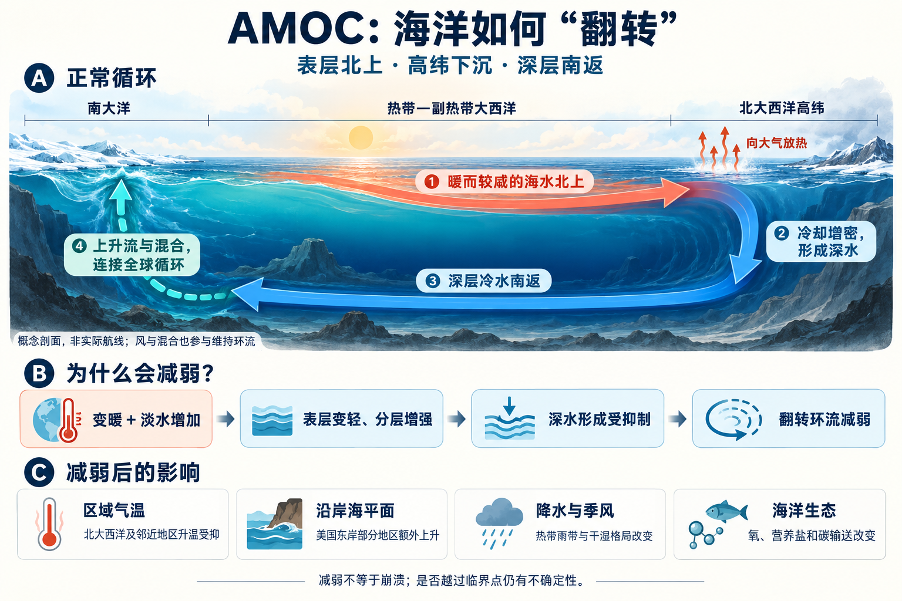

# 大西洋经向翻转环流：海水如何“翻转”，又怎样改变气候？

> **“翻转”是海水在表层与深层之间循环：较暖的上层海水向北流，在北大西洋高纬冷却、增密，形成向南返回的深层水。** 它本来就持续存在；今天受到关注的是，这套循环在全球变暖背景下可能减弱，甚至在某些条件下发生状态突变。

资料核查日期：2026 年 10 月 18 日。本文以大西洋经向翻转环流（Atlantic Meridional Overturning Circulation，**AMOC**）为例，先解释正常循环，再说明减弱的原因、影响和仍未解决的问题。

*图 1｜从正常循环到气候影响。上图按“南在左、北在右”绘制概念剖面：暖色箭头表示上层北向输送，蓝色箭头表示深层南向返回，左侧虚线表示通过上升流和混合连接全球循环。真实海洋有多条路径和不同水团，不能把图中的环线理解为一条固定航线；中、下两部分说明的是减弱机制及其可能影响。*

## 1. 先弄清楚：什么在“翻转”？

“经向”指主要沿南北方向；“翻转”强调上层和深层的水流方向不同，并通过水团形成、上升流与混合相联系。因此，AMOC 是一个跨越整个大西洋盆地的三维环流系统，不是某一条暖流的名字。[NOAA 概念介绍](https://oceanservice.noaa.gov/facts/amoc.html)

理解它时，可以想象从侧面观察海洋：上面一层把海水向北输送，下面一层把海水向南送回。这里的“翻转”没有要求整股洋流突然反向，也不是海面像水盆一样整体翻过来。[NOAA 环流研究介绍](https://www.aoml.noaa.gov/moc/)

另外两个常见名称与它有联系，但范围不同：

| 名称 | 它强调什么 | 与 AMOC 的关系 |
|---|---|---|
| 墨西哥湾流 | 北大西洋西侧的一股强暖流 | 同时属于风驱动的水平环流和翻转环流；只是 AMOC 上层输送的一部分 |
| 温盐环流 | 温度、盐度引起的密度变化及相关运动 | 有助于解释 AMOC 的水团变化，但不能涵盖风、混合等全部动力过程 |

所以，“AMOC 减弱”“墨西哥湾流完全停止”“全球海洋停止流动”是不同命题，不能互相替换。[IPCC 第 9 章 FAQ 9.3](https://www.ipcc.ch/report/ar6/wg1/downloads/report/IPCC_AR6_WGI_Chapter09.pdf)

## 2. 一次完整的循环是怎样发生的？

### 第一步：上层海水向北输送热量和盐分

热带和副热带海洋获得较多太阳能；蒸发还会影响表层盐度。大西洋上层环流把较暖、较咸的水向北输送，经过北大西洋暖流系统，进入更高纬的海域。**水在移动，水所携带的热量和盐分也在移动。**[NOAA 科学事实说明书](https://repository.library.noaa.gov/view/noaa/70414)

### 第二步：海水向大气放热，冷却并形成深水

进入寒冷的高纬海域后，海水向大气释放热量。冷却会使海水密度增加；在适宜的盐度和周围分层条件下，海水发生深层混合，形成较密的水团，并通过溢流等过程进入深海。

这发生在北大西洋副极地及北欧海等多个区域，不是一个集中“吸水”的漏斗。形成深水还包括与周围水团混合等过程。[NOAA 环流研究介绍](https://www.aoml.noaa.gov/moc/)

### 第三步：深层水向南返回

形成的冷而较密的深层水向南流动，与其他水团交换、混合。这样，大西洋中就出现了“上层北上、深层南返”的整体结构。[NOAA 概念介绍](https://oceanservice.noaa.gov/facts/amoc.html)

### 第四步：通过上升流和混合，重新连接上层海洋

深层水不会一直堆积在海底。它在南大洋以及与印度洋、太平洋相连的路径上，经过上升流和混合，逐渐重新成为上层水，再参与后续输送。[NOAA 科学事实说明书](https://repository.library.noaa.gov/view/noaa/70414)

这里需要补上一个关键环节：**密度变化可以解释水团为什么变重，却不能单独解释整套循环怎样长期维持。** 南大洋风驱动的上升流，以及海洋内部的混合，也参与连接深层与上层。2025 年一项多模型研究尤其强调了南大洋风对维持减弱后的 AMOC 的作用。[Baker 等，2025，Nature](https://www.nature.com/articles/s41586-024-08544-0)

## 3. 为什么温度和盐度能改变这套循环？

在相同压力下、其他条件近似不变时，可以先记住两个方向：

| 海水变化 | 通常怎样改变密度 | 对表层下混的影响 |
|---|---|---|
| 冷却 | 密度增加 | 更容易与下方水混合 |
| 淡化，即盐度降低 | 密度降低 | 更容易浮在上面，维持分层 |

如果表层水足够轻，就像在较重的水上面铺了一层“轻盖子”，垂直混合会更困难。反过来，表层冷却增密有利于混合向更深处发展。是否真正形成深水，还取决于它相对于周围海水的密度，以及当地风、海冰和水团输送等条件。[加拿大《气候变化报告 2026》第 4.9 节](https://www.canada.ca/en/environment-climate-change/services/science-technology/changing-climate-report-2026/cccr-chapter-4-en.html)

海冰形成时排出的盐分也会使周围海水变咸，但不能据此把整个 AMOC 简化成“北极结冰带动的一台水泵”。从海面热量与淡水交换，到南大洋风场和内部混合，多个环节共同参与运行。[NOAA 概念介绍](https://oceanservice.noaa.gov/facts/amoc.html)、[Baker 等，2025](https://www.nature.com/articles/s41586-024-08544-0)

## 4. 正常运行时，它已经在影响什么？

AMOC 持续把热量带到北大西洋，并在那里与大气交换，影响周围海域和邻近陆地的气候。欧洲西北部的气候也受盛行风、大气环流和海陆分布影响，不能全部归功于一股暖流。[英国气象局 AMOC 研究说明](https://www.metoffice.gov.uk/about-us/news-and-media/media-centre/weather-and-climate-news/2025/climate-change-amoc-likely-to-withstand-future-warming)、[IPCC FAQ 9.3](https://www.ipcc.ch/report/ar6/wg1/downloads/report/IPCC_AR6_WGI_Chapter09.pdf)

它还输送盐、碳和营养盐，连接海洋表层与深层。因此，环流强弱变化会同时改变热量分配、物质分布和部分沿岸海平面。所谓“气候调节”，正是这些持续输送与交换累积起来的结果。[NOAA 环流研究介绍](https://www.aoml.noaa.gov/moc/)

## 5. 全球变暖为什么可能使 AMOC 减弱？

### 5.1 两条路径共同影响北大西洋表层密度

**一条是变暖。** 高纬海水更暖，或向大气失热的条件改变，会使表层水较难达到原来的高密度状态。

**另一条是淡化。** 格陵兰冰盖融水、降水和北极淡水输送等变化，可以降低相关海域的表层盐度。淡水在何处进入、怎样被洋流带走，会影响其实际作用，不能只看融水总量。

这些变化可能加强分层，抑制深水形成，并促使大尺度翻转环流减弱。图 1 的中间一行展示的就是这条简化机制。深水形成与盆地尺度输送之间还有动力调整，因此也不能把某一处对流的短期变化直接等同于整个 AMOC 的同比例变化。[IPCC 第 9 章，第 9.2.3.1 节及 FAQ 9.3](https://www.ipcc.ch/report/ar6/wg1/chapter/chapter-9/)、[Baker 等，2025](https://www.nature.com/articles/s41586-024-08544-0)

### 5.2 减弱可能进一步放大自身

在有利于正反馈的条件下，可能出现这样的链条：

> 环流变弱 → 向北输送的盐分减少 → 北部海水更淡、更轻 → 深水形成进一步受抑制 → 环流继续变弱。

这叫**盐平流反馈**：“平流”就是物质被水流带着移动。它使 AMOC 有可能表现出非线性变化，而非始终随外界影响平缓地增减。不过，反馈强弱还取决于大西洋盐度分布、其他水流以及海气相互作用，不能仅凭这条链就判断现实系统已经越过临界点。[Loriani 等，2025，环流临界点综述](https://esd.copernicus.org/articles/16/1611/2025/index.html)

### 5.3 “减弱”与“崩溃”分别是什么意思？

| 状态 | 含义 | 能否直接画等号？ |
|---|---|---|
| 短期波动 | 季节、年际或年代际的强弱起伏 | 一次低值不能证明长期衰退 |
| 持续减弱 | 较长时间内，大尺度翻转输送低于原先水平 | 不自动意味着将完全停止 |
| 临界转变或“崩溃” | 系统转入显著不同的弱翻转状态，可能由反馈自行维持 | 不意味着所有洋流都停止 |

若发生临界转变，撤去最初的扰动也未必能让系统沿原路迅速恢复，这种路径依赖称为“滞后”。是否会发生、阈值在哪里，以及恢复条件如何，仍是研究问题。[Loriani 等，2025](https://esd.copernicus.org/articles/16/1611/2025/index.html)

## 6. 减弱之后，会产生哪些影响？

### 6.1 北大西洋及邻近地区：获得的海洋热量减少

北向热输送减少，会对北大西洋和邻近地区产生降温作用。**在全球仍然变暖时，这常表现为“比环流不减弱时升温更少”，未必是气温已经低于今天。** 如果是强烈减弱或崩溃情景，区域降温作用则可能更大。[英国气象局研究说明](https://www.metoffice.gov.uk/about-us/news-and-media/media-centre/weather-and-climate-news/2025/climate-change-amoc-likely-to-withstand-future-warming)、[加拿大《气候变化报告 2026》第 4.9 节](https://www.canada.ca/en/environment-climate-change/services/science-technology/changing-climate-report-2026/cccr-chapter-4-en.html)

海温分布改变还可能影响风暴路径和区域降水。大气会调整自身的热量输送，部分补偿海洋输热减少，因此具体地点、季节和幅度需要用耦合气候模型评估。[IPCC FAQ 9.3](https://www.ipcc.ch/report/ar6/wg1/downloads/report/IPCC_AR6_WGI_Chapter09.pdf)

### 6.2 美国东岸部分地区：沿岸海平面可能额外升高

海面并不是完全水平的。洋流与地球自转、海面高度差相互联系；环流和相关边界流改变时，海水的空间分布也会调整，使部分沿岸海平面升高。

这属于**动力海平面变化**，可以叠加在全球海水热膨胀和陆地冰融化造成的上升之上。额外升高的海面会提高沿岸洪水风险，但不同岸段的变化并不相同。[NOAA 环流与区域海平面介绍](https://www.aoml.noaa.gov/moc/)、[IPCC FAQ 9.3](https://www.ipcc.ch/report/ar6/wg1/downloads/report/IPCC_AR6_WGI_Chapter09.pdf)

### 6.3 热带和季风区：雨下在哪里会改变

北大西洋变冷会改变海气之间的热量交换，并通过大气环流把影响传递到远处。强 AMOC 减弱或崩溃实验常出现热带辐合带向南移动，以及部分北半球季风减弱；但真实降水响应有明显的区域差异。[IPCC 第 8 章，第 8.6.1 节](https://www.ipcc.ch/report/ar6/wg1/chapter/chapter-8/)

2025 年一项结合气候模拟和古气候记录的研究进一步指出，北大西洋的冷却信号可经大气与海气相互作用传到印度洋和太平洋，改变远至印度尼西亚、热带安第斯和澳大利亚北部的降水。在其分析的未来情景中，中美洲、亚马孙和西非出现了更高的干旱风险。[DiNezio 等，2025，Nature](https://www.nature.com/articles/s41586-025-09319-x)

因此，影响可以沿着“海温变化 → 大气环流调整 → 水汽输送改变 → 区域干湿变化”传播。对农业和供水而言，降雨的地点与季节变化往往和年平均温度一样关键；不能把某项研究中的局部结果外推成“整个热带都变干”。

### 6.4 海洋生态与碳循环：水和物质的更新路径改变

环流变化会改变海水更新，以及氧、营养盐和碳的输送与储存；再与温度变化共同作用，影响生物栖息环境和海洋生产力。不同海域可能出现不同响应，不能统一断言所有渔场都减产。[NOAA 科学事实说明书](https://repository.library.noaa.gov/view/noaa/70414)、[加拿大《气候变化报告 2026》第 4.9 节](https://www.canada.ca/en/environment-climate-change/services/science-technology/changing-climate-report-2026/cccr-chapter-4-en.html)

同样，碳输送改变会影响海洋与气候的相互作用，但仅凭“AMOC 变弱”这一条信息，无法给出全球海洋碳吸收变化的统一数值。[Baker 等，2025](https://www.nature.com/articles/s41586-024-08544-0)

## 7. 这些变化有多快？我们现在知道到哪一步？

### 海水走完一圈很慢，不代表气候必须等那么久才响应

海水沿全球翻转路径经历深层输送、上升流与混合，可以需要数百至数千年。但环流强度、海温和大气可以在更短的时间尺度调整。某一地区的气候响应，不必等待同一团海水完成整段旅程。[NOAA 科学事实说明书](https://repository.library.noaa.gov/view/noaa/70414)

### 当前证据要分开看

| 问题 | 应怎样理解现有证据 |
|---|---|
| 是否观测到强弱变化？ | 是。RAPID 自 2004 年起持续监测北纬约 26.5° 的 AMOC；记录包含减弱和后续部分恢复，不能描述成毫无波动的持续下降。 |
| 未来会不会减弱？ | 变暖背景下减弱有较强的模型与物理依据，但幅度仍不确定。 |
| 本世纪一定崩溃吗？ | 不能这样判断。不同模型、指标和假设给出的风险存在差异，也没有一个可以当作事实使用的确定“崩溃年份”。 |

观测时长、自然变率和模型偏差，都限制着我们对长期趋势和人为归因的判断。加拿大 2026 年评估仍区分了“对未来减弱的高信心”和“对本世纪不发生关闭的中等信心”。后者不能换算成某个简单的崩溃概率。[加拿大《气候变化报告 2026》第 4.9 节](https://www.canada.ca/en/environment-climate-change/services/science-technology/changing-climate-report-2026/cccr-chapter-4-en.html)

新研究也在继续修正认识：2025 年的多模型研究强调南大洋风可以维持残余翻转；2026 年的一项观测约束研究则在 SSP2-4.5 情景下，给出了世纪末较工业化前明显减弱的估计。这些研究说明不同方法仍在约束未来变化，不能把“预计明显减弱”直接改写成“已经证明即将崩溃”。[Baker 等，2025](https://www.nature.com/articles/s41586-024-08544-0)、[Science Advances，2026](https://doi.org/10.1126/sciadv.adx4298)

## 8. 把整个过程连起来

正常运行的主线是：**低纬上层海水携热携盐北上 → 高纬放热、冷却增密 → 形成南返深水 → 经上升流与混合连接上层海洋。** 这套循环持续重分配热量和物质，参与塑造区域气候。

今天关注的变化主线则是：**人类增暖及淡水输入变化 → 北大西洋表层密度与分层改变 → 深水形成和大尺度翻转受到影响 → 北向热量及其他物质输送改变 → 区域气温、降水、沿岸海平面与生态环境随之调整。** 某些反馈可能放大减弱，但是否进入另一种稳定状态，需要更多证据判断。

理解“翻转环流”，最关键的是同时看见它的两个维度：海水在南北之间输送，也在上层与深层之间交换。气候影响来自这套输送与交换的改变，不能只盯住某一股表面暖流。

## 参考资料与图像说明

1. [NOAA：What is the Atlantic Meridional Overturning Circulation (AMOC)?](https://oceanservice.noaa.gov/facts/amoc.html)——基本概念与循环过程。
2. [NOAA：State of the Science Fact Sheet: AMOC（2024）](https://repository.library.noaa.gov/view/noaa/70414)——全球连接、时间尺度及物质输送。
3. [NOAA AOML：Meridional Overturning Circulation](https://www.aoml.noaa.gov/moc/)——观测、热盐输送及区域海平面。
4. [IPCC AR6 WGI 第 9 章（2021）](https://www.ipcc.ch/report/ar6/wg1/downloads/report/IPCC_AR6_WGI_Chapter09.pdf)——第 9.2.3.1 节及 FAQ 9.3（报告页码 1320），解释 AMOC 与墨西哥湾流的关系及气候效应。
5. [IPCC AR6 WGI 第 8 章（2021）](https://www.ipcc.ch/report/ar6/wg1/chapter/chapter-8/)——第 8.6.1 节，水循环对 AMOC 变化的响应。
6. [Baker et al.（2025）：Continued Atlantic overturning circulation even under climate extremes](https://www.nature.com/articles/s41586-024-08544-0)，*Nature*, 638, 987–994——南大洋作用与多模型结果。
7. [英国气象局（2025）：Climate change: AMOC likely to withstand future warming](https://www.metoffice.gov.uk/about-us/news-and-media/media-centre/weather-and-climate-news/2025/climate-change-amoc-likely-to-withstand-future-warming)——上述研究的机构解读。
8. [Loriani et al.（2025）：Tipping points in ocean and atmosphere circulations](https://esd.copernicus.org/articles/16/1611/2025/index.html)，*Earth System Dynamics*, 16, 1611–1653——反馈、临界转变与不确定性综述。
9. [DiNezio et al.（2025）：Tropical response to ocean circulation slowdown raises future drought risk](https://www.nature.com/articles/s41586-025-09319-x)，*Nature*, 644, 676–683——热带降水响应；本文使用其公开摘要所报告的结果。
10. [加拿大《气候变化报告 2026》第 4 章](https://www.canada.ca/en/environment-climate-change/services/science-technology/changing-climate-report-2026/cccr-chapter-4-en.html)——第 4.9 节，观测变化、未来预测及置信度区分。
11. [Observational constraints project a ~50% AMOC weakening by the end of this century（2026）](https://doi.org/10.1126/sciadv.adx4298)，*Science Advances*——条件性的世纪末预测，不能解释为崩溃概率或已经发生的降幅。

图 1 为使用内置 image_gen 生成并核对文字、方向与含义的原创概念示意图，不代表观测结果或定量模拟。[原尺寸图片](fig/amoc_overturning.png)；[完整制图提示词](fig/amoc_overturning.prompt.txt)。
