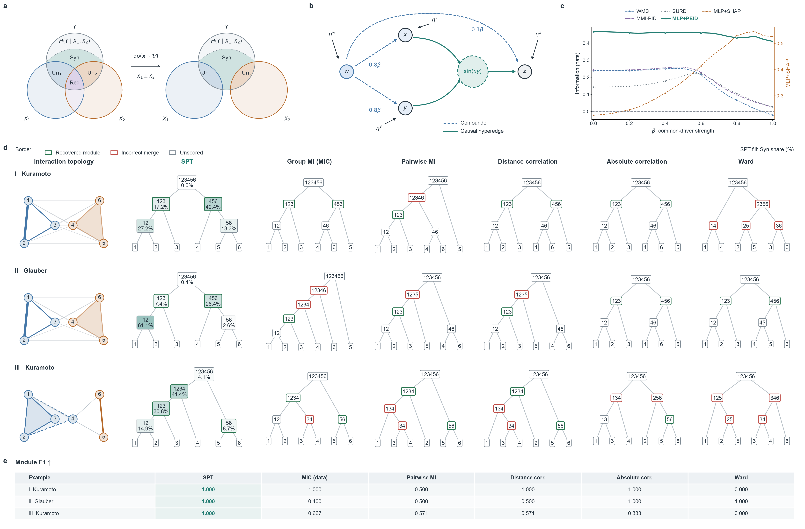
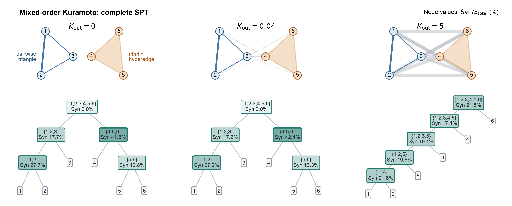
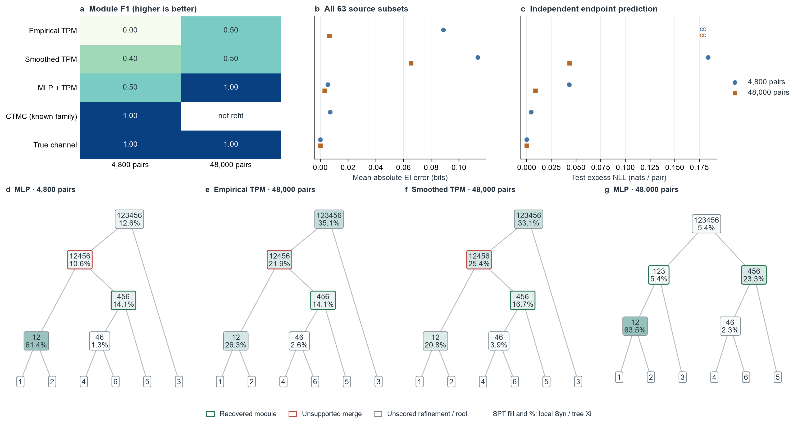
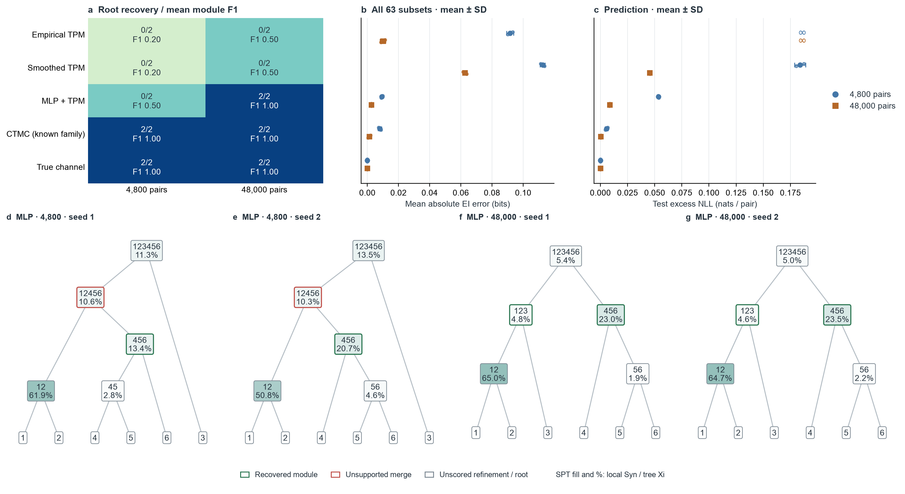

# Part 1：从干预式协同到交互的层级组织

**图1｜协同因果的定义、检验与层级恢复。** **a**，在保持转移机制的条件下施加独立均匀干预；在本文采用的 PID 公理下，源间冗余消失，联合信息分为单源贡献和协同贡献。**b**，固定 $\sin(x_ty_t)\to z_{t+1}$ 联合作用和共同驱动的系统示意。**c**，扫描共同驱动强度 $\beta$，比较 MLP+PEID、WMS、MMI-PID、SURD 和 MLP+SHAP。信息量用 nats，MLP+SHAP 使用右轴的原生尺度；曲线为四个配对数据种子的均值。**d**，两种交互拓扑上的三个六节点例子：I 为混合二体／三体 Kuramoto，II 为同一交互支持上的 Glauber，III 为包含嵌套模块与两条弱桥边的 Kuramoto。各行依次给出生成结构、SPT 和五种层级基线的输出。绿色、红色和灰色边框分别标记真实模块、错误合并和不计分的共同根、叶子或最小模块内部细分。SPT 的青绿色填色按共享的 0–100% 色阶表示节点局部 Syn 占全树 Syn 总和的百分比，零值为白色，不展示总量。**e**，以相同模块评分规则计算图示输出的 F1。d、e 均来自数据种子 0；III 的基线使用两个预设视图中得分较高者。枝高只表示树的拓扑层级，不能跨方法比较聚类距离。

多变量之间的统计依赖，既可能来自共同驱动，也可能来自必须联合多个变量才能产生的机制约束。PEID 在共同干预分布上区分这些贡献，SPT 再将联合贡献组织成变量组的层级。图1依次检验三个问题：干预如何定义协同，固定联合作用能否在共同驱动增强时被保留，以及联合信息能否帮助恢复已知模块及其嵌套关系。

## 1. 在共同干预分布上定义协同（图1a）

设 $\mathbf{x}$ 为完整源状态，$\mathbf{y}$ 为固定未来目标。在预先指定的有界支持上，对源变量施加因子化最大熵干预

$$
q_{\max}(\mathbf{x})=\prod_i q_i^{\max}(x_i),
$$

其中每个边缘分布均为该支持上的均匀分布。保持转移核不变，由此得到同一个干预诱导联合分布 $q$，并定义源子集 $A$ 的有效信息

$$
\mathrm{EI}(A\to\mathbf{y})=I_q(\mathbf{x}_A;\mathbf{y}).
$$

不同子集始终共享干预支持、背景、目标和预测时间窗；未选中的源按同一完整干预分布边缘化。对两个源，在本文采用的 PID 公理下，源独立性使冗余项为零，协同因而写为

$$
\mathrm{Syn}^{\mathrm{EID}}(x_1,x_2\to\mathbf{y})
=\mathrm{EI}(\{1,2\}\to\mathbf{y})
-\mathrm{EI}(\{1\}\to\mathbf{y})
-\mathrm{EI}(\{2\}\to\mathbf{y})\ge0.
$$

对于一般源集合，整合有效信息

$$
\Xi(A\to\mathbf{y})
=\mathrm{EI}(A\to\mathbf{y})
-\sum_{i\in A}\mathrm{EI}(\{i\}\to\mathbf{y})
$$

表示超出全部单源贡献的联合信息增量。图1a 的区域用于说明分解关系；干预会改变源分布，不能由区域示意推断干预前后的协同数值严格相同。对多于两个源，$\Xi$ 也不等于一个纯高阶 PID 原子。

## 2. 固定联合作用，改变共同驱动（图1c）

共同驱动检验保持 $\sin(x_ty_t)$ 的系数不变，只通过 $\beta$ 增强 $w$ 对 $x,y,z$ 的影响。四维 MLP 学习完整的一步转移，随后在固定 $x,y\in[-1.8,1.8]$ 支持上，用 5,120 个交换配对干预样本计算 PEID。$w,z$ 的背景支持取自各条件的经验范围。

随着 $\beta$ 从 0 增至 1，$|\operatorname{corr}(x,y)|$ 从 0.018 增至 0.859。MLP+PEID 的协同从 **0.468 降至 0.411 nats**，始终保持正值；WMS 则从 0.240 降至 −0.022 nats，MMI-PID 与 SURD 的协同读数也明显下降。MLP+SHAP 呈相反趋势，从 0.225 增至 0.527。尽管规定的联合作用未改变，不同观测读数仍表现出衰减、放大或符号反转。

这一结果支持 PEID 在当前干预协议下较好保留固定联合作用的正贡献。它仍有小幅下降，不能表述为严格不变；动力学拟合、有限样本估计和随 $\beta$ 变化的背景支持均可能影响数值。图1c 保留五条直接相关的比较曲线，单源信息和成对预测因果读数见后面的实验细节。

## 3. 从联合信息恢复模块层级（图1d）

SPT 在固定目标与时间窗下，递归寻找最能保留子组联合信息的二分。对每个内部节点 $A$，选择

$$
(L_A^*,R_A^*)\in\arg\max_{L\mathbin{\dot\cup}R=A}
\left\{\Xi(L\to\mathbf{y})+\Xi(R\to\mathbf{y})\right\},
$$

并把这次二分不能保留在两个子组内部的贡献记为节点 Syn：

$$
\mathrm{Syn}_A
=\Xi(A\to\mathbf{y})-\Xi(L_A^*\to\mathbf{y})-\Xi(R_A^*\to\mathbf{y}).
$$

六节点实验在每个节点枚举全部非平凡二分，并递归到单点。沿树求和后，内部节点 Syn 总和等于根的 $\Xi$。因此，图中百分比为 $100\,\mathrm{Syn}_A/\sum_{B\in\mathcal I}\mathrm{Syn}_B$，其中 $\mathcal I$ 是该树的内部节点集合。每棵树单独归一化，显示舍入后不必精确合计为 100%；叶子 Syn 为零，不重复标注。

三个例子分别检验双模块恢复、同一交互支持下的不同动力学，以及外层模块内部的嵌套恢复。

| 例子 | 动力学与交互支持 | 需要恢复的模块 |
|---|---|---|
| I | 123 内为二体作用，456 为三体作用，两团之间保留弱成对耦合；采用 Kuramoto 动力学 | 123、456 |
| II | 与 I 共享交互支持，采用混合二体／三体 Hamiltonian 上的连续时间 Glauber 动力学 | 123、456 |
| III | 三体 123 嵌入四体 1234，另有二体 56；增加 1–5、4–6 两条权重均为 0.02 的弱桥边 | 123、1234、56 |

SPT 在三个图示输出中均保留全部目标模块，并给出每次分割的贡献比例。例如，I 的 12 节点占比为 27.2%，456 节点为 42.4%；II 对应为 61.1% 和 28.4%。III 同时保留外层 1234、56 与内层 123，其 1234 和 123 节点分别占全树 Syn 的 41.4% 和 30.8%。这些数值描述各自学习通道内的贡献分配，不能作为跨动力学的绝对强度比较。

SPT 节点是沿所选二分路径定义的分组残差。节点包含三个或四个变量，不意味着该残差就是纯三阶或纯四阶 PID 原子，也不能与生成网络中的一条超边逐项等同。I 的根 Syn 为零还依赖学习通道的分量近似，不能解释为物理弱跨边不存在。

## 4. 模块恢复的定量比较（图1e）

图1e 用模块 F1 同时计入漏检和错误合并：

$$
F_1=\frac{2|\widehat{\mathcal M}\cap\mathcal M|}
{|\widehat{\mathcal M}|+|\mathcal M|},
$$

其中 $\mathcal M$ 为真实模块集合，$\widehat{\mathcal M}$ 为预测树中的可评分模块。共同根、单点叶子和原生最小模块内部没有唯一真值的二叉细分不计分，其他错误合并均计为假阳性。图中灰色框采用同一排除规则。

三个例子的 SPT 得分均为 **1.000**。直接使用样本的 MIC 分别为 **1.000、0.400、0.667**；Ward 分别为 **0.000、1.000、0.000**。这说明某些基线可以恢复简单的外层分团，但其成功依赖动力学和表示。对于 III，MIC 保留 1234 与 56，却遗漏内层 123；其余已展示基线的最佳 F1 为 0.571。只判断外层是否分成两团，会掩盖这一层级差别。

这些结果是探索性案例比较。II 在冻结配置后的十个新数据种子中，SPT 与 Ward 均正确恢复根分区 10/10，直接样本 MIC 为 0/10，共享拟合通道 MIC 为 1/10；自然平衡采样下，直接样本 MIC 同样能达到 10/10。III 的数值积分检查已经通过，但物理数据仍只有一个种子。三个例子也使用不同目标、模型先验和样本量，因此不合并成总体算法排名。

## 实验方法与读图约定

### 联合信息与预测交互读数

图1c 及补充图 S1 比较各方法对参数变化的响应。方法名称相邻，并不意味着读数具有相同定义或尺度。

| 方法 | 读数的含义 |
|---|---|
| MLP+PEID | 在 MLP 近似的转移机制上，以共同干预分布计算不可约联合信息 |
| WMS | 联合互信息减去两个单源互信息，反映协同与冗余的净平衡 |
| MMI-PID | 在最小互信息冗余定义下计算协同 |
| SURD | 按目标状态分解冗余、独有信息与协同 |
| MLP+SHAP | 两个源变量对 MLP 预测的非加性交互归因（SHAP interaction） |
| Neural Granger | 非线性预测器对各历史源变量的依赖强度 |
| PCMCI-CMIknn | 控制其他历史变量后的滞后条件依赖 |

二源 WMS 与 MMI-PID 协同分别为

$$
\operatorname{WMS}(X,Y;Z)=I(\{X,Y\};Z)-I(X;Z)-I(Y;Z),
$$

$$
S_{\mathrm{MMI}}(X,Y;Z)=I(\{X,Y\};Z)-\max\{I(X;Z),I(Y;Z)\}.
$$

WMS 的正值表示协同占优，负值表示冗余占优。SURD 的目标状态分解写为

$$
R_{xy}(z)=\min\{i_x(z),i_y(z)\},\quad
U_x(z)=i_x(z)-R_{xy}(z),\quad
U_y(z)=i_y(z)-R_{xy}(z),\quad
S_{xy}(z)=i_{xy}(z)-\max\{i_x(z),i_y(z)\}.
$$

其中 $S_{xy}$ 为 SURD synergy。Neural Granger 与 PCMCI 的成对依赖读数用于补充诊断，不能当作二源协同原子。

### 层级基线与输入表示

图1d 的 Group MI（MIC）在每次合并后重新计算变量组之间的互信息；这里 MIC 指 mutual-information clustering。Pairwise MI、Distance correlation 和 Absolute correlation 分别以成对互信息、距离相关和绝对相关构造 average-linkage 层级树；Ward 使用欧氏空间中的组内方差准则。五种方法均保留原生二叉树，没有将平面分组补成层级。

图1e 的 MIC (data) 直接使用样本；图1d 的 MIC 树也对应 data 版本。MIC (shared fit) 使用与 SPT 相同的拟合通道，以控制模型拟合与构树规则的差别，仅在 II 做了这一附加控制。该例 seed 0 的模块 F1 为 0.400，结果保留在补充材料，不再作为主图表格的一列。

各例子内部共享数据，但源、目标和基线表示不在例子之间强行统一：

| 例子 | 数据与 SPT 目标 | 基线输入 | EI 计算 |
|---|---|---|---|
| I | 4,800 对训练转移；独立均匀相位干预，固定完整六维 wrapped phase increment 目标 | 相位增量 | 学习通道的依赖分量近似与 neural TM |
| II | 4,800 对随机独立自旋初态及末态；干预初态均匀，固定完整六维末态目标 | 初态与末态的完整节点块 | 通用 41 参数 heat-bath 通道拟合后，精确枚举离散 EI |
| III | 32,768 对共同样本，训练／验证／测试为 24,576／4,096／4,096；独立均匀相位干预，固定完整未包裹六维未来相位目标 | 相位增量或初态＋增量，每种基线取两者中较高 F1 | 统一 Fourier 特征 MLP、完整条件 TM 与边缘积分 |

III 取较优视图的口径有利于基线，不据此宣称完全相同表示下的算法比较。I 的 TM context 含机制 Fourier 项，II 已知 heat-bath 模型族，III 使用统一的二至四体 Fourier 字典；这些先验均属于实际比较条件。完整来源、逐方法视图和审计见[三例比较与复现索引](#three-example-provenance)。

## 共同驱动实验：模型与计算细节

本节不重新设计动力学，只把附录 B 的原始两位小数系数局部改写为一位小数，以检验原有定性结论是否对这种表示简化稳健。$\beta\in[0,1]$ 是扫描变量，不属于固定系数。最终动力学为

$$
\begin{aligned}
w_{t+1} &= 0.8w_t + \eta^w_t,\\
x_{t+1} &= 0.4x_t + 0.8\left(\beta w_t + \sqrt{1-\beta^2}\,\xi^x_t\right) + \eta^x_t,\\
y_{t+1} &= 0.4y_t + 0.8\left(\beta w_t + \sqrt{1-\beta^2}\,\xi^y_t\right) + \eta^y_t,\\
z_{t+1} &= 0.2z_t + 1.0\sin\left(x_t y_t\right) + 0.1\beta w_t + \eta^z_t.
\end{aligned}
$$

其中 $\eta^w_t\sim\mathcal N(0,0.4^2)$、$\xi^x_t,\xi^y_t\sim\mathcal N(0,0.6^2)$、$\eta^x_t,\eta^y_t\sim\mathcal N(0,0.3^2)$、$\eta^z_t\sim\mathcal N(0,0.05^2)$。固定结构项 $1.0\sin(x_ty_t)$ 不随 $\beta$ 改变。

### 系数简化与控制协议

`0.78,0.42,0.82,0.38,0.76,0.22` 分别改为 `0.8,0.4,0.8,0.4,0.8,0.2`。原 `0.15` 位于一位小数的中点，因此只预先比较 `0.1` 与 `0.2` 两个局部候选，不扩展其他系数搜索。两个候选在五个 $\beta$ 点、两个 seeds 的预检中都保留六项主读出的趋势符号；`0.1` 的归一化斜率偏差较小，因而在完整实验前固定为正文版本。随后一次性运行 `21` 个 $\beta$ 点和 seeds `0,1,2,3`，不再按完整结果调整系数。

四维 MLP 学习完整一步转移

$$
[w_t,x_t,y_t,z_t]\mapsto[w_{t+1},x_{t+1},y_{t+1},z_{t+1}].
$$

MLP+PEID 使用 `5120` 个随机干预样本，固定 $x,y\in[-1.8,1.8]$ 的均匀干预支持，$w,z$ 从每个 $\beta$ 对应的经验支持中采样。为降低有限样本造成的源顺序不对称，$x,y$ 使用交换配对样本，同一对样本共享相同的 $w,z$ 上下文。读出直接对完整预测 $\hat z_{t+1}$ 做三阶 transport-map PEID，不提取函数 ANOVA 交互面。MMI-PID、SURD 和 WMS 使用自然轨迹 $(x_t,y_t,z_{t+1})$；图中不绘制 Oracle。各方法的绝对量纲不同，因此只在同一方法内比较 $\beta$ 趋势，或在同为 nats 的信息读数之间比较参数敏感性。

按照当前论文的双源定义，所有 EI 在共同干预分布上计算；在所采用的 PID 公理下，redundancy 为零，并令

$$
R=0,\qquad
U_x=I_{\mathrm{TM}}(x;\hat z),\qquad
U_y=I_{\mathrm{TM}}(y;\hat z),\qquad
S_{xy}=I_{\mathrm{TM}}(x,y;\hat z)-U_x-U_y.
$$

因此图中的 $U_x/U_y$ 是干预分布上的单源 EI 原子；增加样本量只能降低其估计噪声，不能保证把 MLP 学到的真实单源响应强制归零。

### 四维 MLP 的全方法对比曲线

曲线为四个配对 seeds 的均值，MLP+PEID 的 $U_x,U_y$ 和 synergy 均使用 `5120` 个干预样本。$U_x$ 的跨 $\beta$ 均值为 `0.0155` nats、线性斜率约为 `0.0006` nats / $\beta$；$U_y$ 的均值为 `0.0117` nats、线性斜率约为 `0.0043` nats / $\beta$。两条曲线未出现明显的单调漂移，但仍保留非零单源响应。MLP+PEID synergy 从 $\beta=0$ 的 `0.468` 降至 $\beta=1$ 的 `0.411` nats，线性斜率为 `-0.0440` nats / $\beta$。MLP+SHAP 从 `0.225` 增至 `0.527`，而 observational WMS、MMI-PID synergy 和 SURD synergy 总体下降。MLP 对 $z_{t+1}$ 的平均增量 $R^2$ 为 `0.937`，未出现整体拟合失效。

随着 $\beta:0\to1$，$|\operatorname{corr}(x,y)|$ 从 `0.018` 增至 `0.859`，$\sin(x_ty_t)$ 的系数始终为 `1.0`。WMS 从 `0.240` 降至 `-0.022` nats，MMI-PID synergy 从 `0.243` 降至 `0.025` nats，SURD synergy 从 `0.142` 降至 `0.027` nats；这些下降及 WMS 的符号反转与观测冗余增强一致。Neural Granger 的二源汇总分数从 `3.346` 降至 `3.093`，PCMCI-CMIknn 从 `0.479` 降至 `0.100`，但这些原生尺度的成对依赖分数不能直接解释为 causal hyperedge 的强度。

MLP+PEID 保持约 `0.45` nats 的正联合贡献，并将较少信息分配给单源；相较于明显改变方向或符号的观测读数，这支持它在当前干预协议下较好保留固定联合作用。固定支持的 Oracle 参考读数未随 $\beta$ 改变，但 MLP+PEID 仍有轻微下降。有限样本、动力学拟合和变化的 $w,z$ 背景支持可能共同影响这一结果，不能声称完整学习通道的协同严格不变。

图1c 的缓存显示复核覆盖 84 个 $\beta\times\mathrm{seed}$ 的 PEID Syn，声明 **0 nats 显示复核容差**；最小原值为 `0.374577` nats，容差带负值及显著违例数均为 0，不作裁剪。这是对既有缓存的显示复核，不追称为原实验预注册的容差。缓存仍以 bits 保存，主图及本节采用 $I_{\mathrm{nats}}=(\ln2)I_{\mathrm{bits}}$；SHAP、PCMCI、Neural Granger 和 Liang IF 不参与这一换算。

## 三个六节点例子：动力学与数值检查

### I：混合二体／三体 Kuramoto

I 采用二体模块 123、三体模块 456 和九条弱跨团边；$K_{\mathrm{out}}=0.04$，每条跨边权重为 $K_{\mathrm{out}}/3$。完整动力学、训练条件和分量近似见补充图 S2 对应的方法。图1d 复用该条件下的种子 0 输出，未重新训练。

### II：连续时间 Glauber 动力学

此例采用连续时间、逐个自旋翻转的 Glauber（heat-bath）动力学。六个节点的状态为 $x_i\in\{-1,+1\}$，记 $P=\{1,2,3\}$、$T=\{4,5,6\}$，能量函数为

$$
H(\boldsymbol{x})=-\sum_{\substack{i<j\\i,j\in P}}w_{ij}x_ix_j
-J_3x_4x_5x_6
-\frac{K_{\mathrm{out}}}{3}\sum_{i\in P}\sum_{j\in T}x_ix_j.
$$

三项分别对应 123 内的成对作用、456 的三体作用，以及两团间的弱成对耦合。本例固定 $w_{12}=\sqrt{1.5}$、$w_{13}=w_{23}=\sqrt{1.5}/4$、$J_3=1$、$K_{\mathrm{out}}=0.04$ 和逆温度 $\beta=1$；456 内没有直接成对能量项。

令 $\boldsymbol{x}^{(i)}$ 表示仅翻转第 $i$ 个自旋后的状态。单位尝试率下，翻转速率为

$$
c_i(\boldsymbol{x})=
\frac{1}{1+\exp\!\left[\beta\bigl(H(\boldsymbol{x}^{(i)})-H(\boldsymbol{x})\bigr)\right]},
\qquad
\Pr\!\left[\boldsymbol{x}(t+\mathrm{d}t)=\boldsymbol{x}^{(i)}\mid\boldsymbol{x}(t)=\boldsymbol{x}\right]
=c_i(\boldsymbol{x})\,\mathrm{d}t+o(\mathrm{d}t).
$$

降低能量的翻转速率更高，升高能量的翻转仍有非零速率。它描述随机跳变过程，时间连续、状态离散。概率分布满足主方程

$$
\frac{\mathrm{d}p_t(\boldsymbol{x})}{\mathrm{d}t}
=\sum_{i=1}^{6}\left[
c_i(\boldsymbol{x}^{(i)})p_t(\boldsymbol{x}^{(i)})
-c_i(\boldsymbol{x})p_t(\boldsymbol{x})\right].
$$

相应的 $64\times64$ 生成矩阵满足 $[\boldsymbol{Q}]_{\boldsymbol{x},\boldsymbol{x}^{(i)}}=c_i(\boldsymbol{x})$，对角元为所有离开速率之负和，完整转移矩阵为 $\boldsymbol{P}_{\tau}=\exp(\tau\boldsymbol{Q})$；实验取 $\tau=2$。以上参数和方程对应本仓库的混合二体/三体扩展，不能将三体 Hamiltonian 本身归为原始一维 Ising 例子。实现位置：`scripts/search_six_node_mixed_dynamics.py` 的 `spin_kernel`，`family="glauber_ctmc"`。

补充的[数据驱动 TPM 对照](#data-driven-tpm-two-seeds)去掉拟合器中的 Glauber 模型族约束。固定模型后，种子 1、2 在 48,000 对转移时均恢复 123｜456，模块 F1 均为 1.00；原 4,800 对转移下均为 0.50，未恢复根分区。直接计数和平滑 TPM 在两种样本量下均未恢复根分区。两个重复支持这一实例中的可行性，尚不足以确立稳定恢复率；图1d 的 II 仍对应原有 CTMC 拟合，种子 0 预试验另存于 B.5。

### III：含弱桥边的嵌套 Kuramoto

“嵌套”表示一个小作用模块完整包含在更大的作用模块内。此例同时设置三体超边 $\{1,2,3\}$ 和四体超边 $\{1,2,3,4\}$，即 $\{1,2,3\}\subset\{1,2,3,4\}$；另有二体模块 $\{5,6\}$，通过两条弱桥边与前四个节点相连。这里“嵌套”描述植入的交互支持结构，不是只因输出树有多层才这样命名。

具体相位动力学为

$$
\mathrm{d}\theta_i=
\left[\omega_i+
\sum_{\substack{e\in\mathcal{E}\\i\in e}}
\kappa_e\sin\!\left(\sum_{j\in e\setminus\{i\}}\theta_j-(|e|-1)\theta_i\right)
\right]\mathrm{d}t+\sigma\,\mathrm{d}W_i,
\qquad
\mathcal{E}=\bigl\{\{1,2,3\},\{1,2,3,4\},\{5,6\},\{1,5\},\{4,6\}\bigr\}.
$$

所选配置中 $\kappa_{123}=\kappa_{56}\approx0.56695$、$\kappa_{1234}\approx1.13389$，$\sigma=0.08$，$\boldsymbol{\omega}=(-0.4,0,0.4,-0.4,0,0.4)^{\mathsf T}$。目标是同时恢复外层 $1234\mid56$ 和内层 $123\mid4$。只找对外层两团的方法仍可能漏掉内层 123。实现位置：`scripts/kuramoto_six_topology_core.py` 的 `SUPPORTS["B"]`、`configuration("B", 2)` 和 `drift`。

弱桥边固定为 $\kappa_{15}=\kappa_{46}=0.02$，原三个团内系数不重新归一化。上式实际交互支持包含弱桥边；模块 F1 真值仍为 123、1234、56。

### III 的积分精度与百分比

先前的约等号表示 EI 边缘积分与节点占比尚未通过声明的精度检查，并非动力学方程中含有近似关系。加入固定弱桥边后，在保持物理参数不变的条件下，使用完整条件 TM，并引入解析零均值的噪声控制及独立校准的 Fourier 方差控制，降低积分方差。校准依据数值误差，没有按模块 F1 搜索参数。

最终使用 4 次独立 scramble、每次 4,096 个外层点与 512 个内层补全样本。最大 EI 标准误为 0.00449 nats，跨档变化为 0.00295 nats，均低于 0.01 nats 门槛；最差局部积分 ESS 为 11.39，最大归一化权重为 0.2465，也通过原门槛。节点占比的最大标准误和跨档变化分别为 0.267 与 0.264 个百分点；固定外层点，把内层样本从 512 增至 1,024 时，节点占比最大变化为 0.095 个百分点。

因此主图删除未收敛提示符，保留一位小数的估计百分比。通过的是受控估计的既定数值检查，原始无控制估计的未通过记录仍然保留。四次 scramble 衡量数值积分重复，不能替代不同物理数据种子的验证。配置、原始积分结果和全部门槛见[弱耦合复算记录](../ref/spt_third_case_weak_coupling.md)。

### Syn 非负性与显示规则

I、II、III 分别沿用 0.10 bits、$10^{-10}$ bits 和 0.01 nats 的原生 Syn 容差。已有候选审计和显示节点均没有容差带内负值或显著非负违例；图示 III 的候选最小 Syn 为 0.001069 nats。主图直接读取缓存残差，没有裁剪、非负投影或修改树的分裂。图1c 另对缓存采用 0 nats 的严格显示复核容差，最小 Syn 为 0.374577 nats，无负值。

## 补充验证一：跨动力学的机制读数（图 S1）

每个系统比较 WMS、SURD synergy、SHAP interaction、MLP+PEID synergy 和 MMI-PID synergy。六个子图 分别基于 coupled standard map、Wilson–Cowan、active-rotator/Kuramoto、受控 Hénon-style、Ikeda 和 Nicholson–Bailey 动力学；各系统的经典来源分别见 [Chirikov (1979)](https://doi.org/10.1016/0370-1573(79)90023-1)、[Wilson & Cowan (1972)](https://doi.org/10.1016/S0006-3495(72)86068-5)、[Shinomoto & Kuramoto (1986)](https://doi.org/10.1143/PTP.75.1105)、[Hénon (1976)](https://doi.org/10.1007/BF01608556)、[Ikeda (1979)](https://doi.org/10.1016/0030-4018(79)90090-7) 和 [Nicholson & Bailey (1935)](https://doi.org/10.1111/j.1096-3642.1935.tb01680.x)。各子图 内五种方法使用相同的源变量与目标变量；曲线为 `3` 个 seed 的均值，浅色区域表示 `mean ± std`。MI 本身不作为曲线绘制。

缓存显示复核对六个系统的 162 个种子级缓存 PEID Syn 声明 0 bits（等价于 0 nats）容差；存在原始 Syn 字段时优先检查原值。最小值为 0，容差带负值及显著违例数均为 0，不作裁剪。该规则用于复核已有图值，不追称为历史实验预注册的容差；重绘脚本遇到显著违例时会明确失败。

| 系统与扫描 | 被检验的变化 | 观察 |
|---|---|---|
| Coupled standard map，$J$ | 转子间相位耦合增强 | PEID 随耦合增强；弱耦合处 SURD 的极端估计需结合数值退化解释，纵轴使用 symlog |
| Wilson–Cowan，$g$ | sigmoid gain 改变联合门控与饱和 | PEID 先升高再降低，并不随 gain 单调增大 |
| Kuramoto active rotator，$K$ | 相位差作用持续，同时锁相增加观测冗余 | WMS 转为负值，PEID 仍保留正联合贡献；SURD 使用独立右轴 |
| 受控 Hénon-inspired response，$\lambda$ | 显式交互减弱，同时独立单源通道增强 | PEID 降低，MMI-PID 却升高，区分协同与 unique information |
| Ikeda，$u$ | 同一非线性联合响应的输出幅值缩放 | 信息读数在开启后近似平台，SHAP interaction 继续随幅值增大 |
| Nicholson–Bailey，$a$ | 指数存活门控开启并趋于饱和 | PEID 从结构零点升高后趋于平台 |

受控 Hénon 是对经典二次非线性的实验性改写，不是原始 Hénon 迭代。六个系统的源、目标和时间定义也各不相同，具体方程见下文；它们支持的是跨机制的定性比较，不能据此宣称有限样本估计对任意系统都准确。

### Coupled Standard Map

**领域背景**：Standard Map 是哈密顿混沌中的经典受冲击转子模型；本文在其基础上加入第二转子及正弦差分耦合。$K$ 控制单转子非线性，$J$ 控制转子间耦合（[Chirikov, 1979](https://doi.org/10.1016/0370-1573(79)90023-1)）。

双转子 Coupled Standard Map 的冲量方程为

$$
\begin{aligned}
I_{1,t}&=K\sin q_{1,t}+J\sin(q_{2,t}-q_{1,t}),\\
I_{2,t}&=K\sin q_{2,t}-J\sin(q_{2,t}-q_{1,t}).
\end{aligned}
$$

冲量 $I_i$ 先更新动量，再由更新后的动量推进角度：

$$
\begin{aligned}
p_{i,t+1}&=\operatorname{wrap}\left(p_{i,t}+I_{i,t}\right),\\
q_{i,t+1}&=\operatorname{wrap}\left(q_{i,t}+p_{i,t+1}\right),\\
\operatorname{wrap}(a)&=\left((a+\pi)\bmod 2\pi\right)-\pi .
\end{aligned}
$$

**协同源和目标**：计算 `q1+q2->I1`。随着 $J$ 增大，两个角度对第一转子冲量的联合约束增强。SURD 在弱耦合处的大幅波动主要来自周期、多对一映射下的不稳定估计，不宜解释为真实协同。

### Wilson-Cowan Refractory Map

**领域背景**：Wilson-Cowan 模型描述兴奋性与抑制性神经元群体的平均活动。sigmoid gain $g$ 控制群体对净输入的响应陡峭程度（[Wilson & Cowan, 1972](https://doi.org/10.1016/S0006-3495(72)86068-5)）。

连续方程写为

$$
\begin{aligned}
\dot E&=-E+(1-\rho E)S\{g(w_{EE}E-w_{EI}I+P_E)\},\\
\dot I&=-I+(1-\rho I)S\{g(w_{IE}E-w_{II}I+P_I)\},
\qquad S(z)=\frac{1}{1+e^{-z}} .
\end{aligned}
$$

实验采用 $\Delta t=0.05$ 的一步 Euler 映射，扫描 sigmoid gain $g$，其余参数固定为

$$
\rho=0.5,\quad w_{EE}=3.2,\quad w_{EI}=2.6,\quad
w_{IE}=2.4,\quad w_{II}=1.7,\quad P_E=0.35,\quad P_I=-0.20 .
$$

**协同源和目标**：只计算 `E+I->E_tau`。目标映射为

$$
E_{t+\Delta t}
=E_t+\Delta t\left[-E_t+(1-\rho E_t)S\{g(w_{EE}E_t-w_{EI}I_t+P_E)\}\right].
$$

`gain=0` 时 $I_t$ 不影响目标，是结构零点；随着 $g$ 增大，非线性门控变陡，$E_t$ 与 $I_t$ 对目标形成更强的联合约束。

### Kuramoto Active-Rotator Phase Model

**领域背景**：Kuramoto 模型用于研究耦合振荡器的同步与锁相。Active-rotator 扩展加入周期势，$K$ 表示相位差耦合强度（[Shinomoto & Kuramoto, 1986](https://doi.org/10.1143/PTP.75.1105)）。

该子图 使用经典 active-rotator/Kuramoto 相位动力学：

$$
\begin{aligned}
\dot{\theta}_1&=\omega_1+A\sin\theta_1+K\sin(\theta_2-\theta_1),\\
\dot{\theta}_2&=\omega_2+A\sin\theta_2,
\end{aligned}
\qquad
\omega_1=1.0,\quad \omega_2=0.9,\quad A=0.2.
$$

其中 $A\sin\theta_i$ 是周期相位势，$K\sin(\theta_2-\theta_1)$ 是相位耦合。

**协同源和目标**：所有算法只计算同一条 `theta1+theta2->dtheta1`，即

$$
\{\theta_{1,t},\theta_{2,t}\}\longrightarrow
\dot{\theta}_{1,t}.
$$

目标是第一振子的瞬时速度。该扫描覆盖
$K\in\{0,0.05,0.1,0.15,0.2,0.3,0.5,0.75,1.0,1.5,2.0\}$，
使参数范围从锁相转变区延伸到高耦合的有序同步相。

随着 $K$ 增大，系统逐渐锁相；WMS 受同步冗余影响转为负值，而 MLP+PEID 保留相位差机制的正协同。SURD 在锁相转变附近波动较大，不宜作定量解释。

### Controlled Hénon Unique-Information Sweep

**领域背景**：Hénon 映射是经典二维耗散混沌模型（[Hénon, 1976](https://doi.org/10.1007/BF01608556)）。这里使用的是由其二次非线性构造的受控 Hénon-style 读出，而不是未经修改的经典迭代映射；该构造把显式二源交互项和单源观测通道分开。

两个标量源 $x_t,y_t$ 的二维一步响应写为：

$$
\begin{aligned}
x_{t+1}&=1-1.4x_t^2+(0.5-0.4\lambda)x_ty_t,\\
y_{t+1}&=(0.3+1.7\lambda)y_t+\epsilon_t,\\
\gamma(\lambda)&=0.3+1.7\lambda,\qquad
\kappa(\lambda)=0.5-0.4\lambda,\qquad \lambda\in[0,1],\\
\epsilon_t&\sim\mathcal N(0,0.5^2),\qquad \epsilon_t\perp(x_t,y_t).
\end{aligned}
$$

$x_{t+1}$ 包含二次非线性和显式二源交互，$y_{t+1}$ 是仅依赖 $y_t$ 的带噪声单源通道；两者共同组成二维未来目标。随 $\lambda:0\to1$，$\gamma$ 从 $0.3$ 线性增至 $2.0$，$\kappa$ 从 $0.5$ 线性减至 $0.1$，噪声标准差固定为 $0.5$。

**协同源和目标**：计算 $\{x_t,y_t\}\to(x_{t+1},y_{t+1})$，以两个未来分量组成的二维向量为共同目标。扫描参数为 $\lambda$，令单源通道 $\gamma(\lambda)y_t+\epsilon_t$ 增强，同时令显式交互项 $\kappa(\lambda)x_ty_t$ 减弱。因此该子图 用来展示：PEID 可随真实交互减弱而下降，而 MMI-PID 仍会因为弱源单源信息增加而上升；MI 本身仍只作为诊断保存在 JSON 中，不在图中绘制。

<!-- 2026-10-08 局部核对：Zotero 父项 P6UJCVG8，题名 Emergent hierarchical organization of causal interactions in complex systems；当前唯一正文附件 DXGC7JEA（19 页）和补充材料 MWIWKSVG（28 页），附件元数据分别修改于 2026-10-04T08:40:46Z 和 2026-10-04T08:40:31Z，未注明手稿版本或日期，元数据修改时间不视为稿件版本日期。已读正文 Results 的 PEID 定义（式 1）及六系统比较，补充材料 S6.4（第 10 页，式 S61）。本次仅核对二维目标、参数线性路径和噪声定义，并与 scripts/henon_mmi_pid_vs_mlp_peid.py 及 results/henon_unique_five_method_synergy/summary.json 对照；按用户要求将两个输出分量改记为 x_{t+1}、y_{t+1}，响应公式和参数不变，不涉及采样或迭代方式的修改；不声称完整估计流程一致性已验证。 -->

### Ikeda Optical Cavity

**领域背景**：Ikeda 映射源自非线性光学环形腔，描述光场在逐次反馈后的演化。$u$ 控制反馈中保留的场幅（[Ikeda, 1979](https://doi.org/10.1016/0030-4018(79)90090-7)）。

Ikeda 离散映射为

$$
x_{t+1}=1+u(x_t\cos\theta_t-y_t\sin\theta_t),\qquad
y_{t+1}=u(x_t\sin\theta_t+y_t\cos\theta_t),\qquad
\theta_t=0.4-\frac{6}{1+x_t^2+y_t^2}.
$$

**协同源和目标**：只计算 `x+y->y_tau` 这一条一步映射协同读出。

该映射可写为

$$
y_{t+1}=u\,r(x_t,y_t),\qquad
r(x,y)=x\sin\theta(x,y)+y\cos\theta(x,y),
$$

其中 $u$ 主要缩放同一非线性联合响应。因此 `u=0` 是结构零点；`u>0` 后信息协同近似保持平台，而 SHAP interaction 随输出幅值增大。

### Nicholson–Bailey Host–Parasitoid Map

**领域背景**：Nicholson-Bailey 模型描述宿主与寄生蜂的世代更新。$R$ 是宿主繁殖率，$a$ 是寄生蜂攻击效率（[Nicholson & Bailey, 1935](https://doi.org/10.1111/j.1096-3642.1935.tb01680.x)）。

宿主密度 $H_t$ 与寄生蜂密度 $P_t$。离散映射为

$$
H_{t+1}=R H_t e^{-aP_t},\qquad
P_{t+1}=H_t\left(1-e^{-aP_t}\right),\qquad R=1.6.
$$

**协同源和目标**：只计算 `H+P->H_tau`。

当 $a=0$ 时，$P_t$ 不影响目标；当 $a>0$ 时，指数项形成乘性门控。随着攻击效率继续增大，指数响应逐渐饱和，因此信息协同表现为平台而非线性增长。

## 补充验证二：跨团耦合与树形重组（图 S2）

图 S2 保留原来的三档耦合扫描，讨论同一 Kuramoto 系统中跨团耦合对树形的影响；它与图1d 的三个动力学例子分别回答不同问题。原有六系统比较与耦合扫描的数值均保留，主图集中展示定义、共同驱动与层级恢复。

普通 Kuramoto 的每个相互作用只涉及一对振子。真正的高阶 Kuramoto 在向量场中加入不可约三体或四体项。本节实验采用的三体形式为

$$
\dot{\theta}_i
=\omega_i
+\frac{K_1}{d_i^{(1)}}\sum_j A_{ij}\sin(\theta_j-\theta_i)
+\frac{K_2}{d_i^{(2)}}\sum_{j,k}B_{ijk}
\sin(\theta_j+\theta_k-2\theta_i),
$$

其中 $\mathbf{A}$ 是 pairwise adjacency matrix，$\mathbf{B}$ 是三元 adjacency tensor。$B_{ijk}=1$ 表示 $\{i,j,k\}$ 形成一个真正的动力学超边。这里的“高阶”不能与 $\sin 2(\theta_j-\theta_i)$ 之类的二体高次谐波混淆：后者仍只涉及两个振子，前者才要求同时知道 $\theta_i,\theta_j,\theta_k$。

### 六振子混合阶 $K_{\mathrm{out}}$ 扫描：纯三体与 pairwise 子树

六振子生成机制包含两个三节点模块

$$
A=\{\theta_1,\theta_2,\theta_3\},
\qquad
B=\{\theta_4,\theta_5,\theta_6\}.
$$

模块 $A$ 是不对称 pairwise 三角形：

$$
(w_{12},w_{13},w_{23})
=c(\rho)(1,\rho,\rho),
\qquad
c(\rho)=\frac{K_{\mathrm{in}}}{2}
\sqrt{\frac{3}{1+2\rho^2}},
\qquad \rho=0.25,
$$

其中 $K_{\mathrm{in}}=1.5$，即 $(w_{12},w_{13},w_{23})=(1.225,0.306,0.306)$。模块 $B$ 只包含三体超边：

$$
\dot{\theta}_i
=\omega_i+K_3\sin(\theta_j+\theta_k-2\theta_i),
\qquad
\{i,j,k\}=\{4,5,6\},
$$

其中 $K_3=K_{\mathrm{in}}/\sqrt{2}=1.061$。两个模块之间加入九条全连接 pairwise 边，每条权重为 $K_{\mathrm{out}}/3$。最终只保留三个代表条件：

$$
K_{\mathrm{out}}\in\{0,0.04,5\}.
$$

补充图 S2 使用配对种子 0；三个条件统一使用 4,800 个有限时间转移训练同一容量、800 epochs 的 MLP，时间窗 $\tau=0.20$、积分步长 $0.01$、过程噪声尺度 $0.08$。MLP 对所有节点使用相同的一、二阶圆周 Fourier 特征。随后在 4,000 个独立均匀相位干预上采样 learned channel。除了 $K_{\mathrm{out}}$，初始相位、随机种子、训练预算、干预支持和概率估计预算全部固定。

EI 的输入干预分布固定为六个相位相互独立的最大熵均匀分布

$$
p_{\mathrm{do}}(\boldsymbol{\theta}^t)
=\prod_{i=1}^{6}\operatorname{Unif}(-\pi,\pi).
$$

所有 SPT 节点共享同一个六维 target：完整系统在同一未来时间窗内的 wrapped phase increment

$$
\boldsymbol{y}
=\Delta_\tau\boldsymbol{\theta}_{1:6}
=\operatorname{wrap}\!\left(
\boldsymbol{\theta}^{t+\tau}_{1:6}-\boldsymbol{\theta}^{t}_{1:6}
\right).
$$

分裂时只改变 source 子集，target 不缩减为局部模块或代表节点。MLP held-out 残差的完整协方差定义随机读出，不额外加入人为噪声下限。完整 SPT 对每个 learned dependency component 拟合一个条件 neural TM，全部 63 个非空 source 子集始终使用同一分量判定规则和同一估计预算；每个 TM 均使用 100 epochs、512 个 scrambled Sobol 评价点和 256 个边缘积分样本。TM context 在基础圆周特征之外显式加入对应的 pairwise、triadic 与候选跨边 Fourier 项；三个条件使用完全相同的特征字典。

概率通道使用同一个 MLP permutation-effect 规则发现可辨识分量，门槛预先固定为 0.25 个输出标准差。$K_{\mathrm{out}}=0$ 和 0.04 的最大跨模块效应约为 0.19，因而 learned channel 仍分成两个模块；$K_{\mathrm{out}}=5$ 明显越过门槛，六节点作为一个联合通道。该规则不读取 $K_{\mathrm{out}}$ 标签或 planted 根分区。SPT 在每个内部节点枚举全部非平凡二分并递归到单节点叶子。

作为同一批条件下的补充机制阶数诊断，缓存另用 degree-3 polynomial TM 对两个三节点模块各自计算 7 个 source 子集。它只负责报告模块内 pair atom 与 triple residual，不与完整树中的 neural-TM Syn 混写。两种估计都固定 0.10 bits 的原生非负容差（显示单位为 $0.10\ln2\approx0.069315$ nats）；完整树与模块内诊断的容差带负值数、超容差违例数均为 0，完整树闭合误差为 0，不使用 jackknife、非负裁剪或单调投影。

完整树见补充图 S2，节点显示局部 Syn 占本树总 $\Xi$ 的百分比。下表保留 nats 绝对量：系统量来自 neural-TM 完整树，模块内二阶／三阶量来自另行计算的 polynomial-TM 诊断；后者不是补充图 S2 的节点值。

| $K_{\mathrm{out}}$ | 根 $\Xi$（nats） | 根 Syn（nats） | 根分裂 | pairwise 诊断：二阶 / 三阶（nats） | triadic 诊断：二阶 / 三阶（nats） |
|---:|---:|---:|:---|---:|---:|
| 0 | 4.733 | 0.000 | $\{1,2,3\}\mid\{4,5,6\}$ | 1.072 / 0.878 | 0.045 / 1.021 |
| 0.04 | 4.792 | 0.000 | $\{1,2,3\}\mid\{4,5,6\}$ | 1.073 / 0.880 | 0.045 / 1.054 |
| 5 | 5.603 | 1.224 | $\{1,2,3,4,5\}\mid\{6\}$ | 0.516 / 0.541 | 0.263 / 0.466 |

在 $K_{\mathrm{out}}=0$ 时，根 Syn 精确为 0，自由 SPT 恢复两个模块。弱连接 0.04 的物理跨边已经存在，但其效应低于统一的 learned-channel 分辨门槛；因此树仍保留平衡 3–3 结构，模块内原子相对零连接几乎不变。这一档应解释为“存在但当前模型不可分辨的弱跨模块耦合”，而不是严格断连。

当 $K_{\mathrm{out}}=5$ 时，六节点越过分量门槛，根首先分成 $\{1,2,3,4,5\}\mid\{6\}$，随后继续以 $4$–$1$、$3$–$1$、$2$–$1$ 递归，形成链式结构；根 Syn 升至 1.224 nats（补充图 S2 显示其占本树总 $\Xi$ 的比例 21.8%）。因而三档在同一算法下依次表现为断连平衡树、弱连接平衡树和强连接链。

同批条件的模块内 polynomial-TM 诊断也恢复了预期阶数差异：在 0 与 0.04 下，纯三体模块的二源原子只有约 0.045 nats，而三节点残差为 1.021–1.054 nats，三阶质量约占 96%。强跨边会让任意二节点共同约束完整未来，因此该模块的二源原子升至 0.263 nats；这表示跨模块信息约束增强，不表示纯三体模块内部新增了物理 pairwise 边。

已有研究显示，多体相位作用可以产生普通 pairwise 模型中没有或不稳定出现的现象：

- 同一参数下存在大量同步吸引子，最终同步度强烈依赖初始相位；
- 同步参数突然跳变并形成向上/向下扫描不同的滞回环；
- 即使 pairwise 耦合为排斥，高阶项仍可稳定同步分支；
- 两个反相同步簇使一阶序参量 $R_1$ 接近零，但二阶序参量
  $$
  R_2=\left|N^{-1}\sum_j e^{2\mathrm{i}\theta_j}\right|
  $$
  仍接近 1，并可发生突然的 $\pi$-transition；
- 近期三振子纯三体模型还报告了 devil's staircase、multistability 和 synchronization revival。

这些现象分别由三体多稳态研究、simplicial Kuramoto、multicluster 稳定性分析和双簇相变工作支持，而不是本仓库已经完成的实验结果。关键来源包括 [Tanaka & Aoyagi 2011](https://doi.org/10.1103/PhysRevLett.106.224101)、[Skardal & Arenas 2020](https://www.nature.com/articles/s42005-020-00485-0)、[Millán et al. 2020](https://doi.org/10.1103/PhysRevLett.124.218301)、[Xu & Skardal 2021](https://doi.org/10.1103/PhysRevResearch.3.013013)、[Carballosa et al. 2023](https://doi.org/10.1016/j.chaos.2023.114197) 和 [Li et al. 2026](https://doi.org/10.1103/5rg2-4xkq)。

## 附录 A：干预样本数量鲁棒性

本附录只改变 MLP+PEID 的干预样本数 $n_I\in\{320,640,1280,2560,5120\}$。动力学、四维 MLP、训练数据、模型容量、90 epochs、21 个 $\beta$ 点、seeds `0,1,2,3` 和 $x,y\in[-1.8,1.8]$ 均保持不变。每个 $\beta\times\mathrm{seed}$ 只训练一次 MLP；五个样本量使用同一组嵌套的交换配对干预样本，因此差异只来自读出样本量。实验不使用函数 ANOVA，也不使用 Oracle 信息。

| 干预样本数 | mean $U_x$（bits） | mean $U_y$（bits） | TV $U_x$（bits） | TV $U_y$（bits） | synergy slope（bits / $\beta$） |
|---:|---:|---:|---:|---:|---:|
| 320 | 0.0285 | 0.0216 | 0.0867 | 0.0759 | -0.0992 |
| 640 | 0.0231 | 0.0160 | 0.0834 | 0.0541 | -0.0794 |
| 1280 | 0.0236 | 0.0172 | 0.0967 | 0.0659 | -0.0704 |
| 2560 | 0.0217 | 0.0165 | 0.1025 | 0.0692 | -0.0670 |
| 5120 | 0.0223 | 0.0169 | 0.1015 | 0.0718 | -0.0634 |

从 `320` 增至 `640` 时，$U_x/U_y$ 的平均偏移明显下降；从 `640` 继续增至 `5120` 后，均值稳定在约 `0.02/0.017` bits，没有继续趋近零。`5120` 样本时 $U_x/U_y$ 的线性斜率分别只有 `0.0009/0.0062` bits / $\beta$，说明它们没有稳定的单调 beta 趋势；但 absolute TV 并未随样本量单调下降，局部起伏主要来自各 beta 下重新训练的 MLP，而不是干预 Monte Carlo 样本不足。正文使用用户预先指定的最大样本量 `5120`，并保留这一非零偏移，不通过改变动力学、缩窄干预区间或事后平滑将其人为压到零。

## 图版与稿件依据（2026-10-17）

本次重新通过 Zotero 本地 API 核对父项 P6UJCVG8，题名为 *Emergent hierarchical organization of causal interactions in complex systems*，并重新列举其附件。当前可用正文为 DXGC7JEA（19 页），补充为 MWIWKSVG（28 页）；读取正文第 4–5 页的图1与受控实验论述、第 15–17 页 Methods 式（5）–（12），以及补充第 9 页 S5.1／Algorithm S1。两附件均无明确稿件版本或成稿日期，附件元数据编辑时间不作为新稿证明，最新版本歧义仍保留。

图1a 按原分解关系重绘，b 为系统示意，c 读取同一份既有数据；c 使用既有 5,120 干预样本读出，将信息量从 bits 换算为 nats，SHAP 保留原生尺度。图1d、e 读取三例统一比较的最新缓存；III 为增加固定弱桥边后已完成的复算。本次只合图与重组说明，没有新增训练、积分或参数扫描。六系统比较与原三档耦合扫描分别编号为补充图 S1、S2；附录 A 保留干预样本数检查的原始 bits 单位。重复列出的六系统方程已合并到图 S1 的方法部分，其中 Wilson–Cowan 的 Euler 步长仍保留为 0.05。

SPT 的分割准则、局部残差与闭合关系对应正文式（10）–（12）。I 的完整增量目标、机制特征与通道分量近似，II 的已知 heat-bath 模型族，以及 III 的学习通道、方差控制和单物理种子边界均在相应方法部分保留。节点贡献不解释为纯阶 PID 原子，不因本次图版整合而宣称全部稿件／实现差异已解决。

主图全部面板直接绘制在同一画布上，使用 Arial 无衬线字体；正文、节点、图例和表格均为 9 pt，坐标刻度与曲线图例为 8.5 pt，标题为 10.5 pt，面板字母为 12.5 pt。数学符号采用同尺寸的无衬线数学字形。PEID 曲线、联合因果作用和 SPT 填色统一使用青绿色；红色只标错误合并。曲线采用不同线型和标记；MLP+SHAP 使用橙色虚线，并与同色右轴对应，MLP+PEID 保留青绿色实线。拓扑中的蓝／橙色表示模块身份，三体或四体作用由填充面及其轮廓表示；III 的 123、1234 同属蓝色，56 为橙色。SPT 边框用于模块恢复分类，填色用于 Syn 占比，两种编码分别解释。

图版由 `scripts/compose_part1_figure1.py --three-examples` 复现；三例树与得分来源、数据摘要和逐项数值审计见[三例比较与复现索引](#three-example-provenance)。

## 附录 B：三例比较与复现索引

### B.1 图示 seed 0 的完整模块 F1

| 方法 | I Kuramoto | II Glauber | III Kuramoto |
|---|---:|---:|---:|
| SPT：模块 F1 | 1.000 | 1.000 | 1.000 |
| Group MI (MIC) | 1.000 | 0.400 | 0.667 |
| Pairwise MI | 0.500 | 0.500 | 0.571 |
| Distance correlation | 1.000 | 0.500 | 0.571 |
| Absolute correlation | 1.000 | 1.000 | 0.333 |
| Ward | 0.000 | 1.000 | 0.000 |
| MIC：共享拟合通道 F1 | — | 0.400 | — |

以上均为图示 seed 0 的实际输出得分，不是十种子平均分。II 的独立确认结果另列为精确根恢复次数：SPT 10/10、Ward 10/10、MIC Data 0/10、MIC Fit 1/10，不能将这些次数直接替换成 F1。II 自然平衡分布的 Data MIC 也为 10/10，本图只呈现随机独立初态实验。

### B.2 Glauber：冻结参数后的独立确认

成功定义为树根或原生两类精确等于 123｜456。分母均为 10 个独立数据种子，不含选择种子 0。

| 方法 | 随机初态 Data | 随机初态 Fit | 自然稳态 Data | 自然数据拟合后 Fit |
|---|---:|---:|---:|---:|
| K-means | 5/10 | 3/10 | 0/10 | 4/10 |
| Ward | 10/10 | 10/10 | 10/10 | 10/10 |
| Spectral | 9/10 | 8/10 | 10/10 | 10/10 |
| Correlation HAC | 2/10 | 0/10 | 0/10 | 0/10 |
| Distance-corr. HAC | 1/10 | 1/10 | 4/10 | 0/10 |
| Pairwise MI HAC | 2/10 | 1/10 | 10/10 | 2/10 |
| Group MI (MIC) | 0/10 | 1/10 | 10/10 | 0/10 |
| SPT | — | 10/10 | — | 10/10 |

SPT 不能解释为压过所有对照：Ward 在这两套数据上也全部正确，谱聚类也经常正确。按维数归一化 MIC 在随机初态完整转移视图同为 Data 0/10、Fit 1/10；在自然数据完整转移视图同为 Data 10/10、Fit 0/10。Fit 列描述均匀干预分布下的重建聚类，不能替代左侧自然观测结果。

视图也会改变结论：随机初态的增量视图中，真实精确通道的 MIC **可以**正确分团，拟合模型 MIC 为 9/10；直接经验 MIC 为 0/10，说明此处还有组熵有限样本偏差。自然稳态的增量 MIC 为 Data 10/10、Fit 10/10。不能把主视图的失败扩大成所有表示下都失败。

### B.3 Syn 审计与当前结果的范围

| 例子 | 原生 Syn 容差 | 已存候选最小值 | 容差内负值数 | 显著违反数 |
|---|---:|---:|---:|---:|
| I Kuramoto | 0.1 bits | 0.735624 bits（依赖分量内二分；完整树零根另计） | 0 | 0 |
| II Glauber | 1e-10 bits | 8.07288e-7 bits（全部 301 个二分） | 0 | 0 |
| III 弱桥 Kuramoto | 0.01 nats | 0.001068814 nats（全部 301 个二分） | 0 | 0 |

三例没有裁剪或投影；低于负容差的值必须显式失败。I 的完整树使用可分学习通道，不能把组件审计改称物理完整联合通道的确认。II 使用有限离散通道精确枚举，TM 不适用；III 使用完整六维未来相位目标、共同学习通道和受控数值积分。节点百分比均以全树内部 Syn 总和为分母，显示舍入不必精确合计 100%。

II 的固定配置来自探索性筛选；参数选择后才做独立数据种子确认。III 仍只有一个物理数据种子。原先无桥边候选与未受控积分没有通过的记录保存在原结果目录，不能将其状态改写为当前弱桥版本已经通过。

### B.4 图版与数值来源

绘图入口：`scripts/compose_spt_three_examples.py`；使用仓库 `.venv/bin/python` 直接运行，仅依赖现有结果。完整参数、原始估计与数值审计保存在以下结果缓存。

- original: `results/kuramoto_short_trajectory_clustering/summary.json`；SHA256 `0c99f5fba7651095f524383b3695306fd5bf663819e189695b5e03b8a4238f63`
- glauber: `results/six_node_mixed_dynamics_search/ctmc_confirmation.json`；SHA256 `32092f4a7739296b0e95da513b53068ac2bd5dcc7d729ff4fd78aecf18349e8b`
- nested_spt: `results/kuramoto_six_topology_search/generic_fourier_x4/B_2_seed0/spt.json`；SHA256 `a0486afd230682c86f4ca4249ac0f5dc6d96a250b030ec86fd69f949b3b2a211`
- nested_baselines: `results/kuramoto_six_topology_search/generic_fourier_x4/B_2_seed0/baselines_raw.json`；SHA256 `24ab26f0de8ad6e54e28fc49e733559fc59ef96b7e9cb261b05cb9d372b239d7`
- 本轮 configuration.json: `results/spt_third_case_weak_coupling/configuration.json`；SHA256 `9eae84fe7daa73f4bbe04bd881cb72031a08fe1a56c535b8955472aa2542b777`
- 本轮 model.json: `results/spt_third_case_weak_coupling/model.json`；SHA256 `9915db9fbab413c18c244edeb4fe4315bccfa4e51e0bd3f04b94cf3eae076cf6`
- 本轮 data_manifest.json: `results/spt_third_case_weak_coupling/data_manifest.json`；SHA256 `fc3fb48fdeda9962cb59bfaedab893213f24c2c6e0089010e30e338bd1b2c967`
- 本轮 baselines_raw.json: `results/spt_third_case_weak_coupling/baselines_raw.json`；SHA256 `8e745666187ac9fa67a3e4cc0e13687418c4c14f31661dbd980befc5c861bad1`
- 本轮 spt.json: `results/spt_third_case_weak_coupling/spt.json`；SHA256 `c66f437a8d79ece38b6d84403e3e49a9afe5f2130e0308f64d5717f63765eb67`
- 本轮 protocol.json: `results/spt_third_case_weak_coupling/protocol.json`；SHA256 `60bee036583c0214f58b80b68133086fe68b8948fb0379fa8685ad01042846e6`
- 数值审计 spt_projection.json: `results/spt_third_case_weak_coupling/spt_projection.json`；SHA256 `edae1d32c46857cbee1f8b3cf804ba2cd6977ab25cf8023ef4099e1d638ae117`
- 数值审计 spt_projection_levels.json: `results/spt_third_case_weak_coupling/spt_projection_levels.json`；SHA256 `5ec897b39fa4dee40987bc2d13ceea935088a574c9b4c6525561a575acd2a854`
- 数值审计 fourier_control.json: `results/spt_third_case_weak_coupling/fourier_control.json`；SHA256 `2315ebc40aae79c6343f199534e23be9d5fa1b10f8bdf6aaa02b4fcb1794788e`
- 数值审计 mps_ei_equivalence.json: `results/spt_third_case_weak_coupling/mps_ei_equivalence.json`；SHA256 `67ea51f42d78d6358bda6f5a75d6a8ec8032d3e30cc27f99826a0aec93a2f12a`
- 数值审计 inner_precision_check.json: `results/spt_third_case_weak_coupling/inner_precision_check.json`；SHA256 `9c89b24b8fec8777002f71fe59a1758aa6b15ca333fd04034169712ccc88f441`
- 数值审计 jacobian_evaluation_equivalence.json: `results/spt_third_case_weak_coupling/jacobian_evaluation_equivalence.json`；SHA256 `dee58698afb0500e4a8e8055b50ddedac674eaa2ce8505c58efec3741fb9dc42`

### B.5 去掉 Glauber 拟合先验：直接 TPM 与交叉熵 MLP

2026-10-20 补充。固定例 II 的生成动力学、$\tau=2$、独立均匀六位输入和完整六位未来目标，改变转移通道的估计方式。数据仍由 Glauber 模拟器产生，但以下三个拟合器只接收端点样本，不接收能量函数、生成矩阵、翻转规则、真实系数、作用阶数字典或模块标签。先运行原 4,800 对的种子 0 对照，失败后增加同种子的 48,000 对样本检查，未搜索其他动力学参数或 MLP 架构。增加样本量是探索性跟进；两档样本及测试数据并不相同，不能当作同一批转移的嵌套子样本。

图 a 为模块 F1；b 为全部 63 个非空源子集相对真实通道 EI 的平均绝对误差；c 为同档独立测试数据上相对真实通道的额外负对数似然，右侧的 $\infty$ 表示经验零概率使测试损失发散，位置不编码有限数值。两档样本各只有一个数据种子，因此未绘制不确定区间。CTMC 仅复用原 4,800 对拟合，48,000 对列的缺失表示没有重新拟合。d–g 展示实际 SPT；边框和节点百分比沿用主图规则，分母为各树的全树 $\Xi$。

| 通道估计 | 转移对数 | 根分区 | 模块 F1 | 测试额外 NLL（nats/对） | EI 平均绝对误差（bits） |
|---|---:|---|---:|---:|---:|
| 直接计数 TPM | 4,800 | 12456｜3 | 0.00 | $\infty$ | 0.088746 |
| 平滑 TPM | 4,800 | 12456｜3 | 0.40 | 0.183772 | 0.113513 |
| 64 类 MLP＋TPM | 4,800 | 12456｜3 | 0.50 | 0.043064 | 0.005306 |
| 原 CTMC：已知模型族 | 4,800 | 123｜456 | 1.00 | 0.004592 | 0.007049 |
| 直接计数 TPM | 48,000 | 12456｜3 | 0.50 | $\infty$ | 0.006519 |
| 平滑 TPM | 48,000 | 12456｜3 | 0.50 | 0.043327 | 0.065448 |
| 64 类 MLP＋TPM | 48,000 | 123｜456 | 1.00 | 0.008726 | 0.002977 |

**拟合与信息计算。** 直接 TPM 使用各初态的经验末态频率。平滑 TPM 将条件行向训练集的完整未来边缘分布收缩，边缘分布每类加固定半计数；每行总伪计数在预设的 1、3、10、30、100、300、1,000 中，仅按验证集 NLL 选择。MLP 输入六个原始自旋，采用两层 64 单元 SiLU 隐层和 64 类 softmax 联合输出，完整未来状态是一个类别，没有将六个末态节点设为条件独立。训练使用计数聚合的多类别交叉熵，它与逐转移交叉熵及梯度严格等价。AdamW 学习率 0.003、weight decay 0.01，最多 3,000 epochs；每十个 epoch 检查验证损失，连续 30 次未改善至少 1e-5 nats 则停止。

每个数据集先随机划分 80%／20%，仅用预测损失选择平滑强度和训练轮数，再按选定规则使用全部样本重拟合，以匹配原 CTMC 的数据总量。4,800 与 48,000 对数据的 MLP 分别选择 50、80 epochs。初态和末态采用小端二进制编码；模型输入与全部未来类别的枚举一致。两档数据的真实模块均只在拟合完成后用于 F1 评分。原 4,800 对端点的哈希和 CTMC 独立测试 NLL 与既有缓存逐项吻合。

对每个学得的 $64\times64$ TPM，在同一个 $q(\boldsymbol{x})=1/64$ 下边缘化补集，固定完整六节点未来目标，精确求和得到全部 63 个 EI。有限离散支持可完整枚举，因此无需连续 TM 或信息积分采样。SPT 保持原始残差目标、穷举二分和递归至单点。每个通道审计全部 301 个候选 Syn，原生容差为 1e-10 bits；本轮所有候选无容差带负值及显著非负性违例，未裁剪或投影，闭合误差在浮点精度内。

**结果边界。** 48,000 对数据的普通 MLP 支持“无 Glauber 机制先验也能恢复正确模块”的实例可行性，不能据此声称原 4,800 对协议已获得同样结果，或得到稳定的多种子恢复率。恢复拓扑也不等于准确恢复每个节点的协同量：48,000 对 MLP 的根 Syn 为 0.002042 bits，真实通道为 0.00003551 bits；其根节点占比为 5.4%，仍高于真实通道约 0.094%。生成过程的全状态可观测、Markov 假设和均匀输入覆盖仍是本实验条件，不能外推为任意观测数据上的因果可识别性结论。

复现入口为 `scripts/compare_six_node_data_driven_tpm.py`，默认仅运行 4,800 对种子 0；加 `--samples 48000` 运行第二档。`scripts/report_six_node_data_driven_tpm.py` 仅读取结果并重绘。JSON 记录选择过程、实际树、数据哈希和 Syn 审计；同目录 NPZ 保留端点、划分、测试计数和可直接重用的 TPM，位于 `results/six_node_data_driven_tpm/n{样本量}_seed0.*`。数值测试覆盖交叉熵及梯度等价、训练验证分离、经验零概率与未访问初态、联合未来依赖、MLP TPM 归一性和独立恒等通道的 EI 可加性，连同既有六节点及 SPT 核心检查共 18 项通过。另从 NPZ 的 TPM 独立重算全部 EI、SPT 和测试 NLL，逐项与 JSON 对齐，并验证端点哈希、划分和树闭合。

本任务重新核对 Zotero 父项 P6UJCVG8，标题为 *Emergent hierarchical organization of causal interactions in complex systems*。唯一主稿 DXGC7JEA、补充稿 MWIWKSVG 无明确稿件日期或版本；依据为正文 Methods（5）–（12）、SI S1.1（S1）–（S3）、S5／Algorithm S1。所读补充稿尚无后来加入的例 II，具体例子设置另以现有代码及 2026-10-20 本地 Overleaf 源文快照核对；没有声称读取了最新在线稿。

### B.6 两个配对数据种子的 TPM 对照

2026-10-21，按用户指定仅汇总种子 1、2，种子 0 保留为预试验。两档样本量、MLP 架构、优化器、验证集选轮数及平滑规则在检查这两个种子的输出前固定，沿用 B.5。每个种子和样本量内，全部方法共享完全相同的端点与测试数据。4,800 对的 CTMC 从原记录重建并核验数据哈希；48,000 对重新拟合同一 41 参数模型，保持 L2 系数 10、参数界和优化器设置不变。比较匹配的是样本预算，模型容量、机制先验与计算成本不同。

图 a 的分数为精确根恢复次数／2，填色及下行数字为两个种子的模块 F1 均值。b、c 的大符号和误差线为两个数据种子的均值与样本标准差，小点为各自原值；标准差不表示置信区间。$\infty$ 保留经验零概率导致的发散损失。d–g 展示这两个种子在两档样本量下的全部 MLP 树，没有按效果挑选展示种子。树中 Syn 百分比与主图口径相同。

| 通道估计 | 转移对数 | 精确根恢复 | 模块 F1 均值 | EI 平均绝对误差（bits，均值 ± SD） | 额外测试 NLL（nats/对，均值 ± SD） |
|---|---:|---:|---:|---:|---:|
| 直接计数 TPM | 4,800 | 0/2 | 0.20 | 0.091603 ± 0.002248 | $\infty$（两次均发散） |
| 平滑 TPM | 4,800 | 0/2 | 0.20 | 0.112444 ± 0.001621 | 0.183846 ± 0.005018 |
| 64 类 MLP＋TPM | 4,800 | 0/2 | 0.50 | 0.009382 ± 0.000538 | 0.053514 ± 0.000382 |
| CTMC：已知模型族 | 4,800 | 2/2 | 1.00 | 0.008005 ± 0.001069 | 0.005661 ± 0.001345 |
| 直接计数 TPM | 48,000 | 0/2 | 0.50 | 0.009989 ± 0.001816 | $\infty$（两次均发散） |
| 平滑 TPM | 48,000 | 0/2 | 0.50 | 0.062557 ± 0.001517 | 0.045444 ± 0.000287 |
| 64 类 MLP＋TPM | 48,000 | 2/2 | 1.00 | 0.002575 ± 0.000029 | 0.008522 ± 0.000122 |
| CTMC：已知模型族 | 48,000 | 2/2 | 1.00 | 0.001262 ± 0.001031 | 0.000409 ± 0.000142 |

额外 NLL 为每个方法与真实通道在同一测试端点上的 NLL 差值。48,000 对时，MLP 与 CTMC 的模块 F1 均为 1.00，但 MLP 的配对测试 NLL 仍平均高 0.008113 nats/对，EI 平均绝对误差高 0.001313 bits。因此，结果支持去掉 Glauber 机制先验后恢复正确模块，尚不支持与已知模型族达到相同的转移概率精度。MLP 的根 Syn 在两个种子中分别为 0.001989、0.001770 bits，真实通道为 0.00003551 bits；拓扑恢复与协同量校准仍需区分。

独立数值核对从能量差重新构造生成矩阵和端点数据，核验四组数据的配对、划分、全部 20 个通道记录，并用条件行平均及 KL 公式独立复算 1,260 个 EI、6,020 个候选 Syn、每个实际选分与闭合。EI、树节点值和 NLL 的最大差异分别为 4.00e-15 bits、4.88e-15 bits 和 4.44e-16 nats。所有通道保持 1e-10 bits 的 Syn 容差，无容差带负值、显著负值或裁剪。新增及既有数值检查共 22 项通过，包含双种子汇总、无穷损失、重复种子拒绝及缓存配置／EI／预测损失一致性。

复现入口为 `scripts/compare_six_node_data_driven_tpm.py --confirmation`，默认固定种子 1、2，可复用匹配的结果；绘图为 `scripts/report_six_node_data_driven_tpm.py --confirmation`。结果及双种子汇总位于 `results/six_node_data_driven_tpm/confirmation/`。用户缩减重复数时短批次已经完成，其他种子的原始计算记录保留作历史，但未并入本节分母、均值或图版，也未替换这两个种子。

本轮重新列举 Zotero 父项 P6UJCVG8 的附件，并读取正文 Methods（5）–（12）、SI S1.1 与 S5／Algorithm S1；主稿 DXGC7JEA、补充稿 MWIWKSVG 未变，明确稿件版本／日期仍缺失，所读 SI 仍未含后加的例 II。指标、完整未来目标、共同均匀输入、离散精确 EI 与标准残差 SPT 和所读定义一致；不据此声称核验了最新在线手稿。

### B.7 48,000 对数据时，原层级基线是否仍然失败

对 B.6 的种子 1、2，重算主图 II 的五种层级基线，保持完整初态＋末态节点块视图，不选择更有利的视图，也没有生成新数据或重训 MLP。Data 直接使用与 SPT 拟合同一批的全部 48,000 对端点；Shared MLP 使用与 SPT 完全相同的联合分布 $q(\boldsymbol{x})p_{\rm MLP}(\boldsymbol{y}\mid\boldsymbol{x})$，其中 $\boldsymbol{y}$ 为完整未来状态，以区分通道学习和构树规则的影响。

| 方法 | 原始数据：根恢复 | 原始数据：F1 均值 | 共享 MLP 通道：根恢复 | 共享 MLP 通道：F1 均值 |
|---|---:|---:|---:|---:|
| Group MI（MIC） | 0/2 | 0.40 | 0/2 | 0.40 |
| Pairwise MI | 0/2 | 0.50 | 1/2 | 0.75 |
| Distance correlation | 0/2 | 0.40 | 0/2 | 0.40 |
| Absolute correlation | 0/2 | 0.45 | 0/2 | 0.40 |
| Ward | 2/2 | 1.00 | 2/2 | 1.00 |
| MLP＋SPT | — | — | 2/2 | 1.00 |

增加至 48,000 对后，MIC、距离相关和绝对相关在这两个数据种子中仍未恢复根分区；成对 MI 在共享 MLP 通道后恢复一次。Ward 在两种输入下均全部正确，因此不能概括为“所有对比算法仍然效果不好”，也不能宣称 SPT 的分团精度高于 Ward。当前结果支持去掉 Glauber 拟合先验后恢复正确 SPT，以及对特定聚类基线的差异；SPT 节点的原生协同量读数与这些基线的分团精度属于不同输出。

复现命令为 `scripts/compare_six_node_data_driven_tpm.py --baselines-only`。完整实际分区、树、矩阵和两种样本量的结果保存在 `results/six_node_data_driven_tpm/confirmation/clustering_baselines_two_seeds.json`，数据哈希与 B.6 一致。
