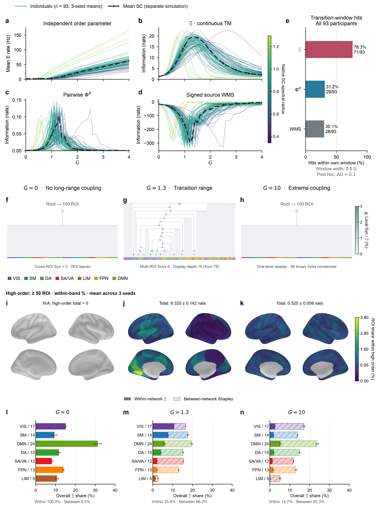

# Brain：序参量转折识别与整合有效信息组织

## 主图：个体转折定位与跨尺度信息组织

[查看原始分辨率主图](assets/dmf_brain_main_composite_high_order.png) · [PDF 图版](../../fig/dmf_schaefer100/dmf_brain_main_composite.pdf) · [低阶分布与高／低阶对比](#dmf-roi-low-order-comparison) · [阶数拆分与估计记录](#dmf-main-composite-details)

**图 1｜DMF 模型的转折邻域、层级结构与高阶信息分配。** $G$ 为全局耦合强度，SC 为结构连接，ROI 为 Schaefer100 图谱脑区；每个 ROI 含兴奋／抑制（E/I）两个状态变量。$\Xi$ 表示联合状态对未来的信息超出各单变量信息之和的部分。信息量使用 nats，平均 E 发放率使用 Hz；脑图显示占高阶总量的段内百分比，网络柱图显示占整体 $\Xi$ 的百分比。

**a–e：93 个体的转折定位。** a 为独立模拟的平均 E 发放率，b 为连续 $G$ 约束 affine-TM 估计的 $\Xi$，c 为自然分布下 pairwise $\Phi^R$，d 为自然 signed source WMS。细线为每人 seed 3、4、5 的均值，颜色表示原生 SC 谱半径；黑色虚线及圆点为平均 SC 的独立模拟，不计入 93 人统计。扫描 $G=0$–4、步长 0.1，信息时距为 300 ms。$\Xi$ 使用独立均匀干预 $U(0.3,0.7)$ 和完整 200 维未来；$\Phi^R$ 对 200 个 E/I 标量的全部 19,900 对等权平均，保留两两未来目标的定义，并与 WMS 共用自然源样本及其未来响应。e 判断 $\Xi/\Phi^R$ 的峰、WMS 的谷是否落在每人的独立发放率转折窗口内：分别为 **71/93（76.3%）、29/93（31.2%）、28/93（30.1%）**。窗口宽度为事后选定的 0.5 $G$，迁移估计器时保持冻结；曲线没有平滑、幅度归一化或峰位对齐。

**f–h：三个耦合状态的层级结构。** 三列依次为 $G=0$、1.3、10，均使用平均 SC、seed 4，以 100 个 ROI 块为叶，E/I 坐标保留在各 ROI 内。f 合并零 Syn 的跨 ROI 连接，根的 $\Xi=1.4138$ nats 全部来自 ROI 内 E/I 量。g 保留 8 个多 ROI 分叉，将连续单 ROI 剥离段压缩后，显示深度由 79 降至 15；节点颜色为原局部二分 Syn／同条件根 $\Xi$，压缩段取局部峰值，不能相加为预算。h 将 $G=10$ 的 99 个二叉分叉压缩为一层，虚线横枝和空心菱形标示显示压缩；其跨 ROI 信息仍非零。枝长和高度不编码信息强度，f 与 h 的外形相似不代表信息量或机制相同。叶色为事后 Yeo-7 标签。

**i–k：至少 50 阶的皮层 ROI 归因分布。** 高阶取固定 SPT 路径中父节点含至少 50 个 ROI 的分量，阶数按 ROI 块计数；局部 ROI 内 E/I 量归入低阶。各 ROI 的高阶 Shapley 分配先除以同条件、同 seed 的高阶总量，再等权平均 seed 3、4、5；每个有效条件的 100 个 ROI 份额合计 100%。三个 $G$ 共用 **0–3.8027%** 线性色标，并与附录低阶图保持相同色域。每列上排为左／右半球外侧，下排为左／右半球内侧，内侧壁为灰色。$G=0$ 的高阶总量精确为零，百分比分布未定义，以灰色脑图和 N/A 标示；$G=1.3$、10 的高阶总量分别为 **8.320 ± 0.142、0.525 ± 0.008 nats**，标题为均值 ± seed 样本 SD。颜色表示高阶内部的相对分配，不能直接比较绝对量；阶数定义依赖所选树路径，不对应纯阶 PID 原子。

**高／低阶对比。** $G=1.3$ 的高阶分配更集中于左侧视觉区，最大单 ROI 为 LH Vis 3（段内 3.80%）；低阶分配更偏右侧，最大单 ROI 为 RH SomMot 2（段内 3.46%），见[附录低阶图](#dmf-roi-low-order-comparison)。$G=10$ 的高阶分配较均匀，单 ROI 份额为 0.61%–1.35%，但其高阶绝对总量仅约为 $G=1.3$ 的 1/15.8。$G=0$ 只有低阶局部 E/I 贡献。这些空间差异描述当前固定树诱导的归因，尚不能据此推断固有神经侧化。

**l–n：网络内与网络间贡献。** 实色段为各 Yeo 网络内部完整 E/I 源集合的 $\Xi$，浅色斜线段为网络间残差的精确 Shapley 归因。两类贡献均先除以同条件全系统 $\Xi$，再平均 seed 3、4、5；七网络的全部色段共同合计 100%，并非各网络分别归一化。网络内／网络间总份额依次为 **100.0%／0.0%、33.8%／66.2%、14.7%／85.3%**。内部段末端和整柱末端的误差条分别为内部份额及总份额的 seed SD；标签斜线后为 ROI 数，三图共用网络顺序及横轴。VIS、SM、DA、SA/VA、LIM、FPN、DMN 分别表示视觉、躯体运动、背侧注意、显著性／腹侧注意、边缘、额顶控制和默认网络。

**读图结论与适用范围。** 当前协议下，$\Xi$ 峰落在个体转折邻域内的比例较高。三个组织工作点中，$G=1.3$ 的整体信息总量最高，并呈现多 ROI 分叉和不同于两端的空间分配。$G=10$ 的网络间相对份额升高，同时绝对信息总量下降。a–e 使用连续 $G$ 约束版本；f–n 保留原组件修正／历史层级的组织参考，树为单 seed，皮层和网络图为三 seed 汇总，不能将它们视为同一拟合的逐点分解。干预与自然分布、未来目标的区别也不支持据此建立指标的一般优劣排序；转折邻域命中不等于严格临界定位。版本差异、数值容差和稿件核对见[阶数拆分与估计记录](#dmf-main-composite-details)。

## 阅读导航

- [数据、模型与干预](#dmf-data)
- [93 人转折窗口比较](#dmf-identification)
- [固定树、阶数拆分与归因](#dmf-main-composite-details)
- [HCP 57 人补充结果](#hcp-main)
- [复现入口与稿件依据](#brain-provenance)
- [Brain 英文修订副本](#brain-english)

## 1. 数据、模型与干预

结构输入为 UCLA CNP LA5c 健康对照的 93 份 Schaefer100 结构连接矩阵，分别模拟各个体与逐元素算术平均矩阵。数据来自 `data/neuromodulator_receptor_sc_100/CON_SC_1mio/sub-*.csv`；原始 `average.csv` 是 19 项受体／转运体指标，没有进入模型。每个个体均保留原生权重尺度，不作行归一化或谱半径缩放。

每个 ROI 含兴奋与抑制群体。令 $\mathbf{s}_E,\mathbf{s}_I\in\mathbb{R}^{100}$ 为门控状态，$\overline{\mathbf{C}}=93^{-1}\sum_{s=1}^{93}\mathbf{C}^{(s)}$ 为群体平均结构连接矩阵。个体模拟将其替换为相应的 $\mathbf{C}^{(s)}$。反馈抑制向量 $\mathbf{j}^{\mathrm{FIC}}$ 在平均连接组、$G=1.0$ 下校准到约 3 Hz，之后在全部扫描中固定共用。

### 1.1 局部电流与输入输出函数

兴奋性、抑制性群体的输入电流为

$$
\begin{aligned}
\mathbf{i}_E
&=w_E I_0\mathbf{1}
+w_+J_{\mathrm{NMDA}}\mathbf{s}_E
+GJ_{\mathrm{NMDA}}\overline{\mathbf{C}}\mathbf{s}_E
-\mathbf{j}^{\mathrm{FIC}}\odot\mathbf{s}_I,\\
\mathbf{i}_I
&=w_I I_0\mathbf{1}
+J_{\mathrm{NMDA}}\mathbf{s}_E
-\mathbf{s}_I.
\end{aligned}
$$

因此，主实验使用的是**直接** 长程兴奋输入 $\overline{\mathbf{C}}\mathbf{s}_E$，而不是扩散型 $\overline{\mathbf{C}}\mathbf{s}_E-\operatorname{diag}(\overline{\mathbf{C}}\mathbf{1})\mathbf{s}_E$；连接矩阵也没有做行归一化。兴奋性与抑制性放电率写为

$$
\mathbf{r}_E=f_{a_E,b_E,d_E}(\mathbf{i}_E),\qquad
\mathbf{r}_I=f_{a_I,b_I,d_I}(\mathbf{i}_I),
$$

其中

$$
f_{a,b,d}(x)=
\frac{a(x-b)}{1-\exp\!\left[-d\,a(x-b)\right]},
\qquad
f_{a,b,d}(b)=\frac{1}{d},
$$

后一个值是分母数值接近零时采用的连续极限。参数为

| 参数 | 数值 |
|---|---:|
| $w_E,w_I,I_0,w_+,J_{\mathrm{NMDA}}$ | $1.0,\ 0.7,\ 0.382,\ 1.4,\ 0.15$ |
| $a_E,b_E,d_E$ | $310,\ 0.403,\ 0.16$ |
| $a_I,b_I,d_I$ | $615,\ 0.288,\ 0.087$ |
| $\tau_E,\tau_I,\gamma_E,\sigma$ | $0.100,\ 0.010,\ 0.641,\ 0.01$ |

### 1.2 随机 Euler--Maruyama 更新

第 $k$ 个积分步以 $\Delta t=0.001$ 更新为

$$
\begin{aligned}
\mathbf{s}_E^{k+1}
&=\mathbf{s}_E^k
+\Delta t\left[-\frac{\mathbf{s}_E^k}{\tau_E}
+(\mathbf{1}-\mathbf{s}_E^k)\odot\gamma_E\mathbf{r}_E^k\right]
+\sigma\sqrt{\Delta t}\,\boldsymbol{\xi}_E^k,\\
\mathbf{s}_I^{k+1}
&=\mathbf{s}_I^k
+\Delta t\left[-\frac{\mathbf{s}_I^k}{\tau_I}+\mathbf{r}_I^k\right]
+\sigma\sqrt{\Delta t}\,\boldsymbol{\xi}_I^k,
\end{aligned}
$$

其中 $\boldsymbol{\xi}_E^k,\boldsymbol{\xi}_I^k\overset{\mathrm{iid}}{\sim}\mathcal{N}(\mathbf{0},\mathbf{I})$，并在群体、ROI 与时间步之间独立。EI 干预从

$$
\mathbf{s}_E^0,\mathbf{s}_I^0\overset{\mathrm{ind}}{\sim}U(0.30,0.70)^{100}
$$

开始，随后按上式积分 300 步；完整的 $[\mathbf{s}_E^{300},\mathbf{s}_I^{300}]\in\mathbb{R}^{200}$ 是 target。主确认设置 `state_boundary=none`，因此更新后**不** 将任何状态裁剪回 $[0,1]$。初始干预支持规定最大熵外生初态，`state_boundary` 则规定后续随机动力学不施加硬边界，两者不是同一设定。

### 1.3 采样与连续 $G$ 估计

93 人及平均 SC 的识别扫描均为 $G=0,0.1,\ldots,4.0$、seed 3–5。FIC 和自然发放率参考曲线使用 $10^{-4}$ s 步长、1.5 s 轨迹及至少 0.3 s burn-in；EI 干预的步长为 $10^{-3}$ s、300 步。每个 seed–$G$ 条件使用 2,048 个独立完整输入，固定共同 200 维 E/I 未来目标。各子集由同一 affine-TM Gaussian 联合模型边缘化，源先验用匹配均匀干预矩的对角协方差，数值 ridge 为 $10^{-6}$。

主图 a–e 在全部 $G$（包括零点）使用同一连续约束家族：跨 ROI 均值回归和 modified-Cholesky 残差回归的预测项按 $G$ 缩放，对未缩放系数施加固定惩罚 0.1 和 10；ROI 内回归不惩罚，SC 连通分量 mask 固定。这消除了此前局部与完整拟合切换造成的零点跳变。惩罚从平均 SC pilot 的验证样本选出后冻结；Gaussian 矩近似、收缩偏差、样本量敏感性与残差顺序依赖仍存在。该实现没有特征提升，也没有实施稿件 S1.2 的有限样本偏差修正。

### 1.4 ROI 标签的证据边界

93 份原始矩阵无表头，有限、非负、对称且对角为零。原始归档未附 ROI 标签；Schaefer 顺序来自与已标注 HCP 共识 SC 的核查：同序边相关 0.44956，2,000 次置换的单侧 $p=0.000500$。这支持顺序推断，不能替代原始标签，状态保持 **inferred**。脑图名称、Yeo-7 和表面注释使用 [CBIG Schaefer2018 官方发布](https://github.com/ThomasYeoLab/CBIG/tree/master/stable_projects/brain_parcellation/Schaefer2018_LocalGlobal)。

## 2. 93 人转折窗口比较

每人的独立平均 E 发放率曲线以最大正有限差分定位宽 0.1 的区间 $[L,U]$，冻结事后窗口为 $[L-0.2,U+0.2]$，总宽 0.5，不截断端点。对 seed 3–5 的未平滑均值取第一个全局极值：$\Xi$、$Phi^R$ 取峰，signed WMS 取谷；端点计命中，平坦曲线与边界极值计未命中。统计单位为个体，平均 SC 不进入分母。

| 指标 | 命中人数／93 | 命中率 | 相对 $\Xi$ 的配对记录：双方／仅 $\Xi$／仅基线／均未 |
|---|---:|---:|---|
| 连续约束 $\Xi$ | 71 | 76.3% | — |
| 自然 pairwise $Phi^R$ | 29 | 31.2% | 29／42／0／22 |
| 自然 signed WMS | 28 | 30.1% | 28／43／0／22 |

两项双侧精确 McNemar 检验的原始 $p$ 分别为 $4.5475\times10^{-13}$ 与 $2.2737\times10^{-13}$；两比较 Holm 校正后均为 $4.5475\times10^{-13}$。配对提升为 45.1613 与 46.2366 个百分点；10,000 次共同重采样个体、seed 20261017 的描述性 95% 百分位区间为 [35.4839,55.9140]、[36.5591,56.9892] 个百分点。

**比较对象是完整测量协议。** $\Xi$ 使用独立均匀干预；两项基线从自然轨迹末段有放回抽取 2,048 个完整 E/I 状态，并独立传播 300 ms，保留源相关，部分条件只有 100 个不同源索引。$Phi^R$ 等权平均全部 19,900 个标量对，目标为各对未来；WMS 保留完整未来与有符号读数。两项 Holm 校正不覆盖先前的窗口或估计器选择，区间也非同时区间，因此不构成独立前瞻验证或普遍算法排名。

平均 SC 的连续估计峰位为 $G=1.4$；组织例子取 $G=1.3$，并与 $G=0,10$ 对照。$G=10$ 超出识别扫描，峰值发放率约 528 Hz，是极端模型控制，不能解释为生理工作点。

## 3. 固定树、阶数拆分与归因

### 3.1 固定路径的定义与估计范围

主图 f–n 沿用组件修正的九个 affine-TM 模型（3 个 $G$ × 3 个 seed），并保留历史树拓扑；它们与 a–e 的连续 $G$ 家族不同，不能当作曲线的逐点分解。E/I 始终合在一个 ROI 叶块内，完整未来固定。小于等于 8 ROI 的节点穷举二分，大节点使用谱、average-linkage 与原编号前缀候选；Yeo 标签仅在构树后叠加。

**分配定义与守恒。** 令v(S)为当前脑图在共同完整未来target下的标量精细Ξ联盟游戏。沿每个条件的完整原SPT向下截取“ROI数< N”的最大子树，所得不重叠ROI集合记为$\mathcal F_N$。冻结这个划分，定义两个联盟游戏：

$$
v_{<N}(S)=\sum_{F\in\mathcal F_N}v(S\cap F),\qquad
v_{\ge N}(S)=v(S)-v_{<N}(S).
$$

全联盟的高阶总量恰为原树所有$|A|\ge N$内部节点的二分Syn之和；低阶总量包含其余内部节点及局部ROI的E/I量。两部分分别使用原来的正反排列计算Shapley分配。由线性性，逐ROI满足$\phi_{i,<N}+\phi_{i,\ge N}=\phi_i$，并分别合计各自阶数段的总量。原生分配单位为 nats；当前图绘制各 seed 段内归一化后的平均百分比。此处明确采用固定树诱导的子联盟定义；并未把每条排列中第N个加入后的增量称为N阶协同，也未把节点Syn平均平摊给成员。

**估计与拓扑边界。** 正G复用原图三G比较的谱候选SPT拓扑，在当前组件修正affine-TM联合密度上重新查询所有节点及其截断子联盟；没有重新搜索或宣称这些拓扑对当前密度仍最优。六个正G条件中，节点Ξ与旧树记录的最大差异为0.03352 nats，因此不直接累加旧树的Syn数值。干预仍为原独立U(0.3,0.7)样本，2048输入、300 ms、200维完整E/I未来及共同联合模型不变。继续继承uniform-to-Gaussian矩近似、无特征提升与未实施稿件 S1.2 的有限样本修正的限制；未迁移到上方连续G曲线的新正则家族。

**数值核验。** 原生非负容差为$10^{-8}$ nats。921,600个低／高分配抽样值的最小值为0，容差内负值与显著违反均为0；594个当前模型的原树内部Syn同样无负值。每个ROI的低＋高与原值最大误差为$5.55\times10^{-17}$ nats；分段Shapley总量与树分段预算最大误差为$3.82\times10^{-14}$ nats。512对共享正反排列的最大三seed均值MC标准误为0.01805个百分点（仅作为抽样精度诊断），与seed SD分开记录。小系统全排列检查、阈值边界及原归因相关检查共12项通过；没有进行新模拟、密度拟合或划分搜索。

原生分配及绝对量图可由 `python scripts/plot_dmf_roi_order_attribution.py --threshold 50` 复现；已有缓存时无需重算分配。当前百分比主图先以 `python scripts/plot_dmf_roi_order_attribution.py --threshold 50 --view band-percent` 重绘段内百分比图，再运行 `python scripts/compose_dmf_brain_main_figure.py --roi-order-threshold 50` 排版；若百分比图已存在，仅需后一步。阈值可在 2–101 间指定。两排、各 seed 的原生 nats 分配和诊断保存在 `results/dmf_schaefer100/main_independent_components_v2/roi_order_split_N50/`。固定树阶数段的子联盟游戏是本节明确增加的可视化定义，不能声称补充 S1.3 已直接规定了该拆分。

### 3.2 低阶分布与主图高阶分布的对比

[低阶图 PDF](../../fig/dmf_schaefer100/main_independent_components_v2/roi_order_split_N50_low_band_percent.pdf) · [完整高／低阶对照](../../fig/dmf_schaefer100/main_independent_components_v2/roi_order_split_N50_band_percent.png) · [返回主图](#dmf-main-composite)

**补图 1｜低阶（<50 ROI）分量的皮层归因。** 三列依次为 $G=0$、1.3、10，每列上排为左／右半球外侧，下排为左／右半球内侧。每个 seed 的低阶 ROI 分配除以同 seed、同 $G$ 的低阶总量，再对 seed 3、4、5 等权平均，各列合计 100%。与主图高阶脑图共用 **0–3.8027%** 线性色标，内侧壁为灰色。标题为低阶总量的均值 ± seed 样本 SD：**1.354 ± 0.060、9.693 ± 0.172、0.198 ± 0.005 nats**。低阶包含 ROI 内 E/I 量；低、高阶分别归一化后的百分比不能相加成整体归因，原生 nats 分配则逐 ROI 相加守恒。

**转折工作点的差别主要体现在承担信息的成员。** $G=1.3$ 时，高阶段内的左半球份额为 71.84%，最高单 ROI 是 LH Vis 3（3.80%）；低阶段内的右半球份额为 69.08%，最高单 ROI 是 RH SomMot 2（3.46%）。两段绝对总量分别为 8.3198 与 9.6929 nats，因此空间偏向不能解释为其中一段整体占优。左右差别由固定树在阈值处的成员组成直接产生，尚未建立神经侧化解释；核查见[下方半球分析](#dmf-roi-hemisphere-check)。

**极端耦合下，高阶占比升高而绝对量下降。** $G=10$ 的高阶占整体 $\Xi$ 的 72.62%，高于 $G=1.3$ 的 46.19%，但绝对量从 8.3198 降至 0.5254 nats。其高阶单 ROI 份额为 0.61%–1.35%，比低阶的 0.0032%–2.13% 更接近等份。$G=0$ 的全部 $\Xi$ 留在低阶局部 E/I 分量，高阶百分比不存在；主图灰色不表示均匀归因。这里比较的是平均 SC 下三 seed 的固定 SPT 路径，50 阶按 ROI 块计数。

复现主图和本附图：`python scripts/compose_dmf_brain_main_figure.py --roi-order-threshold 50`。直接读取现有百分比图及原生分配缓存，统一裁去白边后按相同比例排版。原生非负容差为 $10^{-8}$ nats；本次重检 1,800 个逐 seed ROI 值及 18 个段总量，最小值为 0，容差内负值与显著违反均为 0。$G=0$ 的三个高阶 seed 条件保持未定义，其余条件份额合计 100%。没有新增模拟、密度拟合、树搜索或归因估计。

### 3.3 半球差别与解释限制

$G=1.3$ 的低／高阶分配在原生单位上分别为：

| 三 seed 均值 / nats | 左半球 | 右半球 |
|---|---:|---:|
| 低阶（<50 ROI） | 2.9967 | 6.6961 |
| 高阶（≥50 ROI） | 5.9774 | 2.3424 |
| 两段之和 | 8.9742 | 9.0385 |

整体几乎对称，差异发生在固定树的阶数分配。三个 seed 的最大低阶块含 46–49 ROI，右侧占 35–42 个；较多左侧 ROI 在更大祖先节点处分离，其增量进入高阶段。阈值改成 30／40／60 时方向保留，但共用同一树，未验证拓扑或神经侧化的稳健性。直接查询完整左／右半球的 $\Xi$ 为 7.8256／7.8898 nats，亦近乎对称；未完成重编号或镜像连接组下的构树检验。

已有文献核查只支持局部加工侧化的背景：[Bunge 等（2009）](https://doi.org/10.1016/j.neuroimage.2009.01.064)研究关系整合，[Gandour 等（2004）](https://doi.org/10.1016/j.neuroimage.2004.06.004)研究韵律层级，[Gonzalez Alam 等（2022）](https://doi.org/10.1007/s00429-021-02374-w)研究功能梯度，均未检验多 ROI Syn 阶数。相反，[Jiang 等（2026，预印本）](https://doi.org/10.21203/rs.3.rs-9287158/v1)在面孔任务报告右侧协同优势。因此不能用这些文献证明“高阶偏左、低阶偏右”。此处压缩保留 2026-10-16 的文献记录与反例：Gandour 为摘要证据，其余所列研究当时读到全文；本次未重新检索或复读这些文献。

### 3.4 网络分解与数值审计

各 Yeo 网络内部贡献为其完整 E/I 源集合的标量精细 $\Xi$；网络间联盟游戏减去各网络内部量，再对全部 $2^7=128$ 联盟作精确 Shapley 归因。内部与网络间分配均除以同 seed、同 $G$ 的整体 $\Xi$ 后平均；七柱合计 100%，误差为三 seed 样本 SD。这是信息预算，不能解释为解剖连接强度。

连续 $G$ 查询的原生非负容差为 $10^{-8}$ nats；3,549,534 次查询有 188 个容差内负值，最小为 $-5.6843\times10^{-14}$ nats，显著违反 0，原值保留。旧树缓存的容差为 $10^{-8}$ bits，显示时按 $I_{\mathrm{nats}}=(\ln2)I_{\mathrm{bits}}$ 换算。921,600 个低／高阶分配抽样值与 1,800 个 seed 级 ROI 均值、18 个分量总量均无负值。任何低于负容差的 Syn 均须显式失败，不能通过裁剪修复；自然 WMS 的负值不属于 PEID Syn。

## 4. HCP 57 人补充结果

### 4.1 数据与信息对象

HCP S1200 的固定队列为同时具有 REST1_LR 与七项 LR 任务的 57 人。Schaefer-1000 parcel 按 Yeo-7 归组，网络内保留第一主成分；任务载荷从前 75% 的 taskRetained−taskRegressed 成分拟合，REST 从自身前 75% 拟合。每个“被试×状态”用 $\Delta$-Ridge（$p=3,\alpha=1$）从 21 维历史预测下一步七网络状态，后 25% 仅作预测诊断。

系统 $\Xi$ 扣除 21 个网络–滞后标量各自的 EI；网络归因把同网络三滞后绑定，网络内量加跨网络游戏的精确 Shapley 分配闭合到整体。该连续 EI 是 affine-TM Gaussian 近似。**本地原始缓存以 bits 保存，稿件以 nats 报告，两者乘以 $\ln2$ 换算；不能混读数值。**

### 4.2 状态与行为的主要证据

主配置中，REST 系统 $\Xi$ 均值为 7.122 bits，EMOTION／GAMBLING／LANGUAGE／MOTOR／RELATIONAL／SOCIAL／WM 为 4.633／4.785／5.150／5.568／5.357／6.243／5.323 bits。七个配对 Wilcoxon 对比经 BH 校正均显著；REST 优势是群体结果，不是逐人规律。SPT 的 tree-wise order mass 主要在 5–6 网络阶，不能当作纯高阶 PID 原子；Control 的归因份额由 REST 的 12.2% 升至任务态 14.1%–19.2%，Limbic 份额最小。

**严格长度匹配限制了“七任务均下降”的范围。** 在同一 57 人、相同 PCA／模型设置下，对每个任务使用 12 个与该任务等长的 REST 窗口，窗口内重拟合并对每人取均值。REST−任务差在 EMOTION／GAMBLING／LANGUAGE／MOTOR／RELATIONAL／WM 分别为 1.170／0.979／0.717／0.426／0.597／0.616 nats，七项 BH 校正后均 $q<0.017$；SOCIAL 为 −0.045 nats、$q=0.877$，未见匹配差异。这个控制已进入当前补充材料，不能只保留未经长度控制的七任务结论。

行为解释保留当前补充图中的四任务：LANGUAGE 的 Story／Math 与相应联盟 Syn 正相关，SOCIAL 的 Visual–Limbic–Control、EMOTION 的 Limbic–Control–Default，以及 MOTOR 多个联盟呈负相关。**只有图示 SOCIAL 关联计入了 120 联盟选择校正；其余为点对点探索性结果。** SOCIAL 的年龄／性别调整 $d'$ 关联为 $\rho=-0.453$，120 联盟 max-$T$ $p=0.0319$；连同两个行为端点的 240 项 max-$T$ 为 0.0433，而常规 240 项 BH 为 $q=0.108$。这些结果尚非独立样本确认。系统总 $\Xi$ 与对应行为没有一项通过七任务校正，不能以局部联盟关联替代整体量的阴性结论。

### 4.3 稳健性、容差与适用范围

队列含原 29 人与按行为多样性补入的 28 人，不代表 HCP 总体抽样。25 点参数网格只有 12 点保持 REST 群体均值最高、7 点保留全部七项显著对比；结果并非参数无关。未控制家系、完整头动／生理混杂或复核 RL run；MOTOR 评分来自扫描外行为，图谱不含皮层下结构。

原生 HCP 主验证容差为 $10^{-10}$ bits；当前缓存中 456 个系统 $\Xi$ 的最小值为 1.521789 bits，456 个跨网络 $\Xi$ 最小值为 1.380521 bits，两者容差内负值与显著违反均为 0。固定联盟的行为分析另用 $10^{-9}$ bits 容差，6,840 个 Syn 最小为 0.000979 bits，同样无负值。容差只吸收估计误差，不是负 Syn 的证据。

## 5. 复现入口与稿件依据

| 内容 | 入口或缓存 |
|---|---|
| 当前主图与低阶附图 | `scripts/compose_dmf_brain_main_figure.py --roi-order-threshold 50` |
| 原生低／高阶分配与百分比 | `scripts/plot_dmf_roi_order_attribution.py --threshold 50 --view band-percent`；`results/dmf_schaefer100/main_independent_components_v2/roi_order_split_N50/` |
| 93 人命中与配对检验来源 | `results/dmf_schaefer100/main_continuous_curves_v1/fixed_window_summary.json` |
| 数据完整性与 ROI 顺序 | `results/dmf_schaefer100/preparation_summary.json` |
| HCP 主结果与联盟图 | `results/hcp_schaefer1000_task_evoked_xi_57/final/` |
| HCP 模型、null、参数与预测检查 | `results/hcp_schaefer1000_57_validation_suite/` |
| HCP 严格长度匹配 | `scripts/run_hcp_schaefer1000_length_matched_rest_57.py`；`results/hcp_schaefer1000_length_matched_rest_57/` |

配对统计源文件 SHA-256 为 `5d95620b17512a776a65c17aff1f2942d6cc6006367804ec444bf48e8f948076`；曲线身份为 `df314544168b79784b09b8392d15b60071cb26a3600951146747d991c7ef87bd`。复现图版读取缓存即可，不需重跑模拟。

2026-10-17 经 Zotero 本地 API 重新核验父项 **P6UJCVG8** 的题名 *Emergent hierarchical organization of causal interactions in complex systems*，重新取得正文 **DXGC7JEA**（19/19 页）和补充 **MWIWKSVG**（28/28 页）全文，读取 Brain/Fig. 2、Methods（5）–（12）、补充 S1.3（S16–S19）与 S5／Algorithm S1。附件没有明确修订号或成稿日期。当前章节取舍还参照当天 Overleaf 源文快照：Brain 正文为 DMF 三小节，HCP 与低阶 ROI 归因分别在补充 S12、S13，DMF 方法为 S14.2.1。Zotero 附件与该快照不是同一修订，不据本次整理宣称全面一致性已验证。

均匀干预的 Gaussian 矩近似、连续 $G$ 曲线与固定树归因的家族差别、ROI 块阶数与标量源阶数的区别，以及由无标签归档推断 ROI 顺序的限制继续保留。移出的社团比较、共同核搜索、脑指纹、PED/O-information 和刺激用途预实验未进入此正文／补充叙事，不作为当前结论的证据。

## 附录：Brain 英文修订副本（2026-10-17）

We applied PEID to a structure-constrained brain model to test whether whole-brain joint causal information identifies individual dynamical transition regions and explains how information is organized within them. The analysis combines an objective comparison of transition correspondence with hierarchical, regional and functional-network attribution (Fig. 2). Complementary resting-state and seven-task fMRI analyses in 57 Human Connectome Project participants are reported in Supplementary Section S12.

### Structure-constrained modelling of brain coordination

Different cortical regions support specialized computations, while coordinated behaviour requires interactions across those regions. The hypothesis that the brain operates near a transition between weakly and strongly coordinated regimes offers a dynamical account of this balance (Williams-García et al., 2014; Toker et al., 2022). A system-level information peak can provide a candidate marker of such a regime, but it leaves two questions unresolved: how reliably does the marker locate the transition across individual connectomes, and which combinations of regions carry its joint contribution? We used PEID to address both questions in a model where anatomical connectivity constrains the dynamics and global coupling can be varied directly.

The structural input comprised 93 participant-specific diffusion-MRI connectomes from healthy controls in the UCLA Consortium for Neuropsychiatric Phenomics LA5c dataset (Poldrack et al., 2016), represented in the 100-region Schaefer cortical parcellation (Schaefer et al., 2018). Following the excitatory–inhibitory dynamic mean-field framework (Deco et al., 2014), each region contained coupled excitatory and inhibitory populations. We simulated each native connectome and, separately, their element-wise arithmetic mean. Feedback inhibition was calibrated once and held fixed while the global coupling $G$ varied from 0 to 4 in steps of 0.1. This design changes interregional coupling against a fixed anatomical and local-regulatory background. The mean-connectome simulation supplies representative organization examples and does not enter the participant-level comparison.

At each coupling, $\Xi$ quantified information about the full 200-dimensional E/I state 300 ms later that exceeded the summed contributions of individual scalar sources. Independent uniform interventions sampled the neural-state inputs, and a common affine transport-map model supplied the joint and marginal information queries. We compared $\Xi$ with natural-state pairwise Gaussian-MMI $\Phi^R$ and signed source WMS (Mediano et al., 2025). These observational baselines describe dependence under the model's naturally correlated states. Together, the analyses test transition correspondence and then resolve the information budget into source coalitions, cortical locations and functional-network contributions (Supplementary Section S14.2.1).

### Whole-brain synergy identifies individual transition regions

We defined the reference transition from mean excitatory firing rate, independently of the information measures (Fig. 2a). For each participant, its maximal positive finite-difference slope identified a $0.1$-wide interval in $G$. The frozen post hoc evaluation window extended this interval by 0.2 on each side, giving a common width of 0.5. A hit required the global $\Xi$ or $\Phi^R$ maximum, or the signed WMS minimum, to fall within that participant's own window. Classification used unsmoothed means across seeds 3–5, with the participant as the comparison unit. Thus, the endpoint measures correspondence to an independently defined transition region rather than similarity in curve shape or amplitude.

Across the 93 connectomes, the $\Xi$ peak fell inside the transition window in 71 cases (76.3%), compared with 29 (31.2%) for the $\Phi^R$ peak and 28 (30.1%) for the WMS trough (Fig. 2b–e). The paired gains were 45.2 and 46.2 percentage points, respectively. Every baseline hit was also a $\Xi$ hit, with 42 and 43 additional participants identified only by $\Xi$. Two-sided exact McNemar tests, with Holm correction across the two comparisons, gave $P=4.55\times10^{-13}$ for each comparison. Descriptive paired-bootstrap 95% intervals for the gains were 35.5–55.9 and 36.6–57.0 percentage points. $\Xi$ therefore achieved a significantly higher transition-window hit rate than both tested baselines under this fixed-window analysis.

This advantage concerns the complete measurement protocols. $\Xi$ used independent interventions, whereas the baselines retained natural source correlations. Pairwise $\Phi^R$ averaged 19,900 E/I scalar pairs with pair-specific future targets, while WMS and $\Xi$ retained the full future-state target. Because the window was selected post hoc and the tests do not account for prior window or estimator selection, the significance is conditional on the frozen analysis and does not establish prospective detection performance. The mean-connectome $\Xi$ curve peaked at $G=1.4$. We used $G=1.3$ to examine transition-range organization, alongside $G=0$ and the extreme-coupling control $G=10$, without identifying these model conditions with a physiological critical point.

### Hierarchical organization and functional allocation of brain synergy

The SPTs show how joint information is assembled across cortical regions (Fig. 2f–h). Each ROI's E/I coordinates remained together as one source block, and Yeo-network labels (Yeo et al., 2011) were applied after tree construction without constraining the split search. At $G=0$, cross-ROI Syn was zero and all retained information lay within local E/I blocks. At $G=1.3$, the representative seed-4 tree contained eight splits separating two multi-ROI children, revealing nested regional coalitions. Condensing successive single-ROI exits reduced its displayed depth from 79 to 15 while retaining these forks and all 100 ROIs. At $G=10$, the 99-step binary chain was condensed to one displayed level, although its original cross-ROI contributions remained nonzero. The transition-range example therefore exhibits a branching hierarchy absent from the two endpoint examples, rather than simply a larger scalar information value.

Regional attribution localized the contributions associated with large coalitions (Fig. 2i–k). We defined the high-order component by SPT nodes containing at least 50 ROI blocks and normalized each seed's ROI Shapley allocations by its own high-order total before averaging. At $G=1.3$, this component contained $8.320\pm0.142$ nats (mean $\pm$ seed SD), with 71.84% allocated to the left hemisphere and the largest parcel share in left visual cortex (3.80%). Low-order allocation instead favored right somatomotor and salience/ventral-attention parcels (Supplementary Section S13; Supplementary Fig. 4). The spatial contrast concerns how information is divided across order bands: order counts coalition size along the frozen SPT path, and the hemisphere labels use inferred Schaefer ordering of the original unlabeled connectivity archive. It does not establish intrinsic hemispheric specialization. At $G=10$, high-order shares became more uniform, but their absolute total fell to $0.525\pm0.008$ nats, approximately 1/15.8 of the transition-range value. At $G=0$, the high-order total was zero and its percentage map was undefined.

At the functional-network level, we separated information retained within each of the seven Yeo networks from the residual requiring sources across network boundaries (Fig. 2l–n). Each internal term was computed from that network's complete E/I source set, and exact Shapley attribution allocated the between-network residual across all 128 network coalitions. Both terms were divided by the same condition's overall $\Xi$ before averaging seeds. At $G=1.3$, within-network contributions accounted for 33.8% and the between-network residual for 66.2% of the total. Visual and Somatomotor had the largest internal shares, 10.7% and 7.7% of overall $\Xi$. In contrast, Default-mode and Salience/ventral-attention received the largest between-network shares, 13.7% and 13.2%, followed by Dorsal-attention and Frontoparietal-control, 11.2% and 10.9%.

This allocation is consistent with a division between local specialization and distributed coordination. Sensory and motor networks retained more joint information internally, while association, attention and control networks participated more strongly in the contribution spanning network boundaries. For example, the internal component comprised approximately 64.4% of Visual's combined allocation, whereas the between-network component comprised 86.0% of Salience/ventral-attention's and 83.7% of Frontoparietal-control's allocation. These information shares characterize the model's functional organization under the chosen interventions. They are not measurements of anatomical connection strength or pairwise coupling, and differences in network size and structural embedding remain relevant to their interpretation.

The between-network fraction rose to 85.3% at $G=10$, despite the smaller absolute information budget, whereas it was zero at $G=0$. Stronger model coupling therefore did not produce a monotonic increase in informative coordination: the transition-range condition combined a richer branching hierarchy, selective high-order regional allocation and differentiated internal versus cross-network contributions. The hierarchy and attribution panels retain the earlier component-corrected models and legacy tree topology, while the participant curves use continuous-$G$ regularization. They provide complementary organizational views rather than pointwise decompositions of those curves. The selected hierarchy remains dependent on its search policy and does not identify unique anatomical modules.
