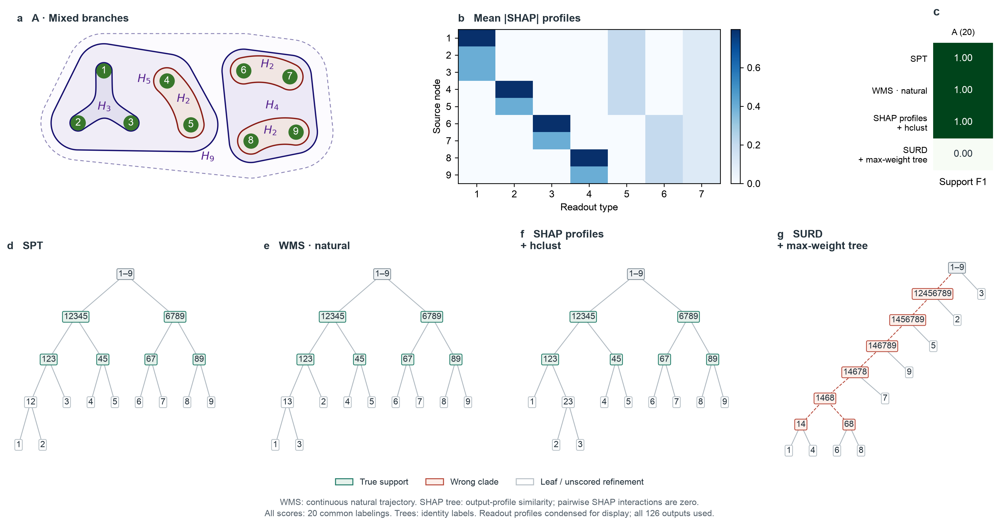

# 案例 A：自然分布 WMS 与 SHAP 归因模式树

只计算截图中的 Gaussian Mixed branches 案例 A，没有新增 B/C 计算。WMS 保留自然轨迹的联合分布；SHAP 解释同一模型的一步未来条件均值，再按输出归因模式做层次聚类。两者均恢复全部待评分支持集，F1 为 1.00，但两种树表达的含义不同。



图中树只展示拓扑，纵向间距不代表信息量或聚类距离。绿色表示真实支持集，红色表示错误分支。SPT、WMS、SHAP 在最小真实支持集 `{1,2,3}` 内的二叉细化不同；这类细化沿用原图评分规则，不计入错误。

## 结果与比较范围

| 方法 | 支持集 F1 | 正确根划分 | 本次使用的信息 |
|---|---:|---:|---|
| SPT，既有结果 | 1.00 | 20/20 | 独立高斯干预，已知联合分布 |
| WMS，自然轨迹 | 1.00 | 20/20 | 65,536 个连续自然转移，完整经验联合协方差 |
| WMS，精确自然分布核查 | 1.00 | 20/20 | 自然平稳分布的精确联合协方差 |
| SHAP 输出归因模式 + 层次聚类 | 1.00 | 20/20 | 精确线性 SHAP，完整 126 维输出 |
| SHAP，轨迹平均归因模式核查 | 1.00 | 20/20 | 同一自然轨迹上的平均绝对归因 |
| SURD + 最大权重树，既有完整计算 | 0.00 | 0/20 | 完整组合分解，再作最大权重层叠选择 |

20 次对应原实验的同一物理模型、同一组节点重标号，不是 20 个独立模拟重复，不能据此给出物理重复的置信区间。待评分的六个非根支持集为 `{123}`、`{45}`、`{67}`、`{89}`、`{12345}`、`{6789}`，正确根划分为 `{12345}|{6789}`。根和叶节点不纳入支持集 F1，最小支持集内部的进一步细化不计分。

## WMS：保持 SPT 的划分规则，只改变输入分布

对当前源集合 \(A=L\mathbin{\dot\cup}R\)，目标始终是完整一步未来向量 \(\boldsymbol{y}=\boldsymbol{x}_{t+1}\)：

\[
W_{\mathrm{nat}}(L,R;\boldsymbol{y})
=I_{\mathrm{nat}}(\boldsymbol{x}_A;\boldsymbol{y})
-I_{\mathrm{nat}}(\boldsymbol{x}_L;\boldsymbol{y})
-I_{\mathrm{nat}}(\boldsymbol{x}_R;\boldsymbol{y}).
\]

递归选择使该量最小的二分，完整细化到单节点，不改变目标、不加归一化、不取绝对值。这个规则与本例 SPT 的原始残差划分规则相同；理论比较的区别在于自然输入分布与干预输入分布。WMS 本身是有符号信息残差，不内置唯一的树算法；这里按用户要求沿用 SPT 的递归规则。

案例 A 的既有干预基线是均值、方差约束下的独立标准高斯；它不是有界状态空间上的均匀分布。这里遵循的关键区别仍是：WMS 使用自然联合分布，SPT 使用使源变量相互独立的最大熵干预分布。

采样采用一条连续自然轨迹，丢弃前 128 步，保留 65,536 个相邻转移。相邻样本真实共享一个状态，各节点的全部 14 个坐标保留，不逐节点独立重采样，不打乱时间。估计器使用完整 252 维源—未来经验协方差的仿射 Cholesky transport map，没有对角化、正则化或非负投影。

自然状态确实不是节点相互独立的分布：节点 1、2 的第一类旧读出量相关系数为 **0.715703**，精确值为 **0.714286**；对应新鲜驱动量的样本相关系数为 0.005674。

案例 A 的特殊结构解释了 WMS 为什么与 SPT 得到相同结果。模型满足

\[
\boldsymbol{x}_{t+1}=\boldsymbol{T}\boldsymbol{x}_t+\boldsymbol{\epsilon}_t,
\qquad \boldsymbol{T}^{2}=\boldsymbol{0},
\qquad
\boldsymbol{\Sigma}_{\mathrm{nat}}
=\boldsymbol{Q}+\boldsymbol{T}\boldsymbol{Q}\boldsymbol{T}^{\mathsf T},
\]

其中 \(\boldsymbol{Q}\) 为一步噪声协方差。相关的旧读出量不进入下一步驱动，新鲜驱动量每步独立刷新为标准高斯，并与旧读出量独立。因此自然状态与干预状态的完整分布不同，但决定未来的有效输入具有相同分布。对全部 511 个非空源子集，精确自然互信息与既有干预互信息的最大差为 **\(2.22\times10^{-15}\) nats**。

所以，案例 A 能验证自然采样实现，却不能区分自然与干预输入分布对 WMS/SPT 的影响；这个相等关系不能推广到一般动力系统。另需明确：原 SPT 是已知分布精确计算，轨迹 WMS 是有限样本估计，因此表中另列精确自然 WMS，作为只改变分布的比较。经验自然互信息对精确自然互信息的最大绝对误差为 0.124308 nats，完整联合协方差的最大元素误差为 0.045017；这里的树恢复不等于信息量已无估计误差，也不能把经验估计误差解释成分布效应。

在所有子集合的 9,330 个候选二分中，经验 WMS 最小值为 **−0.000571134 nats**，有 **69** 个负值，均低于审计阈值 −\(10^{-8}\) nats；负容差区间内的数量为 0。全部按原值保留。精确自然 WMS 的最小值为 **0.0000798969 nats**，无负值，因此本次负估计属于有限样本误差，不能作为总体 WMS 为负的证据。WMS 一般允许负值；这里没有套用 PEID Syn 的非负规则。既有 SPT 的 Syn 容差为 \(10^{-8}\) nats，原结果无负值、无投影。

## SHAP：归因模式能给树，交互值不能在本例给出有效层次

采用已知模型的完整条件均值 \(\boldsymbol{f}(\boldsymbol{x})=\boldsymbol{T}\boldsymbol{x}\)，每个节点的 14 维状态作为一个玩家，解释全部 126 维未来输出，没有先把输出压缩成一个标量，也没有训练代理预测器。

对输出坐标 \(o\)，本例精确分组 SHAP 为

\[
\phi_{i,o}(\boldsymbol{x})
=\sum_{d\in\text{node }i}T_{od}x_d,
\qquad
P_{io}=\mathbb E_{\mathrm{nat}}|\phi_{i,o}|
=\sqrt{\frac{2}{\pi}}
\sqrt{\sum_{d\in\text{node }i}T_{od}^{2}}.
\]

自然背景中的相关旧读出量系数为零，且与有效驱动量独立，所以本例条件 SHAP 与独立替换 SHAP 一致。该闭式表达遵循 [SHAP LinearExplainer 的线性模型定义](https://shap.readthedocs.io/en/stable/generated/shap.LinearExplainer.html)。逐一枚举一个真实自然状态的全部 512 个联盟核查，Shapley 求和最大误差为 \(3.55\times10^{-15}\) 个输出单位。

将 \(\boldsymbol{P}\) 的九个行向量作为各节点的输出作用模式，采用余弦距离、single linkage 构树。这两个选项是 [SHAP hclust 文档支持的设置](https://shap.readthedocs.io/en/stable/generated/shap.utils.hclust.html)，但“对平均绝对输出归因模式聚类”是这里明确增加的可视化规则，**不是 SHAP 自身唯一规定的树算法**。计算使用解析 SHAP 与 SciPy 聚类，没有调用未安装的 SHAP 软件包。模型权重决定归因，真实支持集仅用于评分和图示，不进入聚类输入，也未按 F1 选择距离或连接规则。

所得树先形成 `{23}`，再形成 `{123}`、`{45}`、`{67}`、`{89}`，随后合并为 `{12345}`、`{6789}`，最后合并全系统。典型聚类高度为 0、0.027997、0.761905、0.952381。图中归因热图把九份重复读出压缩为七种类型用于展示；构树始终使用完整 126 维输出。自然轨迹上的经验平均归因模式也得到相同的待评分支持集，最大归因模式误差为 0.002253 个输出单位。

模型条件均值是线性可加的，所有联盟背景下的两变量二阶差分均为零，故非对角 SHAP 交互值总体上严格为零，数值核查最大残差为 \(1.11\times10^{-16}\) 个输出单位。直接聚类这些交互值无法得到有证据支持的层次，也不应把任意零距离细化评分为 SHAP 的实测结构。

本例 SHAP 归因模式树成功，是因为共同作用于哪些输出的模式已经显示了嵌套支持结构。它说明输出作用模式可用于恢复本例层次；不说明 SHAP 检测到了高阶协同信息，也不与信息残差的正值矛盾。SHAP 归因使用原输出单位，余弦距离无量纲，WMS 使用 nats，三者不能直接比较数值大小。

## 方法来源与复现

2026-10-15 重新查询 Zotero 主条目 `P6UJCVG8`，核对标题 *Emergent hierarchical organization of causal interactions in complex systems*，读取当前主文附件 `DXGC7JEA` 的 Methods (5)–(12)，以及 SI 附件 `MWIWKSVG` 的 S1.2、S5、S9.1、S9.4。当前只有这一对主文/SI 附件，但没有显式稿件版本或日期，无法进一步确认版本先后。SI S9.1 支持自然观测分布下的有符号 WMS 定义；S9.4 讨论 SHAP 替换与两两非加性。本次计算完整的分组 Shapley 归因，而非仅使用 SI 的两两替换差分；额外的归因模式树已明确标注。

复现入口：

```bash
OPENBLAS_NUM_THREADS=1 OMP_NUM_THREADS=1 .venv/bin/python scripts/compare_shap_wms_case_a.py
```

固定轨迹种子为 20261015；摘要默认写入 `/tmp/eisyn_shap_wms_case_a.json`，图直接更新本报告的案例 A 附图。读取既有 SPT 与完整 SURD 的案例 A 结果作为参考，不重新计算 B/C，不覆盖原 A/B/C 对比图。计算约 3.4 秒；没有保存大体积轨迹缓存。

验证：`tests/test_shap_wms_case_a.py` 与既有 `tests/test_spt_surd_three_cases.py` 共 13 项通过。新增检查覆盖自然相关性与转移噪声、自然精确互信息、相关源下合法的负 WMS，以及完整联盟 Shapley 求和；另已检查导出图的标签、图例和机制符号无重叠。
