# 连续层级比较：有限数据 TM 验证与历史相位基准

2026-10-14 最新结果：保留九节点 A，将 B/C 换成第 13 节的固定连续公共读出案例。完整有限数据验证通过：新 B/C 的三个样本规模、三个独立数据集均得到 SPT 支持 F1=1，两个 Block 仍有分组错误。主图 c 已使用拟合 TM 的结果，a/b 保留、d 删除。结果、当前图与附录记录见[第 14 节](#14-新-bc-的完整有限数据验证与主图更新)。旧相位 B/C 的结果与失败诊断均保留。

2026-10-14 早先结构更新：**A 扩展为九节点、七个独立连续通道的嵌套高斯公共读出模型**，包含 123、45、67、89、12345、6789 和九阶根。SPT 的支持 F1 为 **1**，未归一化及按 $\Phi_R/\min(|L|,|R|)$ 归一化的 Block-ΦR 均为 **0**，20 个与 B/C 相同的共同标签均成立。结构图仅保留绿色节点和紫色阶数标记，沿用 B/C 的包络风格。该阶段结构与动力学见第 6 节，A 模型与验证见第 9 节。第 7–8 节保留两个先前四节点 A，第 1–5 节保留原相位基准和九标量积分诊断。

2026-10-13。按[修正方案](../ref/spt_continuous_hierarchy_refinement_design.md)完成第 1–2 步。**可解析连续相位基准通过数值与层级验证，SPT 和 Block-ΦR 均恢复全部预设支持；九标量模型的积分误差明显缩小，但仍未达到预设精度目标。** 未启动后验 proposal 训练或 Kuramoto 外推，原比较大图保留。

## 1. 原连续相位主基准的结果（替换前）

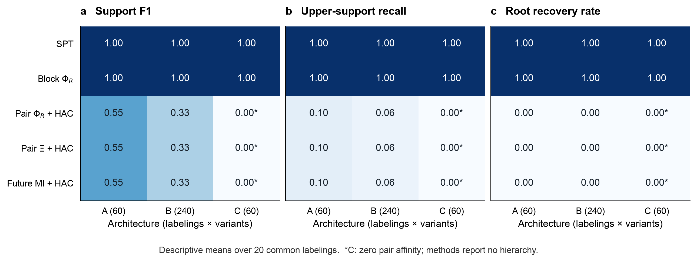

固定九个节点，每节点九个连续圆周坐标，共 81 维源与完整 81 维未来目标；源逐坐标独立均匀干预，时距一步。每条超边采用独立相位通道，增益统一为 1、von Mises 集中度统一为 2；节点局部谐波、频率和记忆噪声异质，所有架构内固定。模型由方案式（4）–（6）的连续 heat-bath kernel 定义，不是离散状态抖动，也不是九个单相位 Kuramoto 振子。

比较统一查询接口上的 SPT、递归最小未归一化 MMI Block-ΦR、pair-ΦR+average linkage、完整目标 pair-Ξ+average linkage、future-MI+average linkage。SPT 枚举全部合法二分，最大化子块 Ξ，递归到单节点。Block-ΦR 随当前节点改变局部目标，因此作为独立方法报告。算法只接收信息查询值或成对矩阵；超边成员、活跃通道和反事实编号只在通道 oracle 内部及事后评分使用。

- A：三个上层重连，保留 123、45、67、89 与九阶根。
- B：左侧 3/4/5 的全部六种增添次序 × 右侧 8/9 的两种增添次序，共 12 种级联；保留 12、67、左右最高分支与九阶根。
- C：方案给定的三种三元组重连，保持三条三阶、一条六阶和一条九阶通道。

每个架构采用同一套 20 个节点标签：原标签＋seed=20261013 生成的 19 个随机双射。共 360 条记录。标签置换用于检查平局与叶序敏感性，**不是独立物理系统重复**。下表是架构内所有反事实与标签的等权描述性均值，无物理置信区间；B 不与 A/C 混合计算一个总分。主指标沿用非根 support F1，所有方法均忽略最小支持内部的真子集细分；上层召回只计非最小、非根超边。

| 方法 | A：F1 / 上层召回 / 根恢复率 | B：F1 / 上层召回 / 根恢复率 | C：F1 / 上层召回 / 根恢复率 |
|---|---:|---:|---:|
| SPT | 1.000 / 1.000 / 1.000 | 1.000 / 1.000 / 1.000 | 1.000 / 1.000 / 1.000 |
| Block-ΦR | 1.000 / 1.000 / 1.000 | 1.000 / 1.000 / 1.000 | 1.000 / 1.000 / 1.000 |
| pair-ΦR + HAC | .554 / .100 / .000 | .330 / .062 / .000 | .000 / .000 / .000* |
| pair-Ξ + HAC | .554 / .100 / .000 | .330 / .062 / .000 | .000 / .000 / .000* |
| future-MI + HAC | .554 / .100 / .000 | .330 / .062 / .000 | .000 / .000 / .000* |

\* C 的三种成对矩阵严格为零，方法返回“无结构信息”，不产生测量树。零分表示未报告任何支持，不是人为构造树的失败分数。

A/B 成对方法的 F1 范围分别为 [.462, .833]、[.286, .714]，说明平局与标签能产生偶然吻合。三个成对方法在本基准中各自只保留固定底层二阶通道，矩阵之间相差正的整体尺度，因而得到相同 HAC 结果。**每个架构内部、每个共同标签下，所有反事实的三种对应成对矩阵最大差均为严格 0。** 单靠这些矩阵无法识别改变的上层支持；这比一次低 F1 更直接地检验了信息压缩的辨识边界。Block-ΦR 的平手完整保留，不能由本例推出 SPT 优于所有高阶方法。

所有方法使用同一个已知联合与同一积分网格，但查询能力与数量不同，不声称训练数据、查询预算或运行时间完全相同。SPT 的共享 EI 表有 511 项，Block-ΦR 查询组联合，成对方法只使用其各自定义的成对信息。结果记录保存各阶段查询数量。

## 2. 新基准的独立数值检查

原生 Syn 容差预设为 **1e-8 nats**。未裁剪或投影。

| 检查 | 实测结果 |
|---|---|
| 128/256/512/1024 周期网格，单通道 EI | 均为 .249393452377278 nats |
| 直接密度比积分 vs 熵差积分 | 最大差 < 8e-16 nats |
| 二阶通道 future MI | .322162322067782 nats |
| 二／三阶 kernel 归一化与缺失读出均匀性 | 最大密度误差 < 6e-17 |
| 缺失原源相位的边缘化，谐波 1/2 | 与保留源无关，最大密度误差 < 2e-16 |
| 完整 81 维目标 vs 充分读出的逐样本密度比 | A/B/C 最大差 < 1.4e-13 nats |
| 条件 CDF 三角 TM 的正对角与密度换元 | 最小对角 > .087；有限差分密度误差 < 1.6e-7 nats |
| 360 × 9330 个二分的 raw Syn 审计 | 最小 −8.88e-16 nats；显著违规 0 |
| 容差内负残差 | 193444 个二分记录，保留原值；重复标签含重复数值，非独立违规次数 |
| 全部树节点贡献闭合 | 最大误差 0 nats |
| 无节点间交互对照，全部超边集中度为 0 | Ξ = 3.11e-15 nats；成对方法返回无结构信息 |

还从实际 81 维 kernel 为每例生成 65536 个独立均匀干预样本与完整未来状态，检查全部 511 子集的样本密度比均值和 oracle EI。最大绝对差为 A .01468、B .01078、C .01057 nats；相对于各自 iid 积分标准误，最大为 3.33、1.32、2.06。该检查验证采样实现与解析积分的一致性，**不把这批 MC 样本误差当成最终周期积分误差**。条件 TM 变换后的 2048 个验证样本也通过标准正态参考的均值、方差检查。

无交互对照保留局部记忆；其任意二叉细分不构成节点间层级证据。对照把超边噪声集中度设为零，而非只把增益设为零；后者仍可保留未来读出间的相位约束。

A/B/C 系统 Ξ 分别为 1.745754、1.995148、1.246967 nats，根残差均为 .249393 nats。这里原源块的独立通道允许加法公式成立；不同架构的超边数量不同，系统总量不作为孤立架构效应比较。全部上层支持能被恢复，但最小支持内部的二叉细分不唯一；节点 Syn 仍是分解路径上的残差，不解释为纯阶 PID atom。

## 3. 九标量模型：有限精度诊断

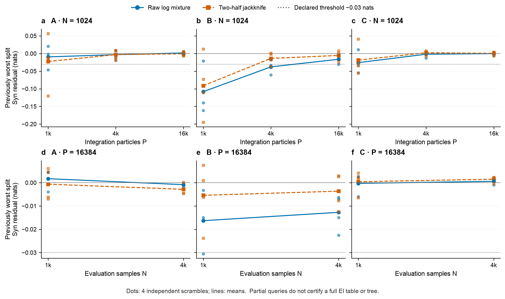

保留[首次试算](spt_continuous_abc_pilot.md)的全部方程、节点参数、独立 Uniform(−1,1)^9 干预、完整九维未来目标和一步时距。精确条件 Gaussian TM 不重新训练。固定查询：共同分母、每例原 seed 0 最差二分，以及参考根；缓存中的候选最佳根恰好与参考根一致，未增加全表或次佳根搜索。

| 架构 | 原最差二分 | 固定参考根 |
|---|---|---|
| A | 26：2 \| 6 | 12345 \| 6789 |
| B | 45678：45 \| 678 | 12345 \| 6789 |
| C | 34579：345 \| 79 | 123456 \| 789 |

seed=0/1/2/3 为四个独立 scramble。每个重复中，所有查询与三例共用实际评价样本、源积分点；N/P 改变时复用 Sobol 前缀。固定 N=1024 时取 P=1024/4096/16384，再固定 P=16384 增至 N=4096。独立检查确认嵌套前缀逐元素一致，新的 jackknife 密度实现与原 pilot 一致。两种估计均预先报告，无事后择优。

最高设置 N=4096、P=16384 下，原最差查询的残差如下；括号为四个独立 scramble 的最小–最大值，**不是置信区间**。

| 架构 | Raw Syn（nats） | Jackknife Syn（nats） |
|---|---:|---:|
| A | −.000841 [−.001653, −.000295] | −.002842 [−.004648, .000221] |
| B | −.012718 [−.022510, −.006334] | −.003639 [−.012456, .002958] |
| C | .000592 [−.000991, .001477] | .001502 [−.000521, .002281] |

参考根残差的 raw/jackknife 均值分别为：A .02206/.02781，B .00350/.01899，C .02097/.02308 nats。B 的参考根 raw 范围 [−.01411, .01921]、jackknife 范围 [.00222, .03421]，其数值敏感性仍明显。

原容差仍为 **.03 nats**。最高设置的两个查询 × 三例 × 四个重复 × 两种估计共 48 项中，显著违规为 0；raw/jackknife 的容差内负值分别为 10/6 项，照原值保存。中间设置仍有显著违规，例如 B 在 N=1024、P=16384 的一个 raw 原最差残差为 −.03053 nats。**查询过关不代表全部 9330 个二分过关，初算全表的失败记录不改写为有效树。** 本诊断不构建 SPT，也不评估最佳／次佳划分差的分辨率。

P 从 4096 增至 16384 时，所有查询／重复的最大绝对变化：

| 架构 | Raw EI / residual（nats） | Jackknife EI / residual（nats） |
|---|---:|---:|
| A | .02912 / .02730 | .02470 / .02338 |
| B | .05090 / .04701 | .01746 / .01288 |
| C | .00930 / .00918 | .01054 / .00607 |

固定 P=16384 后，N 从 1024 增至 4096 的最大 EI 变化仍有 A .03348、B .05255、C .05847 nats（取两种估计中较大者）。残差的最大变化分别为 .01042、.02961、.00597 nats。因此不能认定“关键 EI 与 residual 都稳定在 .01 nats 内”；C 的已查残差较稳定，也不足以认证全部 EI。四次重复只作初步诊断，未宣称达到正式八重复的数值不确定性要求。

共同分母的 ESS 中位数，按四个 scramble 的中位数再取均值，从 P=1024 时的 A 23.70、B 23.93、C 57.62，升至最高设置的 338.50、301.35、908.16。但最高设置 ESS<10 的评价比例仍分别为 1.69%、5.63%、.55%。ESS 是贡献权重集中度诊断，不据此将 Sobol 行当成 iid 样本生成误差条。原生非负性容差只吸收数值误差，不支持真实负 Syn 的解释。

结论是：均匀积分加密改善已查失败残差，尤其 A/C；B 的尾部覆盖、修正差异和外层评价误差仍需处理。当前证据支持下一阶段比较防御型 posterior-guided proposal，但尚未验证其收益，也未获本轮执行授权。没有直接启动约 14 小时的全表加密。

## 4. 方法版本与范围

本任务重新通过 Zotero 本地 API 核对父项 `P6UJCVG8` 的题名 *Emergent hierarchical organization of causal interactions in complex systems*，重新列出附件并获取主文 `DXGC7JEA`、SI `MWIWKSVG` 的全文。当前仅这一组主文／SI，无明确稿件日期或修订号；附件元数据修改时间不作为新版本证据，版本歧义保留。

依据为主文 Methods pp15–17、式（4）–（12）；SI S1.2 pp3–4、S3.2 p7、S5/Algorithm S1 pp8–9。共同干预、完整目标、固定时距、原始 Syn 残差和标准 SPT 目标与这些定义一致。连续相位 benchmark 使用九个源块，遵守该块分辨率，不与 81 个标量叶子的分解混用。

两组实验均使用已知非线性条件 TM 密度。新基准进一步通过解析边缘化与周期求积消除高维嵌套积分；它不是改用协方差 MI。两者均有别于 SI 的 affine feature-TM 近似，是 oracle 验证，不能据此宣称未知动力学学习或实际九标量系统已达到同样恢复性能。独立通道、没有跨通道反馈是主要适用边界；相位共享、共同驱动及 Kuramoto 扩展尚未执行。

周期密度与圆周 CDF 核对 [SciPy von Mises 定义](https://docs.scipy.org/doc/scipy/reference/generated/scipy.stats.vonmises.html)；独立随机化重复依据 [SciPy QMC 文档](https://docs.scipy.org/doc/scipy/reference/stats.qmc.html)。内外层误差不能互相替代，参见 [Rainforth 等关于嵌套 MC 的研究](https://proceedings.mlr.press/v80/rainforth18a.html)。本次是定向方法核对，非系统综述。

## 5. 复现与验证

实际积分诊断共 12 次架构／scramble 运行，累计 **521.91 秒（8.70 分钟）**；连续相位完整比较含数值校验用时 **18.94 秒**。先前小规模 smoke 用于估计成本，未作为最终结果混入。B 的 12 种级联全部保留，没有按评分筛选架构。

执行入口：[积分诊断](../../scripts/spt_continuous_precision_diagnostic.py)、[相位主基准](../../scripts/spt_continuous_phase_benchmark.py)、[绘图](../../scripts/plot_spt_continuous_refinement.py)。内部结果用于重复分析和图生成：[积分记录](../../results/spt_continuous_precision_diagnostic/summary.json)、[相位记录](../../results/spt_continuous_phase_benchmark/summary.json)。

```bash
OPENBLAS_NUM_THREADS=1 OMP_NUM_THREADS=1 .venv/bin/python scripts/spt_continuous_precision_diagnostic.py --output results/spt_continuous_precision_diagnostic/summary.json
OPENBLAS_NUM_THREADS=1 OMP_NUM_THREADS=1 .venv/bin/python scripts/spt_continuous_phase_benchmark.py --output results/spt_continuous_phase_benchmark/summary.json
OPENBLAS_NUM_THREADS=1 OMP_NUM_THREADS=1 .venv/bin/python scripts/plot_spt_continuous_refinement.py
OPENBLAS_NUM_THREADS=1 OMP_NUM_THREADS=1 .venv/bin/python -m pytest tests/test_spt_continuous_phase_benchmark.py tests/test_spt_core.py -q
```

积分诊断入口保留全部独立设置的结果后，只要任一 raw/jackknife 设置有显著违规即返回退出码 2，并报告最小值、阈值和受影响数。本次低精度设置仍失败，复现时这一退出状态是预期审计结果。最高精度的部分查询通过不改变全表未认证状态。

相关测试 **13/13 通过**，覆盖独立密度／熵积分、成对匹配反事实、无交互返回、显著负 Syn 拒绝与完整错误报告、前缀复用与原条件 TM 一致性，以及共用 SPT 核心行为。最终图另作视觉检查，图例放在绘图区外。

## 6. 当前 A/B/C 的原始结构与动力学

2026-10-14 更新。A 使用第 9 节的九节点嵌套高斯反例，每节点含 14 个实数坐标；B/C 仍使用原标签、variant 0 的九节点相位模型，每节点九个相位坐标。三例节点数相同，模型族、状态维数及干预分布仍不同，因此分例展示辨识结果，不作为仅改变架构的控制比较。

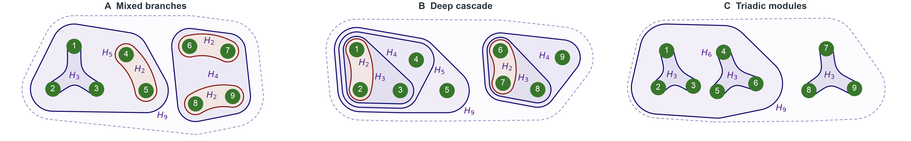

A 左侧由 123 三元组与 45 节点对组成五节点分支，右侧由 67、89 两对组成四节点分支，两支再由九阶通道连接。每个机制使用独立驱动坐标，生成带噪公共信号，再由九个节点分别带独立噪声读取；图中包络表示源作用支持，读取结构在本段和第 9 节说明。B 的左支依次包含 12、123、1234、12345，右支依次包含 67、678、6789。C 包含 123、456、789 三个三元组，其中前两个再组成 123456。三例均有真实九阶通道。

绘图沿用参考图的绿色圆节点、酒红色二阶曲线、深蓝／浅紫高阶包络及九阶虚线边界。紫色 $H_m$ 标记连续的 $m$ 源机制。区域表示生成机制中的成员关系，不表示交互强度或空间距离，也不把推断树当成真网络。B/C 的节点使用独立超边相位通道，其嵌套支持不意味着跨层反馈或逐级传播。

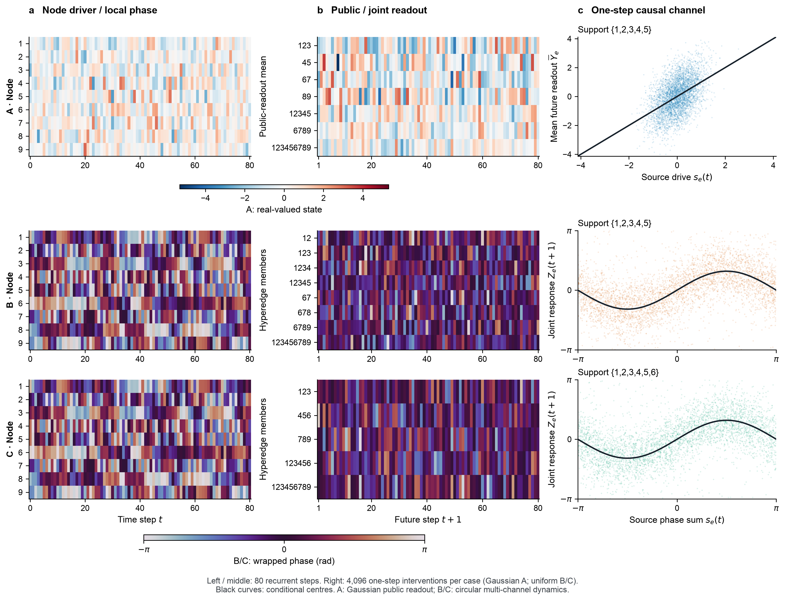

动力学图的三行依次为 A、B、C。A 使用实值色标，B/C 使用圆周色标，数值不能跨色标直接比较。

- 左列：A 显示九个节点的第一通道驱动 $D_{i,1}(t)$，B/C 显示九个局部相位。均连续迭代 80 步；B/C 共用全状态初值与逐步相同的局部噪声，其局部轨迹逐点相同。A 独立采用完整 126 维标准高斯初始化。
- 中列：A 显示七个实际机制在九个未来节点的平均读出；B/C 显示每条实际超边的完整联合读出 $Z_e(t+1)=\operatorname{wrap}[\sum_{i\in e}(r_{i,e}(t+1)-\omega_i\tau)]$。A 的平均读出是可视化用充分统计量，信息计算仍使用完整 126 维未来状态。B/C 的未激活均匀填充通道不显示。
- 右列：每例另取 4096 个完整状态的一步独立干预，均选择最大非根支持。A 使用独立标准高斯干预，显示 $s_e(t)=\sum_{i\in e}w_{e,i}D_{i,e}(t)$ 与九节点平均未来读出，当前 $e=12345$，黑线为条件均值。B/C 使用完整 81 维独立均匀相位干预，显示 $s_e(t)$ 与 $Z_e(t+1)$，黑线为 $\sin s_e$。所有样本均显示。

左／中列在初始化后自由迭代，右列每个点重新独立干预；时序只展示机制运行，未用于重估 EI/Syn。seed 固定为 20261014。B/C 的实际数据和更新核保持不变。旧九节点相位 A 可用 `--legacy-phase-a` 在单独输出目录复现，旧比较结果仍在第 1–2 节。

检查确认 B/C 状态始终位于圆周支持内、局部轨迹完全配对；其残差圆周均值均为 −.00422 rad，合向量长度均为 .69585，理论值约 .69777。A 的真实采样器另用精确条件 TM 检查，见第 9 节。模拟便宜，不另保存轨迹缓存。

```bash
OPENBLAS_NUM_THREADS=1 OMP_NUM_THREADS=1 .venv/bin/python scripts/plot_spt_continuous_original_dynamics.py
# 只重绘原始结构，复用参考图的节点布局和曲线渲染：
OPENBLAS_NUM_THREADS=1 OMP_NUM_THREADS=1 .venv/bin/python scripts/plot_spt_continuous_original_dynamics.py --networks-only
```

实现见[原始结构与动力学绘图](../../scripts/plot_spt_continuous_original_dynamics.py)。两张 PNG 已检查文字、颜色、坐标和裁切，图例均位于绘图区外。

本节重新定位 Zotero `P6UJCVG8` 并核对题名，重新列出附件、取得主文 `DXGC7JEA` 和 SI `MWIWKSVG` 的相关全文。方法边界依据仍为 Methods p15 式（4）–（5）与 SI S1.2 pp3–4；附件无明确稿件版本日期的歧义保留。图中多通道相位机制来自本项目修正方案式（4）–（6），不将其描述为手稿中已包含的原始动力学模型。

## 7. 先前的 A：可由归一化修复的等强度公共读出反例

本轮执行用户指定聊天中最新连续反例的轻量数值核验，固定其四节点、噪声方差与高斯干预，未扩展为九节点，也未训练估计器或扫描参数。定义与原推导见[设计文档第 8.1 节](../ref/spt_hierarchy_comparison_design.md)。

四个节点均为 $\mathbf{x}_i=(D_i,Y_{i1},Y_{i2})^\top$。对全部 12 个当前坐标施加独立 $\mathcal N(0,1)$ 干预，即固定每坐标均值 0、方差 1 的最大熵分布。当前读出不参与更新；一步动力学为

$$
\begin{aligned}
Z_1&=D_1+D_2+\varepsilon_1,& Z_2&=D_3+D_4+\varepsilon_2,\\
Y_{ig}(t+1)&=Z_g+\eta_{ig},&
\mathbf{x}_i(t+1)&=(U_i,Y_{i1}(t+1),Y_{i2}(t+1))^\top.
\end{aligned}
$$

$\varepsilon_g,\eta_{ig},U_i$ 相互独立且均为标准高斯；同一个 $\varepsilon_g$ 随公共信号共享，各节点的 $\eta_{ig}$ 独立。SPT 始终以完整 12 维未来状态为 target。真值来自两个混合通道的源系数支持 12、34；不存在额外的四阶源机制。

实现构造一个完整 24 维跨时联合，使用真协方差的 Cholesky 三角 TM 计算所有信息查询。这里高斯密度就是生成模型，不是将非高斯系统近似成高斯。全部 225 个非空 source/group-target 互信息与独立充分统计量公式核对，最大差为 **9.99e-16 nats**。联合秩为 24，最小特征值为 **.3667504193**，Cholesky 重构最大误差 **4.44e-16**；采样器的条件 TM 参考检查使用 8192 个 iid 样本，条件密度与独立高斯密度实现的最大差为 **7.11e-15 nats**。

全部七个根二分的数值核验与引用聊天的解析结论一致：

| 根二分类型 | 数量 | SPT raw Syn（nats） | 未归一化 Block-ΦR（nats） |
|---|---:|---:|---:|
| 正确模块 12 \| 34 | 1 | 0（浮点值 2.22e-16） | .5318625148 |
| 任意单节点 \| 其余三节点 | 4 | .1100309424 | .3190286071 |
| 交错 13 \| 24、14 \| 23 | 2 | .2200618848 | .6190392084 |

错误 singleton 的 Block 分数比正确根低 **.2128339077 nats**。SPT 的原标签树为 `((1,2),(3,4))`；Block 为 `(1,(2,(3,4)))`，恢复一个真模块并增加一个错误三节点 clade。枚举全部 24 个标签双射，SPT 的 F1／根恢复率始终为 1／1，Block 始终为 .5／0；标签只改变其切开哪个模块。它们是标签敏感性枚举，不是 24 次物理系统重复。

预设 Syn 容差仍为 **1e-8 nats**。每个标签计算全部 15 项 EI、25 个二分，24 × 25 项的最小 raw Syn 为 **−4.44e-16 nats**，显著违规 **0**；容差内负值共 **144** 个重复记录，保留原值，未裁剪或投影。全部树闭合误差为 0。根 Ξ 为 **.2200618848 nats**，根 residual 的数值零对应两个独立源通道。

以下保留先前等强度 A 的比较，当前图与当前 A 结果见第 9 节。

| 方法 | 先前 A：F1 / 根恢复率 | B：F1 / 根恢复率 | C：F1 / 根恢复率 |
|---|---:|---:|---:|
| SPT | 1.000 / 1.000 | 1.000 / 1.000 | 1.000 / 1.000 |
| 未归一化 Block-ΦR | .500 / .000 | 1.000 / 1.000 | 1.000 / 1.000 |
| pair-ΦR + HAC | 1.000 / 1.000 | .330 / .000 | .000 / .000* |
| pair-Ξ + HAC | 1.000 / 1.000 | .330 / .000 | .000 / .000* |
| future-MI + HAC | .167 / .000 | .330 / .000 | .000 / .000* |

\* C 的成对方法无结构信息，未输出树。A 没有非最小的非根真支持，上层召回标为 **N/A**，不赋零分。A 使用全部 24 个标签，B/C 复用第 1 节已通过审计的 240／60 条记录；各例分开汇总，不计算跨模型总体分数。

成对 ΦR 和成对 Ξ 在新 A 上都成功，应保留这一结果。A 的 future-MI 矩阵因公共读出而所有非对角元素相同，HAC 的平局细分偶尔吻合某个真模块；.167 是所有标签的描述性均值。A 检验未归一化 Block 的单侧大组偏好，B/C 检验成对压缩丢失上层支持，两类证据的作用不同。

按 $\Phi_R/\min(|L|,|R|)$ 归一化后，正确根分数为 .2659312574，小于 singleton 的 .3190286071；该独立控制在全部 24 个标签下 F1／根恢复率均为 1／1。因此本例的失败结论仅针对当前未归一化递归适配，不推广到所有 Block-ΦR 或 MIP 归一化。原九标量模型的积分精度问题仍保留原记录。

实现与内部数值记录：[四节点模型与核验](../../scripts/spt_continuous_broadcast_case.py)、[解析结果](../../results/spt_continuous_broadcast_case/summary.json)。复现如下：

```bash
OPENBLAS_NUM_THREADS=1 OMP_NUM_THREADS=1 .venv/bin/python scripts/spt_continuous_broadcast_case.py
OPENBLAS_NUM_THREADS=1 OMP_NUM_THREADS=1 .venv/bin/python scripts/plot_spt_continuous_original_dynamics.py --symmetric-a --output results/spt_continuous_broadcast_case/figures
OPENBLAS_NUM_THREADS=1 OMP_NUM_THREADS=1 .venv/bin/python scripts/plot_spt_continuous_refinement.py --replacement-a results/spt_continuous_broadcast_case/summary.json --current-only --output results/spt_continuous_broadcast_case/figures
OPENBLAS_NUM_THREADS=1 OMP_NUM_THREADS=1 .venv/bin/python -m pytest tests/test_spt_continuous_phase_benchmark.py tests/test_spt_core.py -q
```

本轮 **16/16 测试通过**，增加了全秩 TM 与充分统计量公式对照、全部标签的失败／归一化修复，以及严格根分数差检查。结构、动力学和对比三图均按实际输出作视觉核对，图例或说明不覆盖数据。

本任务再次核验 Zotero 父项 `P6UJCVG8` 题名并重新列出附件，读取当前主文 `DXGC7JEA` Methods pp15–17 式（4）–（12）及 SI `MWIWKSVG` S1.2 pp3–4、S5 pp8–9。附件仍无明确稿件日期／版本号，歧义保留。Gaussian 最大熵干预、完整 target、共同联合和标准 SPT 目标均沿用手稿定义；带噪公共读出是引用聊天新增的验证模型，不声称其已写入手稿。

## 8. 先前四节点 A：归一化 Block-ΦR 仍严格分错的连续例子

2026-10-14。按用户要求，用不等输入强度替换第 7 节的等强度 A。保留四节点、每节点三个实数坐标、独立标准高斯全状态干预、完整未来 target、一步时距及所有噪声方差 1，只将两个混合通道改为

$$
Z_1=D_1+\tfrac12D_2+\varepsilon_1,\qquad
Z_2=D_3+\tfrac12D_4+\varepsilon_2.
$$

仍令 $Y_{ig}(t+1)=Z_g+\eta_{ig}$、$\mathbf{x}_i(t+1)=(U_i,Y_{i1}(t+1),Y_{i2}(t+1))^\top$。所有当前坐标独立服从 $\mathcal N(0,1)$，全部噪声相互独立，只有同一通道的 $\varepsilon_g$ 随公共信号共享。两个真实源支持仍为 **12、34**，由方程的非零系数确定，而非按 SPT 输出指定。系数 $1,1/2$ 是构造反例时选定的简单有理数；本结果是开发阶段的反例验证，不是随机系统上的确认性优越性比较。

**所检验的归一化。** 在当前节点 $A=L\mathbin{\dot\cup}R$ 上，先按[设计文档第 6 节](../ref/spt_hierarchy_comparison_design.md)定义的 MMI 冗余计算

$$
\Phi_R(L,R)=I(\mathbf{x}_A;\mathbf{y}_A)-I(\mathbf{x}_L;\mathbf{y}_L)
-I(\mathbf{x}_R;\mathbf{y}_R)
+\min_{U,V\in\{L,R\}}I(\mathbf{x}_U;\mathbf{y}_V),\qquad
J(L,R)=\frac{\Phi_R(L,R)}{\min(|L|,|R|)}.
$$

每层最小化 $J$ 并递归到单节点；分母按节点数计，未改成微分熵或其他 MIP 归一化。SPT 仍使用完整四节点未来目标，最小化 raw Syn residual。各方法读取同一 24 维跨时联合，Block 的局部目标随递归节点改变。

**信息量的独立解析式。** 设目标组 $T$ 含 $k$ 个节点，$a_k=1+1/k$，$w_1=w_3=1$、$w_2=w_4=1/2$，$E_1=\{1,2\}$、$E_2=\{3,4\}$，$q_g(S)=\sum_{i\in S\cap E_g}w_i^2$。每通道的四个观测可取组内平均，独立观测噪声方差变成 $1/k$，共享噪声方差仍为 1，因此

$$
I(\mathbf{x}_S;\mathbf{y}_T)
=\frac12\sum_{g=1}^2\log\frac{a_k+5/4}{a_k+5/4-q_g(S)}.
$$

**命题：该归一化在本模型中不能恢复两个真实模块。** 正确根 $12\mid34$ 的 raw Syn 为 0。切开一个模块的 residual 为 $\delta=\tfrac12\log(27/25)=.0384805206$ nats，切开两个模块为 $2\delta$；故 SPT 的正确根具有严格优势。对归一化 Block，正确分数和剥离弱输入的分数分别为

$$
J(12,34)=\tfrac14\log(24/11)=.1950396394,
\qquad J(123,4)=\tfrac12\log(1216/961)=.1176738268.
$$

由于 $(1216/961)^2<24/11$，错误划分严格更优。即使限制成两侧等大的候选，仍有 $J(13,24)=\tfrac12\log(14/11)=.1205810284<J(12,34)$：把两个强输入放在一起也优于真实模块。故失败不能仅归于 1∣3 与 2∣2 的规模差异。全部七个根候选为：

| 根二分 | 数量 | raw Syn（nats） | raw Block-ΦR（nats） | 归一化 Block 分数（越小越优） |
|---|---:|---:|---:|---:|
| 正确 12 ∣ 34 | 1 | 0 | .3900792788 | .1950396394 |
| 剥离弱输入 2 ∣ 134、4 ∣ 123 | 2 | .0384805206 | .1176738268 | **.1176738268** |
| 剥离强输入 1 ∣ 234、3 ∣ 124 | 2 | .0384805206 | .3115565923 | .3115565923 |
| 强输入 ∣ 弱输入 13 ∣ 24 | 1 | .0769610411 | .2411620568 | .1205810284 |
| 混合交错 14 ∣ 23 | 1 | .0769610411 | .4194995288 | .2097497644 |

正确根与错误最小值差为 **.0773658126**。两个最优错误划分互为对称；它们与正确根之间并非平局。原标签下两种 Block 均先剥离 4；在剩余 123 中，$12\mid3$、$13\mid2$、$1\mid23$ 的分数分别为 .2724054520、.1234882300、.3018257020，继续剥离 2，最终树为 `(((1,3),2),4)`。两个真模块均未恢复，错误强输入 clade 为 13。

以下保留四节点 A 的历史结果，当前九节点 A 的图与结果见第 9 节。

| 方法 | 先前四节点 A：F1 / 根恢复率 | B：F1 / 根恢复率 | C：F1 / 根恢复率 |
|---|---:|---:|---:|
| SPT | 1.000 / 1.000 | 1.000 / 1.000 | 1.000 / 1.000 |
| 未归一化 Block-ΦR | .000 / .000 | 1.000 / 1.000 | 1.000 / 1.000 |
| 归一化 Block-ΦR | .000 / .000 | .808 / 1.000 | 1.000 / 1.000 |
| pair-ΦR + HAC | .000 / .000 | .330 / .000 | .000 / .000* |
| pair-Ξ + HAC | 1.000 / 1.000 | .330 / .000 | .000 / .000* |
| future-MI + HAC | .167 / .000 | .330 / .000 | .000 / .000* |

A 枚举全部 24 个标签，SPT 和 pair-Ξ 均完整恢复，两个 Block 和 pair-ΦR 均 F1=0。future-MI 仍为常数成对矩阵，报告原平局规则下全部标签均值。A 没有非最小非根支持，上层召回为 N/A。\* C 成对方法因零亲和度未输出树。

B/C 复用原相位模型及 240／60 条标签与架构记录，新增归一化行直接重算原模型的信息查询，未将 raw Block 结果冒充归一化结果。B 的归一化上层召回为 .731667，F1 范围 [.714286, 1]。级联内部存在“跨 1 条通道除以 1”与“跨 2 条通道除以 2”的解析平局，原浮点最小值和标签规则影响细分；该均值只描述当前实现。C 的归一化结果保持全恢复。A 的错误则有上述严格间隔，不依赖这类浮点平局。三例分开汇总，不合成跨模型总体分数。

**数值有效性。** 采用已知全秩高斯联合的精确 Cholesky 三角 TM。联合秩 24，最小特征值 .4750621894；全部 225 个组间互信息与上述独立公式最大差 **8.33e-16 nats**。8192 个独立样本通过采样器／条件 TM 检查，条件密度对照最大差 **1.07e-14 nats**。全部 25 个二分候选均保存，完整递归遍历和全部标签均核验。

原生 Syn 容差固定为 **1e-8 nats**。24 × 25 个重复二分记录最小 raw Syn 为 **−8.88e-16 nats**，容差内负值 **120** 个，显著违规 **0**，闭合误差为 0；所有原值保留，无裁剪或非负投影。根系统 $\Xi=.0769610411$ nats。每个真二源模块的 Syn 为 .0384805206 nats，弱输入仍有非零机制贡献。

本结果说明，按节点数量归一化仍可将不等信息强度的输入错误聚合；不推论所有熵归一化或其他 Block-ΦR 版本均失败。该次比较使用四节点高斯 A 与九节点相位 B/C；未知模型拟合误差、连续时间反馈动力学与泛化性能未由本反例检验。

复现入口沿用[模型与核验](../../scripts/spt_continuous_broadcast_case.py)，等强度默认入口保留；新例使用 `--weighted` 并写入独立结果目录，未覆盖第 7 节的数据：

```bash
OPENBLAS_NUM_THREADS=1 OMP_NUM_THREADS=1 .venv/bin/python scripts/spt_continuous_broadcast_case.py --weighted
OPENBLAS_NUM_THREADS=1 OMP_NUM_THREADS=1 .venv/bin/python scripts/plot_spt_continuous_original_dynamics.py --four-node-a --output results/spt_normalized_block_counterexample/figures
OPENBLAS_NUM_THREADS=1 OMP_NUM_THREADS=1 .venv/bin/python scripts/plot_spt_continuous_refinement.py --replacement-a results/spt_normalized_block_counterexample/summary.json --current-only --output results/spt_normalized_block_counterexample/figures
OPENBLAS_NUM_THREADS=1 OMP_NUM_THREADS=1 .venv/bin/python -m pytest tests/test_spt_continuous_phase_benchmark.py tests/test_spt_core.py -q
```

本轮 **19/19 测试通过**，覆盖新例 TM／独立公式、全部标签的完整树、严格错误间隔、限制等规模切分仍失败，以及相位归一化切分与独立跨通道计数的对照。结构、动力学、六方法比较三图均已视觉检查。

本任务重新通过 Zotero 核对父项 `P6UJCVG8` 的题名并列出附件，重新读取主文 `DXGC7JEA` 的 SPT Methods 式（10）–（12），及 SI `MWIWKSVG` S1.2、S5.1 的干预域与精确二分规则。仅一组主文／SI，仍无明确版本日期。Gaussian 干预属于固定均值／方差约束下的最大熵选择，与 B/C 的有界均匀干预分开声明；本次归一化仅用于 Block 比较，未更改标准 SPT 目标。

## 9. 当前九节点 A：嵌套结构与简洁绘图

2026-10-14。按用户要求，扩展 A 的真实机制，保持与 B/C 一致的九节点嵌套包络风格，并把公式、读出框和说明文字移出结构图。底层支持为 123、45、67、89，上层为 12345、6789，最外层为 123456789；它们均对应实际动力学通道。结构与动力学图位于第 6 节。

令 $\mathcal E$ 为这七个支持的集合。每个节点包含七个独立驱动与七个读出，$\mathbf{x}_i=(D_{i,1},\ldots,D_{i,7},Y_{i,1},\ldots,Y_{i,7})^\top$，在全部 126 个当前坐标上施加独立标准高斯干预。对每个 $e\in\mathcal E$，定义一步更新

$$
Z_e(t)=\sum_{i\in e}w_{e,i}D_{i,e}(t)+\varepsilon_e(t),\qquad
Y_{i,e}(t+1)=Z_e(t)+\eta_{i,e}(t),\qquad D_{i,e}(t+1)=U_{i,e}(t).
$$

$\varepsilon_e,\eta_{i,e},U_{i,e}$ 在通道、节点、时刻上独立且均为标准高斯；同一 $Z_e$ 由所有九个节点分别读取。不同支持使用不同驱动坐标，因此通道独立，嵌套不代表逐级反馈。SPT 仍以完整 126 维未来状态为固定 target。

固定底层 123 的权重为 $(1,1/2,1/2)$，各二元组按节点序为 $(1,1/2)$；五阶、四阶通道的所有非零权重均为 $1/4$，九阶通道均为 $1/8$，支持外权重为零。该结构扩展只验证这一组简单有理数系数，未扫描参数。包络和 $H_m$ 表示非零系数的源支持，不代表等强度，也不将 SPT residual 解释成纯阶 PID atom。

**精确 TM 与独立信息公式。** 生成模型是全秩高斯，构造完整 252 维跨时联合，并按七个独立通道分解 Cholesky 三角 TM。未使用学习得到的协方差近似。设 $v_e=\sum_{i\in e}w_{e,i}^2$、$q_e(S)=\sum_{i\in S\cap e}w_{e,i}^2$，目标组有 $k$ 个节点，则独立充分统计量推导给出

$$
I(\mathbf{x}_S;\mathbf{y}_T)
=\frac12\sum_{e\in\mathcal E}\log\frac{1+1/k+v_e}{1+1/k+v_e-q_e(S)}.
$$

该式与 TM 计算在全部 511 个非空源组 × 九种目标组规模上比较，共 4599 项，最大差 **4.89e-15 nats**。目标节点为可交换公共读出，故覆盖 511²=261121 个 source/group-target 查询。另取 32 个随机源／目标组，直接与完整 252 维协方差的 Cholesky 信息量对照，最大差 **2.89e-15 nats**；全部未来成对互信息对照误差 **1.78e-15 nats**。联合秩为 252，最小特征值 **.4151996215**。真实采样器用 8192 个独立样本核验条件 TM，密度对照最大差 **1.71e-13 nats**。

**分组结果。** 枚举全部 255 个根二分。正确根 $12345\mid6789$ 的 raw Syn 为 **.0017523003 nats**，归一化 Block 分数为 **.2336872031**。归一化 Block 选择 $1456789\mid23$，其 raw Syn 为 .0880824984 nats，Block 分数却只有 **.1421417858**，严格低 **.0915454174**。因此增加嵌套层次后，错误仍有明确分数优势。完整递归后，两个 Block 都丢失所有六个非根真实支持；三元组内部的任意二叉细分沿用 B/C 的评分规则，不计为额外错误。

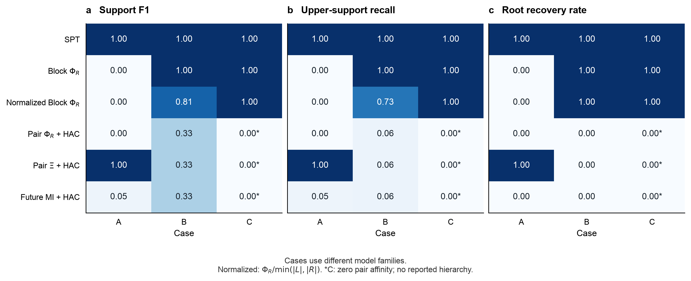

| 方法 | A：F1 / 上层召回 / 根恢复率 | B：F1 / 上层召回 / 根恢复率 | C：F1 / 上层召回 / 根恢复率 |
|---|---:|---:|---:|
| SPT | 1.000 / 1.000 / 1.000 | 1.000 / 1.000 / 1.000 | 1.000 / 1.000 / 1.000 |
| 未归一化 Block-ΦR | .000 / .000 / .000 | 1.000 / 1.000 / 1.000 | 1.000 / 1.000 / 1.000 |
| 归一化 Block-ΦR | .000 / .000 / .000 | .808 / .732 / 1.000 | 1.000 / 1.000 / 1.000 |
| pair-ΦR + HAC | .000 / .000 / .000 | .330 / .062 / .000 | .000 / .000 / .000* |
| pair-Ξ + HAC | 1.000 / 1.000 / 1.000 | .330 / .062 / .000 | .000 / .000 / .000* |
| future-MI + HAC | .047 / .050 / .000 | .330 / .062 / .000 | .000 / .000 / .000* |

A 使用原相位 B/C 的同一套 20 个标签：原标签及 seed=20261013 的 19 个双射；它们是标签敏感性检查，不是物理重复。A 未枚举全部 9! 个标签。B/C 的 240／60 条记录及动力学不变。\* C 的成对零亲和度方法不输出树。A 的 pair-Ξ 完整恢复，应保留该阳性结果；future-MI 的常数矩阵仅产生平局细分。模型族及状态维数仍不相同，不作跨例总体优越性推断。

**原生 Syn 有效性。** 容差继续固定为 **1e-8 nats**。每个标签检查全部 9330 个二分，20 个标签的最小 raw Syn 为 **7.9896864e-5 nats**，容差内负数 **0**，显著违规 **0**，闭合误差为 0；没有裁剪、投影或把小信号重设为零。根系统 $\Xi=.2438707276$ nats。

实现见[九节点嵌套模型](../../scripts/spt_nested_broadcast_case.py)。结果使用独立目录，先前四节点数据保留；绘图入口增加 `--four-node-a` 复现第 8 节版本，`--symmetric-a` 复现第 7 节版本。

```bash
OPENBLAS_NUM_THREADS=1 OMP_NUM_THREADS=1 .venv/bin/python scripts/spt_nested_broadcast_case.py
OPENBLAS_NUM_THREADS=1 OMP_NUM_THREADS=1 .venv/bin/python scripts/plot_spt_continuous_original_dynamics.py
OPENBLAS_NUM_THREADS=1 OMP_NUM_THREADS=1 .venv/bin/python scripts/plot_spt_continuous_refinement.py --replacement-a results/spt_nested_broadcast_case/summary.json --current-only
OPENBLAS_NUM_THREADS=1 OMP_NUM_THREADS=1 .venv/bin/python -m pytest tests/test_spt_continuous_phase_benchmark.py tests/test_spt_core.py -q
```

本轮 **20/20 测试通过**。新增测试覆盖 252 维联合、信息量分解、全部未来成对查询、共同标签下的完整恢复／失败及严格根分数差。三张输出图均已视觉检查，结构图的全部包络成员关系、嵌套边界及标记间距另经渲染检查。

本轮再次从 Zotero 核对父项 `P6UJCVG8` 的题名与附件，并重新读取主文 `DXGC7JEA` Methods 式（10）–（12）及 SI `MWIWKSVG` S1.2、S5.1。仍只有这一组主文／SI，无明确稿件版本日期。新增嵌套高斯模型为本项目的构造验证；共同干预、固定完整 target、raw Syn 与精确二分遵循所读定义，不声称手稿已包含该模型或已验证未知动力学学习。

## 10. 当前三面板主图：更新 c，删除 d

2026-10-14。按用户要求，主图保留 a 的非比例干预概念图和 b 的原始共驱动比较图，将 c 更新为当前连续系统案例，并删除原独立 Kuramoto 面板 d。a/b 使用已有原始 PNG，不数字化、重估或改变其数值曲线；全图重新排版为 5,400 × 3,960 像素。

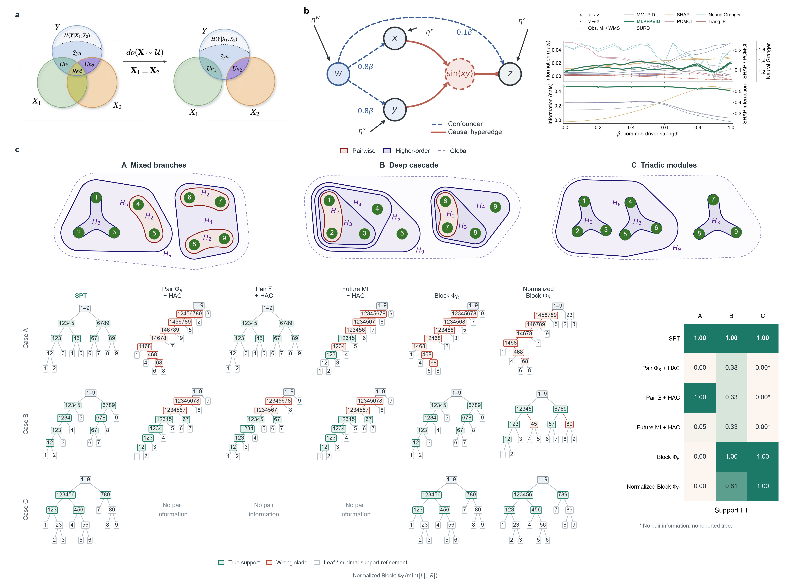

c 顶部沿用第 6 节 A/B/C 的真实源支持和简洁包络，采用 $H_m$ 标记连续机制。下方逐行显示 Case A、B、C，逐列为 SPT、pair-ΦR+HAC、pair-Ξ+HAC、future-MI+HAC、未归一化 Block-ΦR、归一化 Block-ΦR。代表树统一固定原标签、variant 0，不按方法胜负挑选；绿色为真实支持，红色虚线分支为错误 clade，灰白节点为叶子或不计分的最小支持内部细分。C 的三种成对方法均为“无成对信息”，不补画任意二叉树。

右侧 Support F1 使用 A 的全部 20 个标签、B 的 12 种架构 × 20 个标签、C 的 3 种架构 × 20 个标签，分别汇总，数值与第 9 节一致。代表树来自其中一个固定标签，分数是全标签与架构均值，二者不混为单树成绩。A 的 pair-Ξ 完整恢复以及 B/C 的 Block 成功均保留。归一化规则为 $\Phi_R/\min(|L|,|R|)$；原 Copied／Shared 行及 parity 标记不再用于当前 c。三例均为连续状态，A 为高斯公共读出，B/C 为圆周相位；状态维数及干预分布的差异仍适用。

本次仅复用已有模型结果并重绘；未训练、模拟或搜索新模型。载入全部 320 条记录时重新检查原生 Syn 容差 **1e-8 nats**、无显著非负违规、无裁剪／投影及贡献闭合，并保留原值。所有网络区域的成员关系、完整边界嵌套及 $H_m$ 间距经渲染检查；全部树节点框另作成对重叠检查，最终 PNG 已视觉核对。

输入记录的最小 raw Syn 为 **−8.88e-16 nats**，容差内负残差合计 **170328** 个重复二分记录，显著违规 **0**；标签重复不解释为独立误差事件。数值原值及计数沿用各原生结果，没有为拼图重新截断或修正。

默认入口生成当前三面板图；先前四面板 PNG 及其原始结果保留，增加 `--legacy` 可重绘历史版本：

```bash
OPENBLAS_NUM_THREADS=1 OMP_NUM_THREADS=1 .venv/bin/python scripts/compose_spt_framework_comparison.py
```

本轮重新通过 Zotero 核对父项 `P6UJCVG8` 的题名和附件，重新获取正文 `DXGC7JEA` Methods 式（10）–（12）及 SI `MWIWKSVG` S5.1 的全文。附件仍为唯一主文／SI、无明确版本日期；本次更新只改变主图组织，不改变 SPT 方法定义。

### 10.1 评估记录数与 F1 汇总（论文附录内容）

按用户要求，主图及当前独立对比图的列标只保留 **A、B、C**，不再显示括号中的 20、240、60，也不在图底写标签／架构重复安排。以下评估规模、标签方案和计分细节留在本 Markdown；整理成论文时纳入**附录／补充方法**，不放进正文主图。

三个案例均为九节点。A 固定一个嵌套高斯结构，配合 20 种节点标签排列，共 20 条评估记录。B 包含 12 种级联结构，即左支三个节点的 3! 种加入顺序与右支两个节点的 2! 种加入顺序组合，每种结构配合同一套 20 个标签，共 240 条记录。C 包含三种三元模块组合，每种使用同一套 20 个标签，共 60 条记录。20 个标签由原标签及 seed=20261013 生成的 19 个双射组成，用于检查编号及平局敏感性；这些记录数不是节点数、动力学采样点数或独立物理重复，不据此构造物理置信区间。

F1 以真实机制的非根源支持为真值，按节点成员集合完全相等判断命中。设 TP 为正确恢复的支持数，FP 为误报支持数，FN 为遗漏支持数，则

$$
P=\frac{\mathrm{TP}}{\mathrm{TP}+\mathrm{FP}},\qquad
R=\frac{\mathrm{TP}}{\mathrm{TP}+\mathrm{FN}},\qquad
F1=\frac{2PR}{P+R}
=\frac{2\mathrm{TP}}{2\mathrm{TP}+\mathrm{FP}+\mathrm{FN}}.
$$

共同的九节点根与单节点不计分。对所有方法一致忽略最小真实支持内部的真子集细分，例如 A 的 123 内部出现 12，不加分也不扣分。A 的六个计分真支持为 123、45、67、89、12345、6789。若恢复四个并误报两个，则 TP=4、FP=2、FN=2，F1=2/3。当 P+R=0 时 F1 定义为 0，包括未报告任何支持或所报支持全部错误；C 的无成对信息方法使用这一约定，不制造任意聚类树。

热图先逐条记录计算 F1，再在每个案例内对全部架构与标签等权平均；不把不同案例混合，也不先汇总 TP／FP／FN 再计算一个总分。代表树固定为原标签、variant 0，不能将其成绩当作均值。平均 F1=0.81 表示支持恢复分数为 0.81，不表示 81% 的记录恢复了整棵树。

## 11. 有限数据端到端仿射 TM 试验

2026-10-14 预声明协议。用户已批准 A/B/C 仿射 TM 首轮试验，预计纯计算 5–10 分钟，计算上限 600 秒；不启动更重的非线性模型训练。当前主图保留已知模型结果，有限数据试验另作图。以下协议在正式采样前固定。

固定当前三例的原标签、variant 0、九个节点、完整未来状态与一步时距。A 保留 126 维独立标准高斯干预；B/C 保留 81 维独立圆周均匀干预。训练规模为 4096、16384、65536，独立采样种子为 0、1、2；每个种子使用嵌套训练前缀和独立的 8192 个测试样本。重复单位为独立采样数据集，不把节点标签排列当作物理重复。本轮不展开 B/C 的全部架构变体。

拟合器只接收成对源／未来样本及已注册干预域，不读取真实支持、系数、噪声协方差或解析 EI。A 使用原坐标；B/C 对每个相位使用固定双射 $z=\Phi^{-1}(\theta/(2\pi))$，将已注册均匀源变成独立标准高斯；输出使用同一坐标变换并在原空间密度中计入 Jacobian。该变换保持 EI，但仿射条件密度族不能充分表达一般圆周高阶关系，B/C 的结果同时反映模型表达误差。

使用全部输入／输出坐标拟合一个稠密仿射条件均值和完整残差协方差，再构造一个统一的条件三角 TM。均值回归的平均平方损失 ridge 固定为 1e-6，残差协方差采用回归自由度修正后统一加 1e-6 对角项；不做机制分块、边阈值或真支持筛选。源干预维持注册的独立标准高斯先验，而非改用带有限样本相关的经验源分布。

EI 取拟合条件模型与注册干预共同诱导联合上的互信息，使用同一已学习 TM 的一致边缘与高斯积分公式；这是**模型介导的 EI 估计**，不是再次调用生成模型真参数。它有别于 SI 式（S13）–（S15）的分别拟合／有限样本 log-density-ratio 估计，因而不额外套用其 Wishart 偏差项。独立测试集用于预测对数密度、相对真实条件密度的损失及参考分布诊断，不用于调参或挑选结果。

所有 511 个非空源组与 9330 个二分使用共同拟合联合，原生 Syn 容差固定为 **1e-8 nats**；显著违规立即停止该条件的下游构树，记录最小值、阈值和受影响数。无裁剪／非负投影。各比较方法从同一拟合联合查询，SPT 使用标准 raw residual 目标。真实支持和解析信息量只在拟合与算法输出之后用于外部评分及误差计算。

主要输出为 SPT 的支持 F1、上层召回与根恢复；同时报告各基线、511 项 EI 的 RMSE、系统 Ξ 误差、独立测试集对数损失和 Syn 审计。三种采样重复全部保留，不选择成功 seed；参数和重复细节属于论文附录，图中不重复标签记录数。A 的模型族与真线性高斯系统匹配，B/C 属于仿射 TM 表达能力检查；不能以内部 Syn 非负代替密度拟合有效性。

本轮已重新定位 Zotero 父项 `P6UJCVG8` 并核对题名，重新读取唯一主文 `DXGC7JEA` Methods 式（10）–（12）和 SI `MWIWKSVG` S1.2 式（S7）–（S15）、S5.1。无明确稿件版本日期的歧义保留；本试验沿用干预、完整 target、raw Syn 与构树规则，明确标记上述模型介导估计与原 SI 估计路径的差异。

### 11.1 执行结果：A 恢复，B/C 暴露仿射模型失配

27 个预声明设置全部完成、全部有效，实际纯计算 **13.70 秒**，未触及 600 秒上限。正式结果不包含实现检查用的低样本 smoke run。以下均为三个独立采样数据集的等权均值；它们是开发性试验，未据三个重复估计确认性置信区间。

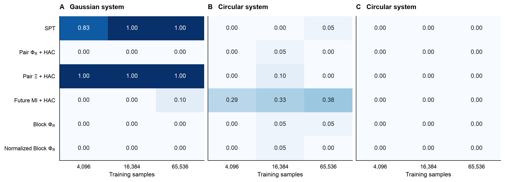

| 案例 | 训练样本 | SPT F1 | 上层召回 | 根恢复率 | EI RMSE / nats | 测试超额 NLL / nats |
|---|---:|---:|---:|---:|---:|---:|
| A | 4096 | .833 | .500 | .000 | 1.0203 | 3.1718 |
| A | 16384 | 1.000 | 1.000 | 1.000 | .2494 | .7543 |
| A | 65536 | 1.000 | 1.000 | 1.000 | .0631 | .1868 |
| B | 4096 | .000 | .000 | .000 | 1.6508 | 9.1860 |
| B | 16384 | .000 | .000 | .000 | 1.9789 | 8.2034 |
| B | 65536 | .048 | .067 | .000 | 2.0524 | 7.9642 |
| C | 4096 | .000 | .000 | .000 | 1.4841 | 7.5377 |
| C | 16384 | .000 | .000 | .000 | 1.8126 | 6.5574 |
| C | 65536 | .000 | .000 | .000 | 1.8875 | 6.3167 |

EI RMSE 对全部 511 个非空源组等权计算，target 始终为完整未来状态。测试超额 NLL 是独立测试样本上 `log p_true(future | source) − log p_fit(future | source)` 的均值，是条件密度失配的外部诊断；真条件密度只在拟合完成后用于这一诊断。NLL 是整个未来状态的总量，A 与 B/C 的维数和干预域不同，不作跨案例数值排名。图中散点为各采样数据集，连线为均值，各列纵轴尺度不同。

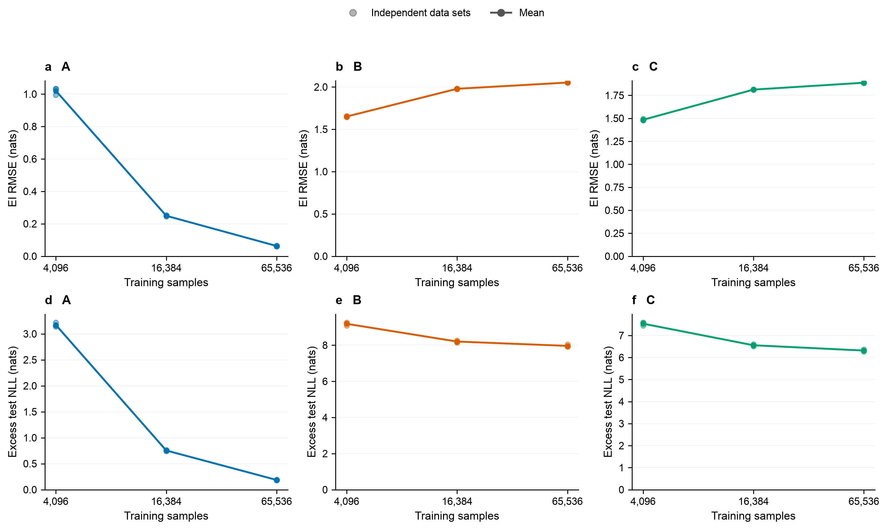

**A 的有限数据端到端结果为阳性。** 拟合器从样本学习全部稠密转移系数与残差协方差，没有读取七个真实机制支持。4096 个训练样本时，三个数据集均恢复六个计分支持中的五个，F1 均为 5/6；错误集中于上层组织，根均未恢复。16384 和 65536 个样本时，三个数据集均恢复全部计分支持与正确根。EI RMSE 和独立测试超额 NLL 随样本增加明显下降，符合正确仿射模型族中的有限样本误差。F1=1 表示树支持恢复，不表示全部 EI 数值已经无偏或精确。

**B/C 的这轮拟合不支持端到端成功。** B 在 65536 个样本时，三个 F1 为 0、0、1/7；C 全部为 0，二者均未恢复正确根。随着样本增加，EI RMSE 没有下降；拟合系统 Ξ 在最大样本量时分别仅为 **.0003130、.0003112 nats**，而真值为 **1.9951476、1.2469673 nats**。测试超额 NLL 虽有所下降，仍分别达到 7.9642、6.3167 nats；增加数据尚未消除密度失配。

该失效与模型结构一致：B/C 的高阶源作用体现为多个未来读出的联合关系，单个相位读出的边缘可保持均匀；逐坐标 Gaussianization 不会把这种关系自动变为线性条件均值和固定高斯残差。仿射族因此会丢失构树所需的高阶信息，更多样本主要减少这个受限模型的拟合波动。这是对**所用仿射 TM 表达能力**的负结果，不能解释为“真实 EI 下的 SPT 不恢复 B/C”，也不能推广为非线性 TM 无效。当前数据不足以将全部剩余误差严格分解为表达误差和有限样本误差。

其他方法使用同一拟合联合，全部结果保留。下表每格依次为训练样本 4096／16384／65536 的平均支持 F1；计分规则沿用第 10.1 节。

| 方法 | A | B | C |
|---|---|---|---|
| SPT | .833 / 1.000 / 1.000 | .000 / .000 / .048 | .000 / .000 / .000 |
| pair-ΦR + HAC | .000 / .000 / .000 | .000 / .048 / .000 | .000 / .000 / .000 |
| pair-Ξ + HAC | 1.000 / 1.000 / 1.000 | .000 / .095 / .000 | .000 / .000 / .000 |
| future-MI + HAC | .000 / .000 / .103 | .286 / .333 / .381 | .000 / .000 / .000 |
| 未归一化 Block-ΦR | .000 / .000 / .000 | .000 / .048 / .048 | .000 / .000 / .000 |
| 归一化 Block-ΦR | .000 / .000 / .000 | .000 / .048 / .000 | .000 / .000 / .000 |

A 的 pair-Ξ 在最小样本量就完整恢复，保留这一优于该条件 SPT 的结果。B 的 future-MI 对部分支持有恢复，但未恢复完整层级。这轮没有为任一方法按其成绩调整拟合器或参数，也没有展开标签敏感性重复。

**数值与流程审计。** 每个拟合模型检查全部 9330 个 raw Syn 二分，共 251910 项；全局最小值 **2.3100605e-6 nats**，预声明容差 **1e-8 nats**，容差内负数 **0**、显著违规 **0**、最大贡献闭合误差 **0**。无裁剪、单调投影或事后容差调整。这个审计证明拟合联合内部的一致性，不能替代与真实动力学的密度核验。测试集哈希在每个案例／种子的三个训练规模间一致，训练前缀哈希不同；训练与测试使用独立随机流。B/C 共用源样本，因机制数不同，不声称其全部噪声也配对。

新增验证覆盖已学习联合的信息量公式、固定独立源先验、圆周密度 Jacobian 与端点检查，以及实际采样后的完整 EI／Syn／SPT 流程。相关测试 **23/23 通过**；两张新图均已视觉检查，图例位于数据区域外。当前主图未替换成这轮学习结果。后续若验证 B/C 的恢复，需要可表达圆周高阶条件关系的非线性 TM，并另行固定训练与验证方案；本轮未启动该训练。

复现入口如下。拟合结果保存在轻量 JSON 内部缓存，绘图只读缓存、不重复拟合；没有默认生成 CSV。

```bash
OPENBLAS_NUM_THREADS=1 OMP_NUM_THREADS=1 .venv/bin/python scripts/spt_finite_data_tm.py
OPENBLAS_NUM_THREADS=1 OMP_NUM_THREADS=1 .venv/bin/python scripts/plot_spt_finite_data_tm.py
OPENBLAS_NUM_THREADS=1 OMP_NUM_THREADS=1 .venv/bin/python -m pytest tests/test_spt_continuous_phase_benchmark.py tests/test_spt_core.py -q
```

实现：[有限数据采样／拟合／估计入口](../../scripts/spt_finite_data_tm.py)、[缓存绘图入口](../../scripts/plot_spt_finite_data_tm.py)。内部缓存为 `results/spt_finite_data_tm/summary.json`，逐项保留估计与真 EI、树、误差、密度诊断、Syn 计数和数据哈希；`run.log` 记录正式执行进度。协议、采样重复、估计路径与手稿 SI 的差异以及本节数值审计，整理进论文时应放入附录／补充方法。

## 12. 高阶 TM 首轮方案与执行记录

2026-10-14。用户要求取消仅使用仿射 TM 的限制，允许高阶 TM 估计，并已批准下述 **A/B/C 首轮、40 分钟计算上限**。第 11 节的负结果仅针对仿射族，不作为一般 TM 的能力结论。以下协议在正式训练前固定。

本次重新通过本地 Zotero 核对父项 `P6UJCVG8` 题名与全部附件，并重新获取唯一主文 `DXGC7JEA` 和 SI `MWIWKSVG` 全文；附件元数据仍不含明确稿件日期／版本，不能用修改日期替代版本。方法依据为主文式（10）–（12）、SI S1.2 式（S7）–（S15）及 S5.1。SI 式（S9）–（S10）允许一般非线性单调三角 TM；式（S11）–（S15）是其中的仿射／固定特征近似，不把后者当作 TM 的上限。

**模型选择理由。** 仓库已有二／三阶多项式自回归 TM，但完整 162 维相位跨时联合在最后一个三角分量上，三阶全展开需要 721764 个基函数；A 的 252 维联合则需 2699004 个。这些数值包含常数项，来自所有总次数不超过三的单项式计数。现有实现还需构造基函数 Gram 矩阵，直接全展开不可作为轻量默认方案。只给变量附加平方／立方项后再拟合仿射 Gaussian，不等于已经使用一般非线性 TM。

推荐首轮使用**条件单调样条自回归三角 TM**，以共享神经条件网络表示多变量非线性依赖，避免完整多项式展开。B/C 使用圆周 Fourier 输入上下文及有界相位输出，样条的正对角导数、端点和圆周密度接缝必须显式检查；A 保留实数域和适配该域的单调映射。每个案例只学习一个完整条件联合，不按真实超边拆分、筛选输入或注入相位和。神经网络不是已知真机制，是否学到高阶关系须由独立诊断判断；三阶多项式次数、样条阶次与真实作用支持的节点数不能混为一谈。

建议执行范围与控制如下：

- A/B/C 各一组，固定原标签、variant 0、seed 0、训练样本 16384，复用第 11 节对应样本；干预分布、完整 target、一步时距和评分规则不变。与同一数据集上的仿射结果配对比较，不与三个仿射种子的均值混为配对差异。
- 另用独立随机流生成 4096 个验证样本；原有 8192 个测试样本只用于冻结模型后的开发性评价。已有测试结果已被观察，因此本轮不称为未触碰测试集上的确认性验证。
- 初始固定容量为两层 128 单元条件网络、每个标量 8 个样条区间、最多 50 个 epoch；验证 NLL 用于保存 checkpoint，不按 F1、真 EI 或真实支持选择。无超参数搜索，数据拟合与算法均不接收真支持和生成参数。
- 先做至多 5 分钟的支持／密度／耗时检查。若实现有效，则在总预算内依次完成训练、固定查询积分诊断和全表。先报告独立测试 NLL，再报告 EI 误差与恢复成绩，不因某一成绩不佳而删除案例。
- EI 沿用第 11 节的模型介导定义：注册独立输入先验乘上同一已学习条件密度；缺失源从这个联合边缘化。外层样本来自该拟合联合，独立真实测试样本用于拟合误差诊断，二者分开。不能分别为 511 个源组拟合不一致的联合／分母，也不能将高阶模型继续代入 Gaussian logdet 公式。
- 边缘积分先固定外层 256、内层 256／512 点及两个独立 scramble；固定查询包括完整源、九个 singleton，以及编号切分 12345|6789、123456|789 所需子集。检查重复差异、内层加密变化和权重集中；必要时只在预算内增至内层 1024。关键 EI 的最高两档变化目标为 .01 nats。未通过则报告积分未认证，不拼出完整恢复结论。
- 全表完成时审计全部 511 个 EI 与 9330 个 raw Syn，并构建标准精确递归 SPT。高阶数值积分单独预声明原生 Syn 容差 **.03 nats**，与仿射闭式计算的 **1e-8 nats** 分开报告；保留原始负值及计数。低于 −.03 nats 时停止该条件构树并记录最小值、阈值与受影响数，不裁剪、不投影、不按结果放宽容差。
- 本轮主要比较估计器对 SPT 的影响，不顺带重跑需要额外 group-target 边缘积分的全部六方法，也不展开标签置换或架构变体。独立样本／积分随机化不充当多个独立物理系统。

**预算与轻量替代。** 推荐以上三例单 seed 首轮，先预留约 **20–40 分钟计算、总上限 40 分钟**；这是未经高维样条计时的资源预算，不是运行时保证。到上限停止并保存已完成模型、查询与失败诊断，全表未完成则明确报告覆盖率。更轻的替代是只做 B/C 的高阶密度拟合与固定查询检查，约 **5–10 分钟、上限 10 分钟**，不承诺输出完整 SPT。扩展到三个种子、三个训练规模或更大的网络均不包含在此次预算内。

以上范围已依据仓库 `AGENTS.md` 的复杂工作流规则取得明确预算批准。未使用子代理，也不覆盖现有主图或仿射缓存。

### 12.1 训练前实现细节

模型使用两个 128 单元 SiLU 隐藏层；一个网络路径读取所有源上下文，另一路使用严格前序 mask 读取未来坐标历史，两路输出样条参数。后者不读取当前或之后的未来坐标。B/C 的源上下文为全部坐标的第一／第二 Fourier 谐波，历史同样周期化，样条首尾导数绑定；不输入真实超边、活跃通道或生成模型的相位和。每条一维条件映射单调归一化，其乘积定义完整条件密度。

A 先从同一训练数据学习稠密仿射条件均值与完整残差 Cholesky，再对残差学习带线性尾的单调样条；这只是拟合模型的数值预处理，不读取真实高斯参数。最初的恒等样条作为 epoch 0 验证候选，与之后的非线性 checkpoint 一起按验证 NLL 选择；若选择 epoch 0，须明确报告该样条修正未被数据支持，不能称为已学到非线性。

优化固定 Adam 学习率 5e-4、weight decay 1e-6、batch 512、梯度范数上限 10；每五个 epoch 检查验证 NLL，连续 15 个 epoch 无改善则停止，最大 50 个 epoch。梯度范数约束只用于优化稳定性，不作用于 EI／Syn。验证 seed 为 101，与 seed 0 的训练／测试随机流独立。生成训练数据时仍先生成原先的 65536 条再取 16384 前缀，以保持噪声消耗顺序和实际样本哈希一致。

积分实现固定在看到结果前：B/C 使用注册均匀源的直接 RQMC；A 使用**已学习仿射模型**的条件 Gaussian 后验作重要性 proposal，以 `p_spline(future|source) / p_affine(future|source)` 精确修正权重，乘回仿射模型解析边缘。该重要性恒等式仍积分同一非线性 TM，保留注册独立干预；不把仿射 proposal 的信息量冒充样条信息量，不使用真实动力学后验。两个 scramble 各有共同的 256 个拟合联合外层样本和逐行嵌套的 256／512／1024 内层前缀，所有子集共享分母。采用未经 jackknife 的原始 log-mixture 并检查加密差异，避免直接沿用未经本例校验的偏差外推。最高两档关键 EI 的最大变化超过 .01 nats 时停止完整构树，只交付拟合与积分诊断。

执行中的等价提速：A 按验证 NLL 选择 epoch 0 恒等样条后，对应的 spline／affine 重要性修正权重严格恒为 1。实现检测两个输出头的系数确实全零时，省略重复的内层网络计算，直接返回同一仿射边缘；**外层仍保持原先的有限 RQMC 样本与 EI 均值**，没有改用解析信息量或按 F1 调整估计器。原进程在保存全部模型后中断并从 checkpoint 继续；先前耗时计入同一个 2400 秒总预算。另用真正非恒等的源依赖样条，与独立 Gauss–Hermite 求积比较，验证重要性修正路径，而非只检验恒等特例。

### 12.2 执行结果：非线性密度改善，但 B/C 的 EI 积分未过关

三例拟合与预声明积分诊断均已完成，实验进程累计 **743.79 秒（12.40 分钟）**，包含中断前已用时间，未达到 40 分钟上限。B/C 按积分精度停止规则提前终止构树，不能将这两例标成 SPT F1=0。正式结果与第 11 节 seed 0、16384 样本的实际训练／测试哈希逐例一致；独立验证集只选择 checkpoint，不按真支持或 F1 调参。

| 案例 | 仿射测试超额 NLL | 样条测试超额 NLL | 样条相对改善 | 选择 epoch / 已训练 epoch |
|---|---:|---:|---:|---:|
| A | .7560 | .7560 | 数值上相同 | 0 / 15 |
| B | 8.2643 | 7.1851 | 1.0792 | 5 / 20 |
| C | 6.6001 | 5.4978 | 1.1024 | 5 / 20 |

单位均为每个完整未来样本的 nats，越低越好；这里的仿射对照是同一 seed 0 的值，不是第 11 节三个种子的均值。A 的 .0000019 nats 差异属于浮点实现差异，不称为改善。A 有 813220 个可训练参数，B/C 各 597040 个；该比较评价模型族整体差异，不声称参数容量或计算量相等。

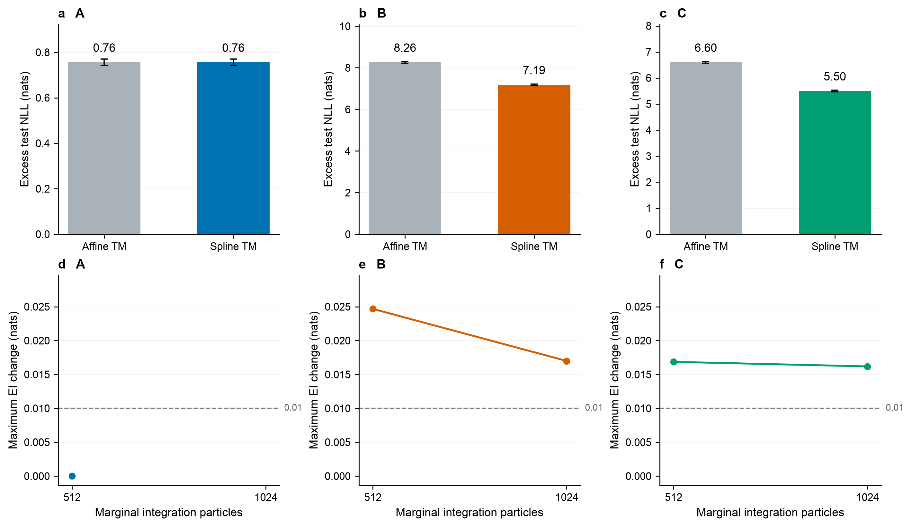

图上排为独立测试集超额 NLL，误差棒为 8192 个测试样本上逐样本超额 log loss 的 **1 SEM**，不代表训练种子不确定性。三例状态维数和域不同，上排采用各自尺度，只作每例内部的两模型比较。下排在共同纵轴上显示最高相邻内层精度间、全部固定查询及两个 scramble 的最大 EI 变化；虚线为 .01 nats 阈值。A 在 512 点已通过内层检查，因此未计算 1024 点；零变化点保持可见，不将未计算点补成零。图中不重复标签／采样重复细节。

**B/C 确实使用了非恒等非线性 TM。** 两例均选择训练后的 epoch 5，独立测试密度较仿射族改善约 1.1 nats，但仍明显偏离真实条件密度。这里使用有界样条的均匀辅助参考；再接固定的 Gaussian quantile 即得到 SI 式（S9）的标准 Gaussian 参考映射，两种写法的 Jacobian 给出相同原空间密度。预测密度改善不单独证明九节点高阶支持已被识别，也不证明 EI 已准确。

**积分检查没有允许 B/C 输出完整树。** 固定 14 个查询包含完整源、九个 singleton 以及两个编号根切分的子集。比较每个 scramble 自己的嵌套粒子前缀，而非只比较两个均值。

| 案例 | 256→512 最大 EI 变化 | 512→1024 最大 EI 变化 | 最后一级两个 scramble 的最大 EI 差 | 完整 EI／SPT 状态 |
|---|---:|---:|---:|---|
| A | .00000 | 未计算 | .10090 | 511 项完成；有限外层结果有波动 |
| B | .02468 | .01700 | .10981 | 内层未过 .01 阈值，不构树 |
| C | .01686 | .01619 | .10598 | 内层未过 .01 阈值，不构树 |

B/C 在 1024 点的共同分母权重 ESS，中位数分别约为 85–88 与 79–86，最小值约为 5.3–5.5 与 2.5–4.9。这些仅是权重集中诊断，不将 QMC 点当作独立 MC 样本来构造置信区间。内层加密仍有变化，加上约 .1 nats 的外层 scramble 差异，因此不能用这些数值声称完整层级恢复。停止依据是预声明积分阈值，不是发现 F1 不佳后隐藏结果。

在相同 14 个固定查询上，仿射与样条的真 EI RMSE 分别为 A：.18875／.18932，B：1.91692／1.50092，C：1.64220／1.20497 nats。B/C 有局部误差改善，但这些是**未认证积分下的诊断数值**，不能与第 11 节全部 511 项的 RMSE 混比。样条得到的系统 Ξ 诊断值约为 .29765、.30029 nats，仍远低于真值 1.99515、1.24697；剩余差异同时包含密度表达／拟合与积分误差，本轮未将二者严格分离。

**A 需要区分模型拟合和外层积分。** 验证 NLL 选择了 epoch 0，意味着其最终样条修正为恒等，没有证据表明本例需要额外非线性。在冻结同一个已学模型后，按协议用两个外层各 256 点的 EI 表取均值再构树，支持 F1 为 **5/6=.8333**、上层召回 .5、根未恢复；两个数值 scramble 单独构树的 F1 分别为 **5/6、2/3**。它们是同一模型的数值重复，不是两个训练数据集，不能把均值 EI 的 F1 与两个 F1 的均值混同。

为定位误差，另对这个已被选中的恒等样条模型计算解析 Gaussian MI 作**事后积分审计对照**，未替换正式的有限外层树。该对照的支持 F1 为 **1**，真 EI RMSE 为 .25196 nats；有限外层 EI 相对同一模型解析 EI 的 RMSE 为 **.02327 nats**。因此本轮 A 从解析积分的 1 降到有限积分的 .833，反映小分数差下的外层数值误差，不能归为非线性模型比仿射模型差。内层权重恒为 1 只消除了内层误差，不会自动消除外层误差或保证上层树稳定。

**Syn 原生审计。** 容差始终为预声明 **.03 nats**，并未沿用仿射闭式计算的 1e-8。A 均值 EI 表审计全部 9330 个二分，最小 raw Syn 为 **−.0057617038 nats**，容差内负数 **295**，显著违规 **0**，闭合误差 **0**；两个独立数值表的最小值分别为 −.0079383102、−.0085970382，容差内负数为 542、342，显著违规均为 0。全部原值保留，没有裁剪或投影；这些容差内残差仅作数值误差处理，不是负 Syn 的证据。

B/C 未计算完整 EI 表，因而**没有完整 9330 二分审计**。在已有固定查询中可以组成的四个二分，均值 raw Syn 的最小值分别为 .0183021、.0187012 nats，容差内负数及显著违规均为 0；此局部检查不能替代全表审计。B/C 的 SPT、上层召回、根恢复均标为**未评价**，不填零，不补任意树。三例当前主图均未改写为本轮学习结果。

实现验证 **31/31 测试通过**，包括严格前序依赖、单调 Jacobian 与密度公式、非恒等映射的逆、圆周归一化和接缝、非恒等重要性权重与独立求积、空信息对照以及显著 Syn 违规停止构树。正式本轮密度积分实际使用 CPU。另做的 MPS 加速可用性检查只作实现验证：一个冻结模型批次的最大 log-density 差为 3.05e-5 nats，小批 EI 对照差为 8.18e-6 nats；未用这两个批次替代正式估计。新入口支持选择计算设备；以下命令显式固定 CPU，以对应本节结果。最终 PNG 已视觉核对，阈值注记与误差棒不遮挡数据。

```bash
OPENBLAS_NUM_THREADS=1 OMP_NUM_THREADS=1 .venv/bin/python scripts/run_spt_spline_tm.py --density-device cpu
# 已有结果时复用三个模型和匹配的查询缓存，累计预算不重置：
OPENBLAS_NUM_THREADS=1 OMP_NUM_THREADS=1 .venv/bin/python scripts/run_spt_spline_tm.py --resume --density-device cpu
OPENBLAS_NUM_THREADS=1 OMP_NUM_THREADS=1 .venv/bin/python scripts/plot_spt_spline_tm.py
OPENBLAS_NUM_THREADS=1 OMP_NUM_THREADS=1 .venv/bin/python -m pytest tests/test_spt_spline_tm.py tests/test_spt_continuous_phase_benchmark.py tests/test_spt_core.py -q
```

模型与积分逻辑见[非线性条件 TM](../../scripts/spt_spline_tm.py)，执行见[首轮入口](../../scripts/run_spt_spline_tm.py)。`results/spt_finite_data_spline_tm/` 保留轻量 JSON 诊断、原生运行日志和三个模型权重，便于后续在冻结拟合器上专门改进积分，不默认生成 CSV。若继续，需分别处理 B/C 的高维边缘积分与密度失配，并增加外层精度检验；本次没有按结果扩大网络、训练预算或积分上限。这些拟合、积分误差与非负容差细节归入论文附录／补充方法。

### 12.3 当前 F1 状态与建议的改进顺序

2026-10-14。重新核对现存精确相位基准与有限数据缓存：已知模型精确 TM 的 B/C 支持 F1 均为 1；有限数据仿射 TM 在 65536 个训练样本时，三个数据集的平均 F1 分别为 .04762、0；当前非线性样条 TM 的 B/C 没有通过完整构树前的积分门槛，因此 F1 为未评价。不能把精确模型的 1 转述成有限数据恢复成功，也不能把非线性模型的未评价转述成 F1=0。

推荐先将两类误差分开做对照，而不是把更大的网络与更高积分预算同时改变：

1. **冻结现有已训练 TM，改善积分。** 为缺失源训练支持覆盖完整圆周、允许多峰的条件后验 proposal，并使用带已知密度的重要性权重和防御混合。所有源子集保留同一个条件联合、注册干预、完整未来 target 与共同分母。先对原来的固定查询比较均匀积分与后验引导积分，检查权重集中和加密变化，再决定是否运行全部 511 个 EI。proposal 不替代 EI 所定义的动力学联合，也不从真实生成方程读取后验。
2. **改善高阶关系的表示。** 当前源 Fourier 上下文只含逐坐标谐波，多变量组合由一个稠密网络自行学习；验证集在 epoch 5 之后变差，显示该配置已有泛化问题。可改用周期高阶 Fourier／张量乘积条件特征并加稀疏正则，从统一候选集合与训练／验证数据选择交互，不输入真实超边或按 F1 选模型。源的高阶组合和联合未来读出的关系都需表达。B/C 是独立通道构造，因此可另做按注册通道分解的 TM 对照，以降低单个拟合与积分的维数；这使用通道独立性作为明确的模型先验，不能表述为无结构先验的通用学习。
3. **以切分排序稳定性认证恢复。** 分别控制内层边缘积分和外层 EI 期望的误差，增加独立数值随机化，并检查最佳／次佳切分的配对分数差与根选择频率。通过全表非负审计后，再报告完整 SPT 的 F1、根恢复和上层召回，并用独立训练数据重复检验。整体 NLL 改善、总 Ξ 的大小或单个 EI 的变化阈值，都不能单独替代这个恢复评价。内外层误差分开控制与嵌套估计的收敛分析相符，参见 [Rainforth et al., ICML 2018](https://proceedings.mlr.press/v80/rainforth18a.html)。

这些是待验证的下一步方案，不是已取得的高 F1 结果。本次状态核对未启动新的训练或全表计算，也未修改已完成结果及其 .03 nats Syn 容差。重新从 Zotero 父项 `P6UJCVG8` 定位唯一正文 `DXGC7JEA` 与 SI `MWIWKSVG` 并获取全文；已读主文式（10）–（12）和 SI S1.2 的共同干预、一般单调 TM 与信息定义。附件仍无明确稿件版本／日期；本节建议以这组现存全文与仓库结果为依据，不声称稀疏 Fourier 方案已经写入或经手稿实验验证。

## 13. 保留 A、替换 B/C 的有限数据候选方案

2026-10-14。用户授权考虑保留当前 A，将难以完成有限数据估计的相位 B/C 换为两个容易可靠拟合、且能区分 SPT 与比较指标的连续案例。本节记录采样前声明的两个**固定构造**及解析设计核验（两例合计约 .61 秒，没有生成训练数据）。用户随后批准完整有限数据验证，结果与主图替换见第 14 节。旧相位案例及其失败诊断保留，不能将案例筛选结果作为随机模型总体上的优越性证据。

### 13.1 两个模型及机制真值

两例保留九节点、原 B/C 的源支持及简洁包络布局。每个支持使用独立的标准 Gaussian 驱动坐标与独立通道噪声；每个节点含全部驱动和全部读出。与第 9 节 A 相同，未使用的当前读出仍属于完整的独立标准 Gaussian 干预，SPT 固定全部未来坐标为 target、一步时距。

令 $\mathcal E$ 为已声明的真实机制支持族，$k=|\mathcal E|$，节点状态为 $\mathbf{x}_i=(D_{i,1},\ldots,D_{i,k},R_{i,1},\ldots,R_{i,k})^\top$。真实采样器定义为

$$
Z_e=\sum_{i\in e}w_{e,i}D_{i,e}+\varepsilon_e,
\qquad D'_{i,e}=U_{i,e},
\qquad R'_{i,e}=f(Z_e+\eta_{i,e}).
\tag{13.1}
$$

$\varepsilon_e,\eta_{i,e},U_{i,e}$ 相互独立且均为标准 Gaussian，同一 $Z_e$ 由九个节点独立带噪读取。不同机制的驱动坐标独立；这是连续状态的一步随机映射，不声称连续时间 ODE 或逐级反馈。

**新 B：带强跨支输入的 Gaussian 级联。** 支持为 12、123、1234、12345、67、678、6789、完整九节点。二阶通道非零系数均为 2，其他非根通道系数均为 3。根通道对节点 1、6 的系数为 3，对其他七个节点为 .05，全部非零；因此根仍是九源机制，不把这两个较强输入另画成不存在的二源机制。取 $f(u)=u$，每个节点 16 个坐标，完整 source／target 各 144 维。

**新 C：带强跨模块输入的非线性三元模块。** 支持为 123、456、789、123456、完整九节点。三元通道非零系数均为 2，六源通道为 1。根通道对节点 1、7 的系数为 1.5，对其他节点为 .05。取 $f(u)=\operatorname{arsinh}(u)$，每个节点 10 个坐标，完整 source／target 各 90 维。该非线性为可逆读出，不能当作一般非线性耦合或纯不可约三阶 PID 的验证；它检验未知单调读出下的有限数据 TM 与层级恢复。

A 保留第 9 节的九节点嵌套 Gaussian 公共读出及已完成的有限样本结果。三个案例的状态维数不同，不能混合成一个总体方法排名。

### 13.2 已完成的解析设计核验

令 $v_e=\sum_iw_{e,i}^2$、$q_e(S)=\sum_{i\in S}w_{e,i}^2$，未来目标包含 $m$ 个节点。独立通道的已知模型信息量为

$$
I(\mathbf{x}_S;\mathbf{y}_T)
=\frac12\sum_e\log\left(1+\frac{q_e(S)}{1+1/m+v_e-q_e(S)}\right).
\tag{13.2}
$$

C 的逐坐标 $\operatorname{arsinh}$ 双射保持式（13.2）的互信息；这一步仅用于真值与构造核验，**不表示有限数据拟合器可以读取真实逆变换**。同一公式接口提供 SPT 的固定完整 target、Block 的 group-target、成对指标及全部未来成对 MI，沿用已有评分与递归规则。

| 方法 | 新 B：原标签解析 F1 | 新 C：原标签解析 F1 |
|---|---:|---:|
| SPT | 1.000 | 1.000 |
| pair-ΦR + HAC | .000 | .250 |
| pair-Ξ + HAC | .000 | .250 |
| future-MI + HAC | .571 | .400 |
| 未归一化 Block-ΦR | .000 | .400 |
| 归一化 Block-ΦR | .000 | .250 |

SPT 的正确根分别为 12345|6789、123456|789；全部 255 个根二分中的最佳／次佳 raw Syn 间隔分别为 **.1800927545、.0846215071 nats**。两例各审计 9330 个二分，原生容差固定 **1e-8 nats**，最小 raw Syn 分别为 **8.5427299e-9、9.8726435e-8 nats**，容差内负数和显著违规均为 0，无裁剪／投影。

未来成对亲和度为常数，因此其树和原标签 F1 有平局敏感性，不能把单次成绩当作信息辨识能力。以上只核验这两个固定系数点，没有参数网格或有限样本赢家筛选；全部六方法结果保留。这些分数不是拟合模型后的结果，也不证明有限样本恢复已经成功。正式实现还需与完整生成联合／TM 的独立公式交叉核验。

分歧机制与两个因素有关：较强根输入可诱导跨模块的成对合并，但整体切分需要同时考虑非根通道内保留的信息；Block 改变 group-target 时还受公共读出数量影响。该构造针对现有六方法及其递归／HAC 实现，不外推到所有成对算法、所有 MIP 归一化或所有模型。

### 13.3 已批准的有限数据验证协议

推荐新 B/C 各训练样本 4096、16384、65536，固定三个独立数据种子 **101、102、103**，共 **18 个拟合设置**；同一种子的训练集采用嵌套前缀，各留独立 8192 个测试样本。候选系数已在采样前固定，不能在这三个数据集上改权重、噪声或真值来扩大成绩差距。

B 从完整成对样本学习稠密条件仿射 TM 的均值与残差协方差。C 从训练未来样本学习严格单调的逐坐标 normal-score TM（固定 257 个分位结点、正斜率插值及覆盖全实数域的线性尾），再拟合一个完整条件 Gaussian 联合；拟合器不读取 $\sinh$、真实系数、噪声或机制支持。所有未来坐标应用同一注册拟合规则，不按真实活跃通道筛选。原空间密度必须含已学习单调变换的 Jacobian，并用独立测试样本核验。

EI 是这些**已学习 TM** 与注册独立 Gaussian 源先验诱导联合上的互信息；C 的 target 变换可逆，故拟合联合的边缘积分可以解析完成。这里减少的是已声明模型族的积分困难，不将生成模型真参数替代已学习参数。六方法使用同一完整拟合联合的一致查询。原生 Syn 容差统一为 **1e-8 nats**，全部 511 个 EI、9330 个二分与闭合均须审计，显著违规停止对应下游构树并保留失败。

主要评价为支持 F1、上层召回与根恢复；评分仍以非根机制源支持为真值，忽略最小支持内部细分，原标签代表树及共同 20 个标签复核规则沿用现有图。标签复核不作为独立数据重复。全部方法与数据 seed 保留；模型选择与实现修复不得按测试 F1 调参。预先把“16384 与 65536 样本的 SPT 平均 F1 至少 .95、正确根稳定、与最强所列基线的平均 F1 差至少 .20”作为替换展示是否满足用户目标的检查，不保证这两个候选一定过关。失败也须记录，不静默换 seed 或继续无界搜索。

计划纯计算约 **5–15 分钟、上限 20 分钟**，实际成本需以首个设置计时修正；实现、测试与图的核验另需时间。更轻的替代是仅新 B/C 各一组 16384 样本、一个独立种子，计算约 1–3 分钟、上限 5 分钟；它只检查管线可行性，不提供跨样本规模或数据重复的稳定性结论。

有限数据检查通过后，更新六方法比较、结构／动力学图与当前主图 c；A 保留，旧相位 B/C 的结果及失败记录留在补充材料。拟合路径、采样重复、计分与选例边界继续在 Markdown 中记录，整理成文章时放附录，不堆入主图。用户随后明确批准完整 18 设置验证，纯计算累计上限 1200 秒；现按此协议执行，实施检查不计入正式恢复汇总，其计算时间计入总预算。

本次已重新定位 Zotero 父项 `P6UJCVG8`，核对题名与唯一主文 `DXGC7JEA`／SI `MWIWKSVG`，重新获取全文并读主文式（10）–（12）、SI S1.2 式（S7）–（S15）与 S5.1。仍无明确稿件版本／日期。共同干预、完整 target、raw Syn 与精确切分沿用当前定义；条件模型介导 EI 与 SI 的分别拟合／Wishart 修正路径的区别沿用第 11 节说明。这两个固定模型是本任务提出的构造，不声称已列入手稿或已完成有限数据验证。

## 14. 新 B/C 的完整有限数据验证与主图更新

2026-10-14。用户批准的 18 个设置全部完成且有效。新 B/C 在 4096、16384、65536 个训练样本下，三个独立采样种子的 SPT 支持 F1、上层召回和根恢复率均为 **1.000**。16384 与 65536 的恢复及基线差距均通过第 13.3 节的预设检查，故保留 A 的机制、替换当前 B/C，并更新主图 c。正式计算 **36.85 秒**，另有实施试跑 **2.65 秒**，累计 **39.50 秒**，低于批准的 1200 秒上限；未按正式测试结果调整模型系数、换 seed 或扩大搜索。

### 14.1 有限数据恢复结果

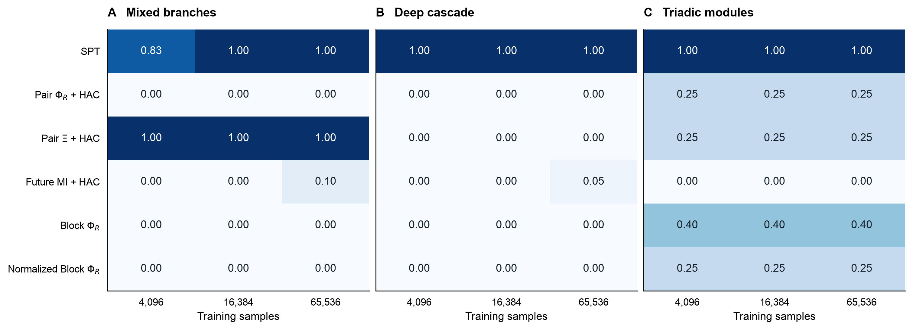

下表每格为三个独立数据集的等权均值。B/C 先在每个已拟合模型内部平均 20 个标签复核，再平均三个数据集；标签数不扩大独立重复数。

| 方法 | B：4096 | B：16384 | B：65536 | C：4096 | C：16384 | C：65536 |
|---|---:|---:|---:|---:|---:|---:|
| SPT | 1.000 | 1.000 | 1.000 | 1.000 | 1.000 | 1.000 |
| pair-ΦR + HAC | .000 | .000 | .000 | .250 | .250 | .250 |
| pair-Ξ + HAC | .000 | .000 | .000 | .250 | .250 | .250 |
| future-MI + HAC | .000 | .000 | .048 | .000 | .000 | .000 |
| 未归一化 Block-ΦR | .000 | .000 | .000 | .400 | .400 | .400 |
| 归一化 Block-ΦR | .000 | .000 | .000 | .250 | .250 | .250 |

B 的正确根为 12345|6789，C 为 123456|789。所有正式数据集及标签下，SPT 均得到正确根；各基线的根恢复率均为 0。B 在 16384／65536 时相对最强基线的平均 F1 差分别为 **1.000／.952**，C 均为 **.600**。C 的未归一化 Block 仍找回六源父支持，上层召回为 1，但缺失部分模块且根错误；不能把它的 .400 描述为没有任何恢复。

A 复用第 11 节已有有限数据缓存，没有新训练或更改机制。它在 4096 时 SPT 平均 F1=.833，在 16384／65536 时均为 1。其 pair-Ξ 在三个规模均为 1，这一平手保留。三个模型的状态维数与生成结构不同，不汇总成一个跨例总分。

### 14.2 采样、非线性 TM 与 EI 路径（论文附录记录）

本次实际完成的是“**采样 → 学习 TM → 估计拟合模型的 EI → 自由 SPT**”。B/C 分别使用第 13.1 节的固定系数与支持。完整源干预为逐坐标独立标准 Gaussian，均值／方差约束已注册；包括当前未使用读出，不按真实活跃坐标筛选。每个案例使用独立数据种子 101、102、103，同 seed 的三个训练规模取同一 65536 样本集的嵌套前缀，另有独立 8192 测试样本。不同案例使用不同随机流，不声称 B/C 的同号 seed 实现物理配对。实施试跑使用 seed 901、2048 训练和 1024 测试样本，不进入正式表格。

B 的 TM 为完整稠密条件仿射模型。C 对**所有未来坐标**学习同一规则的逐坐标单调映射：从训练样本排序后，以 `round(linspace(0,N−1,257))` 取 257 个次序统计结点，对应标准正态分位数 `ndtri((rank+.5)/N)`；相邻结点线性连接，末端延续正斜率线性尾，覆盖整个实数域。它是连续、可逆、具有正对角 Jacobian 的非线性 TM，不是经验阶梯 CDF，也没有把极端读出截到有限范围。拟合器只接收训练配对数组及预先声明的模型族，不读取真实 $\sinh$、权重、噪声、源支持或测试数据。

令已学习目标变换为 $\widehat{\boldsymbol{g}}$，B 中为恒等映射，C 中为上述逐坐标映射。完整联合为

$$
\widehat q(\mathbf{x},\mathbf{y})
=\varphi(\mathbf{x})\,
\varphi_{\widehat{\mathbf{Q}}}
\bigl(\widehat{\boldsymbol{g}}(\mathbf{y})-\widehat{\mathbf{F}}\mathbf{x}-\widehat{\mathbf{b}}\bigr)
\left|\det\mathbf{J}_{\widehat{\boldsymbol{g}}}(\mathbf{y})\right|.
\tag{14.1}
$$

这里 $\varphi$ 为注册标准 Gaussian 源密度，$\varphi_{\widehat{\mathbf{Q}}}$ 为已拟合噪声密度；$\widehat{\mathbf{F}}$ 和 $\widehat{\mathbf{Q}}$ 为矩阵，$\widehat{\mathbf{b}}$ 为截距向量。完整 source／target 的维数分别为 B 144、C 90。稠密均值回归使用均方损失 ridge $10^{-6}$，全残差协方差的分母为 $N-p-1$，另加 $10^{-6}\mathbf{I}$，其中 $p$ 为完整源维数。这些参数在正式采样前固定。

式（14.1）对应“源恒等变换＋已学习目标单调变换＋条件 Cholesky 白化”的三角 TM。所有 source/group-target 查询都取这一个完整联合的边缘。目标变换可逆，因此拟合模型中的互信息可在其 Gaussian 坐标内解析积分；不需要高维嵌套 Monte Carlo。EI 是**已拟合模型介导的估计**，没有把生成器真参数代入恢复计算。解析生成模型只用于采样核验、事后 EI 误差和支持评分。

SPT 全树固定完整未来 target、时距一步，使用手稿式（10）–（12）的 raw residual，枚举每个节点全部合法二分并递归至单节点。两个 Block 使用随节点变化的 group-target，归一化版本除以较小子组的**节点数**。三个 HAC 方法使用各自的成对矩阵及同一 average linkage 规则。六方法读取同一已拟合联合，但查询信息与查询次数不同，不宣称查询预算完全相等。

这一条件拟合／已知源先验路径与 SI S1.2 式（S13）–（S15）的经验联合及边缘分别拟合、Wishart 修正路径不同，未套用该修正，也未声称复现手稿的原估计器。

### 14.3 拟合误差和原生 Syn 审计

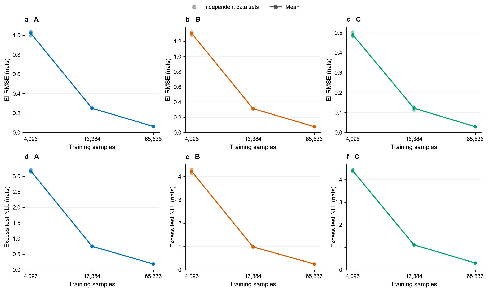

点表示独立数据集，线表示三个数据集均值；训练规模之间是嵌套数据，不是独立重复。表中的 NLL 差在原始读出空间计算，C 包含式（14.1）的已学习 Jacobian，参照同一测试数据的真实条件密度。

| 案例 | 训练样本 | 511 个 EI 的 RMSE（nats） | 测试 excess NLL（nats，完整未来） |
|---|---:|---:|---:|
| B | 4096 | 1.30338 | 4.21653 |
| B | 16384 | .31540 | .98351 |
| B | 65536 | .07761 | .24807 |
| C | 4096 | .49085 | 4.39625 |
| C | 16384 | .12209 | 1.10811 |
| C | 65536 | .02949 | .30170 |

EI 与密度误差随样本增加而下降，仍不为零。F1=1 表明目标支持恢复正确，不意味着所有 EI 已准确到数值容差。B 在 16384 样本的最优／次优根 raw Syn 差为 [.16741,.17697] nats，C 为 [.07273,.08306] nats；本次有限拟合误差没有改变其最优根。三个重复不足以估计确认性置信区间，未把全为 1 的观测解释为总体恢复概率等于 1。

生成器的独立核验使用完整 latent Gaussian 联合与逐通道充分统计量。B/C 的全部 511 源组 × 九种目标规模最大信息误差分别为 **1.21e-13／3.73e-14 nats**，随机完整联合对照为 **4.53e-14／2.80e-14 nats**。C 的非线性采样和原空间真密度 Jacobian 另有测试，不能把 latent covariance 称为原读出的 Gaussian 协方差。所有正式拟合噪声协方差正定；最小特征值 .06047。C 测试值的单调 TM 逆变换最大误差 **8.88e-16**，最小已学习斜率 .12516，线性尾样本被记录且不删除。

每个拟合模型、每个标签审计 511 项 EI 和 9330 个二分。18 个设置共 360 次标签复核、3,358,800 次二分检查，包含同一模型换标签后的重复数值，**不能当作独立统计重复**。原生 Syn 容差固定 **1e-8 nats**，最小 raw Syn **5.26753e-6 nats**，容差内负数和显著违规均为 **0**；最大闭合误差 **1.78e-15 nats**。两个 Block 的候选值亦无显著负值。没有裁剪、投影或按真结构约束候选。

### 14.4 当前图和评分说明（论文附录记录）


结构图沿用绿色节点、二元红带、高阶紫色包络、全局虚线及 $H_m$ 阶数标记。包络表示第 13.1 节的实际非零源支持，不编码系数强度，不意味着这些模型具有逐级反馈或纯不可约阶数的 PID 原子。

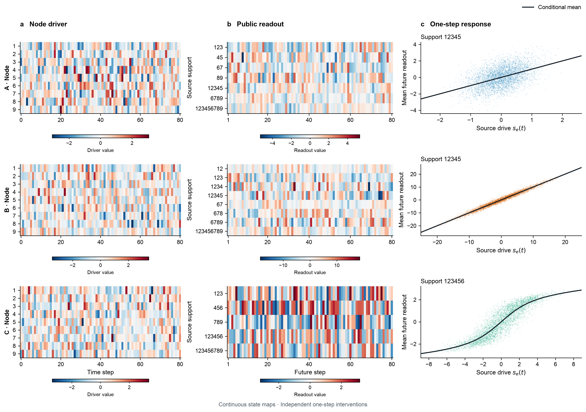

左列为 80 步自然更新中的第一个驱动坐标，中列为各通道九个未来读出的均值；色标均为各自原始变量值，尺度单独标明，未作标准化。右列显示另外 4096 个独立完整状态干预及预先固定的最大非根通道。黑线为真实条件均值：A/B 为源加权和，C 为 Gaussian 噪声下 $\operatorname{arsinh}$ 的期望，用 64 点 Gauss–Hermite 积分绘制。它不是直接把源加权和代入 $\operatorname{arsinh}$，也不是拟合所得的预测曲线。这些自然轨迹和示意干预不进入正式训练／测试集合。

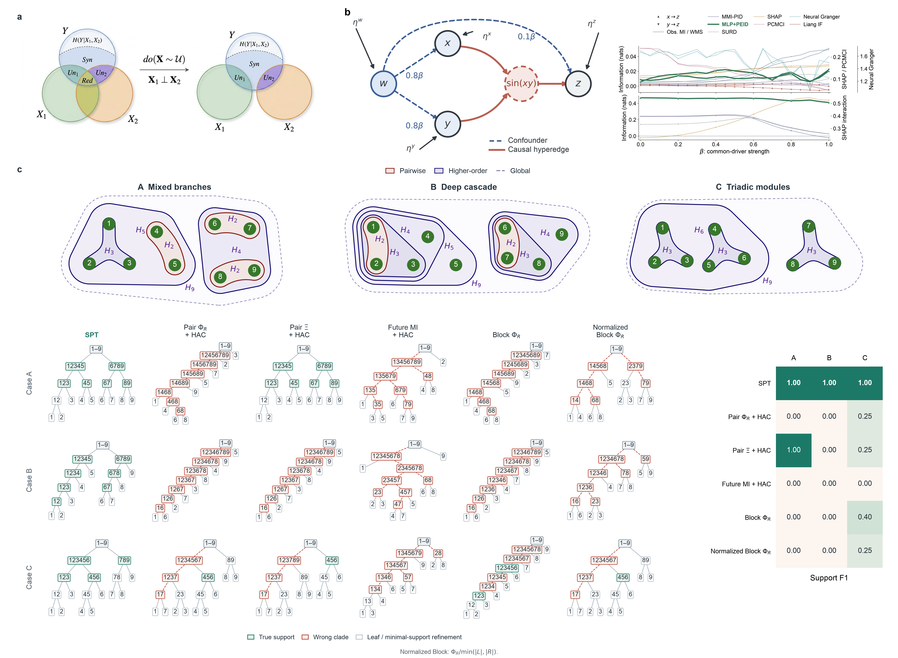

主图 a/b 沿用已有原图源，d 保持删除。c 的全部树来自有限样本拟合，不再把旧 B/C 的解析 oracle 成绩作为有限数据成绩。代表树固定为 **16384 样本、原标签、A seed 0／B/C seed 101**，未挑选最优数据集；右侧分数为该规模下三个独立数据集的等权均值。A 复用已有有限数据结果，B/C 的标签复核在拟合内部平均。只标 A/B/C，不显示记录数、seed、样本安排或估计器流程。原相位 B/C 主图、结构／动力学和指标图保存为带 `_phase_bc` 后缀的历史图，前文相关记录已指向历史资产；相位拟合失败诊断保持原样。

支持真值仅含非根机制集合：A 六个，B 七个，C 四个。预测集合移除单叶／全根及最小机制支持内部的真子集细分；各方法应用同一规则。precision 为命中支持数除以保留预测数，recall 为命中数除以真值数，F1 为两者调和平均。等价地，若命中数为 TP，额外预测为 FP，缺失支持为 FN，则 $\mathrm{F1}=2\mathrm{TP}/(2\mathrm{TP}+\mathrm{FP}+\mathrm{FN})$。例如 C 的原标签 Block 树有 TP=2、FP=4、FN=2，F1=.4。F1 不对节点顺序、树枝长度或 EI 数值误差评分，也不检验最小三元组的内部二叉划分。

### 14.5 结论边界与复现

新 B/C 达到了本任务要求的有限数据恢复与基线差距。它们是围绕特定分组目标构造的两个固定模型，曾在采样前核验解析成绩；这属于构造性开发验证，不能作为随机连续动力学总体上的确认性优越性证据。C 的非线性是可逆单调读出，TM 在这类结构上便于学习和积分，本次不解决旧相位 B/C 的边缘积分困难，也不验证一般不可约非线性耦合。未来 MI 的解析成对矩阵为常数，有限拟合的扰动会形成任意次序，其少量命中不能解释为辨识了源机制。

实现见[有限数据新 B/C 入口](../../scripts/spt_finite_replacement_bc.py)、[绘图入口](../../scripts/plot_spt_finite_replacement_bc.py)。内部 `results/spt_finite_replacement_bc/summary.json` 保留全部设置、六方法、标签、EI 真／估计值、密度诊断、审计和数据哈希；`smoke.json` 单独标明排除的实施试跑，`run.log` 保存原生执行记录。没有 CSV，也没有覆盖旧仿射／样条失败缓存。新增 9 个有效性测试与既有 SPT／连续基准／样条测试合计 **40 项通过**；当前 PNG 已逐张视觉检查，主图的包络成员、嵌套与节点标签间距亦经渲染校验。

```bash
OPENBLAS_NUM_THREADS=1 OMP_NUM_THREADS=1 .venv/bin/python scripts/spt_finite_replacement_bc.py
OPENBLAS_NUM_THREADS=1 OMP_NUM_THREADS=1 .venv/bin/python scripts/plot_spt_finite_replacement_bc.py
OPENBLAS_NUM_THREADS=1 OMP_NUM_THREADS=1 .venv/bin/python scripts/compose_spt_framework_comparison.py
```

绘图只读取拟合缓存，原始动力学面板另用固定示意 seed；不会重新训练。历史主图可用 `scripts/compose_spt_framework_comparison.py --phase-bc` 复现；历史动力学可用 `scripts/plot_spt_continuous_original_dynamics.py --phase-bc` 复现。原始结构／动力学入口默认展示通过检查的新 B/C。

本轮再次以题名核对 Zotero 父项 `P6UJCVG8`，获取当前主文 `DXGC7JEA` 与 SI `MWIWKSVG` 全文并读 Methods 式（10）–（12）、SI S1.2 式（S7）–（S15）及 S5.1。唯一附件组仍无明确稿件日期／版本。固定干预、完整 target、一步时距、raw Syn、非负审计和精确切分与所读定义一致；式（14.1）的条件 TM 路径是本实验明确声明的估计器差异，不能声称已核验与手稿经验估计实现完全一致。第 14.2–14.4 节的采样、积分、计分与图注细节在论文中归入附录／补充方法。
