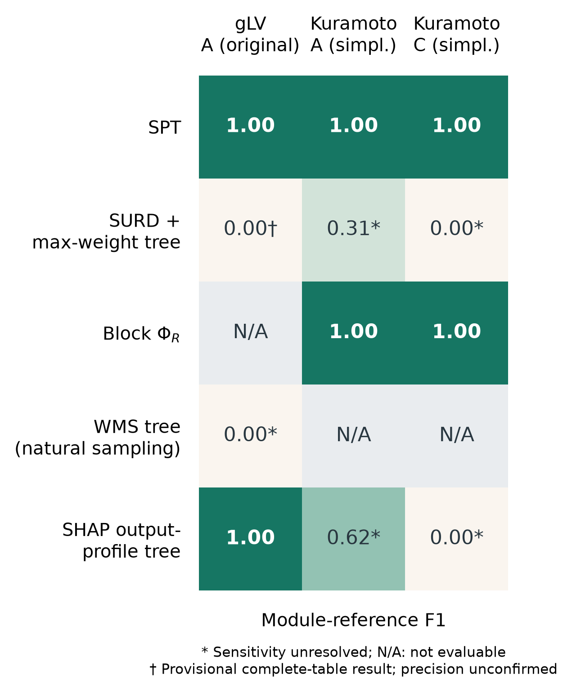

# gLV 与 Kuramoto：三例五方法比较

2026-10-15，原预算收束后的最终可用结果。三例为高阶 gLV 原 A、简化 Kuramoto A、简化 Kuramoto C；保留五种方法，归一化 Block-ΦR 已取消。全部已有计算作业均已停止，未分辨或未完成项保留为 N/A，不填零。

SPT 的模块参考 F1 在三例中均为 1.00；它与 Kuramoto 两例的普通 Block-ΦR、gLV 原 A 的 SHAP 并列。gLV 的普通 Block-ΦR 未在原八小时预算内完成；SURD 只完成两份完整积分表，按引用会话的呈现规则保留暂定分数。Kuramoto 两例 WMS 已完成全部查询，但未通过原数值门槛。当前结果不能支持 SPT 独占最优或跨系统统计显著的结论。

五项为 SPT、SURD + maximum-weight tree、Block ΦR、WMS tree (natural sampling)、SHAP output-profile tree。前三类信息方法沿用各自已注册的干预联合；WMS 和 SHAP 在每个例子内共用同一组真实自然轨迹与同一冻结预测模型。WMS 的 target 始终为完整未来，不随递归块改变；有符号 WMS 允许负值，不套用 PEID Syn 的非负规则，但其组成 MI 仍核查非负性及源包含单调性。SHAP 完整枚举九玩家的 512 个联盟，对平均输出归因向量长度模式采用固定 cosine distance / single linkage；该树是实验适配，不是 SHAP 唯一规定的算法。

## Kuramoto 网络

使用用户提供的重绘图，原图完整保留。图中的 A/C 是两种 Kuramoto 网络的内部名称；表格用完整动力学名称区分 gLV A，避免把两个 A 混为一例。

gLV 原 A 与简化 Kuramoto A 的物理网络不同，因此这一列举是三个案例的并列，不能单独归因动力学效应。已直接核对各自冻结生成器记录：

| 网络 | 登记权重 1 | 登记权重 0.5 | 登记权重 0.25 |
|---|---|---|---|
| gLV 原 A | 123、45、67、89 | 12345、6789 | 123456789 |
| Kuramoto 简化 A | 123、45、67、89 | 34、78 | 56 |
| Kuramoto 简化 C | 123、456、789 | 34 | 67 |

数字串表示超边成员。各动力学的作用函数不同，这些登记权重不表示跨动力学物理效应量相等。简化后的 SPT 可在当前精度和预算内完成；本轮没有以单因素消融确定原计算失败是否由高阶结构单独造成。

## 定义对齐与证据边界

已读取引用会话最新任务及本地自然基线代码，核实其选择为自然采样、固定完整未来的 WMS，且与 SHAP 共用自然轨迹。原 Kuramoto B 的旧进程已按另一会话中的用户要求停止，保持停止。

本任务重新核对 Zotero 父项 P6UJCVG8 标题 *Emergent hierarchical organization of causal interactions in complex systems*，当前主文 DXGC7JEA、SI MWIWKSVG 仍无明确稿件版本/日期；元数据更新时间不能确定新稿。新增方法已读取 SI S9.1 (S75)、S9.4。WMS 与完整联盟 SHAP 的树适配沿用引用会话声明，不能与原手稿中的两两替换差分或局部 target 方法混称。

相位是周期变量，因此 Kuramoto SHAP 解释同一条件 TM 的完整未来圆周均值向量 E(cos Yj)、E(sin Yj)，共九相位、十八个实数输出坐标。先对这十八个坐标求精确 Shapley 值并核查效率，再对每个未来相位的二维归因向量取欧氏长度，平均后得到九玩家×九相位的模式矩阵。这保持任意共同相位原点旋转下的归因模式不变，已由独立旋转控制验证。gLV 对实数未来均值取绝对值，是一维归因向量的相同长度规则。比较的是各自的模块 F1，不直接比较归因数值单位。

两类动力学的 SHAP 都用完整自然背景行联合补全一个联盟的全部缺失节点，保留缺失块内部相关性；背景不按已知联盟条件化，因此这里是 interventional Shapley，不是 conditional Shapley。WMS 的缺失源积分则按拟合自然联合的条件密度计算。

Kuramoto WMS 保留冻结非线性转移 TM，以同一自然轨迹拟合可归一化的“共享均匀旋转 + von Mises 混合”源密度。其全部源边缘可解析计算；条件积分始终使用 q(x_missing|x_known)=q(x)/q(x_known)，保留自然相关性。WMS 外层从该拟合联合采样，SHAP 直接使用共用轨迹中的样本，二者并非逐行使用相同积分样本。该周期源模型是显式密度近似，不是对真实自然联合的精确表示。中心数/浓度只按留出自然数据的似然选择，不看 F1；自然轨迹与条件积分、源密度诊断分别记录。gLV 沿用其原全协方差 Gaussian 源 TM 近似。这些近似差异必须与方法分数一起解释。

每个例子只用一个已拟合物理数据集；四次积分重复或四组 SHAP 背景/评价子样本不构成独立物理重复。F1 仍按各例预声明模块参考评分、忽略 primitive 内部严格细化，不据此报告总体优越性的 p 值。Kuramoto 的重叠桥边不是这一嵌套模块参考的全部物理真值。未完成、数值失败与零分区分。

## 总结果

计算终态：Kuramoto A/C 的五法查询及已安排复核均已结束，自然两项实际于 19:46:39 结束，早于追加四小时上限。gLV 原八小时预算于 23:09:18 到期，随后由所属会话停止主进程；保留两份各含全部 511 子集的 SURD 表，普通 Block-ΦR 仅有 317 项通用信息查询，不能组成该方法完整有效结果。全表检查点的旧 running 头部不表示进程仍在运行。未延长任何计算预算。

gLV SURD 沿用引用会话的最高已完成精度规则：只对已完成全部 511 子集且原子非负与闭合审计通过的完整表构树，并平均所有已完成重复；不按 F1 挑选。该暂定结果标 †，不表示预定四次重复的完整精度检查已通过。部分子集表不补零构树。

<!-- SIX_RESULTS -->

| 方法 | gLV A（原网络） | Kuramoto A（简化） | Kuramoto C（简化） |
|---|---:|---:|---:|
| SPT | 1.0000 | 1.0000 | 1.0000 |
| SURD + max-weight tree | 0.0000† | 0.3077* | 0.0000* |
| Block ΦR | N/A | 1.0000 | 1.0000 |
| WMS tree (natural sampling) | 0.0000* | N/A | N/A |
| SHAP output-profile tree | 1.0000 | 0.6154* | 0.0000* |

* 表示数值或结构敏感性尚未完全解决；† 为已完成完整表的暂定结果，预定完整精度检查尚未通过或结束；N/A/未评价与实测零分区分。

### gLV A
- spt：`native_screen_passed`；来源 `results/spt_local_glv_tm/a_comparison/comparison_1024.json`。根切分 `[[1, 2, 3, 4, 5], [6, 7, 8, 9]]`；clades `[[1, 2, 3, 4, 5], [1, 2, 3], [2, 3], [4, 5], [6, 7, 8, 9], [6, 7], [8, 9]]`。四次积分/背景子样本的 F1 范围 `[1.0, 1.0]`；评分结构一致 4/4，原始树一致 2/4。
- surd：`provisional_completed_full_tables`；来源 `results/spt_local_glv_tm/a_comparison/surd_full.json`。根切分 `((1, 2, 3, 4, 5, 6, 7, 8), (9,))`；clades `[(1, 2, 3, 4, 5, 6, 7, 8), (1, 2, 3, 4, 5, 6, 8), (1, 4), (2, 3, 5, 6, 8), (2, 6, 8), (2, 8), (3, 5)]`。已完成完整表 2/4，采用所有已完成 scramble `[0, 1]` 的平均，精度档 `{'outer': 128, 'posterior': 128, 'inner': 256}`；不按 F1 挑选重复。原生阶段 `budget_exhausted`。原生终止原因：Original absolute 8h deadline reached; stopped before completing four integration scrambles。主作业状态 `budget_exhausted`。原预算已结束、主作业已停止。
- block_phi_r：`not_completed_budget_exhausted`；来源 `results/spt_local_glv_tm/a_comparison/comparison_1024.json`。限制：Partial query cache only; full search and precision audit not completed before budget. Some cached tail rows still fail weight gates.。通用 MI 缓存 317 项；其中未分辨 146 项。
- wms_natural：`sensitivity_unresolved`；来源 `results/spt_local_glv_tm/a_comparison/natural_baselines.json`。根切分 `[[1, 3, 5, 7, 8], [2, 4, 6, 9]]`；clades `[[1, 3, 5, 7, 8], [1, 5], [3, 7, 8], [7, 8], [2, 4, 6, 9], [4, 6, 9], [6, 9]]`。四次积分/背景子样本的 F1 范围 `[0.0, 0.0]`；评分结构一致 2/4，原始树一致 2/4。
  最大 MI 数值 SEM=0.00557976 nats；内层 64→256 最大变化=0.000166693 nats；最小 ESS=63.9058；最大归一化权重=0.0185144。门槛依次为 <0.01、<0.01、≥10、<0.25；未通过时不将诊断候选树分数作为有效 F1。
  MI 非负及源包含单调审计：`{'tolerance_nats': 0.01, 'clipping': False, 'tables': 'each numerical scramble and the canonical mean', 'mutual_information': {'minimum_nats': 0.5513754723260407, 'tolerance_negative_count': 0, 'significant_violation_count': 0}, 'source_inclusion_increment': {'minimum_nats': 0.46035062706776575, 'tolerance_negative_count': 0, 'significant_violation_count': 0}, 'passed': True}`。WMS 有符号残差的负值合法，不据此判为 Syn 非负违规。
- shap_profiles：`native_screen_passed`；来源 `results/spt_local_glv_tm/a_comparison/natural_baselines.json`。根切分 `[[6, 7, 8, 9], [1, 2, 3, 4, 5]]`；clades `[[8, 9], [6, 7], [4, 5], [1, 2], [1, 2, 3], [6, 7, 8, 9], [1, 2, 3, 4, 5]]`。四次积分/背景子样本的 F1 范围 `[1.0, 1.0]`；评分结构一致 4/4，原始树一致 3/4。

### Kuramoto A
- spt：`stable`；来源 `results/spt_local_kuramoto_tm/ac_comparison/A/`。根切分 `[[1, 2, 3, 4, 5], [6, 7, 8, 9]]`；clades `[[1, 2, 3, 4, 5], [6, 7, 8, 9], [1, 2, 3], [4, 5], [1, 3], [6, 7], [8, 9]]`。四次积分/背景子样本的 F1 范围 `[1.0, 1.0]`；评分结构一致 4/4，原始树一致 2/4。
- surd：`sensitivity_unresolved`；来源 `results/spt_local_kuramoto_tm/ac_comparison/A/`。根切分 `[[1, 3, 4, 5, 6, 7, 8, 9], [2]]`；clades `[[1, 3, 4, 5, 6, 7, 8, 9], [3, 4, 5, 6, 7, 8, 9], [3, 4, 5, 6, 7], [3, 4, 5], [3, 4], [6, 7], [8, 9]]`。四次积分/背景子样本的 F1 范围 `[0.15384615384615383, 0.30769230769230765]`；评分结构一致 1/4，原始树一致 1/4。
- block_phi_r：`stable`；来源 `results/spt_local_kuramoto_tm/ac_comparison/A/`。根切分 `[[1, 2, 3, 4, 5], [6, 7, 8, 9]]`；clades `[[1, 2, 3, 4, 5], [6, 7, 8, 9], [1, 2, 3], [4, 5], [1, 2], [6, 7], [8, 9]]`。四次积分/背景子样本的 F1 范围 `[1.0, 1.0]`；评分结构一致 4/4，原始树一致 4/4。
- wms_natural：`numerically_unresolved`；来源 `results/spt_local_kuramoto_tm/ac_comparison/A/`。未通过项 `['information numerical SEM >= .01 nats', 'importance weights failed']`。
  最大 MI 数值 SEM=0.0273506 nats；内层 64→256 最大变化=0.00491972 nats；最小 ESS=4.18461；最大归一化权重=0.479952。门槛依次为 <0.01、<0.01、≥10、<0.25；未通过时不将诊断候选树分数作为有效 F1。
  MI 非负及源包含单调审计：`{'tolerance_nats': 0.01, 'clipping': False, 'tables': 'each numerical scramble and the canonical mean', 'mutual_information': {'minimum_nats': 3.3676083270987722, 'tolerance_negative_count': 0, 'significant_violation_count': 0}, 'source_inclusion_increment': {'minimum_nats': 0.8465668966947781, 'tolerance_negative_count': 0, 'significant_violation_count': 0}, 'passed': True}`。WMS 有符号残差的负值合法，不据此判为 Syn 非负违规。
- shap_profiles：`sensitivity_unresolved`；来源 `results/spt_local_kuramoto_tm/ac_comparison/A/`。根切分 `[[2], [1, 3, 4, 5, 6, 7, 8, 9]]`；clades `[[4, 5], [6, 7], [8, 9], [3, 4, 5], [6, 7, 8, 9], [3, 4, 5, 6, 7, 8, 9], [1, 3, 4, 5, 6, 7, 8, 9]]`。四次积分/背景子样本的 F1 范围 `[0.6153846153846153, 0.6153846153846153]`；评分结构一致 3/4，原始树一致 3/4。

### Kuramoto C
- spt：`stable`；来源 `results/spt_local_kuramoto_tm/ac_comparison/C/`。根切分 `[[1, 2, 3, 4, 5, 6], [7, 8, 9]]`；clades `[[1, 2, 3, 4, 5, 6], [7, 8, 9], [1, 2, 3], [4, 5, 6], [1, 3], [5, 6], [8, 9]]`。四次积分/背景子样本的 F1 范围 `[1.0, 1.0]`；评分结构一致 4/4，原始树一致 0/4。
- surd：`sensitivity_unresolved`；来源 `results/spt_local_kuramoto_tm/ac_comparison/C/`。根切分 `[[1, 3, 4, 5, 6, 7, 8, 9], [2]]`；clades `[[1, 3, 4, 5, 6, 7, 8, 9], [3, 4, 5, 6, 7, 8, 9], [3, 4, 6, 7, 8], [3, 4, 8], [3, 4], [6, 7], [5, 9]]`。四次积分/背景子样本的 F1 范围 `[0.0, 0.0]`；评分结构一致 1/4，原始树一致 1/4。
- block_phi_r：`stable`；来源 `results/spt_local_kuramoto_tm/ac_comparison/C/`。根切分 `[[1, 2, 3, 4, 5, 6], [7, 8, 9]]`；clades `[[1, 2, 3, 4, 5, 6], [7, 8, 9], [1, 2, 3], [4, 5, 6], [1, 2], [5, 6], [8, 9]]`。四次积分/背景子样本的 F1 范围 `[1.0, 1.0]`；评分结构一致 4/4，原始树一致 4/4。
- wms_natural：`numerically_unresolved`；来源 `results/spt_local_kuramoto_tm/ac_comparison/C/`。未通过项 `['information numerical SEM >= .01 nats']`。
  最大 MI 数值 SEM=0.0128516 nats；内层 64→256 最大变化=0.00490806 nats；最小 ESS=24.526；最大归一化权重=0.113225。门槛依次为 <0.01、<0.01、≥10、<0.25；未通过时不将诊断候选树分数作为有效 F1。
  MI 非负及源包含单调审计：`{'tolerance_nats': 0.01, 'clipping': False, 'tables': 'each numerical scramble and the canonical mean', 'mutual_information': {'minimum_nats': 3.288923217742788, 'tolerance_negative_count': 0, 'significant_violation_count': 0}, 'source_inclusion_increment': {'minimum_nats': 1.4160045689093899, 'tolerance_negative_count': 0, 'significant_violation_count': 0}, 'passed': True}`。WMS 有符号残差的负值合法，不据此判为 Syn 非负违规。
- shap_profiles：`sensitivity_unresolved`；来源 `results/spt_local_kuramoto_tm/ac_comparison/C/`。根切分 `[[8], [1, 2, 3, 4, 5, 6, 7, 9]]`；clades `[[3, 4], [6, 7], [3, 4, 6, 7], [3, 4, 5, 6, 7], [1, 3, 4, 5, 6, 7], [1, 2, 3, 4, 5, 6, 7], [1, 2, 3, 4, 5, 6, 7, 9]]`。四次积分/背景子样本的 F1 范围 `[0.0, 0.0]`；评分结构一致 2/4，原始树一致 2/4。

<!-- SIX_RESULTS_END -->

详细三法数值审计见 [Kuramoto 报告](spt_kuramoto_ac_selected_comparison.md)；gLV 的模型、预算与未完成记录见 [并行实验报告](spt_glv_kuramoto_parallel.md)。本总表只读引用 gLV 原生结果及其已验证完整表的汇总适配器，未修改其进程、代码、原生结果或预算。
