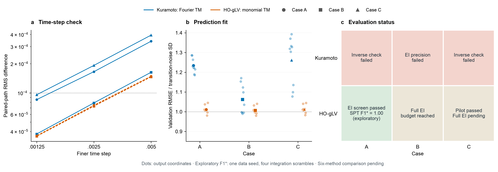
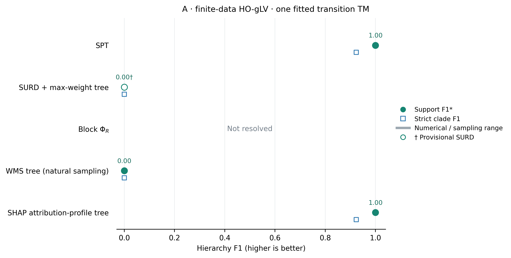

# 局部高阶 HO-gLV 与 Kuramoto 的平行验证

2026-10-15。用户要求对已启动的“开展 Kuramoto SPT 层级实验”（本地线程 `01a13deb-ba1a-7cd2-bed4-0f334614725e`）进行 HO-gLV 平行对照，并明确允许两聊天同步共同协议。该线程原获批分阶段试验、60 分钟计算上限；本次 gLV 沿用相同阶段和上限，不替对方运行或覆盖 Kuramoto 结果，不新增子代理。

## 1. 共同条件与必要差异

对照问题为：在相同九节点超边架构、干预随机数、数据规模、噪声尺度、预测时距和数值精度要求下，替换局部动力学后，拟合密度、EI 积分和层级恢复如何变化。A/B/C 固定连边同 `spt_local_hyperedge_kuramoto.py`；耦合层级 `K0=1, rho=.5`，共同偏移向量为 `linspace(-.2,.2,9)`，无按 F1 调参。

| 控制项 | 两侧共同设置 |
|---|---|
| 节点／source／target | 9 个标量节点，固定完整未来九维 target，时距 .20 |
| 数据 | 开发 seed 0，train/validation/test=16384/4096/4096；通过后才在预算内复核 101/102 |
| 随机流 | `SeedSequence([20261015,seed]).spawn(8)`；source 与动力学噪声用 streams0/1，独立测试2/3，重复初态4 |
| 重复转移 | 256 个共同初态、16 个独立噪声路径，`SeedSequence([20261015,seed,500+i])` |
| 输入坐标分布 | 九坐标独立 Uniform(-pi,pi)，实际源数组配对，不仅 seed 相同 |
| 噪声 | 观测／干预坐标中的独立加性 Brownian 噪声，sigma=.08；固定步长时噪声增量配对 |
| 时间离散 | RK4 漂移＋Gaussian 扩散增量。按 Kuramoto 步长精度诊断，两侧统一正式 dt=.0025，另核验 .0025→.00125 RMS<1e-4 |
| 选择规则 | Lasso alpha=(.002,.0005,.0001)，只按 validation MSE 选；max_iter2500、tol1e-7、cyclic/warm start |
| RQMC | (outer,particles)=(256,64),(256,256),(1024,256),(4096,256)，4 个 scramble，seed20261015+1000*scramble，maxP固定256 |
| 重要性积分 | 学习均值的 Gauss–Newton/Laplace proposal，协方差乘1.2，5%均匀防御；float64，正确 prior/proposal 权重 |
| 精度门槛 | inner256×64→256×256 及最高两档 outer1024→4096 的关键 EI 最大均值变化<.01 nats；最高档最大 scramble SEM<.01 |
| proposal 核验 | 最高档 minimum ESS≥10、maximum normalized weight<.25、Newton剩余步<1e-3；128点二初值差<1e-4、非正 Jacobian determinant 数0 |
| 层级与评分 | full-target 通过后才全511EI/9330Syn，再扩group-target比较原六方法；非根支持F1、上层召回、根恢复；不按排名选参数 |
| Syn | 原生容差 .01 nats；显著负值明确失败并保存最小值/数量，无裁剪或投影；未评价不记F1=0 |
| 预算 | gLV 累计纯实验计算上限3600秒，resume计入已有计算；Kuramoto已有计算只读复用 |

必要差异必须公开：Kuramoto 是圆周变量，gLV 是正丰度。gLV 使用无量纲对数丰度 $u_i=\pi\log x_i$，与相位匹配输入范围和噪声尺度，但未来 $u_i$ 属于实数域，不取模。相位端的 Fourier 均值／von Mises 条件密度与 gLV 的丰度单项式均值／Gaussian 条件密度是按模型状态域作的拟合族适配，不能将整个实验说成两个完全相同估计器之间的纯动力学单因素试验。两侧均不给拟合器真实超边，数据量、正则候选、选择规则、积分门槛和评分保持共同协议。

Kuramoto 侧曾以 dt=.005 试跑，A 的 .005→.0025 RMS=1.6964e-4 rad 未过门槛，故在本轮 gLV 正式计算前同步统一 .0025，并新增最高 outer4096。它的旧结果保留且计入其预算；gLV 未执行旧 .005 正式拟合，不伪造一份旧档结果。协议同步记录来自用户授权的聊天消息，参考最新文件 `docs/reports/spt_local_kuramoto_validation.md` 和 `scripts/spt_kuramoto_finite_tm.py`；本轮输出保存其代码哈希以防后续漂移。

## 2. HO-gLV 方程与强度匹配

每节点只含正丰度 $x_i$。为在共同坐标 $\mathbf{u}$ 中匹配超边信号的均值和 RMS，令 $s=|e|-1$，在独立 $u_i\sim\mathrm{Uniform}(-\pi,\pi)$ 下，$x_i=\exp(u_i/\pi)$，定义

$$
P_{i,e}=\prod_{j\in e\setminus\{i\}}x_j,
\quad \mu_s=(\sinh 1)^s,
\quad v_s=\left(\frac{\sinh2}{2}\right)^s-\mu_s^2,
\quad b_{i,e}=-\frac{P_{i,e}-\mu_s}{\sqrt{2v_s}}.
\tag{2.1}
$$

局部力在超边外恒为零，超边内 $\mathbb E_q b_{i,e}=0$、$\mathbb E_q b_{i,e}^2=1/2$，与单位正弦力的干预均方响应匹配。负号选定竞争性作用，避免把无限增长当作高阶恢复优势；中心／尺度全部由固定输入分布解析确定，不根据采样结果或 F1 调整。

令自限强度 $d=1$，共享偏移 $\omega_i$ 与 Kuramoto 相同，则

$$
\mathrm du_i=\left[\omega_i+\pi d(\sinh1-x_i)+\sum_{e\ni i}K_e b_{i,e}\right]\mathrm dt+\sigma\,\mathrm dW_i.
\tag{2.2}
$$

其丰度方程仍为标准高阶 gLV 形式加乘性噪声：

$$
\mathrm dx_i=x_i\left[r_i-dx_i+
\sum_{e\ni i}a_e\prod_{j\in e\setminus\{i\}}x_j
+\frac{\sigma^2}{2\pi^2}\right]\mathrm dt
+\frac{\sigma}{\pi}x_i\,\mathrm dW_i,
\quad a_e=-\frac{K_e}{\pi\sqrt{2v_s}},
\quad r_i=d\sinh1+\frac{\omega_i}{\pi}-\sum_{e\ni i}a_e\mu_s.
\tag{2.3}
$$

式（2.3）明确包含 Itô 修正；直接丢弃该项会更换式（2.2）的过程。对数域积分保持正丰度，不施加丰度下限或删除不稳定样本。式（2.2）的自限非线性、负竞争力与相位旋转动力学是模型差异，不能解释为完全匹配了两个系统的全部漂移。

物理丰度上的干预是独立 log-uniform，$x_i\in[e^{-1},e]$；它不同于丰度上的独立均匀干预。EI 按已注册共同坐标分布定义。每节点对数变换可逆，因此同一干预下的 MI 不随坐标改变。原空间密度换元含 $|du_i/dx_i|=\pi/x_i$，不能漏掉 Jacobian 或重新改采样分布。HO-gLV 的任意高阶多项式形式可参照 [Sidhom & Galla, Model Definitions Eq.(3)](https://arxiv.org/html/2409.10990v1#S2)，本节的配对归一化和参数是本次实验的明确设计。

相同超边支持不保证相同的信息层级。令 $J\subseteq e\setminus\{i\}$，$k=|J|$、$\mu_1=\sinh1$，由共同乘积分布可直接得到

$$
\mathbb E_q[b_{i,e}\mid\mathbf{x}_J]
=-\frac{\mu_1^{s-k}\prod_{j\in J}x_j-\mu_1^s}{\sqrt{2v_s}}.
\tag{2.4}
$$

当 $k=1$ 时该条件均值已随保留的单一丰度变化；整体中心化不能消除所有低阶边缘响应。相位正弦力在积分掉任一其他均匀相位后则为零。因此 HO-gLV 的多体乘积可有低阶投影，不能把物理超边阶数直接当成不可约信息阶数，也不能预设原超边的嵌套就是 SPT 的最优嵌套。式（2.4）是干预分布下的瞬时力性质，不替代有限时距 EI 数值估计。

## 3. 拟合 TM 与边缘积分

gLV 拟合器接收训练／验证配对数组，使用全部511个非空节点子集的丰度乘积及其1/2/3次幂，共1533个候选特征；不读取 A/B/C 或真实支持。每列以训练数据中心化、缩放至标准差 $1/\sqrt2$，与 Fourier 候选列在共同输入下的尺度对应。选择非零回归系数后保存原坐标系数，预测均值和其 Jacobian 可直接计算。Kuramoto 的每接收节点字典为1530个 Fourier 特征；候选表达族和相差3列的数量均报告，不声称严格容量相同。

用原始实数未来坐标与输入之差作为回归标签，只定义条件平移，不把 EI target 改成增量。训练残差拟合逐输出常方差 Gaussian，并通过条件 CDF／白化构成精确归一化的三角 TM。这是对有限时距 SDE 条件密度的模型近似；独立常方差假设与测试残差相关、PIT、256初态×16独立转移的条件均值误差一起报告。EI 在同一个拟合联合及其边缘上估计，不使用真实生成器参数计算 EI。

实数侧的后验 proposal 顺序截断到绝对源区间 $[-\pi,\pi)$，与相位端在圆周上平移的 proposal 不同，二者密度均精确归一化。gLV 有真实源支持边界，边界 mode 的收敛用投影／KKT 剩余步判断；该投影只用于有界数值优化，不作用于数据、EI、Syn 或树。两初值为 0 和 .15 共同偏移。ESS 是重要性权重诊断，scramble SEM 才表征此处积分重复误差；它们都不是物理数据重复的不确定性。

## 4. 实施与当前状态

已实现独立的[生成器](../../scripts/spt_local_hyperedge_glv.py)与[实数域条件 TM／积分入口](../../scripts/spt_glv_finite_tm.py)，不修改另一聊天负责的 Kuramoto 文件。26 项有效性测试通过，覆盖正值与 Itô 换算、全部阶的解析均值/RMS、真实源数组配对、超边局部性、实数边界 proposal 归一化、条件 TM 密度、解析均值 Jacobian，以及恒等 Gaussian 通道的已知有界源边缘 MI 对照、全511子集／9330切分覆盖与显著负残差必须失败；另检查 Gram 预计算与原 Lasso 目标一致、编译均值与原 NumPy 实现一致。正式采样／拟合／精度运行与结果在下方追加，不能由这些测试推断 SPT 恢复成功。

结果独立保存在 `results/spt_local_glv_tm/pilot.json`，运行日志为同目录 `run.log`。本轮不覆盖既有公共读出主图。若精度 gate 未过，保留失败和已完成覆盖，F1记未评价；若通过则继续全表与排名检查后再报告六方法分数。Kuramoto 参照为 `results/spt_local_kuramoto_tm/pilot_dt0025.json`，只比较共同正式档位。

本任务重新按题名核对 Zotero 父项 `P6UJCVG8`，再次获取主文 `DXGC7JEA`／SI `MWIWKSVG` 全文并读主文 Methods式（4）–（12）、SI S1.2式（S7）–（S15）、S5.1与S7。仍只有无明确稿件版本日期的一组附件。共同干预、完整未来target、raw Syn与精确切分按所读定义处理；条件模型介导EI不同于SI分别拟合的affine／Wishart修正路径，不套用修正，不声称全部代码与手稿原估计器完全一致。

### 4.1 计算实现与预算记录

为完成共同精度档位，先以共享 Gram 矩阵加速同一个 Lasso 目标，再复用单项式乘积加速同一已拟合均值函数；不改变候选特征、正则参数、迭代上限、模型系数、积分点或门槛。A 前两个共同完成输出的 Gram／原实现 validation RMSE 差小于 $6\times10^{-14}$；编译／NumPy 均值差约 $7\times10^{-15}$、Jacobian 差约 $1.4\times10^{-15}$。编译实现使用 float64、关闭 fast-math 和浮点乘加收缩，独立行分配至4线程，与相位侧编译流积分器线程数一致。

前两段拟合尝试计197＋31秒；NumPy 预测积分段计510秒，合计738秒作为加速恢复的前置消耗。恢复沿用已完成 A 拟合和13条积分检查点，不重新抽取数据。记录分别为内部 JSON `attempts_compute.json`、`attempt3_native_acceleration_compute.json`、`pairing_and_acceleration_audit.json` 和 `native_validation.json`。总计时从累计消耗继续，计算加速不重置3600秒上限。部分 Lasso 候选达到2500迭代上限，保留其原始警告和验证选择；预测拟合诊断不等同于证明优化器已收敛。

所有20,480个训练／验证源点与相位侧逐元素一致；源数组 SHA256 为 `718fffd5e77c697cc4c5794f3b102a9c3342dd383830f78949e583bc0ae76168`。该配对验证控制的是源坐标样本，不能消除前述状态域和条件模型族差异。

### 4.2 全表扩展的覆盖口径

入口 `scripts/spt_glv_full_table.py` 在三个 pilot 完成后，仅扩展通过的案例，按 A、B、C 固定顺序，仍受同一累计3600秒预算约束。复用已注册1024×256档的 pilot 查询，补齐全部511个非空 source 子集，使用原4个 scramble；完整后计算9330个不重复无序二切分残差。`.01 nats` 容差内的负数只计数，显著负值明确报告最小值、阈值和数量，不修正 EI 或残差。

该全表是进一步的数值筛查，不把 pilot 的少数查询精度外推为全部511项已经通过。报告全部查询最大 SEM、最差 ESS、最大权重、优化剩余步和残差审计；在最高档及切分排名还没有验证时，不给认证 F1。预算在途中触顶则保存已完成查询，不能把部分表当作完整9330项审计。内部缓存为 `results/spt_local_glv_tm/full_table.json`，其协议绑定完成时的 pilot 文件哈希。

全表阶段再将 proposal 采样与其密度合并计算：复用同一CDF区间宽度，窄／尾部区间仍使用稳定log-CDF差；5%防御先验点单独计算相应proposal密度，混合权重公式保持原样。新旧源样本逐元素一致，A的固定256×256积分查询与旧缓存差不超过7.2e-15 nats；测试另外覆盖相关截断分布和极端边界。原全表段313秒和额外验证.96秒一并计费，保守向上取整，以累计1940秒恢复，不能把这次加速当作免费重试。

在看到完整四次平均表的恢复结果之前，固定附加后处理规则：若全表 SEM、proposal 和9330残差筛查均通过，使用 `analyze_spt_glv_full_table.py` 对平均表及各独立积分表作探索性 SPT，另审计所有 Xi 的非负性，报告支持 F1*、根切分和积分重复间的树一致性。任一表有显著 Syn／Xi 负值，不为该表建树。该点估计明确与“认证 F1”区分；未完成最高档全表、独立数据种子和局部target基线，不更新主图成绩，不宣称优于其他方法。该分析复用已有表，不启动新的拟合或积分。

## 5. 完成的共同档位 pilot

三例 HO-gLV 均通过关键查询的预注册 gate；累计计算1625.95秒（27.10分钟，含全部中断／加速前消耗）。正式数据规模为16384／4096／4096，只有开发种子0；没有启动101／102，以下标准误来自4个积分 scramble，不是独立数据种子的误差。

| 案例 | Kuramoto 初版 validation RMSE／噪声SD | HO-gLV 同比值 | HO-gLV 最细步长配对RMS | HO-gLV 所选拟合达到迭代上限的输出数 |
|---|---:|---:|---:|---:|
| A | 1.2337 | 1.0110 | 3.62212e-05 | 8/9 |
| B | 1.0622 | 1.0069 | 3.57658e-05 | 1/9 |
| C | 1.2620 | 1.0128 | 3.58486e-05 | 7/9 |

比值先逐输出除以256初态×16重复转移估计的噪声标准差，再对9个输出取平均。接近1仅表明预测误差接近该噪声水平；不证明整个条件密度、稀有尾部、逆解或EI已经正确。所选 Lasso 达到迭代上限的结果被保留，不能声称拟合优化器全部收敛。

| HO-gLV案例 | inner均值最大变化 | 最高两档outer均值最大变化 | 最高档最大SEM | 最小ESS | 最大归一化权重 | pilot |
|---|---:|---:|---:|---:|---:|---|
| A | 0.002714 | 0.003679 | 0.002610 | 33.29 | 0.1271 | 通过 |
| B | 0.002662 | 0.003790 | 0.002592 | 39.10 | 0.0938 | 通过 |
| C | 0.002640 | 0.002204 | 0.002380 | 40.83 | 0.0981 | 通过 |

变化与SEM单位均为nats，门槛均为.01；其余门槛为ESS≥10、最大权重<.25。256→1024的较粗outer变化约.023～.024 nats，完整保留，不能称全部粗档均已收敛；最终判据按冻结协议使用1024→4096。三例128点逆解二初值差均小于2.3e-15，非正Jacobian determinant为0；最高积分档最大投影剩余步分别9.98e-8、9.65e-7、2.73e-4，均小于1e-3。这些只是已检查样本上的局部诊断，不是全域单射性的证明。

Kuramoto 初版在同一正式档位的A/C未通过拟合均值的逆解检查，B未通过最坏重要性权重检查；不能把未评价的F1记为0。其初版Fourier条件模型与本例丰度单项式模型有前述族差异，因此不能将初版结果差异单独归因为动力学。对方后来进行的数据驱动flow-TM／多尺度proposal修复另列，不能混入冻结初版对照。

图中浅色散点为9个输出坐标，实色标记为均值，不是9次独立实验。状态面板优先显示已完成的全表筛查状态；“EI pilot passed”只覆盖关键查询，不等于完整SPT恢复。A格中的支持F1*来自第7节的单数据种子探索性后处理，旧主图的恢复分数未据此替换。

### 5.1 探索性支持 F1* 的口径

沿用原对比的支持评分：$\mathcal T$ 为除根之外的真实超边；$\mathcal P$ 为预测树的非根、非单节点 clade，但忽略严格包含于某个最底层真实模块的二叉细分。最底层三节点模块内部的任意两节点细分因此不单独惩罚；跨模块的错误 clade 仍计假阳性。令 $c=|\mathcal P\cap\mathcal T|$，则

$$
\mathrm{Precision}=\frac{c}{|\mathcal P|},\quad
\mathrm{Recall}=\frac{c}{|\mathcal T|},\quad
F_1^*=\frac{2c}{|\mathcal P|+|\mathcal T|}.
\tag{5.1}
$$

这不是对全部二叉 clade 无区别打分的严格树 F1。没有通过数值检查的表记未评价，不能用0代替。四个积分重复分别报告根、评分范围内 clade 和完整二叉 clade 的一致性，避免把允许任意细分的末端差异混同为模块恢复失败；它们仍共用同一份有限训练数据。

### 5.2 已有关键切分的 raw Syn 诊断

以同一积分重复内的 EI 差直接计算残差，原生非负容差仍为.01 nats，保存内部 `critical_syn_audit.json`。最高4096×256档为：

| 案例 | 已覆盖切分数 | 固定参考根Syn均值±积分SEM(nats) | 全部4重复最小raw Syn(nats) | 容差内负数个数 | 显著负数个数 |
|---|---:|---:|---:|---:|---:|
| A | 5 | 0.0017680 ± 0.0005868 | 0.0008024 | 0 | 0 |
| B | 5 | 0.0004696 ± 0.0003806 | -0.0001890 | 1 | 0 |
| C | 4 | 0.0012826 ± 0.0005155 | 0.0000991 | 0 | 0 |

三个案例的关键残差精度检查通过，但只覆盖5／5／4个切分。B有1个重复估计在[-.01,0)内，按已声明容差登记为数值误差，保留原数，不裁剪；这不是负Syn的证据。固定根残差仅约1e-3 nats，尤其B与积分SEM接近，不能用较大的总EI（约33 nats）推断层级信号也强。上述参考根由预注册网络布局给出，不代表精确SPT搜索已经选出该根；排名稳定性需另核查。

## 6. Kuramoto 后续修复：独立补充，不替换冻结对照

对方聊天在初版之后，另以数据拟合相互作用系数并积分ODE来形成flow均值，避免有限时距Fourier回归均值的折叠；候选包含全部502个非单节点超边，不以真实支持筛选。最终边缘proposal又改成80%局部＋15%标准差扩大2倍＋5%均匀防御的精确混合。该估计器和proposal均不同于本节冻结初版／gLV，故其结果单列，不能作为“只改动力学”的配对处理效应。

读取完成的内部缓存 `results/spt_local_kuramoto_tm/flow_mixture_dt0025.json`，关键查询结果为：

| 案例 | 最高两档outer变化(nats) | 最高档最大SEM(nats) | 最小ESS | 最大归一化权重 | 结果 |
|---|---:|---:|---:|---:|---|
| A | 0.010451 | 0.008541 | 4.22 | 0.4852 | 未通过 |
| B | 0.005488 | 0.002778 | 168.92 | 0.0163 | 通过 |
| C | 0.019784 | 0.005205 | 1.00 | 1.0000 | 未通过 |

A/C仍有少数点权重过度集中，C的最大Newton剩余步约.596 rad也未过1e-3门槛。B经估计器修复已通过，说明初版失败不能解释为Kuramoto或SPT本身失效。对方累计计算3518.16秒后停止，B只扩展了首个重复的35/511项，未产出SPT树或F1，详见[Kuramoto实验报告](spt_local_kuramoto_validation.md)；两边完整层级覆盖不同，不作跨案例F1比较。当前可比较的结论集中在采样、拟合和积分可行性，尚不能证明SPT对六方法的优势。

## 7. 本轮终止结果与探索性 SPT

累计计算在3600.17秒停止（含全部中断、加速前消耗；约.17秒为检查边界和结果保存的延迟），进程正常退出，临时巡检已停止。未放宽精度或非负门槛，未启动额外数据种子／新模型。最终覆盖为：

| 案例 | 完整EI表覆盖 | 全9330残差审计 | 探索性支持F1* | 层级结果 |
|---|---|---|---:|---|
| A | 511/511 × 4积分重复，1024×256档 | 通过 | 1.00 | 平均表及4重复的根、评分支持一致 |
| B | 第1重复60/511；其余未扩展 | 未完成 | 未评价 | 预算触顶 |
| C | 仅完成pilot关键查询 | 未执行 | 未评价 | 未启动全表 |

A 全表最大EI SEM=.00688206 nats、最小ESS=49.7256、最大归一化权重=.0799062、最大投影剩余步=4.97e-8，均通过本轮筛查门槛。四次平均表的9330个残差中，最小值为-.00069535 nats，160项位于[-.01,0)内，显著负值0；保留raw值，不裁剪，不解释为真实负Syn。平均表最小Xi=-.00037032 nats，也处于同一声明容差内，无显著违反。单次积分表的最小raw Syn依次为-.00125959、-.00023547、-.00233784、-.00219094 nats，显著违反均为0。平均表SPT闭合误差为0.0 nats。

平均表探索性SPT恢复的非根真实支持为：

- 123、45、67、89；
- 12345、6789；
- 根切分为12345 | 6789。

支持Precision、Recall、F1*和上层支持Recall均为1.00；四个积分重复各自F1*=1.00，根和评分范围内的clade均一致。完整二叉树并非四次完全相同：123内部的两节点细分存在差异，属于评分明确允许任意细分的最底层模块内部，不能据此声称每个二叉枝均已稳定恢复。

该结果是“采样→非线性条件TM→EI→SPT”在A上的有限数据探索性成功，不是三个案例均已通过、也不是六方法对比胜利。A仍只使用一份seed0训练数据，尚未对全部511项统一完成4096外层的复核；训练优化器的迭代上限、常方差独立残差近似以及原始丰度上log-uniform干预的限制仍适用。B/C不能用pilot通过代替层级F1，也不能把未评价记成0。

下一阶段应优先补齐B/C四个积分表，并用独立数据种子复核A；局部target的EI、future-MI和六方法排名必须另行完成。在那之前，本轮不能回答“B、C的SPT是否接近1”或“是否显著优于归一化Block-ΦR”。两侧状态域和TM族的必要适配已经明确，当前结果也不支持纯动力学单因素因果归因。

复现入口为 `scripts/spt_local_hyperedge_glv.py`、`scripts/spt_glv_finite_tm.py`、`scripts/spt_glv_full_table.py` 和 `scripts/analyze_spt_glv_full_table.py`；昂贵计算缓存保留在 `results/spt_local_glv_tm/`，后续扩展应复用已有结果并另行登记获批预算，不重置或伪装本轮累计消耗。26项相关测试通过。

## 8. A 网络五项比较（原上限8小时）

2026-10-15，用户原先明确批准“先完成五法比较（推荐，上限8小时）”，随后引用“对比三个案例中的 SURD 协同划分”聊天，要求只比较SURD与PhiR相关指标、移除全部HAC指标，再追加自然WMS和SHAP；随后取消归一化Block-PhiR，形成第8.1节列出的当前五项。旧HAC进程已停止，已完成的通用信息边缘缓存保留复用，旧协议和部分输出归档至内部`history/`；不再计算或在当前图表呈现HAC分数。原8小时唯一截止时间不重置：2026-10-15 15:09:18 UTC，即北京时间23:09:18。本轮仅执行seed0描述性比较；独立数据重复和正式显著性检验未获批准、未启动。该追加预算与第7节已耗尽的3600.17秒分开登记，本轮smoke、中断和重试均计入原追加预算。

### 8.1 固定的对象和方法

保留A的全部连边、强度、预测时距和转移训练规模；复用seed0已拟合的非线性条件TM及其511项完整未来target EI缓存。当前五项为SPT、SURD＋全局最大权重树、原始Block-PhiR、自然固定target WMS树、SHAP归因模式树。前三项使用同一干预联合分布；WMS按用户要求改为自然源分布估计，但保留同一非线性条件转移TM，SHAP解释同一条件均值。两项自然基线共用一组轨迹，具体近似见第8.6节。Pair Xi＋HAC、Pair PhiR＋HAC、Future MI＋HAC及归一化Block-PhiR均已移出当前比较。

SPT和SURD固定完整九维未来target；Block方法递归改变target至当前块，当前仅执行原始版。完整target EI均值表不能替代Block所需的局部target查询，也不能直接分配为SURD原子。新边缘积分在真实有界源立方体内处理未观测的源变量，复用TM条件密度，不将实数域伪装成圆周，也不分别重拟合互不一致的边缘模型。

主评分仍为第5.1节支持F1*，另报严格非根二叉clade F1、上层支持Recall、根切分和积分重复间稳定性。真实支持仅用于评分。不能因为SPT或某个对比方法得到好结果而改网络、强度、归一化、HAC方式或样本数。

### 8.2 数值有效性与公平性

先对单坐标、成对target、较大块target作小规模性能／精度检查，再扩展实际搜索所需的全部查询。沿用nats和Syn容差.01，保留容差内负估计及数量；显著Syn违反停止相应下游结果并报告最小值、阈值和数量。另检查MI、PhiR估计的有效性、重要性权重和排名稳定性；不把Syn非负容差.01直接当成HAC的“没有信息”截断值，不通过截断弱基线分数制造优势。积分精度不足时保留未分辨状态，不记F1=0；SURD完整表可依用户后来授权的第8.8节规则另给带†暂定分数，但不改变精度状态。节点重标记或积分scramble只作同一数据重复内的稳健性检查，不能充作独立实验样本。

### 8.3 差距与统计显著性

seed0已经用于开发、并在看到SPT恢复成功后选定A；其五项分数只能回答本份数据上的差距和数值稳定性。若做正式的条件于A网络的独立重复比较，应预先固定8份新的数据种子101–108，每份重新采样和拟合，五项在每个种子内配对，并在每份重复内让两项自然基线共享一组独立于其他重复的自然轨迹；seed0不并入主要检验。不得把四个积分重复、9个节点、9330个切分或标签排列当作独立训练数据。

若未来另获批准，主要比较相应改为SPT对当前四个基线的种子内F1*差，报告配对差值分布，作双侧精确配对符号检验（逐种子统计胜／平／负，平局保留记录、不当作胜利）并对四个比较作Holm校正，family-wise alpha=.05。8个种子是一个小规模固定重复方案，不是已论证具有80%功效的样本量；未知基线差值和方差，不虚构效应量或保证检出显著性。符号检验检验非平局情况下更高F1的方向概率，平均F1差另作效应量报告，不混称为无假设的总体均值检验。所有失败和并列保留，不增补种子直至显著。只有某一基线与SPT的校正后差异为正且达到阈值，才可对它声称优势；不能将对部分基线的优势泛化成超过全部基线。

### 8.3a 局部target边缘积分的预定实现

在检查新基线F1之前固定如下proposal：同一TM抽取18维Sobol外层（源9维＋条件噪声9维），新增边缘使用19维内层（未观测源均匀数9维、混合选择1维、引导创新9维），按物理坐标保留维度；四个独立scramble不改变训练数据。主档outer=1024、引导particles=256，内层预留最大1024点；纯先验积分用1024点。每个边缘保存逐点log密度、64点前缀差、ESS、最大归一化权重及proposal剩余投影步，支持中断复用。

引导源坐标由拟合均值在零参考点的噪声白化Jacobian作列主元QR选取，保留对角幅值至少1/pi的方向，最多选target维数；其余未观测源仍按原均匀干预积分。不使用真实网络支持或外层未观测源真值选择／初始化proposal。条件于均匀nuisance后，作最多12步有界Gauss–Newton，引导Hessian加I/pi²、梯度加相应零均值Gaussian参考项以稳定局部proposal。此参考项仅用于proposal，不改变均匀源先验、TM条件密度或EI定义；优化中心投影也不是数据或估计量裁剪。协方差为1.2倍参考Hessian逆，精确重要性混合为80%局部有界顺序Gaussian＋15%标准差扩大2倍＋5%均匀防御。全部先验／混合密度比显式保留。

积分误差筛查门槛为EI／MI的四重复SEM<.01 nats、前缀变化及小规模网格复核、ESS≥10、最大权重<.25、最大投影步<1e-3；候选切分接近时另报重复排名稳定性。精度不足可提高积分点数或修复proposal，必须记录；不得以提高F1为选择依据。HAC采用average-linkage，距离max(W)-W，不裁剪负估计、不设置.01的信息截断。该距离与正最大值时1-W/max(W)产生相同合并顺序。

**正式五法构树前的数值修复记录。** 初版QR条件proposal在局部target的少数尾部点出现ESS<10、顺序截断Gaussian的CDF下溢，以及Gauss–Newton有界优化未收敛。保留`smoke.json`、`smoke_v2.json`及后续全missing proposal对照；修复只影响积分，不重拟合TM。尾部用稳定的log-CDF截断逆函数，仍是同一精确proposal密度，无端点裁剪；优化加回溯和困难点L-BFGS-B收敛复核。正式版改用**全部未观测源坐标**的参考正则化Laplace proposal，按物理坐标顺序采样，避免低秩目标下遗漏需要引导的方向。该选择发生在任何新基线F1计算之前，依据边缘密度精度与计算成本确定。

正式主档仍为outer1024、4个scramble、初始particles256、预留内层1024点。若某个外层点ESS<10或最大权重≥.25，仅对该点换用独立的逐行Sobol流，嵌套增加到1024／4096／16384／65536粒子，保留初始诊断、被细化的行号、最终粒子数和失败；不改变源干预、目标条件密度或重要性比。所有方法共享同一边缘缓存和同一精度规则。`row_refinement_smoke.json`在outer256的单点／双点／大块target均通过权重和投影步检查；可解析identity、非线性遗漏输入的数值积分参考、缓存来源、未观测源真值不泄露、截断尾部、HAC和切分枚举等36项测试通过。这仍是有限点数的数值筛查，不是全局误差界或全域单峰证明。所有这些smoke与修复尝试计入唯一8小时追加截止时间，不重置预算。

### 8.4 预算选项与手稿核对

#### 当前SURD实现与构树适配（用户修改范围后预定）

引用聊天中的SURD原比较采用已知Gaussian／phase模型，其0／0.857／0.400等分数不属于本例有限数据HO-gLV，不能复制过来。这里只沿用其构树目标：对全部511个非空组合的SURD协同权重$s_A$，在合法二叉嵌套树中以动态规划最大化$\sum_{A\in\mathcal I}s_A$。原子权重由本例拟合TM重新积分，不按真实支持筛选、不以F1选阈值或选构树算法。该树是实验适配，SURD原论文本身不输出这种层级树。

令$\widehat q(\boldsymbol x,\boldsymbol y)=q_{\max}(\boldsymbol x)\widehat p_\theta(\boldsymbol y\mid\boldsymbol x)$，其中$q_{\max}$仍为九源独立Uniform(-pi,pi)，$\widehat p_\theta$仍是同一非线性条件TM，$\boldsymbol y$为完整九维未来。对每个目标状态先算

$$
i_A(\boldsymbol y)=\mathbb E_{\widehat q(\boldsymbol x\mid\boldsymbol y)}
\left[\log\frac{\widehat q(\boldsymbol y\mid\boldsymbol x_A)}{\widehat q(\boldsymbol y)}\right],
\qquad
\widehat q(\boldsymbol y\mid\boldsymbol x_A)=\int q_{\max}(\boldsymbol x_{A^c})
\widehat p_\theta(\boldsymbol y\mid\boldsymbol x)\,d\boldsymbol x_{A^c}.
\tag{8.1}
$$

这就是后验与均匀源先验的KL，而非单个联合样本上的pointwise log-ratio。用完整未来的有界逆解Gaussian proposal作后验重要性采样（90%局部＋10%标准差扩大2倍；两者本身均在完整源立方体上有正密度），显式计算真实联合／proposal比并在每个$\boldsymbol y$内自归一化。每个后验源样本的条件边缘再用相同TM和均匀遗漏源积分。先在每个$\boldsymbol y$对完整specific表执行既有SURD分配，最后对目标积分；不对已经平均的MI／EI表作SURD分配，不另拟合Gaussian联合或后验密度。自归一化、有限内层log边缘积分均有数值偏差，需要粒子数复核。

预定pilot覆盖16个固定查询、四scramble，档位(outer,posterior,inner)依次为(32,32,64)、(32,64,64)、(64,64,64)、(64,64,256)。均值档间最大变化与最高档SEM门槛均为.01 nats，后验与条件边缘ESS≥10、最大归一化权重<.25、投影剩余步<1e-3。通过后才扩展到全部511组合：outer128、posterior64；若64→256内层检查通过用inner64，否则须保留精度失败，不以较粗积分制造F1。四个积分重复仍不是独立数据。SURD与SPT的外层点数因嵌套积分成本而不同，均源自同一目标分布和Sobol种子前缀，按精度检查判断可用性，不声称相同计算量。无有效完整表则不输出SURD层级F1。

specific KL与SURD原子均声明非负容差.01 nats，显著负值显式失败并记录最小值／阈值／计数，保留原数不裁剪。SURD的排序／同阶筛除属于已声明的分配定义，不能当作对PEID Syn的数值投影。先以有界Gaussian通道的精确截断后验KL核验估计器，并检查“逐状态分配”与“分配平均MI”确实不同；当前39项相关测试通过。

首轮pilot的三次档间最大变化依次为.044916／.009735／.001880 nats，最高档最大SEM=.007831 nats。主要未收敛项是posterior32→64，因此未计算／公布SURD树F1；不能因粗档失败就给SURD记0。现追加纯积分精度复核(64,128,64)和(128,128,64)，各四scramble，改用最高两个后验／外层档的.01 nats变化门槛，粗档失败完整保留在原pilot缓存。通过后才以outer128/posterior128/inner64计算全部511组合；未通过则保留精度失败。该改变发生在任何本例SURD F1之前，不涉及拟合、网络、构树目标或F1选择。执行顺序改为优先完成这项SURD复核／扩展，再续算两种Block；暂停时Block的86个通用信息查询及边缘缓存均保留，预算和截止时间不变。部分Block尾部在65536粒子后ESS／权重仍未达标，当前不得公布其有效F1或将其解释为算法失败。

本次范围修改再次经Zotero题名核对P6UJCVG8，重新列附件并读取唯一正文DXGC7JEA、SI MWIWKSVG相关全文：Methods(4)–(12)、SI S1.2／S5.1／S9.3。仍无明确稿件版本或日期，正文／SI元数据未显示新附件，不能以修改日期当作新稿。SURD原文父项K69ZCNZG（2024），补充KNU3AJTZ全文S1.2、式S12–S16（pp4–5）已重读；该原始逐目标状态定义是本次接入依据。当前九源、共同干预、联合九维target是实验适配，区别于手稿S9.3的二源自然轨迹比较。

原较轻五法方案先改为四项，后按第8.6节扩充为六项，再按第8.7节取消归一化Block-PhiR，当前五项仍只执行seed0描述性比较，共用获批的原8小时上限，不报告统计显著性结论。SURD的逐目标状态嵌套积分比复用EI均值表成本高，因此不能沿用原2–6小时估算保证全部完成；精度失败或预算触顶均保存覆盖和失败。另含8个独立种子的48小时方案仍未获批准、未执行。无子代理，不修改并行Kuramoto／旧ABC SURD聊天负责的代码。

已在本次追加任务重新通过Zotero题名核对父项P6UJCVG8，重新查询附件并获取主文DXGC7JEA／SI MWIWKSVG全文，阅读Methods式（4）–（12）、SI S1.2式（S7）–（S15）、S5.1式（S49）–（S50）、S7。仍仅这一组无明确稿件日期／版本的附件：主文添加2026-10-02、附件元数据修改2026-10-04，SI添加／修改2026-10-04；这些元数据日期不证明稿件版本更新。共同干预、固定target的SPT、精确二切分和不裁剪raw残差按所读定义；九节点HO-gLV及非线性条件Gaussian TM是本实验扩展，不等同于SI的六节点Kuramoto神经TM复现，也不套用其affine估计器的Wishart修正。

<!-- A_FIVE_METHOD_RESULTS_START -->
### 8.5 当前五项 F1 比较（由缓存合并汇总）

状态：`budget_exhausted`；已完成局部信息查询317项；本轮含smoke／数值修复／追加自然基线的墙钟累计8.019小时（原上限8小时）。SPT复用第7节结果，SURD和Block读取同一有限数据拟合联合分布；追加WMS自然固定target树与SHAP归因模式树，当前共五项；归一化Block-PhiR已按用户要求取消。WMS仅增加自然源密度近似，转移核仍是同一非线性TM；SHAP解释同一非线性均值。已取消的pair/future-MI＋HAC指标不恢复。

| 方法 | 支持F1* | 严格clade F1 | 上层Recall | 正确根 | 数值／子样本重复F1*范围 | 数值状态 |
|---|---:|---:|---:|---|---|---|
| SPT | 1.000 | 0.923 | 1.000 | 是 | 1.000–1.000 | existing_exploratory_screen_passed |
| SURD + max-weight tree | 0.000† | 0.000† | 0.000 | 否 | 0.000–0.000 | provisional_completed_full_tables |
| Block \Phi_R | 未评价 | 未评价 | 未评价 | 未评价 | 未评价 | not_completed_budget_exhausted |
| WMS tree (natural sampling) | 0.000 | 0.000 | 0.000 | 否 | 0.000–0.000 | screen_passed |
| SHAP attribution-profile tree | 1.000 | 0.923 | 1.000 | 是 | 1.000–1.000 | screen_passed |

SURD暂定结果†采用网格`{'outer': 128, 'posterior': 128, 'inner': 256}`的全部2/4份完整511组合表，先平均全部可用完整表的协同原子，再构树；未按F1挑选。完整四scramble精度审计尚未通过；来源状态`budget_exhausted`，已完成表的检查问题`[]`。暂定分数不作为SPT超过SURD的确证证据。

信息方法先平均全部采用的完整积分表再构树，通常为四份；若SURD只有部分完整重复或最终精度审计未过，其空心圆点与†仅表示暂定结果，采用的完整重复数见文字说明。SHAP先平均四份归因模式再构树。方点是对全部非根二叉clade打分的严格F1；灰线为已采用积分重复或SHAP的四组自然评价／背景子样本的F1*范围，不是置信区间。最底层123内部必须二叉细分，因此支持F1*=1时严格F1仍可能是12/13。不完整511组合表不构SURD树，显著负specific／atom仍显式失败；未完成项目不填0，也不据此归因为算法失败。

本轮只有seed0的一份训练数据。四个scramble共用同一拟合TM，仅刻画积分重复稳定性；它们不能用于独立数据显著性检验。表中差距只适用于当前网络和拟合模型，不能据此声称SPT统计显著超过其他方法。SPT也尚未对全511项统一完成4096外层复核，沿用探索性筛查限定。

可复现入口：`scripts/spt_glv_a_comparison.py`与`scripts/spt_glv_natural_baselines.py`；合并结果为`results/spt_local_glv_tm/a_comparison/comparison_active_methods.json`，当前主进程三项与自然两项分别保留原始输出。汇总入口仅读取缓存，不重新积分。

<!-- A_FIVE_METHOD_RESULTS_END -->

### 8.6 追加自然 WMS 与 SHAP：定义、共同轨迹与估计近似

用户随后要求加入WMS、SHAP，并确认WMS沿用参考聊天的**自然采样、固定完整未来target**定义。当时六项依次为SPT、SURD＋最大权重树、Block-PhiR、归一化Block-PhiR、自然WMS树、SHAP归因模式树；归一化Block-PhiR随后按第8.7节取消。各项使用相同A网络、时距tau=.2及已有非线性转移TM，不重训预测器、不增加独立训练重复。新增自然轨迹与估计计算仍计入原8小时预算、同一23:09:18北京时间截止，不另起预算。

#### WMS 的命名与 Block-PhiR 的区别

对当前源块$A=L\mathbin{\dot\cup}R$，本轮WMS始终保持完整九维未来$\boldsymbol y_V$：

$$
W_{\mathrm{nat}}(L,R;\boldsymbol y_V)
=I_{\mathrm{nat}}(\boldsymbol x_A;\boldsymbol y_V)
-I_{\mathrm{nat}}(\boldsymbol x_L;\boldsymbol y_V)
-I_{\mathrm{nat}}(\boldsymbol x_R;\boldsymbol y_V).
\tag{8.2}
$$

每个节点枚举全部合法二分并最小化式（8.2），递归至单节点，使用原始有符号值、不归一化、不取绝对值或非负投影。与SPT的切分目标形式一致，定义上的区别为自然联合输入与独立最大熵干预输入。WMS允许负值，不能套用PEID Syn的显著负值失败规则；分别记录所有已搜索负值、[-.01,0)及低于-.01 nats的数量，并检查有符号望远镜闭合。

从“单个变量推广为源块”的意义可以称块间WMS，但本轮图中采用**WMS tree (natural sampling)**，避免与Block-PhiR混淆。后者的父项用$\boldsymbol y_A$、两个子项分别用$\boldsymbol y_L$和$\boldsymbol y_R$，并加四个跨时MI的最小项作为冗余修正。因此本轮固定target WMS与Block-PhiR不是完全相同的拓展。若另做严格平行的Block-WMS，应使用Block-PhiR去掉冗余修正后的局部target目标，并明确采样分布；本轮不额外计算该第七变体。

#### 唯一一组自然轨迹

依用户后续要求，两项自然基线共用`natural_chains.npz`中的同一组真实HO-gLV自然轨迹，不分别模拟。64条链由同一固定stream[20261015,0,90001]生成，每链丢弃256个tau=.2步，保留512个相邻自然转移，每步仍按dt=.0025积分；所有变量一起更新，无逐节点独立重采样或打乱时间。保留总计32768个自然转移，前后两段各16384个源状态用于源密度拟合／诊断及SHAP背景／评价。64条链只是同一物理系统的模拟采样，不是64份重新拟合SPT的独立实验。SPT、SURD和两种PhiR仍使用原独立干预分布，自然轨迹不替代它们的定义。

WMS对自然源联合分布拟合完整协方差的Cholesky源TM，保留跨变量相关性；**这是自然源密度的Gaussian近似，不替换已有非线性条件转移TM**。实测最大源相关系数绝对值.4570；前后段均值最大偏移.1206个源SD，协方差相对偏移.09754，白化后最大偏度.05133、超额峰度绝对值.14293。它们通过预定源近似诊断门槛（均值偏移<.25 SD、协方差偏移<.25、偏度<.5、超额峰度<1），但不能证明整个自然密度严格Gaussian。该源估计近似是额外误差来源，不能声称本轮数值实现只改变分布而无估计差异。

自然MI仍积分$\widehat q_{\mathrm{nat}}(\boldsymbol x)\widehat p_\theta(\boldsymbol y\mid\boldsymbol x)$。用源Gaussian条件分布与均值在源均值处的一阶展开构造可解析Gaussian参考后验，计算真实非线性条件似然／线性参考似然的显式重要性比；线性参考仅降低积分方差，最终密度不替换为Gaussian联合。四scramble主档outer1024、inner64，检查9个固定查询的inner256变化<.01 nats、全表最大MI SEM<.01、ESS≥10、最大归一化权重<.25。未通过即未分辨，不填0。独立线性Gaussian通道检查表明该积分器逐点等于含相关源的解析条件密度。

#### SHAP 归因模式树

SHAP解释同一非线性条件均值$\boldsymbol f_\theta(\boldsymbol x)$的全部9个输出，以9个节点为9个玩家。对每个评价状态枚举全部512个联盟，联盟外输入取同一组自然轨迹的完整背景行（因此联盟外的相互相关性保留），精确计算该有限背景游戏的分组Shapley值。用

$$
v_o(S;\boldsymbol x)=\frac1B\sum_{b=1}^B
f_{\theta,o}(\boldsymbol x_S,\boldsymbol z^{(b)}_{S^c}),\qquad
P_{io}=\frac1N\sum_{n=1}^N|\phi_{i,o}(\boldsymbol x^{(n)})|
\tag{8.3}
$$

形成九行输出归因矩阵$\boldsymbol P=(P_{io})$，再按固定余弦距离、single linkage构树。四份检查各使用256个自然评价状态、128个同一自然数据集中的背景行；先平均四份轮廓构主树，另保留各自的树与F1。没有按F1挑选距离、连接规则或样本。自然源存在相关性，因此这里明确采用背景替换的interventional SHAP游戏，不声称等于条件SHAP。归因轮廓树是实验适配，F1衡量归因模式的层级恢复，不能解释为测出了协同信息；它也不是先前已移除的pair/future-MI＋HAC基线。

代码手工枚举联盟而未调用SHAP软件包，其有限背景定义核对[官方KernelExplainer说明](https://shap.readthedocs.io/en/stable/generated/shap.KernelExplainer.html)；余弦与single设置参照[官方hclust说明](https://shap.readthedocs.io/en/stable/generated/shap.utils.hclust.html)，输出轮廓聚类这一额外适配已明确。新增独立检查覆盖含相关源的解析条件密度、非线性双变量游戏与完整Shapley求和、合法负WMS及有符号闭合、源协方差相关性保留，4项均通过。

**2026-10-15 08:58 UTC自然基线完成。** WMS全511项、四scramble均已计算，最大信息SEM=.005580 nats、inner64到256最大变化=.0001667 nats、最小ESS=63.91、最大权重=.01851，均通过既定检查。自然源Gaussian近似下，WMS主树支持F1*=0、严格F1=0，四份积分重复的支持F1*均为0；根划分为13578｜2469。主树根WMS为−.414961 nats，负值保留，其有符号闭合误差为2.22e-16 nats。SHAP主树及四份背景／评价子样本均支持F1*=1，严格F1=12/13，与当前SPT持平；Shapley效率误差最高1.39e-16输出单位。因此现有结果支持本设置中SPT优于该自然WMS树，但不支持SPT优于全部基线，也不构成独立数据统计显著性。该WMS数值仍受上述自然源密度近似限制；SURD与Block的未分辨状态不计作低分。

本次新增任务再次通过Zotero按题名定位P6UJCVG8，列出当前唯一正文DXGC7JEA与SI MWIWKSVG，重取全文，阅读Methods(4)–(12)、SI S1.2、S9.1式S75和S9.4。仍无显式稿件日期／版本，附件元数据没有证明新稿；以上定义按当前可读唯一附件，版本歧义保留。自然WMS定义遵循S9.1，完整多输出分组Shapley／轮廓构树是相对SI S9.4两两替换量的明确扩展。

### 8.7 取消归一化 Block-PhiR；SURD 内层精度诊断与修复

2026-10-15，用户明确取消归一化Block-PhiR，并要求检查SURD问题及解决办法。原PID53266已正常中断，保留317条完成的信息查询和全部有效边缘缓存；重启仅用于使当前方法范围生效及优先复核SURD。主进程现在按SURD内层复核→通过后全表→原始Block-PhiR执行。当前五项图与合并缓存改为`spt_glv_a_active_methods.png`、`comparison_active_methods.json`，旧六项图仅为历史快照。原唯一23:09:18北京时间截止不变，未增加训练或数据种子。

**失败位置。** 原refined pilot中，posterior64→128最大均值变化.002871 nats，outer64→128变化.009190，最高SEM=.005834，均低于.01；共同后验和目标边缘也通过。失败来自scramble1的少数条件边缘积分：内层64粒子时，查询123（mask7）最小ESS=7.5195、最大权重=.33526；查询45（mask24）为7.5523、.33662，低于ESS≥10／高于权重<.25门槛。此处SURD在每个目标状态下对后验源状态再估计条件边缘，扩大外层或后验粒子数不能替代内层加密；最坏行检查也不会因总体均值变化较小而自动通过。失败发生在specific表及SURD分配前，因而不是SURD层级F1低。

**定点复核。** 固定同一非线性条件TM、Uniform(-pi,pi)^9源、完整未来、outer128、posterior128及失败scramble1，仅将inner64提高至已登记的inner256。两个困难查询的结果为：

| 查询 | 内层64最小ESS | 内层256最小ESS | 内层64最大权重 | 内层256最大权重 | 均值变化/nats |
|---|---:|---:|---:|---:|---:|
| 123 | 7.520 | 46.979 | .33526 | .10122 | .003548 |
| 45 | 7.552 | 46.511 | .33662 | .09705 | .003436 |

两点的256粒子结果均通过，复核耗时33.27秒，保存于`surd_inner_diagnostic.json`及原SURD缓存。最高逐目标specific变化分别为.01437与.005732 nats；这里预定的加密收敛门槛检验目标平均信息，不能把平均变化小声称为每个状态均误差<.01，也不能从两点通过推断完整SURD表通过。

**执行修复。** 旧失败pilot原样保留，新`surd_pilot_inner256.json`覆盖(outer64, posterior128, inner256)及(outer128, posterior128, inner256)各4scramble、16个预定查询。对照已有(64,64,256)与(128,128,64)，同时复核posterior、outer、inner三种加密的均值变化<.01 nats、最高SEM<.01及全部既有ESS／权重／优化门槛。通过后全511项按outer128/posterior128/inner256估计；仍逐目标状态分配SURD，再平均和构树。未通过时仍保留原精度失败状态；用户后来授权的完整表暂定呈现规则见第8.8节。不放宽门槛、裁剪负值或替换Gaussian联合。已增加回归检查，确保均值收敛但权重失败时仍拒绝，并验证通过后全表使用inner256。

本次再次通过Zotero题名核验父项P6UJCVG8，重新列附件并重取正文DXGC7JEA与SI MWIWKSVG全文，阅读Methods(4)–(12)、SI S9.3。可读附件仍无显式稿件版本／日期，版本歧义保留。手稿SURD以自然轨迹估计，本实验保留先前明确记录的共同干预联合、九维target及最大权重树适配；本次数值修复不改变这一实验定义，也不声称与手稿自然SURD完全一致。

### 8.8 SURD 的最高可用精度呈现与数值可行性说明

用户随后要求：若SURD计算困难，采用其最好可用结果呈现，并在文档文字中说明数值可行性限制。这里将“最好”预先解释为**已完成的最高登记数值精度**，采用该网格的全部完整积分重复，先平均协同原子再构树；不按恢复F1筛选网格、随机重复或树。当前只启动outer128/posterior128/inner256这一完整表网格，因此没有跨网格择优。若只有1–3份完整重复，或最终四scramble精度审计未通过，可呈现完整表所得暂定F1†，同时明确登记完整重复数、原始失败检查、停止原因与尚缺的收敛证据。暂定点在图中仅用空心圆与†区别，数值诊断放在正文／附录文字。完整四份均通过时恢复普通点；门槛没有因呈现方式而改变。

**不可省略的完整性条件。** 每份采用的表必须已算完全部511个非空源子集，并完成逐目标SURD分配及原非负／闭合审计。不完整表不补零，不以16个pilot查询构树；显著负specific或atom仍显式失败。暂定点的F1可以比较恢复现象，但不作为SPT超过SURD的确证或显著性证据。其余未完成方法不填0。旧失败pilot与全部完成的原始缓存保留。

**本次实际进展。** inner256的全部16查询×8设置预检查已通过：posterior64→128最大均值变化.002837 nats，outer64→128变化.009208，inner64→256变化.001860；最高SEM=.005380 nats。所有检查点最小ESS=44.36、最大归一化权重=.10122。预检查通过后进入完整511项计算；该检查本身不保证全表或跨重复精度通过。

**后续文章附录应说明的限制。** 在本九源、九维未来、有限样本非线性条件TM设置中，SURD需要针对每个目标状态估计所有源子集的specific KL，先执行状态内信息分配，再对目标求平均。这里的分配与平均不能交换；相比直接复用目标平均EI表，后验源积分及其内部条件边缘积分增加了计算和误差控制成本。初轮内层64粒子在少数尾部状态出现重要性权重集中，虽目标平均量的变化已较小，最坏行精度仍未达标。提高至256粒子修复了已检查点，但增加成本，且预检查通过不保证全部511项都通过。应联合报告实际耗时、完成覆盖、积分重复范围、ESS／权重门槛及是否完全收敛；若采用暂定分数，应保留标记。该现象说明本实验估计实现与计算预算的可行性限制，不能单独归因为SURD方法本身无法恢复结构。

本次呈现规则核对时再次刷新Zotero父项P6UJCVG8的附件列表并重取DXGC7JEA、MWIWKSVG全文，核对Methods(9)–(12)与SI S9.3。仍仅有无显式日期／版本的正文及SI；未以元数据更新推断新稿。SURD共同干预联合与全局最大权重树仍是本实验适配，区别于手稿的自然轨迹SURD，详见第8.7节。

**2026-10-15 21:39北京时间：首份完整SURD表。** 网格outer128/posterior128/inner256的scramble0已完成全部511组合，逐目标状态SURD分配后构最大权重树；支持F1*=0、严格F1=0，根切分为12356789｜4，已作为0.00†暂定点加入五项图。该份完整表没有失败的条件边缘查询：最小ESS=105.25、最大权重=.02581；specific及协同原子无负估计、无显著违例、无裁剪，最大逐状态闭合误差7.11e-15 nats。因此该单份树确有低恢复分数，并非把未完成／积分失败填成0。当前仅1/4份完整积分重复，尚无跨重复SEM与树稳定性结论；不据此声称SPT统计显著优于SURD。scramble1仍在计算，所有完整重复将依第8.8节规则合并，不按F1取舍。raw Block-PhiR仍待恢复，原唯一截止不变。

### 8.9 本轮最终停止与五项结果

2026-10-15北京时间23:09:18达到原8小时绝对截止。本轮未追加预算或启动后续实验；核验唯一主进程已退出，归一化Block-PhiR和全部旧HAC保持取消。最终当前五项支持F1*：SPT=1、SURD最大权重树=0†、raw Block-PhiR未完成／未分辨、自然WMS树=0、SHAP归因模式树=1。SPT与SHAP严格clade F1均为12/13，其余已有分数的严格F1均为0。当前输出是`comparison_active_methods.json`、`summary.json`及五项PNG。

**SURD最终采用的结果。** 最高登记全表网格outer128/posterior128/inner256已完成scramble0及1两份，每份完整511组合且逐目标分配审计通过；原全表文件于23:08:53.599保存两份完整结果，早于原截止。两份全部保留，平均协同原子后构主树，支持F1*=0†、严格F1=0；各自F1也均为0。主树根为12345678｜9，单份根分别为12356789｜4与12345678｜9，说明F1相同并不代表树结构稳定。完整两份的最小条件ESS分别105.25、34.88，最大权重.02581、.12744，全部已完成条件查询检查通过；两份均无负specific或协同原子、无裁剪，最大逐状态闭合误差7.11e-15 nats。尚缺2/4积分重复，未完成预定跨四重复审计，保留†和数值可行性限制，不把该分数作为统计显著优势证据。

**Block-PhiR覆盖。** 旧原始Block阶段保留317条信息查询，其中146条仍有既定精度检查问题。优先SURD修复后，剩余预算未能恢复并完成Block全树搜索；当前没有有效或获准暂定的Block F1。保留原边缘与查询缓存供以后明确获批的续算复用，本轮不再启动。

**停止检测偏差及实现修复。** 原进程启动时将持久化UTC截止转换一次为monotonic截止；最终墙钟到期时仍在下一重复的初始化，未自行退出。巡检核验后中断，结果保存时累计墙钟28867.27秒，比原上限多67.27秒。上述两份采用的完整表均已在原截止前保存，超时初始化未增加被采用的完整表；不隐瞒该检测偏差，也不将其作为新预算。已在gLV层增加按原epoch直接检查的绝对墙钟截止，并在SURD及完整target积分器初始化前检查；原elapsed-time pilot仍维持其原语义，未修改并行Kuramoto代码。46项相关检查通过，包括模拟monotonic／墙钟不一致时拒绝已到期绝对预算。该修复仅供以后明确授权的运行，本轮没有重启。

原单seed、共同转移模型及自然源Gaussian近似等限制仍适用。SPT本轮与SHAP持平，尚不能声称优于全部对比方法；SURD低恢复分数、其计算成本和未完成跨重复审计应分别表述。后续文章应将第8.7–8.9节的数值可行性、完整性及停止记录放入附录。
