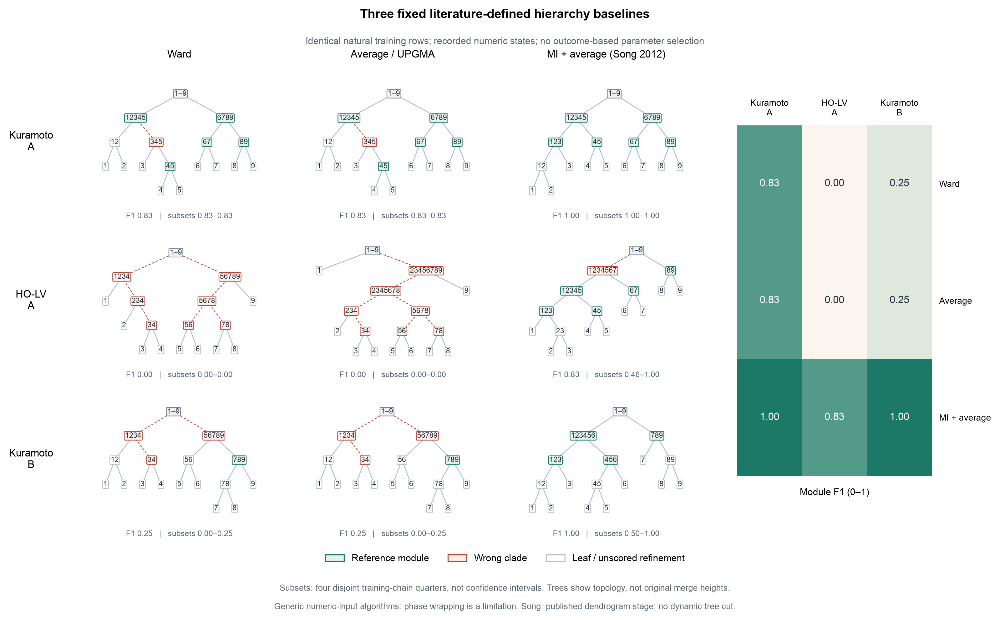

# 层次聚类：精简为三个文献定义的代表

2026-10-16。按用户最新要求，将此前10项主方法和9项表示对照精简为**3项主方法**。优先常用方法，每项仅一个固定设置；算法、距离和估计步骤均有明确出处，不用自定组合代表原论文。原49项探索结果完整保留，筛选不以F1好坏为理由。

## 保留名单与使用广泛程度

没有核实到覆盖所有领域的实际使用量榜单，不能虚构精确名次。这里采用**优先级分层**：第一层是长期广泛使用的通用层次聚类，第二层是有直接应用依据的非线性依赖对照。同层内部不声称有可靠的使用量先后关系。

| 优先级 | 主比较保留 | 文献依据与具体范围 | 唯一固定设置 |
|---|---|---|---|
| 第一层 | **Ward** | Ward (1963), *Hierarchical Grouping to Optimize an Objective Function*，[原刊DOI](https://doi.org/10.1080/01621459.1963.10500845)；Murtagh & Legendre (2014), *Ward’s Hierarchical Clustering Method: Clustering Criterion and Agglomerative Algorithm*，[全文§3.1、3.3](https://arxiv.org/html/1111.6285v2)。后文明确讨论其广泛使用及软件实现差异。 | Euclidean输入，逐步最小化簇内平方误差增量；采用标准Ward2等价实现。 |
| 第一层 | **Average linkage／UPGMA** | Sokal & Michener (1958), *A Statistical Method for Evaluating Systematic Relationships*，[原刊馆藏](https://www.biodiversitylibrary.org/part/385476)；[fastcluster作者说明](https://danifold.net/fastcluster.html)将average、Ward等列为常用连接法。 | Euclidean输入，簇间距离为所有原始跨簇对象对距离的算术平均；不混用WPGMA或质心更新。 |
| 第二层 | **MI＋average，Song原式AUV2构树** | Song, Langfelder & Horvath (2012), *Comparison of co-expression measures: mutual information, correlation, and model based indices*, BMC Bioinformatics 13:328，[正文](https://doi.org/10.1186/1471-2105-13-328)。正文式(10)、(16)、(17)、模块检测段及Supplement 1明确给出整个构树链条。 | 等宽分箱，箱数取样本数平方根的整数部分；Miller–Madow熵；AUV2归一化；1−邻接距离；average linkage。 |

第三项是机制相关的非线性对照，**不是声称它的全球使用量排第三**。Song文中关于“数百篇应用”的表述针对平均连接配合动态截树的模块检测流程，不能转述成其AUV2估计器本身已有数百篇应用。

Ward与average并非同一算法的两个数值超参数：前者最小化方差增量，后者最小化平均跨簇距离。MI项虽然也采用average，其输入是已发表的非线性依赖网络，承担不同的比较目的；不再把三种MI归一化、不同分箱数或多个连接规则分别包装成新方法。

## 本次具体复现到哪一步

**不再把旧适配版分数改名为原方法分数。** 新的三个条目独立使用`paper_protocol.json`和`paper_summary.json`，原探索缓存未覆盖。本次构树和评价共45次，即3方法×3案例×完整训练集及4个链子集；计算0.334秒，无新模拟、MLP拟合或EI/Syn积分。

所有方法使用各例相同48条训练链、24576个源状态，训练／验证／测试链划分与此前MLP契约及49组探索逐项核对一致。聚类对象为9个节点，每个节点的观测轨迹为其输入向量。直接使用已存储数值坐标：Kuramoto为wrapped相位，HO-LV为生成数据的π log丰度坐标；此次没有新增中心化、单位范数、sin/cos、秩变换、滞后混合或核带宽设计。

- **Ward和UPGMA**使用[本机版本SciPy 1.11.4的官方定义](https://docs.scipy.org/doc/scipy-1.11.4/reference/generated/scipy.cluster.hierarchy.linkage.html)。Ward只输入Euclidean距离，不把MI距离套入Ward。Ward每次合并的平方误差增量另以直接计算核验。UPGMA使用所有跨簇原始距离的平均，不把“两个子簇各给一半权重”的WPGMA混作UPGMA。
- **Song AUV2**逐项读取正文、[Supplement 1](https://media.springernature.com/original/springer-static/esm/art:10.1186%2F1471-2105-13-328/MediaObjects/12859_2012_5682_MOESM1_ESM.pdf)、作者[WGCNA::mutualInfoAdjacency](https://raw.githubusercontent.com/cran/WGCNA/master/R/mutualInfoAdjacency.R)及其infotheo、minet、entropy依赖。依作者软件将`sqrt(m)`向下转为整数；等宽箱采用左闭右开，最大值进入最后一箱；Miller–Madow按实际非空格数校正；用I／max(Hx,Hy)归一化，再以1−A运行average。没有替换成KSG、C−MI或自定指数图。正文将箱数写作√m，整数化及非空格处理以其公开软件明确的实现为准。
- 作者软件明确把有限样本负MI置零；此次照其规定实施并保存原始MI矩阵、最小值和影响对数，**不是PEID Syn的裁剪规则**。本次三个完整训练集均为0对受影响；所有原始数值可查。分箱边界、含空格的熵校正、负MI规则及Ward目标等3项针对性软件检查通过。
- Song原论文在树后还用DynamicTreeCut产生平面模块并做GO富集。本任务评价完整层次树，使用原流程中已经生成的dendrogram；**没有执行其下游平面截树和GO分析**，不能称整篇研究全部复现。
- 此处实现为数学步骤与公开软件约定的Python翻译。本机无Rscript，未完成与原R环境逐输出一致性验证。Ward 1963原PDF地址返回站点迁移说明，UPGMA 1958扫描件下载不完整，均未声称完整读取原刊；Ward依据上述可读方法核验研究及固定版本官方定义，UPGMA依据公开标准定义。文献来源和软件文件哈希均已记录。**“构树定义按文献实施”不等于“原作者整个实验环境完全复现”。**

## 三案例结果

每格为完整训练集模块F1；括号内为四个不相交12链子集的最小–最大值，**不是置信区间**。数据、参数与原参考模块不按结果更改。网络B对应原存储键C，不是历史深级联B。

| 方法 | Kuramoto A | HO-LV A | Kuramoto B |
|---|---:|---:|---:|
| Ward | 0.833 [0.833–0.833] | 0.000 [0.000–0.000] | 0.250 [0.000–0.250] |
| Average／UPGMA | 0.833 [0.833–0.833] | 0.000 [0.000–0.000] | 0.250 [0.000–0.250] |
| MI＋average，Song AUV2 | **1.000 [1.000–1.000]** | **0.833 [0.462–1.000]** | **1.000 [0.500–1.000]** |

模块F1忽略最小原始模块内部任意二叉细化；严格clade F1另外保存。三个MI树的严格clade F1分别为0.923、0.769、0.727。图中树枝长度仅用于排版，不冒充原合并距离。

**这仍不足以说明层次聚类普遍不能恢复高阶动力学的模块。** 按已发表的MI流程，两例完整训练集满分，HO-LV也恢复大部分参考层次。它恢复的是模块树，不等于识别不可约三体作用的因果机制。

此外，这些通用方法没有圆周距离设计；Kuramoto的相位截断边界是它们在当前数值输入下的适用限制，不能把低分全部归因于“成对方法无法表达高阶作用”。之前的圆周嵌入和一步增量结果仍完整公开，不能只展示对经典方法不利的状态编码。

共享数据池也不等于相同统计输入：这里三个原方法使用同步源状态，MLP利用相邻源／未来状态对拟合动力学，SPT随后查询冻结模型的干预分布。两条路线的区别需明确，不能声称唯一差异只是最后一步聚类规则。用户要求的MLP→干预TM→SPT必须单独满足；后续[三案例自然MLP试算](spt_natural_mlp_three_cases.md)仍为numerically_unresolved，不用旧字典模型SPT=1替代，也不据此宣布MLP-SPT胜出。

## 移出主图的条目与原因

| 原条目 | 处理依据 |
|---|---|
| Single、complete、weighted、centroid、median | 均有成熟文献；为大幅精简通用凝聚法，保留average代表和目标不同的Ward，其余放原探索附录。不是声称single／complete冷门或仅为数值超参数。 |
| DIANA、bisecting k-means | 均为已有算法；本轮主图不再覆盖每一种分裂式算法，按简洁和通用代表性移出，不按分数删除。 |
| Genie的g=.1/.3/.5；HDBSCAN的m=2/3/5 | 不再将同法参数变体列成独立基线。Genie可留后续专项稳健性比较；此前HDBSCAN展示的是密度凝聚前的完整树，不能充作原方法最终稳定簇结果，整个条目退出此次主比较。 |
| 递归Ncut、自定MI谱图、对称滞后MI、CKA适配 | 原构件有文献，但现有输入图、递归或距离组合并非相关原文的逐项流程；作为探索保留，不再冒称原方法复现。 |
| 旧KSG MI＋average | MI＋average确有直接文献先例，但KSG／torus／copula／C−MI组合不是Song原式。退出原方法主表，保留原三例F1=1及所有敏感性结果，以本次独立计算的Song条目替代。 |
| 状态／增量、PLV／相关、CKA等表示变体 | 不再为每个表示另排一整列主算法；原结果作输入表示敏感性附录。增量Ward与average的原三例结果1、0、1照常保留。 |
| SHiP | 官方源码安装未在既定限时内完成；未运行，不记零分。本次不为凑“最新方法”增加构建成本或自行改写替代。 |

原[49组完整结果和树](spt_hierarchical_clustering_screen.md)仍可查。旧十项筛选图仅是上一次适配筛查的归档，**当前主图以本页三个代表为准**。本次精简发生在已看到探索结果之后，不应称为最初就只有三方法的盲法预注册；新增原式计算的输入、方法和默认值在计算其成绩之前锁定。

互信息＋平均连接还有[Yu & Peng (2013)](https://doi.org/10.1109/TCBB.2013.99)、[Ma et al. (2011)](https://doi.org/10.1109/ISBI.2011.5872577)、[Cánovas et al. (2019)](https://doi.org/10.3390/e21030306)等直接先例；它们分别使用分箱／Joe变换、核密度MI／广义相关变换、序数模式等，未在此混称为同一个估计器。Kraskov等的[MIC分组互信息层次聚类](https://arxiv.org/abs/q-bio/0311039)也不是固定成对矩阵的average，未用其名字命名本方法。

## 核验与复现

本次重新核对Zotero父项P6UJCVG8题名并重列附件，读取唯一主文DXGC7JEA（19/19页）Methods式(10)–(12)和SI MWIWKSVG（28/28页）S5.1式(S49)–(S50)。附件无明确稿件版本日期，元数据修改时间不作为新版本证据。未更动SPT定义、Syn门槛、旧实验预算或旧会话进程。

入口：`.venv/bin/python scripts/spt_hierarchical_clustering_reduced.py`；只重绘使用`--plot-only`。三项检查：`.venv/bin/python -m pytest tests/test_spt_hierarchical_clustering_reduced.py -q`。图已实际视检，图例置于绘图区外，节点标签无重叠，PNG／SVG均保留。

当前筛选和来源哈希在`results/spt_hierarchical_clustering_screen/literature_screening.json`；该文件保留前一版筛选记录。新结果与原探索summary分别有哈希，不用更新后的数据覆盖历史结果。
