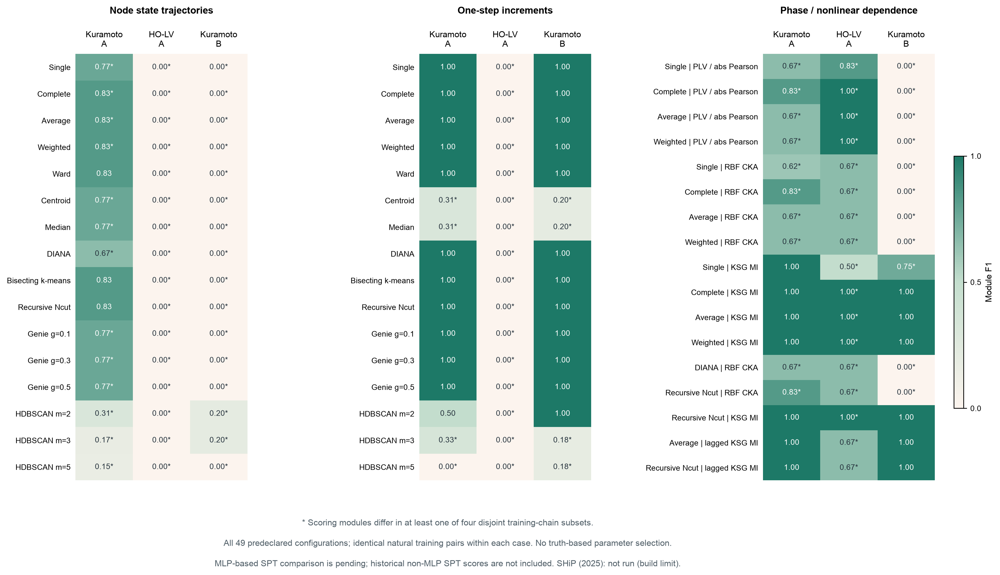
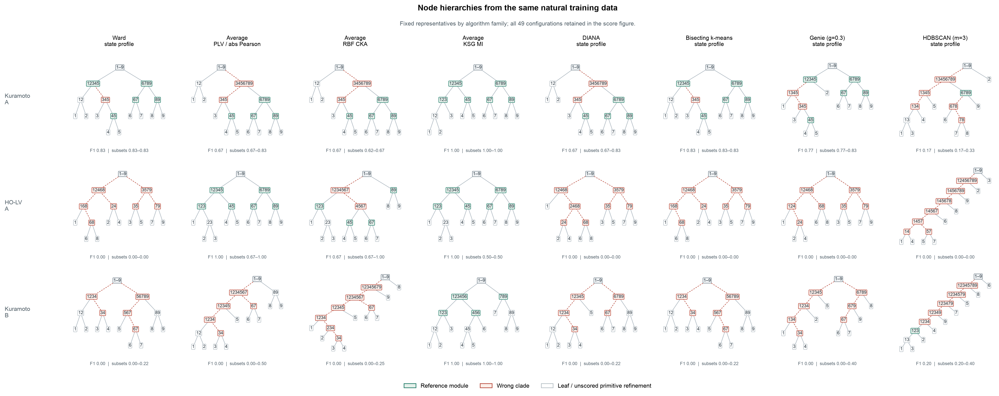

# 三案例：自然数据层次聚类轻量筛查（历史探索归档）

2026-10-16更新：当前主比较已精简为[三个文献定义代表](spt_hierarchical_clustering_literature_audit.md)，见[新图](assets/kuramoto_hierarchy/spt_hierarchical_clustering_reduced.png)。本页49组仅作为探索归档；KSG组合为适配，不是Song论文复现。所有原始分数保留。

2026-10-16。按用户要求，从协同指标比较转向数据驱动的节点层次恢复；本轮只复用既有自然轨迹，不生成新动力学数据、不训练新MLP、不估计EI或Syn。

**现有结果不支持“直接层次聚类普遍无法恢复这三个案例”。KSG互信息＋平均连接在三个完整训练集上模块F1均为1；完整连接、加权连接及基于MI的递归Ncut也达到同样结果。** 常规轨迹几何聚类在HO-LV A与Kuramoto B上明显较弱，但不能省略非线性依赖聚类的成功。

本表不搬用旧Fourier／指数特征拟合所得的SPT=1。后续自然MLP试算见[独立报告](spt_natural_mlp_three_cases.md)，其积分尚未解决；不能宣称MLP-SPT优于这些基线。

预登记49组算法／表示／参数配置，三个案例各做完整训练集与四个训练链子集，共735/735棵完整树。正式重跑计算20.58秒；首次实现检查19.87秒，另有限时120秒的SHiP源码安装尝试。安装与修复不是新物理实验。

星号表示至少一个训练链子集的计分模块不同于完整训练集。所有配置均展示，不按F1选方法或参数。

## 固定代表方法与观察结果

| 方法／表示 | Kuramoto A | HO-LV A | Kuramoto B |
|---|---:|---:|---:|
| Ward | state | 0.833 | 0.000 | 0.000 |
| Average | state | 0.833 | 0.000 | 0.000 |
| Average | PLV / abs Pearson | 0.667 | 1.000 | 0.000 |
| Ward | increment | 1.000 | 0.000 | 1.000 |
| Average | RBF CKA | 0.667 | 0.667 | 0.000 |
| Average | KSG MI | 1.000 | 1.000 | 1.000 |
| Average | lagged KSG MI | 1.000 | 0.667 | 1.000 |
| DIANA | state | 0.667 | 0.000 | 0.000 |
| Bisecting k-means | state | 0.833 | 0.000 | 0.000 |
| Genie g=0.3 | state | 0.769 | 0.000 | 0.000 |
| HDBSCAN m=3 | state | 0.167 | 0.000 | 0.200 |

代表树固定为Ward、相位锁定／绝对相关平均连接、核依赖平均连接、MI平均连接、DIANA、二分k-means、Genie g=.3和HDBSCAN m=3。选择按方法家族覆盖，未按结果好坏选树。枝长仅排版；红色节点为相对既定参考的额外clade，不代表物理相互作用为负。

## 数据、模型与评分边界

- 聚类对象始终是九个系统节点。每个节点的训练轨迹为其特征，未将时刻聚成状态簇后冒充节点树。
- 复用每例64条链×512个相邻状态对的原自然轨迹池，固定seed=20261016按链划分48／8／8。聚类只使用48条训练链，即24576对；验证与测试链不参与距离计算。Kuramoto A逐项核对并完全复用了已批准自然MLP试算的训练数组摘要；LV和Kuramoto B锁定同一划分规则。后续三例自然MLP拟合另见独立报告，未混入本次735棵树。
- 状态表示：Kuramoto用sin/cos圆周嵌入，LV沿用u=π log(丰度)；节点内沿训练时间中心化并归一化为单位范数。一步变化表示用wrapped相位差或相邻log丰度差，也逐节点归一化。未在节点间打乱时间，未将独立链首尾拼接成新转移。
- 非线性距离：相位锁定值或绝对Pearson；RBF中心核归一化Frobenius相似度（CKA，1024个共同训练行，逐节点中位距离带宽）；KSG-1互信息（2048个共同训练行、k=5，圆周用torus最近邻，LV用秩copula）；另计算两方向跨时互信息的平均。MI只作为聚类相似度，不称因果或有效信息。KSG负估计原样保留，距离为最大off-diagonal MI减原MI，无截断。
- 凝聚法包括single、complete、average、weighted、Ward、centroid、median；后三者只用于确为Euclidean的轨迹表示，未把一般MI距离代入Ward。Genie使用官方genieclust预计算距离接口，g=.1/.3/.5全部保留；HDBSCAN使用官方完整mutual-reachability单连接树、m=2/3/5，未把丢弃噪声后的平面标签补造成树。DIANA为按splinter规则的独立实现；递归Ncut为谱向量排序后的全部prefix sweep，均递归到单节点。二分k-means使用sklearn官方实现，固定20次内部初始化和随机种子。
- 模块参考与旧实验一致，来自预声明权重阈值连通层级；忽略最小三元模块内部严格细化，所有方法同规则。另在JSON记录严格clade F1、precision/recall、根恢复、上层召回及TP/FP/FN。模块满分不等于恢复了所有重叠物理超边，也不验证最小三元组内部任意二叉结构。网络B对应native C，未加载历史深级联B。
- 四子集各取训练链顺序中的12条完整链，属于同一生成模型／同一轨迹池的敏感性检查。三个案例各一个生成种子，无独立系统重复或显著性检验；不对735棵树作独立样本统计。

## 所有预登记配置

每格为完整训练集模块F1，方括号为四个12链子集的最小–最大值，不是置信区间。

| 配置 | Kuramoto A | HO-LV A | Kuramoto B |
|---|---:|---:|---:|
| Single | state | 0.769 [0.615, 0.833] | 0.000 [0.000, 0.000] | 0.000 [0.000, 0.200] |
| Complete | state | 0.833 [0.769, 0.833] | 0.000 [0.000, 0.000] | 0.000 [0.000, 0.250] |
| Average | state | 0.833 [0.769, 0.833] | 0.000 [0.000, 0.000] | 0.000 [0.000, 0.222] |
| Weighted | state | 0.833 [0.769, 0.833] | 0.000 [0.000, 0.000] | 0.000 [0.000, 0.222] |
| Ward | state | 0.833 [0.833, 0.833] | 0.000 [0.000, 0.000] | 0.000 [0.000, 0.222] |
| Centroid | state | 0.769 [0.769, 0.769] | 0.000 [0.000, 0.000] | 0.000 [0.000, 0.200] |
| Median | state | 0.769 [0.769, 0.769] | 0.000 [0.000, 0.000] | 0.000 [0.000, 0.200] |
| DIANA | state | 0.667 [0.667, 0.833] | 0.000 [0.000, 0.000] | 0.000 [0.000, 0.222] |
| Bisecting k-means | state | 0.833 [0.833, 0.833] | 0.000 [0.000, 0.000] | 0.000 [0.000, 0.222] |
| Recursive Ncut | state | 0.833 [0.833, 0.833] | 0.000 [0.000, 0.000] | 0.000 [0.000, 0.250] |
| Genie g=0.1 | state | 0.769 [0.769, 0.833] | 0.000 [0.000, 0.000] | 0.000 [0.000, 0.400] |
| Genie g=0.3 | state | 0.769 [0.769, 0.833] | 0.000 [0.000, 0.000] | 0.000 [0.000, 0.400] |
| Genie g=0.5 | state | 0.769 [0.615, 0.833] | 0.000 [0.000, 0.000] | 0.000 [0.000, 0.200] |
| HDBSCAN m=2 | state | 0.308 [0.154, 0.308] | 0.000 [0.000, 0.000] | 0.200 [0.200, 0.444] |
| HDBSCAN m=3 | state | 0.167 [0.167, 0.333] | 0.000 [0.000, 0.000] | 0.200 [0.200, 0.400] |
| HDBSCAN m=5 | state | 0.154 [0.000, 0.154] | 0.000 [0.000, 0.000] | 0.000 [0.000, 0.182] |
| Single | increment | 1.000 [1.000, 1.000] | 0.000 [0.000, 0.000] | 1.000 [1.000, 1.000] |
| Complete | increment | 1.000 [1.000, 1.000] | 0.000 [0.000, 0.000] | 1.000 [1.000, 1.000] |
| Average | increment | 1.000 [1.000, 1.000] | 0.000 [0.000, 0.000] | 1.000 [1.000, 1.000] |
| Weighted | increment | 1.000 [1.000, 1.000] | 0.000 [0.000, 0.000] | 1.000 [1.000, 1.000] |
| Ward | increment | 1.000 [1.000, 1.000] | 0.000 [0.000, 0.000] | 1.000 [1.000, 1.000] |
| Centroid | increment | 0.308 [0.308, 0.308] | 0.000 [0.000, 0.000] | 0.200 [0.200, 0.200] |
| Median | increment | 0.308 [0.308, 0.308] | 0.000 [0.000, 0.000] | 0.200 [0.200, 0.200] |
| DIANA | increment | 1.000 [1.000, 1.000] | 0.000 [0.000, 0.000] | 1.000 [1.000, 1.000] |
| Bisecting k-means | increment | 1.000 [1.000, 1.000] | 0.000 [0.000, 0.000] | 1.000 [1.000, 1.000] |
| Recursive Ncut | increment | 1.000 [1.000, 1.000] | 0.000 [0.000, 0.000] | 1.000 [1.000, 1.000] |
| Genie g=0.1 | increment | 1.000 [1.000, 1.000] | 0.000 [0.000, 0.000] | 1.000 [1.000, 1.000] |
| Genie g=0.3 | increment | 1.000 [1.000, 1.000] | 0.000 [0.000, 0.000] | 1.000 [1.000, 1.000] |
| Genie g=0.5 | increment | 1.000 [1.000, 1.000] | 0.000 [0.000, 0.000] | 1.000 [1.000, 1.000] |
| HDBSCAN m=2 | increment | 0.500 [0.500, 0.500] | 0.000 [0.000, 0.000] | 1.000 [1.000, 1.000] |
| HDBSCAN m=3 | increment | 0.333 [0.333, 0.333] | 0.000 [0.000, 0.000] | 0.182 [0.182, 0.182] |
| HDBSCAN m=5 | increment | 0.000 [0.000, 0.167] | 0.000 [0.000, 0.000] | 0.182 [0.182, 0.182] |
| Single | PLV / abs Pearson | 0.667 [0.615, 0.667] | 0.833 [0.769, 0.833] | 0.000 [0.000, 0.000] |
| Complete | PLV / abs Pearson | 0.833 [0.667, 0.833] | 1.000 [0.667, 1.000] | 0.000 [0.000, 0.500] |
| Average | PLV / abs Pearson | 0.667 [0.667, 0.833] | 1.000 [0.667, 1.000] | 0.000 [0.000, 0.500] |
| Weighted | PLV / abs Pearson | 0.667 [0.667, 0.833] | 1.000 [0.667, 1.000] | 0.000 [0.000, 0.250] |
| Single | RBF CKA | 0.615 [0.615, 0.667] | 0.667 [0.833, 1.000] | 0.000 [0.000, 0.000] |
| Complete | RBF CKA | 0.833 [0.615, 0.833] | 0.667 [0.667, 1.000] | 0.000 [0.000, 0.500] |
| Average | RBF CKA | 0.667 [0.615, 0.667] | 0.667 [0.667, 1.000] | 0.000 [0.000, 0.250] |
| Weighted | RBF CKA | 0.667 [0.615, 0.769] | 0.667 [0.667, 1.000] | 0.000 [0.000, 0.250] |
| Single | KSG MI | 1.000 [1.000, 1.000] | 0.500 [0.462, 0.500] | 0.750 [0.667, 0.750] |
| Complete | KSG MI | 1.000 [1.000, 1.000] | 1.000 [0.500, 0.500] | 1.000 [1.000, 1.000] |
| Average | KSG MI | 1.000 [1.000, 1.000] | 1.000 [0.500, 0.500] | 1.000 [1.000, 1.000] |
| Weighted | KSG MI | 1.000 [1.000, 1.000] | 1.000 [0.500, 0.500] | 1.000 [1.000, 1.000] |
| DIANA | RBF CKA | 0.667 [0.615, 0.667] | 0.667 [0.667, 0.833] | 0.000 [0.000, 0.250] |
| Recursive Ncut | RBF CKA | 0.833 [0.615, 0.833] | 0.667 [0.833, 1.000] | 0.000 [0.000, 0.250] |
| Recursive Ncut | KSG MI | 1.000 [1.000, 1.000] | 1.000 [0.500, 0.833] | 1.000 [1.000, 1.000] |
| Average | lagged KSG MI | 1.000 [1.000, 1.000] | 0.667 [0.500, 1.000] | 1.000 [1.000, 1.000] |
| Recursive Ncut | lagged KSG MI | 1.000 [1.000, 1.000] | 0.667 [0.667, 0.833] | 1.000 [1.000, 1.000] |

## 解释与下一步方向

这些自然轨迹已将部分高阶耦合投影成可由成对非线性依赖辨识的模块关系；这不是说成对统计识别了不可约三体机制。跨时刻与同步相关、有限噪声下的间接作用，都可能使相似度树恰好匹配模块参考。本轮未分离这些因素。

HO-LV的MI平均连接在完整训练集F1=1，四个12链子集均降为.5；Kuramoto两例的同一方法在四个子集仍均为1。因此可进一步研究采样覆盖与小样本稳定性，但须在同一自然训练数据上完成可信MLP-SPT后再比较，不能用旧SPT分数推断这一优势。

若论文要论证普通依赖聚类的辨识边界，更有力的方向是预先构造／登记“不同高阶机制但低阶统计接近”的对照，并保留聚类成功与失败；不能只挑当前低分的距离或算法。当前结果适合说明相似性结构与干预机制层次是不同对象，尚不能证明MLP-SPT的恢复精度更高。

## 方法来源、未运行项目与实现核查

常用方法与现代稳健方法已执行，但不声称覆盖所有最前沿层次聚类。另核查NeurIPS 2025的SHiP官方实现：当前解释器／平台无可用binary wheel，源码构建在预设120秒上限停止并终止安装进程组。本轮不长时间编译、不将它记成F1=0。不能称已完成2025／2026最前沿方法的全面比较。

- [SciPy linkage](https://docs.scipy.org/doc/scipy/reference/generated/scipy.cluster.hierarchy.linkage.html)
- [DIANA](https://stat.ethz.ch/R-manual/R-devel/library/cluster/html/diana.html)
- [Bisecting k-means](https://scikit-learn.org/stable/modules/generated/sklearn.cluster.BisectingKMeans.html)
- [Normalized cuts](https://people.eecs.berkeley.edu/~malik/papers/SM-ncut.pdf)
- [Genie](https://genieclust.gagolewski.com/pythonapi_root.html)
- [HDBSCAN hierarchy](https://hdbscan.readthedocs.io/en/latest/how_hdbscan_works.html)
- [KSG MI](https://doi.org/10.1103/PhysRevE.69.066138)
- [SHiP (NeurIPS 2025)](https://github.com/pasiweber/SHiP-framework/)
- [CKA / normalized kernel alignment](https://proceedings.mlr.press/v97/kornblith19a.html)

仅在临时目录安装官方Genie/HDBSCAN及依赖，未升级项目NumPy。Genie用精确预计算距离避开其Euclidean加速路径的NumPy2接口要求。首次运行发现sklearn释放叶节点indices及相关矩阵约1e-15非对称舍入，已读取官方labels_恢复叶身份，并在明确对称误差检查后对距离取对称均值；未改变表示、超参数、评分或真值。原失败与修复原因保存在implementation_repair.json。

5项独立软件检查通过：圆周共同旋转不变性及Euclidean等距降维、torus KSG非线性依赖与独立控制、DIANA／Ncut分离控制、官方二分k-means叶身份、模块F1与严格F1区别。图均已实际视检，图例／色条不覆盖数据；这些软件验证不替代方法泛化证据。

本次经Zotero重新核对P6UJCVG8题名及全部附件，重新读取唯一主文DXGC7JEA（19页）Methods式（10）–（12）和SI MWIWKSVG（28页）S5.1式（S49）–（S50）。附件无明确稿件日期／版本，保留歧义。本轮不消费Syn，无新增Syn非负估计或容差放宽。

复现：先在可用Python环境安装genieclust、deadwood、quitefastmst和hdbscan；本机使用临时路径`PYTHONPATH=/tmp/eisyn_hc_deps`，再以`.venv/bin/python scripts/spt_hierarchical_clustering_screen.py`执行。图表直接读summary.json：`.venv/bin/python scripts/plot_spt_hierarchical_clustering_screen.py`。全部原轨迹、旧实验结果及旧预算均未修改。
