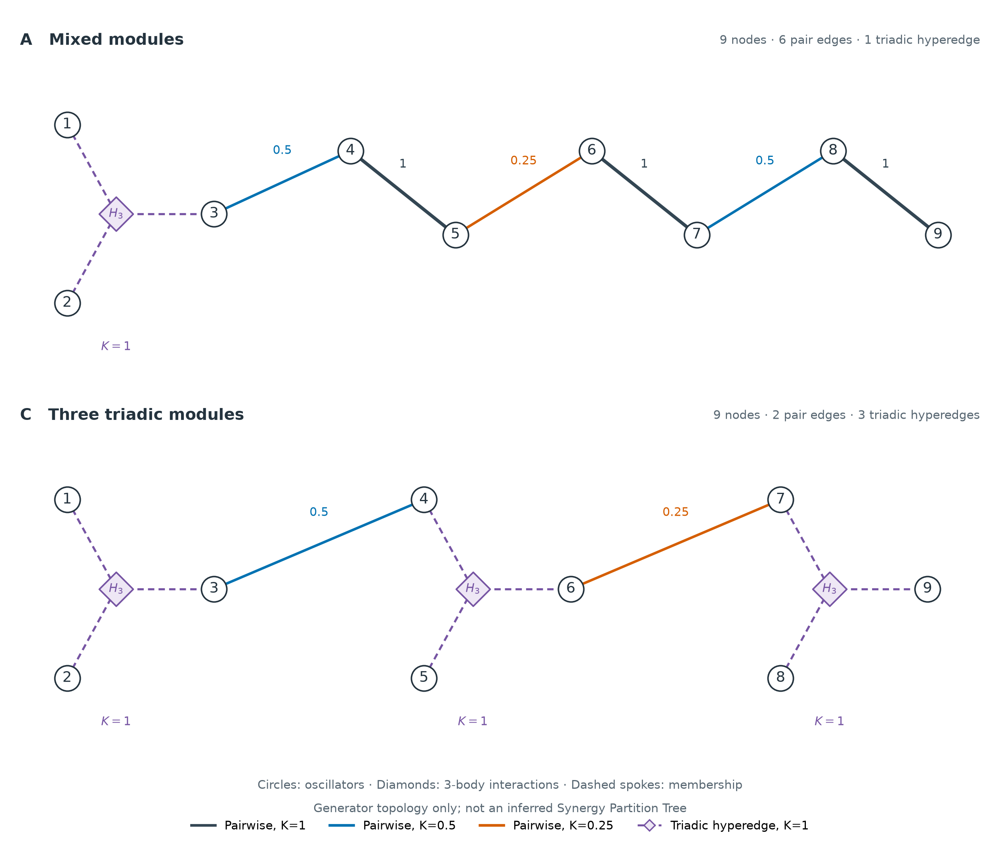
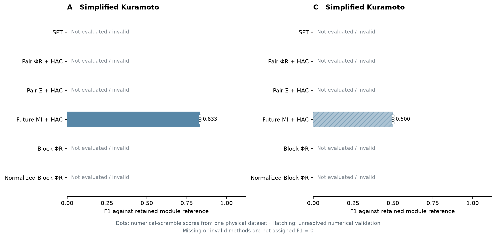

# 简化 A/C Kuramoto：六方法对比

> 用户已将最终范围改为 SPT 与三个选定基线。此六法工作流已停止；当前结果与方法声明见 [四法报告](spt_kuramoto_ac_selected_comparison.md)，以下仅保留历史工作记录。

2026-10-15。用户要求完成此前说明的对比，沿用新增计算最多 6 小时及一个只读方法核查子代理的范围。两个独立工作进程分别处理 A/C，共用一个墙钟截止时间。结果逐项缓存；预算外不重启，不按成绩更改参数。

## 预声明的比较对象

问题是在同一冻结学习联合下，SPT、Pair ΦR + HAC、Pair Ξ + HAC、Future MI + HAC、Block ΦR、Normalized Block ΦR 对保留模块层级的相似度如何。原始 clades、根切分和数值重复均同时保留。

模块参考在计算前固定：A 的底层为 123、45、67、89，上层为 12345、6789；C 的底层为 123、456、789，上层为 123456（另一根子组为 789）。这些是从原设计保留的嵌套模块参考，不是简化后重叠物理边的完整真值，也不承诺动力学必然产生这一 SPT。沿用既有 clade F1 规则，忽略底层模块严格内部的二叉细化，所有方法一视同仁。新增桥边不作为必须同时恢复的 clade。除评分外，拟合与积分过程不接收模块参考。

源为独立 Uniform(-π,π)^9 干预；τ=.20、dt=.0025、σ=.08、原九频率及已画出的全部连边系数保持不变。复用开发数据 seed 0 的 16384/4096/4096 训练、验证、测试及 learned-flow + product-von-Mises 周期条件 TM。SPT/Pair Ξ 的 target 固定为完整未来九相位；其余基线使用定义规定的未来群组或成对 target，均从同一冻结联合边缘化。信息单位为 nats。

全源表先计算 N=1024、P=256、4 个 scramble 的全部 511 项 EI，审计全部 9330 个 raw Syn 二分及 Ξ。原生 Syn 容差固定 .01 nats；容差内负值保留并计数，低于 -.01 则明确失败，报告最小值、阈值、数量，不裁剪。所有完整/部分昂贵缓存均可复用，缺项不填零。

群组基线先采用 N=256、informed P=256、prior-only P=1024、4 个 scramble；full-target 分支仍使用 P=256。ΦR 的点估计先分别平均 EI，再取 MMI 最小值；逐 scramble 的 ΦR 仅用于数值变动和树稳定性。Normalized Block ΦR 除以 min(|L|,|R|)，单位 nats/node，不是 SI S5.2 的另一种可选 SPT 归一化。

Future MI 复用整体旋转对称性和 Fourier/VM 解析噪声积分；从 2^18 源样本开始，只有数值误差未达 1e-4 nats 时才加密至 2^20。HAC 为共同 average linkage。完整枚举每个访问节点的所有无序二分；不按真实模块缩减候选。

初始六法计算完成后，对所有 Pair Ξ、选中 SPT 节点及粗网格竞争切分加密至 N=4096、P=256。群组基线加密至 N=512、informed P=512；prior-only 仍 1024、full-target 仍 256。筛选规则为粗网格前两名及距最优不超过 8 个配对数值 SEM 的候选，属于启发式候选池核查，不是全部高精度候选的同时认证。若新树引入未核查父节点，继续扩展对应候选或明确标为未解决。

## 证据边界

每例只有一个物理训练数据集；4 个积分 scramble 不能当作 4 个独立物理实验，不计算总体优越性的 p 值。数值精度不等于 SDE 密度拟合正确。独立、恒浓度 VM 输出仍是明确的模型近似。程序状态 complete 只表示查询完成，低 ESS、大权重、分辨不清的排名仍需单独报告。失败算法不记 F1=0。

## 手稿核对

本任务重新通过 Zotero 本地 API 核验父项 P6UJCVG8：*Emergent hierarchical organization of causal interactions in complex systems*，重新读取当前唯一主文 DXGC7JEA 与 SI MWIWKSVG。附件与正文均无明确稿件日期或版本；2026-10-04 的元数据修改时间不能确定新版。已核对 Methods (5)–(12)、SI S1.2 (S7)–(S15)、S5.1 (S49)–(S50)、S7 (S67)–(S71)。共同干预、固定 target 的 EI/Syn 与完整到单叶的标准 SPT 沿用这些定义；这里九节点未来相位 target 和周期条件 TM 与手稿六节点未来增量、具体 TM 近似不同，不套用 affine/Wishart 修正。

## 计算结果

<!-- AC_RESULTS -->

| 案例 | 方法 | 模块参考 F1 | 根切分 | 数值状态 |
|---|---|---:|---|---|
| A | SPT | 未评价 | — | not_computed |
| A | Pair ΦR + HAC | 未评价 | — | not_computed |
| A | Pair Ξ + HAC | 未评价 | — | not_computed |
| A | Future MI + HAC | 0.8333 | {6,7,8,9} / {1,2,3,4,5} | numerically_stable |
| A | Block ΦR | 未评价 | — | not_computed |
| A | Normalized Block ΦR | 未评价 | — | not_computed |
| C | SPT | 未评价 | — | not_computed |
| C | Pair ΦR + HAC | 未评价 | — | not_computed |
| C | Pair Ξ + HAC | 未评价 | — | not_computed |
| C | Future MI + HAC | 0.5000 | {7,8,9} / {1,2,3,4,5,6} | exploratory_unresolved |
| C | Block ΦR | 未评价 | — | not_computed |
| C | Normalized Block ΦR | 未评价 | — | not_computed |

斜线柱为尚未通过数值稳定性核查的探索性分数；白点是同一物理数据集的数值 scramble 得分，不能解释为独立物理重复。未完成或显著违规的方法不补零。F1 评价相对于预声明的模块参考，不是所有物理连边的恢复率。

### A：覆盖及原始结构

运行状态 `running`；完整 EI 各重复覆盖 `[511, 92]`/511。full/group/refined-full/refined-group 状态：`running` / `not_started` / `not_started` / `not_started`。

- Future MI + HAC：原始 clades 为 `[[6, 7], [8, 9], [6, 7, 8, 9], [4, 5], [3, 4, 5], [1, 2], [1, 2, 3, 4, 5]]`；分数来自 future_mi_refined_p20.json。

### C：覆盖及原始结构

运行状态 `running`；完整 EI 各重复覆盖 `[511, 134]`/511。full/group/refined-full/refined-group 状态：`running` / `not_started` / `not_started` / `not_started`。

- Future MI + HAC：原始 clades 为 `[[7, 9], [7, 8, 9], [5, 6], [3, 4], [1, 2], [1, 2, 3, 4], [1, 2, 3, 4, 5, 6]]`；分数来自 future_mi_refined_p20.json。

<!-- AC_RESULTS_END -->

入口：`scripts/spt_kuramoto_ac_comparison.py`。内部缓存位于 `results/spt_local_kuramoto_tm/ac_comparison/A/` 和 `C/`，使用 JSON/JSONL；共享 `budget.json` 记录模型、估计器来源指纹及截止时间。原 B 代码及缓存不受修改。
