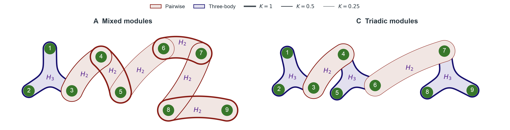
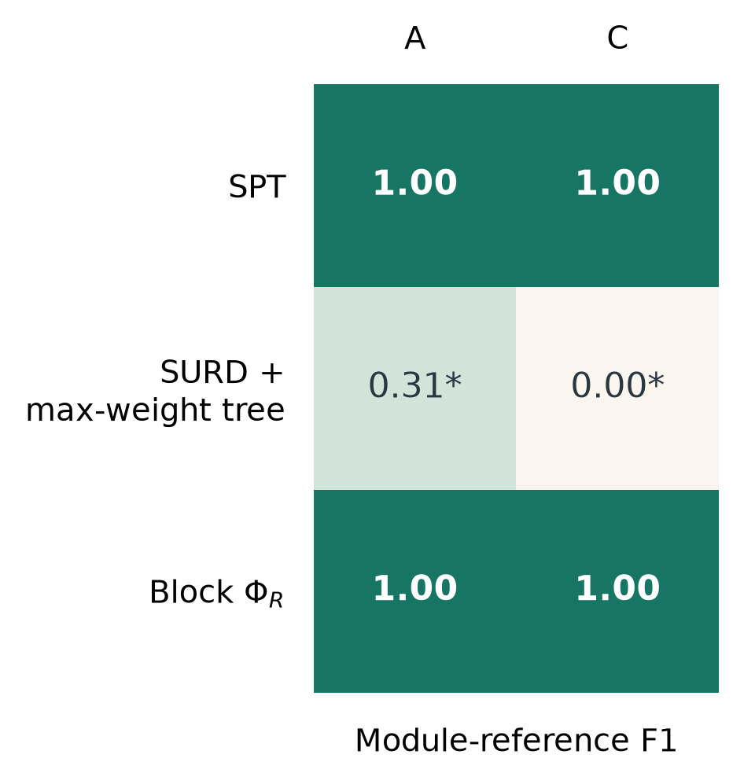

# 简化 A/C Kuramoto：SPT 与三个选定对比算法

2026-10-15。按用户最后确定的范围，只完成 SPT、SURD + max-weight tree、Block ΦR。旧六法工作流已停止；已有 full-target EI 缓存继续复用。共享计算截止时间仍为当天 21:04:03（Asia/Shanghai），没有重置六小时预算。

## 网络与共同条件

采用用户于本轮提供的重绘示意图，保持原图不作图像编辑。绿色圆点是相位节点；蓝色 H3 区域表示三体相互作用，红色 H2 区域表示二体相互作用；边界线宽表示 K。A 保留三体 123，二体 45、67、89，桥边 34、78、56；C 保留三体 123、456、789，桥边 34、67。粗模块强度为 1，桥边为 .5 或 .25；τ=.20、dt=.0025、噪声 σ=.08，九个固有频率不变。最高只到三体。该图与冻结生成器的超边和系数一致。

同一物理数据集 seed 0，训练/验证/测试为 16384/4096/4096。所有方法复用数据选择的 learned-flow + 独立恒浓度 von Mises 周期条件 TM；502 个非单点候选相互作用均进入数据筛选，拟合与搜索不接收模块参考。独立 Uniform(-π,π)^9 源干预、未来相位 target、时间跨度和冻结联合均保持一致；群组 target 是这个共同联合的边缘，不重新拟合。EI 与原生 Syn/ΦR 使用 nats。

F1 对照预先保留的**嵌套模块参考**：A 为 123、45、67、89、12345、6789；C 为 123、456、789、123456。忽略底层模块严格内部的二叉细化，对三法使用同一评分规则。桥边的物理支持会重叠，因此该指标不是所有物理边的恢复率，也不预设这些模块必然是新动力学的信息层级。

对应这一主指标，分别记录模块尺度树一致性（根与同一评分规则过滤后的 clades）和全部原始二叉树一致性。底层模块内部的对称细化若变化，不能称完整树已认证，但不单独否定已稳定的模块 F1；三法采用相同口径。Block 的候选差距门槛也区分影响模块指标的切分与底层模块内部细化，原始诊断全部保留。

## 算法与数值条件

- SPT：N=1024、P=256、四个独立 Sobol scramble，全部 511 个非空源子集和全部 9330 个无序二分。对平均表和四个重复逐份审计 Syn、全部 Ξ 和层级 closure。随后 N=4096、P=256 核查粗档前两名及距最优不超过 8 个配对数值 SEM 的候选；新访问父节点扩展全部子切分。这是启发式筛选池核查，不是全体高档切分的同时认证。最终优先使用有效的高档树，明确保存粗档树。
- SURD + max-weight tree：先逐个未来状态计算所有 511 个 specific-information，再按 SURD SI (S13)–(S16) 分配原子，最后平均。以固定动态规划全局最大化所选 clade 的协同原子权重之和，不利用模块参考、模块数量或按结果选择树适配方式。SURD 原算法输出原子，树是本比较声明的后处理。
- SURD 的附加近似：对每个完整未来状态，使用共同冻结联合的完整九维后验重要性采样，独立一批粒子拟合局部 Gaussian 后验 TM，另一批评价其边缘交叉熵。N=1024、P=8192、四个 scramble；同时保留 N=256 和 P=4096 对照。对任意源子集 A，使用 i_A≈|A|log(2π)+E_p log g_A。full-specific 与 Gaussian full-specific 的差估计 KL(p_full‖g_full)；在精确期望下，该 KL 控制全部边缘交叉熵误差。这里有限粒子的 KL 仅为诊断，不是严格误差证书。另核查共同 EI 均值、原子变化、排序敏感性和树一致性。不得把平均 EI 表直接分配为 SURD。
- Block ΦR：在每个访问父节点枚举全部无序二分。ΦR=I(X_LR;Y_LR)−I(X_L;Y_L)−I(X_R;Y_R)+min_{a,b∈{L,R}} I(X_a;Y_b)。先对各 EI 作四次平均再取非线性 MMI 最小项；逐 scramble 的树用于数值敏感性。归一化版本已按用户要求取消，不再执行或展示。
- 群组积分：初档 N=256、informed P=256、prior-only P=1024，四个 scramble；保留 P=64 与 N=128 前缀诊断。缺失自身 target 坐标采用条件重要性采样，其余缺失源按独立均匀先验积分，精确计入实际混合 proposal 密度。局部 Jacobian 协方差只改善 proposal，不改变拟合联合。A/C 使用独立快照，不依赖并行 B 工作流的后续修改。

两种 Block 树完成后，依次对粗档前两名及 8 个配对数值 SEM 内的候选进行 N=512、informed P=512 检查，prior-only 仍为 1024、full-target 仍为 256；新访问父节点展开全部切分。该加密同样属于筛选池检查，不声称全体高档候选的同时认证。

SURD 初档四次重复已完成，但最大原子数值 SEM 为 A=.0182、C=.0111 nats，N256→1024 最大原子变化为 .0270/.0625 nats，外层精度未解决。因此在原预算内追加同一 Sobol 流的 N=4096 检查，完整复用前 1024 个未来状态及其 specific information，只追加其余 3072 个状态。以 256 状态为一块缓存；已用解析 identity TM 验证分块与一次性计算的后验矩完全一致，不改变后验近似、树目标或模型参数。

原生 Syn 容差固定 .01 nats；[-.01,0) 只按数值零解释，原始值与数量保留，不裁剪。低于 -.01 是显著违规，明确报最低值、阈值和数量，不报告有效 F1。独立源干预下，Block ΦR 理论上也应非负，采用相同原生容差检查。缺项、失败与零分区分。`complete` 只表示查询结束，最终状态另核查 proposal、精度变化和树稳定性。

## 手稿与实现边界

本任务重新通过 Zotero 核对父项 P6UJCVG8：*Emergent hierarchical organization of causal interactions in complex systems*。当前主文 DXGC7JEA、SI MWIWKSVG 无明确稿件日期或版本；附件元数据的修改日期不能确定新版本。已读取 Methods (5)–(12)、SI S1.2 (S7)–(S15)、S5.1 (S49)–(S50)、S7 (S67)–(S71)、S9.3。共同干预与 SPT 定义据此核对；本实验九节点未来相位、学习 flow/product-VM 密度近似，与手稿六节点未来增量的具体实现存在差别。

SURD 原文父项 K69ZCNZG，*Decomposing causality into its synergistic, unique, and redundant components*（2024），SI KNU3AJTZ S1.2 (S12)–(S16)。当前手稿 SI S9.3 使用自然轨迹的观察联合；这里为控制干预差异，明确采用**干预联合、完整未来向量 target、固定最大权重树适配**。因此不声称直接复现该观察性 SURD 实验。局部 Gaussian 后验进一步构成显式估计近似，不将其分数描述为精确 SDE SURD。

每例只有一个物理数据集，四次积分 scramble 不能充当四次独立物理重复，不据此计算总体优越性的 p 值。数值精度通过也不等于真实 SDE 的条件密度拟合无误。报告排名仅限本冻结模型、本数据集和声明的近似。

## 结果

<!-- SELECTED_RESULTS -->

| 方法 | A：F1 | C：F1 |
|---|---:|---:|
| SPT | 1.0000 | 1.0000 |
| SURD + max-weight tree | 0.3077 * | 0.0000 * |
| Block ΦR | 1.0000 | 1.0000 |

* 表示数值或近似敏感性尚未全部解决；不将这些分数当作确定排名。失败/缺项不填零。

### A 的结构与核查

- **spt**：`stable`；根切分 `[[1, 2, 3, 4, 5], [6, 7, 8, 9]]`；clades `[[1, 2, 3, 4, 5], [6, 7, 8, 9], [1, 2, 3], [4, 5], [1, 3], [6, 7], [8, 9]]`；数值 F1 范围 `[1.0, 1.0]`；评分结构/原始树一致 4/4、2/4。
  评分来自 N4096 screened candidate pool；五份完整粗档审计的最低 raw Syn 为 -0.00151395 nats，容差负值数 `[596, 555, 273, 558, 559]`，显著 Syn/Ξ 违规均为零；closure=0 nats。
  高档最低 raw Syn/Ξ=0.00251438/0.0140174 nats；容差负 Syn/Ξ 数=0/0。

- **surd**：`sensitivity_unresolved`；根切分 `[[1, 3, 4, 5, 6, 7, 8, 9], [2]]`；clades `[[1, 3, 4, 5, 6, 7, 8, 9], [3, 4, 5, 6, 7, 8, 9], [3, 4, 5, 6, 7], [3, 4, 5], [3, 4], [6, 7], [8, 9]]`；数值 F1 范围 `[0.15384615384615383, 0.30769230769230765]`；评分结构/原始树一致 1/4、1/4。
  粒子/outer 原子最大变化 0.0028147/0.019212 nats；同档原子最大数值 SEM 0.0085821 nats；full-KL 均值 `[0.0025484948730328397, 0.0025520303403710493, 0.002570291441313097, 0.002551027706992822]`。
  与共同 EI 的诊断：`{'maximum_absolute_mean_difference_nats': 0.0024555497426268502, 'maximum_paired_numerical_sem_nats': 0.0016440128234128445, 'outside_01_plus_three_sem_count': 0, 'source_subset_count': 24, 'outer': 4096, 'scope': 'Diagnostic per-subset agreement; no simultaneous statistical certificate'}`。

- **block_phi_r**：`stable`；根切分 `[[1, 2, 3, 4, 5], [6, 7, 8, 9]]`；clades `[[1, 2, 3, 4, 5], [6, 7, 8, 9], [1, 2, 3], [4, 5], [1, 2], [6, 7], [8, 9]]`；数值 F1 范围 `[1.0, 1.0]`；评分结构/原始树一致 4/4、4/4。
  原生 ΦR 非负审计 `{'minimum_raw_phi_nats': 0.5208432824410028, 'threshold_nats': -0.01, 'significant_violation_count': 0, 'tolerance_negative_count': 0}`；proposal 核查 `{'minimum_ess': 15.28648824137025, 'maximum_normalized_weight': 0.11707093549292577, 'low_ess_marginal_count': 0, 'large_weight_marginal_count': 0}`。
### C 的结构与核查

- **spt**：`stable`；根切分 `[[1, 2, 3, 4, 5, 6], [7, 8, 9]]`；clades `[[1, 2, 3, 4, 5, 6], [7, 8, 9], [1, 2, 3], [4, 5, 6], [1, 3], [5, 6], [8, 9]]`；数值 F1 范围 `[1.0, 1.0]`；评分结构/原始树一致 4/4、0/4。
  评分来自 N4096 screened candidate pool；五份完整粗档审计的最低 raw Syn 为 -0.00137357 nats，容差负值数 `[545, 340, 645, 422, 509]`，显著 Syn/Ξ 违规均为零；closure=0 nats。
  高档最低 raw Syn/Ξ=0.00242129/-1.39869e-05 nats；容差负 Syn/Ξ 数=0/2。

- **surd**：`sensitivity_unresolved`；根切分 `[[1, 3, 4, 5, 6, 7, 8, 9], [2]]`；clades `[[1, 3, 4, 5, 6, 7, 8, 9], [3, 4, 5, 6, 7, 8, 9], [3, 4, 6, 7, 8], [3, 4, 8], [3, 4], [6, 7], [5, 9]]`；数值 F1 范围 `[0.0, 0.0]`；评分结构/原始树一致 1/4、1/4。
  粒子/outer 原子最大变化 0.0017919/0.01812 nats；同档原子最大数值 SEM 0.0077439 nats；full-KL 均值 `[0.005734705043807303, 0.005749895909786389, 0.005743078695812637, 0.005743896089316635]`。
  与共同 EI 的诊断：`{'maximum_absolute_mean_difference_nats': 0.005553020842381073, 'maximum_paired_numerical_sem_nats': 0.001644232903514256, 'outside_01_plus_three_sem_count': 0, 'source_subset_count': 41, 'outer': 4096, 'scope': 'Diagnostic per-subset agreement; no simultaneous statistical certificate'}`。

- **block_phi_r**：`stable`；根切分 `[[1, 2, 3, 4, 5, 6], [7, 8, 9]]`；clades `[[1, 2, 3, 4, 5, 6], [7, 8, 9], [1, 2, 3], [4, 5, 6], [1, 2], [5, 6], [8, 9]]`；数值 F1 范围 `[1.0, 1.0]`；评分结构/原始树一致 4/4、4/4。
  原生 ΦR 非负审计 `{'minimum_raw_phi_nats': 0.41134754469030294, 'threshold_nats': -0.01, 'significant_violation_count': 0, 'tolerance_negative_count': 0}`；proposal 核查 `{'minimum_ess': 14.249489798156997, 'maximum_normalized_weight': 0.11506821537185187, 'low_ess_marginal_count': 0, 'large_weight_marginal_count': 0}`。

<!-- SELECTED_RESULTS_END -->

## 复现与计算记录

入口：`scripts/spt_kuramoto_ac_selected.py`、`scripts/spt_kuramoto_ac_surd.py`、`scripts/spt_kuramoto_ac_block.py`；汇总绘图：`scripts/summarize_spt_kuramoto_ac_selected.py`。昂贵结果保存在原 `results/spt_local_kuramoto_tm/ac_comparison/A/`、`C/` 的 JSON/JSONL/NPZ 中，随后运行可复用，不创建默认 CSV 副本。

排查发现 OpenBLAS 默认十线程对批量小矩阵产生严重争抢。固定 BLAS/OpenMP 单线程后，同一 N=16 查询 A/C 分别从 178/447 秒降至 .222/.273 秒，EI 数值保持一致（27.589591790098513 / 27.520769076644292 nats）。正式入口固定该线程配置，原 C++ flow 线程不变。计算曾尝试轻量 diagonal proposal，但没有将其用于正式结果；正式群组缓存仍使用原局部 Jacobian proposal。

SURD 首次第三个 scramble 的 30-bit Sobol 内层网格包含精确零，导致正态逆 CDF 的端点检查明确失败。修复为有限网格单元中点（全部点加半个网格间距，范围严格在 (0,1)），没有截断信息值或舍弃粒子。为保持四次重复完全同一协议，首轮两份已完成记录另存为 `halfopen_legacy`，正式四份均按中点协议重新计算；仍在原共享截止时间内。
