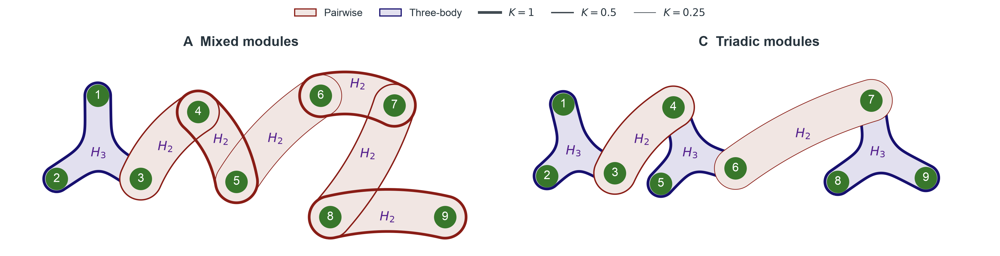
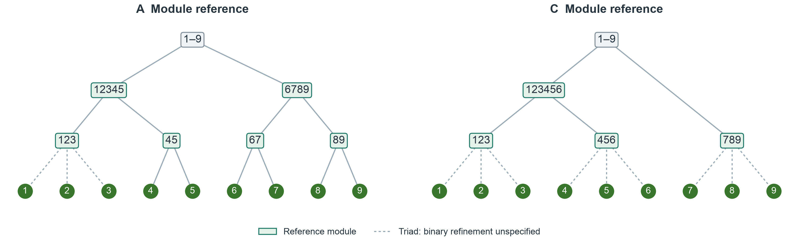
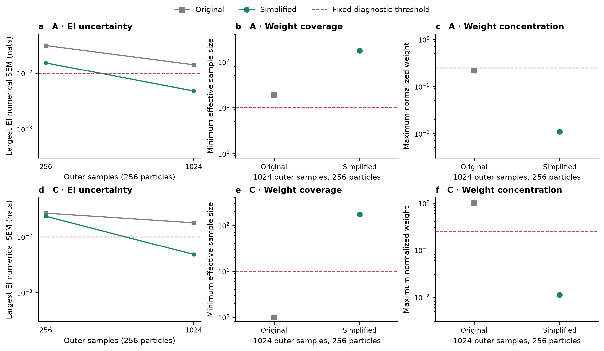

# A/C 简化连边的 Kuramoto 小规模复算

2026-10-15。只复用现有估计器进行约 5 分钟以内的小规模诊断；未启动六法完整比较或参数搜索。

**结果：简化连边明显缓解了样本内的积分权重退化；两例的预设根切分完成 4096 样本加密并通过检查。** 其余查询只计算到 1024 样本，部分 EI 在 256→1024 时仍变化超过 .01 nats；完整 SPT 恢复尚未验证。

## 网络及固定条件

| 案例 | 被替换的超边 → 二体桥（系数） | 保留的底层模块 |
|---|---|---|
| A | 12345→34 (.5)，6789→78 (.5)，123456789→56 (.25) | 123、45、67、89（各 1） |
| C | 123456→34 (.5)，123456789→67 (.25) | 123、456、789（各 1） |

数字串表示节点集合。九个节点、每节点一个相位、边数和逐项系数保持不变；最高作用阶数由 9 降为 3。系数继承原层级，不能按新边的包含关系重新赋值。高阶超边改为桥后，力的频谱、作用范围和总均方幅度也改变；因此这是网络简化方案的探索性对照，不能单独归因于“阶数下降”。旧嵌套支持不作为新网络的恢复真值。

固定独立 Uniform(-π,π)^9 干预、完整未来九相位 target、τ=.20、dt=.0025、σ=.08、原九频率。训练/验证/测试为 16384/4096/4096，开发数据 seed 0。两例与旧实验共享实际初态及 Brownian 增量；重新生成旧转移并匹配旧训练/验证联合摘要，以验证真实配对。

估计器仍为全 502 候选边的数据学习均值流加周期条件 TM，不向拟合器传入真边。独立、恒定浓度 von Mises 输出仍是拟合近似；不把条件均值拟合成功解释为完整 SDE 密度正确。EI 使用 nats；Syn 容差 .01 nats，保留 raw 值，不裁剪。低于 -.01 的估计明确失败并记录最小值、阈值和数量。

2026-10-15 按用户参考风格重绘：绿色圆点为九个相位振子，酒红色双节点包络及 $H_2$ 表示二体 Kuramoto 作用，深紫色三叶包络及 $H_3$ 表示实际三体正弦作用。A 有 6 条二体边和 1 条三体超边，C 有 2 条二体边和 3 条三体超边；全部包络严格包含对应成员。简化后没有四阶以上或全局作用，故不再绘制旧的 $H_4,H_5,H_6,H_9$ 包络与全局虚线。共享节点使不同作用包络可以重叠。

根据用户后续要求，包络**轮廓线宽严格正比于实际耦合系数**：$K=1,0.5,0.25$ 分别对应 $2.4,1.2,0.6$ pt，比例为 $4:2:1$，图顶以相同线宽给出定量图例。红／紫颜色和填色仍区分二体／三体作用；包络面积、带状区域的几何宽度及重叠不编码权重，图中不编码测得的 Syn。线宽从冻结生成器缓存逐边读取并与当前模型核对，逐项系数仍见上表。此次只修改该图的局部轮廓样式，未修改共享绘图器、动力学或评分代码。

这是已计算生成器的真实结构，不是推断得到的 SPT。本次只读取冻结网络缓存并核对当前生成器，没有重算动力学、EI 或修改比较任务。[矢量版](assets/kuramoto_hierarchy/spt_kuramoto_simplified_reference_style.svg)保留可编辑文字；[原连线图](assets/kuramoto_hierarchy/spt_kuramoto_simplified_networks.png)和[原可编辑连线图](assets/kuramoto_hierarchy/spt_kuramoto_simplified_networks.drawio)保留。绘图入口为 `scripts/plot_spt_kuramoto_reference_networks.py`，导出时检查精确成员关系、标签与所有轮廓及节点的间距。本次重新定位的 Zotero 父项／主文／SI 仍为 `P6UJCVG8`／`DXGC7JEA`／`MWIWKSVG`，无明确稿件版本日期；核对主文式（11）–（12）和 SI S7 式（S67）–（S69），仅用于区分作用支持与 SPT 信息分解。

## 模块参考树与 ground truth 的边界

当前比较预先声明的真值对象是保留模块的嵌套集合，并非简化后全部作用边。2026-10-15 对这一参考作结构核验：在每个实际耦合阈值 $\kappa$ 下，仅保留 $K_e\ge\kappa$ 的二体边／三体超边，并取超图连通分量。随着阈值降低，分量依次合并，得到以下参考层级；全部实际不同系数均使用，没有依据算法输出选择阈值。

| 阈值 $\kappa$ | A 的连通模块 | C 的连通模块 |
|---|---|---|
| 1 | 123 / 45 / 67 / 89 | 123 / 456 / 789 |
| .5 | 12345 / 6789 | 123456 / 789 |
| .25 | 123456789 | 123456789 |

该构造的全部非根模块与原有评分代码中的参考集合完全一致：A 为 123、45、67、89、12345、6789；C 为 123、456、789、123456。这里是对已预声明参考的结构核验，没有更换真值、重算成绩或约束 SPT 的候选切分。

三元模块在图中用虚线三叉展开，表示未指定唯一的内部二叉细化。例如 123 可细化为 12|3、13|2 或 1|23，当前评分不区分这些完整二叉补全。因此应称“模块参考 F1”，不能声称认证了某一棵完整二叉树。新桥 34 与模块 123、45（或 C 的 456）部分重叠，它们无法同时作为同一棵分区树的 clade；桥不逐条纳入本分数的必恢复集合。

按耦合阈值得到的是结构参考层级。给定干预分布、完整未来 target 和预测时距的理想 SPT 则由真实 EI 的切分目标决定，不能只凭连边系数证明两者相同。当前参考没有被认证为唯一的 oracle SPT。主文式（10）–（12）及 SI S5.1 式（S49）–（S50）已重新读取，当前唯一主文／SI 附件仍无明确版本日期。参考树绘图仅读取真实连边，入口为 `scripts/plot_spt_kuramoto_reference_networks.py --reference-trees`；[矢量版](assets/kuramoto_hierarchy/spt_kuramoto_simplified_module_reference.svg)一并保存。

## 同精度比较

各例只查 8 个 EI：完整源、预设根切分两侧、1、2、12、3、123；直接核查根切分、1|2、12|3 共 3 个二分。积分档位为 (N,P)=(256,64)、(256,256)、(1024,256)，每档 4 个独立 scramble。数值 SEM 来自积分随机化，不是独立物理数据集的标准误。旧结果只取完全相同的查询和积分档位。

| 案例/网络 | 内层 EI 最大变化 | 外层 EI 最大变化 | 最大 EI SEM | 最低 ESS | 最大权重 | 最大剩余 Newton 步 (rad) |
|---|---:|---:|---:|---:|---:|---:|
| A/Original | 0.003535 | 0.060688 | 0.014170 | 18.978 | 0.220047 | 3.14e-06 |
| A/Simplified | 0.001199 | 0.022813 | 0.004789 | 174.917 | 0.010995 | 6.63e-11 |
| C/Original | 0.005349 | 0.022336 | 0.017739 | 1.000 | 0.999998 | 0.545 |
| C/Simplified | 0.001449 | 0.020416 | 0.004806 | 172.241 | 0.011071 | 6.44e-11 |

EI/Syn 数值门槛保持 .01 nats；proposal 门槛为最低 ESS≥10、最大权重<.25、剩余 Newton 步<1e-3 rad。没有为新网络放宽阈值。

## 新网络结果及边界

总状态：`complete`；计算耗时 246.62 秒。

| 案例 | 已完成积分重复 | 轻量检查 | 步长 RMS (rad) | 已检查 raw Syn 最小值 (nats) | 容差内负值/显著违规 |
|---|---:|---|---:|---:|---:|
| A | 12/12 | 未通过 | 4.34e-05 | -0.007146 | 3/0 |
| C | 12/12 | 未通过 | 5.77e-05 | -0.003396 | 2/0 |

### 剩余额度中的根切分加密

仅将完整源和预设根切分两侧这 3 项 EI 加密到 N=4096、P=256，仍使用同一模型及 4 个 scramble。这次自适应追加由数值误差触发，不依据恢复分数；计算仍计入同一个 300 秒上限。

| 案例 | 完成重复 | 1024→4096 最大 EI 变化 (nats) | 最大 EI SEM (nats) | 根 Syn 均值 ± 数值 SEM (nats) | 最低 ESS | 最大权重 | 根查询门槛 |
|---|---:|---:|---:|---:|---:|---:|---|
| A | 4/4 | 0.001240 | 0.000839 | 0.002630 ± 0.000051 | 174.370 | 0.011008 | 通过 |
| C | 4/4 | 0.002797 | 0.002443 | 0.002641 ± 0.000103 | 171.896 | 0.011071 | 通过 |

A 根加密 raw Syn 最小值 0.002514 nats，容差内负值/显著违规 0/0；根 Syn 加密变化 0.000244 nats。

C 根加密 raw Syn 最小值 0.002421 nats，容差内负值/显著违规 0/0；根 Syn 加密变化 0.000587 nats。

这里的“通过”仅指上述有限查询、1024 样本的轻量诊断；即使根切分完成 4096 样本加密，也未覆盖其余查询的最高档、全部 511 个源子集、9330 个二分、候选切分排名或 group-target 边缘。根加密通过只认证预设切分的这 3 项查询；256→1024 的粗档变化仍完整保留。没有生成 SPT 树、六法 F1 或统计显著性结论。网络简化可能使成对基线也更容易恢复模块；不预设 SPT 必然领先。

## 手稿依据与复现

本任务重新通过 Zotero 本地 API 按题名核对父项 `P6UJCVG8`，*Emergent hierarchical organization of causal interactions in complex systems*，重新读取主文 `DXGC7JEA` 及 SI `MWIWKSVG` 的相关全文：Methods (5)–(12)、SI S1.2 (S7)–(S15)、S5.1 (S49)–(S50)、S7 (S67)–(S71)。当前只有一组主文/SI，均无明确稿件日期或版本；附件 2026-10-04 的元数据修改时间不作为稿件版本日期。

共同干预、固定完整 target、EI 定义和 raw Syn 遵循主文。二体及三体相互作用分别符合 SI (S68)、(S69) 的核形式，九节点网络及桥结构是本次试验设计。完整未来相位不同于 SI S7 的未来增量 target；本周期条件 TM 也不同于 SI S1.2 的 affine TM，不套用其 Wishart 修正。没有在小规模诊断中执行手稿要求的完整 SPT 精确切分。

内部缓存：`results/spt_local_kuramoto_tm/simplified_ac_light.json`。独立文件保留原 A/C 缓存，未修改正在进行的 B 比较。

复现入口：`scripts/spt_kuramoto_simplified_ac.py --output <new.json> --budget-seconds 300`；随后可用同一 output 及 `--refine-roots --budget-seconds 300` 在累计额度内追加根查询；固定结果绘图与报告：`scripts/plot_spt_kuramoto_simplified_ac.py`。
