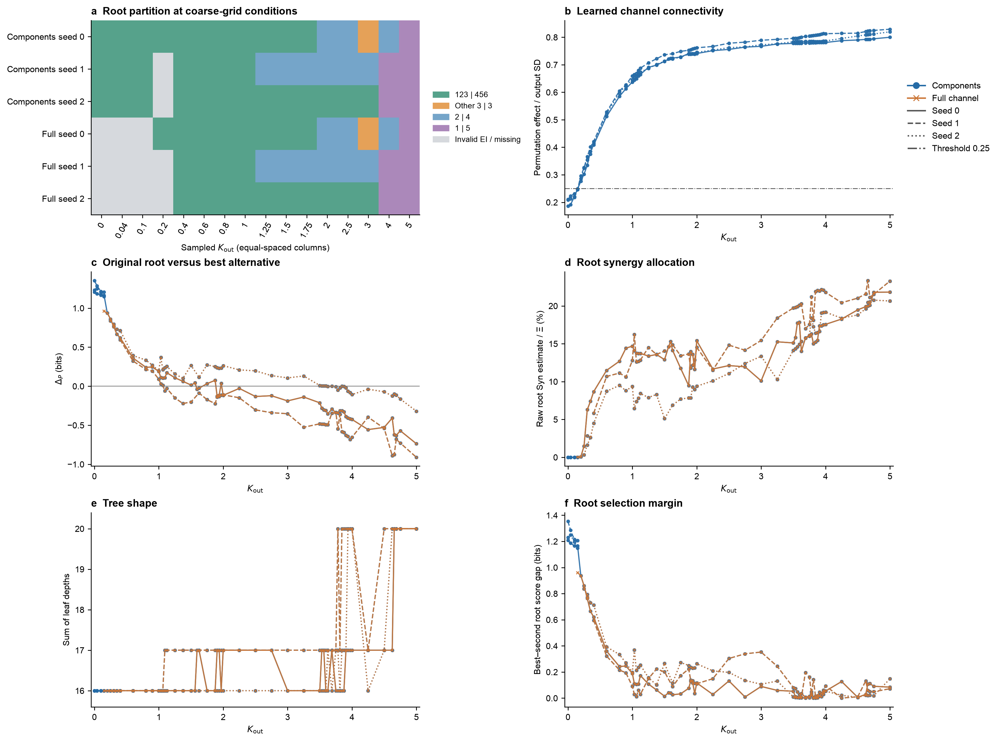
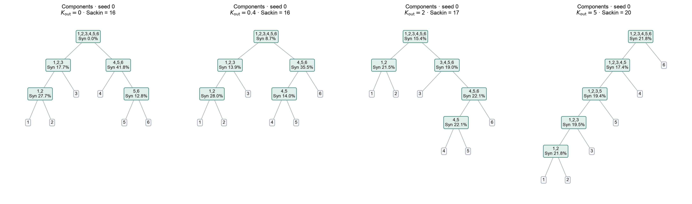
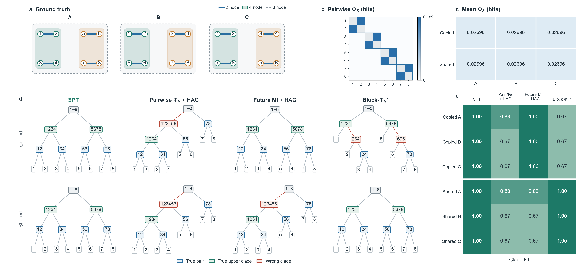
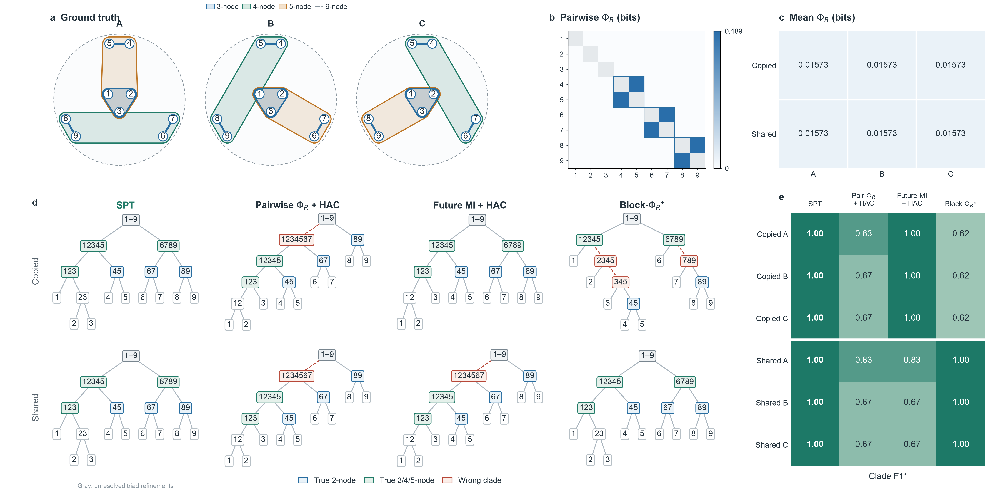
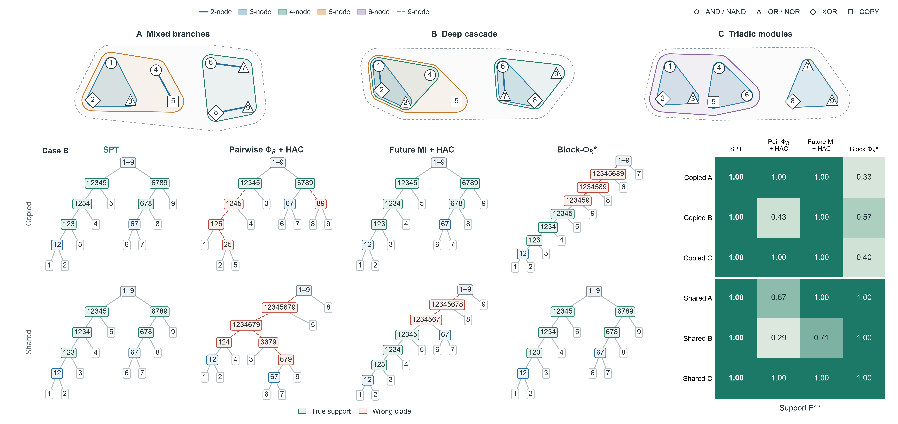

# Kuramoto SPT 变化定位与已知层级比较

2026-10-12。双轨 pilot 与局部加密已完成，计算用时 **89.61 分钟**，在批准的 90 分钟上限内。共 164 个配对参数/种子条件、328 条轨道记录，其中 309 条有效、19 条非负审计失败。算法出处、公式、模型定义与后续指标见 [比较设计](../ref/spt_hierarchy_comparison_design.md)。

## 1. 图中 SPT 从哪里开始变化

**图中 seed 0 的首次内部 clade 变化出现在 $K_{\mathrm{out}}\in(0.2,0.25]$；首次失去原模块根划分在 $(1.5625,1.59375]$；首次整树成为链状在 $(4.625,4.65625]$。** 三个事件不同。下面区间均指已采样点的相邻观察结果，不是置信区间，也未排除更早的未采样窄区间内存在变化与回返。

| 事件 | seed 0（原图种子） | seed 1 | seed 2 |
|---|---|---|---|
| 学习通道由两个 component 合为一个 | $(0.15,0.2]$ | $(0.15,0.2]$ | $(0.15,0.2]$ |
| 首次任意非根、非叶 clade 改变 | $(0.2,0.25]$ | 0.15 未变、0.3 已变；0.2/0.25 失败 | 0.15 未变、0.25 已变；0.2 失败 |
| 首次根不再是 123 \| 456 | $(1.5625,1.59375]$ | $(1.0625,1.09375]$ | $(3.59375,3.625]$ |
| 首次链状树，Sackin = 20 | $(4.625,4.65625]$ | $(3.75,3.78125]$ | $(3.90625,3.9375]$ |

零耦合时三个种子均恢复 123 \| 456，但 seed 1 的内部节点对为 46，seed 0/2 为 56。因此最早的内部标签变化目前不够稳定，不能作为共同的定性转变。component 合并来自 **0.25 输出标准差的学习依赖阈值**；物理方程在任意正跨耦合下已有跨模块作用，该合并点也不是物理相变。原轨道在两个 component 时根 Syn 为零，合并后首批有效点出现非零根分配；这个零到非零变化含有因子化近似的作用。

根选择在边界附近很接近平局。首次根变化的左右端最佳/次佳分数差，seed 0 为 0.04253/0.04033 bits，seed 1 为 0.01264/0.05977 bits，seed 2 为 0.00315/0.00217 bits。当前没有这些分数差的估计不确定性。尤其 seed 2 的区间宽度虽小，选择证据仍很弱。非负容差不是 score gap 的误差条或显著性阈值。

图 1。a 只显示预先固定的 16 点粗网格，各列等宽且标明实际耦合值；c–f 包含全部有效加密结果。曲线是单个种子的结果，无均值或置信带。无效 EI 点不进入树或连线。$\Delta_P$ 是原根划分的子块 $\Xi$ 和减去最优其他划分的分数，过零表示当前估计下的选择改变。蓝色和橙色在六节点连通时复用同一个 TM 结果，重合不构成独立验证。

### 1.1 非单调变化不能省略

下表列出原根划分在相邻有效点之间的全部已观察切换。箭头前后表示是否保留 123 \| 456：

| seed | 已观察根切换区间，按参数递增 |
|---|---|
| 0 | 保留→丢失 $(1.5625,1.59375]$；丢失→保留 $(1.625,1.75]$；保留→丢失 $(1.875,1.90625]$；丢失→保留 $(1.9375,1.96875]$；保留→丢失 $(1.96875,2]$ |
| 1 | 保留→丢失 $(1.0625,1.09375]$ |
| 2 | 保留→丢失 $(3.59375,3.625]$；丢失→保留 $(3.625,3.6875]$；保留→丢失 $(3.6875,3.75]$ |

链状树也会回返。seed 0 在 $(4.625,4.65625]$ 首次进入链状，此后采样点均保持。seed 1 在 $(3.75,3.78125]$ 进入，$(3.78125,3.8125]$ 退出，$(3.8125,3.84375]$ 再进入，$(4,4.25]$ 退出，$(4.25,4.5]$ 再进入。seed 2 在 $(3.90625,3.9375]$ 进入，$(4,4.25]$ 退出，$(4.5,4.625]$ 再进入。尚未区分这些回返是机制重组还是通道学习、TM 与积分误差。

图 2。预先按粗网格选择 seed 0 的基线、首次内部变化、首次根变化与首次链状代表树：0、0.4、2、5。精细首次边界见表 1；此图没有把粗网格代表值当成临界值。百分比为节点 Syn / 系统总 $\Xi$。

## 2. 双轨结果与估计有效性

两轨共享每个参数/种子的一次动力学模拟、MLP 拟合与读出数组，所有配对数组哈希均一致。原轨道按学习的 component 因子化拟合；完整轨道始终拟合六维联合 TM。164 对中，152 对的原轨道已六节点连通，完整轨道直接复用结果。它们不是 328 次独立估计。

完整轨道在 $K_{\mathrm{out}}=0$ 的三个种子全部失败，不能以它定位从零点开始的首次拓扑变化，也未通过严格解耦控制。完整轨道共 15 条失败；其中四个条件同时是原轨道失败，共计 19 条失败记录、15 个不同参数/种子条件：

| seed | 完整轨道失败的 $K_{\mathrm{out}}$ | 原轨道同时失败 |
|---|---|---|
| 0 | 0、0.04、0.1 | 无 |
| 1 | 0、0.04、0.1、0.15、0.2、0.25、0.35 | 0.2、0.25、0.35 |
| 2 | 0、0.04、0.1、0.15、0.2 | 0.2 |

原生 Syn 容差固定为 **0.1 bits**。每个有效条件保留全部 63 项 EI、301 项子集二分 residual 和 11 个完整树节点；显著违规条件保留失败组件的原始 EI 与最小值、阈值、计数，停止构树。所有结果均未裁剪。最严重的失败 Syn 为 −0.40561 bits，最小失败 $\Xi$ 为 −0.20689 bits。仅作数值估计失败证据，PEID Syn 按定义非负。

309 条有效记录中，全部候选共有 29 个容差内负 residual，18 个容差内负 $\Xi$，最小 residual 为 −0.09886 bits；这些计数包含两轨复用的重复记录。所选树节点负值计数为 0，最大闭合误差为 0。容差内值原样保留并记录，既未静默投影，也未据此声称理论 Syn 为负。

## 3. 已知动力学中实际比较了什么

六节点双三元 parity 模型已枚举全部十种无序模块划分：SPT 正确根 10/10，成对跨时 $\Phi_R$ 和成对 PEID 矩阵全部为零。因未来状态复制模块读出，一般的未来互信息图仍可辨识模块；这个案例只证明特定成对表示的局限。

进一步构造八节点、每节点四比特的一阶 Markov 模型。四个底层节点对可有三种不同父层组合；分别采用祖先读出复制（copied）和 XOR 分享（secret-shared），共六个案例。源为完整 32 比特的因子化均匀干预；target 是完整 32 比特未来状态，时距一步。独立新 driver 与分享 masks 可解析积分，完整 target 的 EI 等价于四个 parity 到七个带噪祖先读出的精确互信息。模型与等式见比较设计式（7.2）–（7.4）。

真值来自生成机制的四个底层对与两个父层 clade，排除根和叶；评分没有使用 SPT 目标。所有方法查询同一精确联合。下表给出三种组合的正确根数与平均 Clade F1：

| 方法 | copied：根 / F1 | secret-shared：根 / F1 |
|---|---|---|
| SPT | 3/3 / **1.000** | 3/3 / **1.000** |
| 成对 $\Phi_R$ + average linkage | 0/3 / 0.722 | 0/3 / 0.722 |
| 未来互信息 + average linkage | 3/3 / **1.000** | 0/3 / 0.722 |
| 完整组 Block-$\Phi_R$ 递归适配 | 3/3 / 0.667 | 3/3 / **1.000** |

SPT 六例均完整恢复，系统 $\Xi=2.0845974009$ bits，根 Syn = 0.0833715447 bits，根最佳/次佳分数差 0.4101725165 bits，父层分数差 0.2903198820 bits。每例审计全部 3,025 项二分，容差 $10^{-10}$ bits，最小 Syn 为 0，无负值或违规，闭合误差为 0。

成对 $\Phi_R$ 均值在六例恒为 0.0269602679 bits；两种成对跨时矩阵完全相同，只显示底层节点对。secret-shared 的未来互信息图也对三种父层组合完全相同。因此，在不提供其他信息且三种真值均匀的条件下，任何仅使用这些相同矩阵的方法正确识别根的概率至多为 1/3。HAC 实际的 0/3 来自固定标签与默认平局策略，不能当作所有图算法的准确率。

Block-$\Phi_R$ 是使用 MMI 定义、未归一化递归最小化的实验适配，其 target 随递归节点变化。copied 中细层失败只针对这一适配；secret-shared 中它与 SPT 完全打平。copied 中未来互信息 HAC 也与 SPT 打平。**目前支持的优势是：SPT 能读取成对跨时表示遗漏的上层信息，并在这两个读出版本下保持完整恢复；尚未支持普遍优于完整组、高阶或社区方法。**

图 3。紧凑层级比较图（5,400 × 2,490 像素）。a 用节点网络展示三种真实作用支持：蓝色连线为二节点 parity，绿色/橙色区域各为一个四节点联合 parity，外层虚线为八节点联合 parity。高阶作用用区域表示，没有展开成额外的成对边。节点位置仅按父层归属重排以便阅读，编号和底层节点对不变。b 展示六例相同的成对 $\Phi_R$ 矩阵；对角线灰色，非对角零值白色，色标单位为 bits。c 直接列出六例完全相同的成对均值。d 并排展示固定 case A 在两个读出版本中四种方法的实际树，蓝色为正确底层对、绿色为正确父层 clade、红色为错误 clade；树的枝长仅为排版，不编码动力学尺度。e 在树图右侧展示全部六例 Clade F1，行是读出版本/模型，列是方法，不含共同根和叶，没有筛选案例。图内 Shared 对应正文的 secret-shared；HAC 使用固定标签的 average linkage 默认平局策略；Block-$\Phi_R$* 是未归一化递归适配。完整组方法和未来互信息方法的平手保留。三种模型组合不是随机重复，精确信息量没有添加置信区间。本版按要求移除了分层恢复率与根成功数面板、总标题及长段图内说明，全部原始科学结果保持不变。

大图直接复用已计算的精确案例记录，没有重新运行 Kuramoto 或开展新参数扫描。可复现入口为 [plot_spt_hierarchy_comparison.py](../../scripts/plot_spt_hierarchy_comparison.py)；不提供输入文件时复算相同的六个小型离散案例。重绘前重新通过 Zotero 定位上述父项和当前附件，读取 Methods 式（5）–（12）及补充 S5；当前唯一附件仍未给出明确稿件版本号或日期，版本歧义保留。

这六例是开发模型：在发现 copied 可被未来互信息聚类恢复后加入 secret-shared，并保留 copied 结果。它们不是未经观察的确认性模型集。精确联合也不代表同等计算代价：SPT 使用 255 项节点子集 EI（约简后 16 种 latent 查询），Block-$\Phi_R$ 的缓存共有 98/121 种 latent MI 键（包括初始化查询）。没有以这些数值宣称相同时间或有限样本预算下的优势。

### 3.1 新增异阶嵌套超边模型

原先四个二元组的八节点图之外，新增九节点模型：三元超边 123 与一个二元组组合成五元超边，另两个二元组组合成四元超边，最外层为九元联合作用。例如 case A 为 **123 ⊂ 12345**，并列分支 **67、89 ⊂ 6789**。case B/C 把三元组分别与 67、89 组合；三图保持全部节点位置一致，五元超边的方向和四元分支的形状直接显示差别。

这次同时改变了真实动力学的作用支持，并重新计算六个案例，没有把新示意图贴在旧的八节点分数上。每节点四比特，源干预和完整未来 target 均为 36 比特，时距一步；模型、读出和评分规则见[比较设计第 7.3 节](../ref/spt_hierarchy_comparison_design.md)。

图 4。新的紧凑比较图（5,400 × 2,670 像素）。a 蓝色三角区域为三节点超边，绿色区域为四节点超边，橙色区域为五节点超边，外层虚线为九节点作用；三元超边包含在橙色五元区域内。蓝色短线为剩余三个二元作用。颜色区域表示多变量联合读出，不表示额外的成对边。b/c 成对 $\Phi_R$ 矩阵及均值在六例完全相同。d 为固定 case A 的两种读出与四种方法的真实输出树；灰色三元内部细分没有唯一真值。e 为全部六例 F1*：对所有方法一致地忽略 primitive 三元组的严格真子集 clade，再对六个已知支持评分，其余错误合并保留。图例均在数据外；枝长只为排版。

SPT 六例 F1* 均为 1，根恢复 6/6；成对 $\Phi_R$ + HAC 两种读出的平均 F1* 均为 0.722，根恢复均为 0/3。未来互信息在 copied 中完整恢复，在 secret-shared 中与成对 HAC 一样丢失上层；Block-$\Phi_R$ 递归适配在 copied 中 F1*=0.615，在 secret-shared 中与 SPT 打平。图保留这些平手，不支持所有既有方法均失败的结论。HAC 偶然保留三元 clade 的部分分数来自零值平局，成对 $\Phi_R$ 本身没有三元源信号。

每例 511 项 EI 和全部 9,330 项二分均有效；容差 $10^{-10}$ bits，最小 Syn 为 0，负数/违规计数和闭合误差均为 0。额外以原始九源的 512 × 128 项联合独立核验三例全部 1,533 项 EI，与 latent 约简相差至多 $4.44\times10^{-16}$ bits。原八节点六例记录逐项不变。此模型仍是精确有限状态开发例，不是自然系统或连续 Kuramoto 的确认性结果，没有模型种子置信区间。

新图入口为 [spt_nested_hypergraph_case.py](../../scripts/spt_nested_hypergraph_case.py)，重绘使用已有的比较图模块。无需连续通道训练或昂贵缓存；原来的图 3 保留。

### 3.2 三种不同架构与节点异质性

按最新要求，比较图进一步删除矩阵和均值面板，并重新构造、计算三个非同构九节点模型。A 是三元/二元的混合分支，B 含 2 ⊂ 3 ⊂ 4 ⊂ 5 的深嵌套链，C 是三个三元模块与一个六节点上层社团。各节点具有不同的 AND、XOR、OR、NAND、COPY、NOR driver gate，并带有不同门函数和 flip 概率的记忆更新。节点形状直接标出规则类别。

这是新的实际 Markov kernel：每节点有两个 driver、一个 memory、八个 readout 字段，源为全部 99 比特的独立均匀干预，target 是完整 99 比特未来状态。非线性门诱导的 activation 概率为 1/4、1/2、3/4，计算保留这种非均匀性；未把压缩 activation 错当成均匀干预。memory 具有自身时间保留，并由新读出驱动；其可解码加和信息在 $\Xi$ 中抵消，改变轨迹但不会单独制造 SPT 优势。driver 门和带噪耦合则真实改变高阶 EI。完整定义与约简见[比较设计第 7.4 节](../ref/spt_hierarchy_comparison_design.md)，式（7.6）–（7.8）。

图 5。5,400 × 2,550 像素。上方三图依次为混合分支、深层链、三元模块；彩色区域表示不同阶数的真实联合读出支持，虚线外层为九节点作用，节点形状为实际 gate 类别。每个区域已检查只包含所列支持节点。下方固定展示嵌套最深的 case B，两个读出版本、四种方法的实际树，右侧保留全部六条件的 Support F1*。没有成对矩阵或均值面板，没有新增长曲线和模型训练。F1* 对所有方法一致地忽略最小作用支持内部细分；异质情形下这些细分可能有 EI 偏好，因此不称为数值平局。树的分支长度只用于排版。

SPT 六条件均完整恢复预设支持，F1*=1。在深层链 B 中，成对 $\Phi_R$ 的 copied/shared F1* 为 0.429/0.286，未来互信息为 1/0.714，Block-$\Phi_R$ 未归一化适配为 0.571/1。A/C 中的基线成功与平手全部保留；HAC 的上层零值平局可能偶然命中预设结构，不能把默认标签下的命中当作唯一识别。没有延续旧模型“全部成对矩阵相同”的断言，也没有为强化失败结论重新筛选参数。

六条件各有 511 项 EI、9,330 项 residual。原生 Syn 容差 $10^{-10}$ bits，无显著违规，最小 raw residual 为 $-5.77\times10^{-15}$ bits，闭合误差为 0，无 clipping。容差内负 residual 合计 2,426，包含两种读出复用完整 EI 的重复计数；这只记录浮点误差。四项验证通过，包含 $2^{18}$ 原始 driver 枚举、完整双节点 source/target 联合下的 memory 约简核验，以及真实 `step` 解码与噪声检查。完整计算约两秒，未新增仓库结果缓存。

新图入口为[异质模型](../../scripts/spt_heterogeneous_hierarchy_case.py)和[绘图模块](../../scripts/plot_spt_heterogeneous_hierarchy.py)。这是具有非线性、异质噪声和局部记忆的有限状态开发例；memory 不反馈到 driver/readout parity，尚不是一般反馈网络或连续自然系统确认。三种模型/两种读出是条件，不是独立随机重复。重新定位并重读当前 Zotero 正文 Methods（5）–（12）和补充 S5；附件键仍为 `DXGC7JEA`、`MWIWKSVG`，父项 `P6UJCVG8`，无明确稿件日期或版本号，版本歧义保留。

## 4. 可复现范围与方法依据

粗扫描使用 16 个耦合点 × seeds 0、1、2 × 两轨。局部加密后共有 54 个三种子参数点；末尾 1.5625、1.59375 只计算 seed 0，使其共 56 点。边界定位优先，不强制耗尽剩余 23.60 秒；二级变化区间仍有未加密项，不能声称完整覆盖所有切换。最终缓存与目录清单位于 [refinement_summary.json](../../results/spt_kuramoto_transition_pilot/refinement_summary.json)，审计与事件清单位于 [analysis.json](../../results/spt_kuramoto_transition_pilot/analysis.json)。昂贵结果已保留，可直接重绘，无需再次拟合。

连续协议沿用图 1d：独立均匀相位源 $(-\pi,\pi)^6$，完整六维 phase-increment target，4,800 个训练样本、4,000 个学习通道读出，$\tau=0.20$、积分步长 0.01、过程噪声 0.08，MLP 800 epochs，TM 100 epochs，EI 评价 512 点、边缘积分 256 样本。训练 increment 经相位包裹，但 MLP 加实值高斯残差的读出与 TM 没有严格周期支持；本次复现这一近似。它与正文一般定义的完整 future-state target 有明确区别，也使用包含机制 Fourier 项的 context。没有宣称得到物理信道的精确 EI。

seed 0 在 0、0.04、5 的原图拓扑已复现，数值未达到逐位一致：例如零点 $\Xi$ 历史值 6.828667 bits、本次 6.832573 bits。历史完整软件环境未保存，不据此宣称严格数值复现。本次只修正原脚本中与实际 increment target 不一致的合同措辞，并让非负审计失败携带原始 EI 与诊断；没有改动估计算法。

本次重新通过 Zotero 定位父项 `P6UJCVG8`，确认题名 *Emergent hierarchical organization of causal interactions in complex systems*；重新列出并读取正文 `DXGC7JEA`（19 页）和补充 `MWIWKSVG`（28 页）。正文/补充无明确版本号或稿件日期，附件入库/修改时间不能证明稿件版本，歧义保留。完成扫描后再次读取，全文与本次初读一致。依据为 Methods 式（5）–（12）、补充 S5/Algorithm S1 与 S7；共同干预联合、固定全 target、原始 residual 选择与递归规则已逐项核对。上述 increment、实值支持与机制 context 边界保留，没有声称完成所有理论与实现的一致性验证。

运行前发现环境缺少 `nflows`，安装版本 0.14 后重新启动；初次依赖错误未计入科学条件。配对缓存、非负失败阻断、非单调加密与 canonical SPT 的 **10 项测试通过**。旧 `test_mixed_order_kuramoto_spt_example.py` 引用了当前仓库已缺失的 `mechanism_channel_target`，收集失败；该预存问题未在本次范围内修改。三张图均已目视检查，图例在数据区外，无遮挡或裁切。

## 5. 正式比较的下一步

先校准完整 TM 的严格解耦控制，并估计整条管线的 score-gap 不确定性；再用独立自然轨迹的相位序参量、频率锁定和响应检查变化是否对应物理 crossover。当前连续 pilot 定位了输出变化，尚未比较哪种方法更正确。

层级主比较采用已定位的 HCD-Spec、hierarchical Infomap、nSBM，以及成对 $\Phi_R$/PEID 图；加入 Block-$\Phi_R$ 归一化版本与高阶超图强对照。主指标为独立真 clade F1，补充同分辨率 ARI/VI、固定 decoder/特征预算下的保留干预预测误差、运行成本与失败率。确认性模型和种子另取，报告平手与失败。24/48 节点时另审计 SPT 近似候选覆盖，因为成对引导的候选可能遗漏本案例的上层真分割；八节点精确恢复不能替代这一检查。
