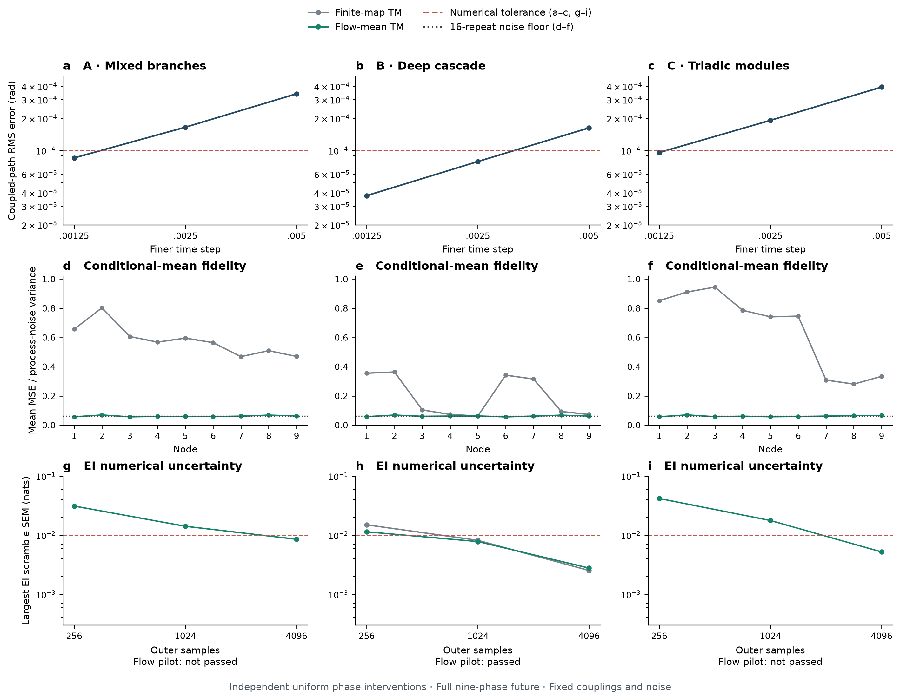

# 九节点局部高阶 Kuramoto：有限数据验证

2026-10-15。用户批准分阶段完整试验、一个只读数值审查子代理，以及累计实验计算上限 60 分钟。原公共读出模型的图和成绩保留；本轮独立保存新模型结果。

结果：A/B/C 均完成动力学生成、条件 TM 学习及四档精度试跑；只有 B 通过关键查询门槛。完整 EI 表、SPT 层级和六方法比较未在预算内完成，因此 **SPT 的显著优势尚未验证**。该结论不等于 SPT 已被检验为失败。

## 执行前协议

- 保留 `spt_local_hyperedge_kuramoto.py` 的 A/B/C 支持：每节点一个相位；局部力为 `sin(sum(theta_e)-|e|*theta_i)`，不向超边外广播。固定 `K0=1, rho=.5, sigma=.08, tau=.20` 及已有九频率。不得按支持 F1 调参。
- 源为九相位独立均匀干预；target 为完整未来九相位。训练中使用相位增量作为回归标签，只用于条件坐标平移，EI 仍针对未来相位，边缘积分对每个候选源重新计算平移。
- 同一真实源干预分别生成训练、验证、测试数据；模型选择只看验证预测误差。统一通用 Fourier 候选族覆盖全部节点子集，各接收节点的候选族相同，不输入真实支持。有限时距产生的组合频率可能超出模型族，必须用独立重复转移和测试残差检查。
- 条件 TM 为学习的周期均值及 von Mises 条件 CDF；完整条件密度精确归一化。首轮独立输出残差是明确的拟合近似，不能声称已知 SDE 有此精确条件密度。所有方法使用同一拟合联合及其边缘，信息单位为 nats。
- 高浓度密度、Jacobian、重要性权重与信息运算均用 float64。缺失源用数值逆解和局部 Laplace proposal，加入固定 5% 均匀防御成分，计算完整混合 proposal 的密度及正确的 prior/proposal 权重。不把 ESS 当作误差条。
- 首先检查 dt=.01/.005/.0025 的共同 Brownian 增量对照，生成正式数据用 .005；必要时仅按收敛诊断加密。动力学误差目标为 RMS 相位差 < 1e-4 rad。
- full-target 精度门槛：独立 scramble 重复，先固定外层 N 加倍内层 P，再独立加倍 N；关键 EI 和 raw Syn 的变化目标 .01 nats。全部 511 个源子集及 9,330 个二分在出树前审计；原生 Syn 容差预声明为 .01 nats，保存容差内负值及显著违规数量，低于 -.01 则明确失败。不裁剪或投影。划分差小于数值不确定性时报告未分辨。
- full-target 过关后才扩展 group-target 边缘，比较 SPT、Pair Phi_R + HAC、Pair Xi + HAC、Future MI + HAC、Block Phi_R、按较小子组节点数归一化的 Block Phi_R。各法沿用相同支持评分规则；不存在足够精度的结果记为未评价，不记 F1=0。
- 首轮为开发性 seed 0；通过后才在剩余预算内用独立数据 seed 101/102 复核。标签置换不是独立物理重复。保留所有失败及基线成功，不从排名选择参数或种子。

## 方法依据与版本边界

本轮通过 Zotero 本地 API 重新按题名核对父项 `P6UJCVG8`：*Emergent hierarchical organization of causal interactions in complex systems*。仅发现一组主文 `DXGC7JEA`（19 页）与 SI `MWIWKSVG`（28 页），均重新提取全文；附件和全文未提供明确稿件日期/版本。主文附件元数据修改于 2026-10-04、SI 元数据修改于 2026-10-04，这不证明稿件版本日期，仍有版本标识不明的限制。

已读主文 Methods 式（4）–（12）、SI S1.2 式（S7）–（S15）、S5.1 式（S49）–（S50）及 S7 式（S67）–（S71）。共同干预、固定完整 target、raw residual、全候选精确二分及单叶停止遵循上述定义。四体以上正弦力是三体式（S69）的本项目推广。此处完整未来相位不同于 SI S7 的未来增量；学习的周期条件 TM 也不同于 S1.2 的 affine/feature-space TM，不套用其 Wishart 修正。单相位反馈动力学不再保证旧多通道案例的 pair-blind 性质。

当前生成器的已有 7 项有效性测试通过。该结果不表示 EI 精度或层级恢复通过。后续执行、失败和结论在此记录。

## 实际执行及数值修正

正式试验保留 A/B/C 原超边及 `K0=1, rho=.5, sigma=.08, tau=.20`，每节点一个相位。生成器为[局部高阶 Kuramoto](../../scripts/spt_local_hyperedge_kuramoto.py)。本轮只使用开发数据集 seed 0：训练 16384、验证 4096、测试 4096。三例共享实际源干预与 Brownian 随机数；各方法的层级比较尚未启动，不能将数值 scramble 当作独立动力学数据集。

### 步长

`.005→.0025` 的共同 Brownian RMS 在 A/C 仍超过 `1e-4 rad`，因此按原协议将正式生成步长统一加密至 `.0025`，再与 `.00125` 对照。每例 512 个干预初态；表中最大误差是同一配对对照的最大坐标差。

| 案例 | `.0025→.00125` RMS（rad） | 最大坐标差（rad） | RMS 门槛 |
|---|---:|---:|---|
| A | 8.5341e-5 | 8.9311e-4 | 通过 |
| B | 3.7738e-5 | 2.9948e-4 | 通过 |
| C | 9.5739e-5 | 9.1459e-4 | 通过 |

这是噪声路径配对的数值收敛检查，不把 RK4 漂移加噪声称为四阶随机积分器。

### 数据学习的均值流

原有限时距 Fourier 回归虽有可用预测误差，A/C 在 128 个独立源点分别出现 3/11 个非正 Jacobian 行列式；两个逆解初值的最大中心差为 `.18685/.46734 rad`。因此停止这两例的该路线积分。B 的原路线也未通过最高档 proposal 门槛：最低 ESS 为 8.19，最大归一化权重 .3457。所有失败缓存保留。

为消除回归产生的人为折叠，另实现[数据学习均值流](../../scripts/spt_kuramoto_flow_tm.py)。其候选族包含**全部 502 条非单节点超边**，每条候选边采用共享、吸引型基本正弦系数；这是一项已知动力学族的结构先验，不读取真实边集合或真系数。Lasso 按验证误差选择筛选设置，随后只用训练集的 2048 前缀及完整 16384 样本拟合有限时间 ODE 流。验证和测试数据不进入最小二乘拟合。A/B/C 分别保留 25/11/18 条候选边，含训练误差造成的弱附加项；这些集合没有作为 SPT 的真值或候选限制。

均值流使用 8 个 RK4 步，在 256 个验证点对照 16 步。最大相位差为 A `1.56e-6`、B `2.80e-7`、C `2.09e-6 rad`。这是学习均值的积分精度，区别于生成 SDE 数据的 `.0025` 步长。41 项新增和相关测试通过，包括原生 float64 加速实现与独立计算的均值/变分方程一致性。

另以 256 个独立初态、每态 16 条独立噪声路径核查条件均值。学习均值与重复平均未来之间的 MSE/噪声方差接近 `1/16`，达到本次重复均值估计的噪声分辨率；这不表示真实条件均值被精确求出。

条件密度继续采用独立、恒定浓度 von Mises 输出，经圆周条件 CDF 构造 TM，密度精确归一化。原始未来相位是 EI target；源相关增量只在拟合/条件坐标平移中使用。A/B/C 测试残差的最大总体相关为 `.0375/.0463/.0521`，条件方差分箱的最大/最小比为 `1.27/1.32/1.46`。因此这个 TM 仍是 SDE 密度的拟合近似，均值拟合成功不能当作完整条件密度正确的证明。

### 后验积分

最高外层增加至 4096，完整布局为 `(N,P)=(256,64),(256,256),(1024,256),(4096,256)`，每档 4 个独立 scramble。所有查询保留同一拟合联合、共同样本及粒子前缀。最高两档外层变化和第一次内层加密分别检查，已被加密替代的粗档差异仍保留。信息、Jacobian、权重和积分均使用 float64；采样采用经 CDF 反向误差 `<=1e-8` 检测的数值逆 CDF。

单尺度局部 proposal 在少数 outer 点出现低 ESS，故保留该试跑，复用原模型，重新用 **80% 局部＋15% 两倍标准差＋5% 均匀**的 proposal 混合计算。两个局部成分都采用逐条件截断的相关 Gaussian 并旋转到圆周，具有精确归一化密度；权重使用三项完整混合密度及注册均匀先验。该修改只调整积分 proposal，不改变干预或拟合联合，未查看 F1。

额外诊断门槛为最低 ESS `>=10`、最大归一化权重 `<.25`、最后 Newton 步 `<1e-3 rad`，并核查两个初值的逆解一致性。ESS 是权重退化指标；误差统计来自不同 scramble。128 点的局部 Jacobian/初值检查不构成全局模式覆盖证明。

Syn 原生容差仍为 `.01 nats`；保存 raw 值，记录容差内负数及低于 `-.01` 的违规数。关键查询只覆盖 A/B 各 5 个、C 4 个可直接配对计算的二分；全部 9330 个二分尚需完整 EI 表后审计。直接用共同样本形成 Syn 的配对重复误差，不能以单个 EI 的误差或代数闭合代替排名精度。

### 最终精度结果

下表均来自同一学习均值流和加宽混合 proposal。外层变化比较 `1024→4096`，内层变化比较 `64→256`；每档 4 个 scramble。EI 查询数 A/B 为 16，C 为 15，包含完整未来 target 下的单源和预先选定群组，并非全部源子集。SEM 是积分随机化的数值标准误，未涵盖 TM 拟合误差或物理数据集之间的变动。

| 案例 | 内层最大 EI 变化（nats） | 最高两档外层变化（nats） | 最高档最大 EI SEM（nats） | 最低 ESS | 最大归一化权重 | 关键查询门槛 |
|---|---:|---:|---:|---:|---:|---|
| A | .003535 | .010451 | .008541 | 4.216 | .485226 | 未通过 |
| B | .001711 | .005488 | .002778 | 168.923 | .016285 | 通过 |
| C | .005349 | .019784 | .005205 | 1.000002 | .999999 | 未通过 |

A 的最高外层变化略高于 `.01 nats`，同时存在权重退化；没有为通过而放宽阈值。C 也存在明显退化，最高档最大剩余 Newton 步为 `.5960 rad`，超过 `1e-3 rad` 门槛。尽管三例的最高档 EI scramble SEM 都低于 `.01`，这不足以取代加密变化和 proposal 检查。

最高档直接配对 raw Syn 的检查如下。参考根切分为 A/B 的 `{1,…,5}|{6,…,9}`、C 的 `{1,…,6}|{7,8,9}`，它们是预设诊断切分，**没有执行 SPT 最优切分搜索**。

| 案例 | 已检查切分数 | 最高档 raw Syn 最小值（nats） | 参考根 Syn 均值 ± 数值 SEM（nats） | 最高档容差内负值 / 显著违规 |
|---|---:|---:|---:|---:|
| A | 5 | .0135910 | .0198951 ± .0026516 | 0 / 0 |
| B | 5 | .0000365 | .0011363 ± .0006331 | 0 / 0 |
| C | 4 | .0010618 | .0171930 ± .0023811 | 0 / 0 |

计入全部四档，A/B/C 容差内负 raw Syn 分别为 0/4/7 个，显著违规均为 0；B/C 的跨档最小值为 `-.0035073/-.0074863 nats`。这些值均保留，未裁剪。关键 Syn 加密门槛 A/B 通过、C 未通过（最高外层最大 Syn 变化 `.013857 nats`）。A 的局部 Syn 通过不能覆盖其 EI/proposal 失败；没有显著负值也不能替代全部 9,330 个二分的审计。

B 的参考根 Syn 仅约 `.00114 nats`，与数值 SEM 的差距不大。即使其关键查询满足 `.01 nats` 的绝对门槛，仍不能据此认定所有候选切分之间的排名已分辨。



图：上排为 512 初态的共同 Brownian 路径步长对照，横轴标记每对步长中的较细者；左端 `.00125` 对应正式 `.0025` 与更细 `.00125` 的比较。中排为 256 独立初态、每态 16 次转移的重复均值诊断；虚点线 `1/16` 是该重复均值的噪声分辨率。下排为固定内层 `P=256`、每档 4 个 scramble 的最大关键 EI 数值 SEM；A/C 的旧有限时距回归因逆解检查失败而没有对应曲线。红色虚线为相应数值阈值。下排标签同时注明完整关键查询门槛，避免将 SEM 单项通过误读为整体通过。此图不呈现算法恢复分数。

### 预算、覆盖和结论边界

主要计算累计 **3518.158 秒（58.64 分钟）**，另保留约 82 秒用于测试、绘图和收尾。主要计算的计时分解为：原 `.005` 试跑 `267.278 s`；原 `.0025` 有限时距回归 `706.989 s`；学习均值流及原 proposal `296.910 s`；复用拟合模型的加宽 proposal 四档试跑 `2214.319 s`；B 完整表扩展 `32.662 s`。模型复用没有重复计入拟合时间。长任务健康检查已删除，未安排预算外重跑。

最后仅对通过关键门槛的 B 扩展全部源子集；硬截止时，首个 scramble 保存 **35/511 项 EI**，其中 16 项复用已有关键查询，新增 19 项。其余三个 scramble 尚未开始完整表扩展；C 没有进入该阶段。`full_table.json` 明确标记 `budget_exhausted`，缺失项没有补零。因此没有完成全表 Syn 审计、候选切分排名检查、SPT 建树、group-target 积分、六法 F1 或独立物理数据重复。

本轮完成了保留连边设计后的局部高阶 Kuramoto 实现与有限数据精度诊断；尚不支持“SPT 显著超过各对比算法”的结论，也没有把未评价方法记为 F1=0。原图多通道构造的可恢复性及 pair-blind 性质不自动迁移到单相位反馈动力学。下一步计算需先解决 A/C 的后验积分退化，再完成所有子集及竞争切分的精度检查，随后才能在同一拟合联合上作六法比较。TM 的残差相关/异方差近似及物理重复仍需计入最终结论边界。

最终缓存另纠正了一个描述性字段：运行进程沿用了旧 Fourier 字典文字，现已改为与实际保存参数一致的“全部 502 条非单节点候选边的共享基本正弦系数”。该更正未改变拟合参数、数据、积分值或来源缓存 SHA；关键 Syn 审计在进程结束后用已保存的逐重复 EI 追加。

## 实现与复现

当前[试验入口](../../scripts/spt_kuramoto_finite_tm.py)默认复用最终路线的缓存；[完整表入口](../../scripts/spt_kuramoto_full_table.py)只对通过关键查询 pilot 的案例继续计算 511 项 EI，并受累计预算限制。完整表阶段也不会输出未经高分辨率/候选排名检验的 F1。后续 group-target 边缘及六方法排名仍须单独通过精度检查。

```bash
OPENBLAS_NUM_THREADS=1 OMP_NUM_THREADS=1 .venv/bin/python scripts/spt_kuramoto_finite_tm.py
OPENBLAS_NUM_THREADS=1 OMP_NUM_THREADS=1 .venv/bin/python scripts/plot_spt_local_kuramoto_validation.py
```

内部结果位于 `results/spt_local_kuramoto_tm/`：`pilot.json` 为原 `.005` 试跑；`pilot_dt0025.json` 为原有限时距回归；`flow_dt0025.json` 为学习均值流及单尺度 proposal；`flow_mixture_dt0025.json` 为同一流模型与加宽混合 proposal。所有中止和失败保留，不覆盖旧公共读出模型的主图或 F1。JSON 保存拟合参数、数据哈希、独立测试诊断、逐 scramble 积分结果和版本边界，没有 CSV。
