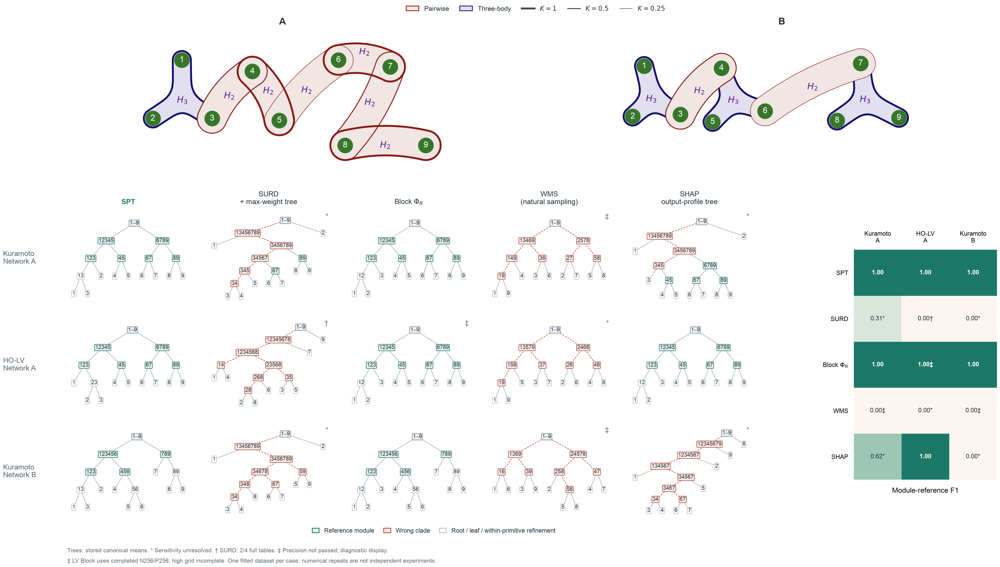

# 同网络与同动力学：三案例五法比较

2026-10-16。三例固定为 Kuramoto 网络 A、高阶 LV 的同权同超边网络 A、Kuramoto 网络 B。按用户要求仅用A/B展示两个网络；图中B对应本轮原始实验键C，冻结缓存及评分参考的键不变。旧高阶 LV 原 A 只作为历史结果保留。

拟合口径：本表是旧条件模型结果，尚不满足用户最新要求的MLP管线。Kuramoto使用Fourier候选字典／Lasso拟合的流模型，高阶LV使用指数特征字典／Lasso，均不是MLP。现有共同自然数据MLP仅完成接口试算，未生成新的完整SPT／Block比较；见[共同MLP约束](../log/spt_natural_mlp_training_contract.md)。

| 方法 | Kuramoto 网络 A | 高阶 LV 同网络 A | Kuramoto 网络 B |
|---|---:|---:|---:|
| SPT | 1.0000 | 1.0000 | 1.0000 |
| SURD + max-weight tree | 0.3077* | 0.0000† | 0.0000* |
| Block PhiR | 1.0000 | 1.0000‡ | 1.0000 |
| WMS natural tree | 0.0000‡ | 0.0000* | 0.0000‡ |
| SHAP output-profile tree | 0.6154* | 1.0000 | 0.0000* |

SPT在三种配置上模块F1均为1，最高档四次积分重复的评分模块结构均一致。Kuramoto两例与普通Block并列，新LV与SHAP并列。按用户最新要求，图表另行呈现精度未通过的诊断输出：新LV Block粗档候选也是1‡，但这项及两个WMS的0‡不作为数值可靠排名。综合评价保留并列，不据诊断零分推断方法优势。

* 表示数值或树结构敏感性未完全解决。† 仅表示完整511子集表构成的暂定结果，重复精度未过。‡ 表示用户授权放宽展示门槛后呈现的完整诊断输出，原精度检查仍失败，不参与可靠排名。没有完整树时仍不补造。

模块 F1 沿用预声明的耦合阈值连通分量参考，忽略 primitive 三元模块内部的任意二叉细化；不是全部物理超边恢复率。网络A/B的桥边可与模块重叠。严格 clade F1 和根恢复另列于各方法详情。

本轮只更换高阶 LV 网络以补齐对照，保持模型/干预/未来 target/时距、评分及原 .01 nats 容差。四积分重复和 SHAP 的背景子样本共用每例一个拟合数据集，不能据此报告跨系统总体优越性的显著性。

## 宽松展示与精度问题

按用户2026-10-16最新要求，原三项N/A改为显示已经保存的完整诊断树和F1，统一标‡。本次豁免进入图表的精度门槛，没有将原始失败状态改写为通过，也没有另设一个事后数值阈值。原SEM<.01 nats、ESS≥10、最大归一化权重<.25、内层变化<.01 nats及非负容差判据均保留供审计。没有新增模拟或积分，没有放宽先前计算的绝对截止，没有裁剪负估计。

| 原N/A项目 | 现展示输出 | 计算来源与精度限制 |
|---|---:|---|
| Kuramoto A / WMS natural tree | 0.0000‡ | 复用原N1024/P64的四份完整511子集表及其均值诊断树。最大MI SEM=0.0273506 nats，高于.01；最小ESS=4.18461，最大归一化权重=0.479952（权重检查失败）；代表查询内层64→256最大变化=0.00491972 nats。原追加精度复核仍未启动。 |
| HO-LV A / Block PhiR | 1.0000‡ | 使用最高已完整结束的N256/P256粗档，1079条查询中746条未过原门槛；最大MI SEM=0.0395224 nats，最小raw MI=-0.0298256 nats，低于−.01的原始MI估计6项。Phi候选本身的显著非负违规数为0，但组成MI未获认证。N512/P512高档未完成，其部分表不构树。 |
| Kuramoto B / WMS natural tree | 0.0000‡ | 复用原N1024/P64的四份完整511子集表及其均值诊断树。最大MI SEM=0.0128516 nats，高于.01；最小ESS=24.526，最大归一化权重=0.113225（权重检查通过）；代表查询内层64→256最大变化=0.00490806 nats。原追加精度复核仍未启动。 |

这些分数是已产生输出的展示，不是精度收敛或统计可靠性的认证。选用规则只依据已完成的登记精度和完整均值结果，不按F1挑选重复或精度档；‡项保留原始metrics为空，诊断结果单独存于summary的diagnostic_display字段。

## 本轮终态与未完成项

全部新阶段现已终止，唯一预算仍为2026-10-16 07:57:47—15:57:47。本轮补齐了三案例对应关系及SPT，但完整五法精度比较没有全部完成，未启动替代计算。

- 新LV SPT：两档均511子集×4次积分重复，完整切分审计与原数值门槛通过。
- 新LV SURD：最高登记精度128/128/256下，仅截止前完成的全部完整表scramble `[0, 1]`进入暂定均值，2/4完整；另两重复分别有120/511和16/511个可用缓存子集（含pilot），均不能补零构树。
- 新LV普通Block：N256/P256完成1079条查询，746条未通过单查询数值门槛；N512/P512只完成854条查询，其中808条未过门槛。高档尚无完整枚举树，现按授权展示完整粗档候选F1=1‡；严格精度认证状态不变。
- 新LV自然SHAP/WMS：共用自然轨迹和冻结模型，均完成。WMS的数值检查通过，但恢复F1=0且树敏感；SHAP模块F1=1。
- Kuramoto网络A/B的新增WMS数值复核未在截止前启动；现复用旧完整诊断树，显示两例F1=0‡，原数值未分辨状态保留。

截止保护异常：SURD守护进程未按绝对截止停止其工作进程；16:06:41核对完整命令后立即强制停止，比截止晚约8分54秒。留存日志不足以确认根因。35份截止后生成的specific缓存及其越时中间计算均不进入本轮汇总。原始检查点与异常记录保留，两份被采用完整表的全部输入缓存均早于截止；分数未使用越时数据。Block和调度器在原截止结束，预算文件未重置。

后续若继续，应先修复绝对墙钟截止保护，再另行授权复用缓存补齐Block、SURD和Kuramoto WMS，随后用独立物理数据种子检验三案例结论。当前并列结果已符合用户的综合评价口径，不需要为了独占第一重新设计网络或按F1选参。

上方展示两种实际超边网络：绿色节点、红色二体包络、蓝色三体包络，边框粗细与耦合权重成比例，面积和重叠不表示Syn或耦合强度。网络A由Kuramoto和高阶LV共用，B为Kuramoto的结构对照。下方三行分别为Kuramoto–A、HO-LV–A和Kuramoto–B，五列为SPT、SURD、普通Block、自然WMS及SHAP；树使用原生均值结果，不按恢复分数挑选积分重复。绿色树节点为恢复的参考模块，红色为错误clade，灰色为根、叶或不计分的primitive内部细化。SURD暂定树仅取全部两份完整表的均值；‡树是精度未通过的完整诊断输出，其中LV Block只用完整粗档，不使用不完整高档。右侧为同一批输出的模块F1。

[独立网络图](assets/kuramoto_hierarchy/spt_matched_networks.png) · [独立分数图](assets/kuramoto_hierarchy/spt_matched_three_case_comparison.png) · [组合图SVG](assets/kuramoto_hierarchy/spt_matched_cases_composite.svg)

## Kuramoto A

- SPT：`complete`，来源 `results/spt_local_kuramoto_tm/ac_comparison/A`。 模块 F1=1.0000，严格 clade F1=0.9231，根=[[1, 2, 3, 4, 5], [6, 7, 8, 9]]。 已有重复的评分结构一致 4/4。
- SURD + max-weight tree：`complete`，来源 `results/spt_local_kuramoto_tm/ac_comparison/A`。 模块 F1=0.3077，严格 clade F1=0.3077，根=[[1, 3, 4, 5, 6, 7, 8, 9], [2]]。 已有重复的评分结构一致 1/4。
- Block PhiR：`complete`，来源 `results/spt_local_kuramoto_tm/ac_comparison/A`。 模块 F1=1.0000，严格 clade F1=0.9231，根=[[1, 2, 3, 4, 5], [6, 7, 8, 9]]。 已有重复的评分结构一致 4/4。
- WMS natural tree：`not_started_budget_exhausted`，来源 `results/spt_matched_three_case/full_comparison/kuramoto_wms_A.json`。 模块 F1=0.0000，严格 clade F1=0.0000，根=[[1, 3, 4, 6, 9], [2, 5, 7, 8]]。 已有重复的评分结构一致 2/4。 未通过项：`['information numerical SEM >= .01 nats', 'importance weights failed']`。 限制：`New WMS numerical verification never started before shared eight-hour cutoff; original result remains numerically unresolved`。 原始数值结果：`results/spt_local_kuramoto_tm/ac_comparison/A/natural_baselines.json`，状态 `numerically_unresolved`。 ‡诊断展示来源：`results/spt_local_kuramoto_tm/ac_comparison/A/natural_baselines.json`；stored canonical WMS tree; four complete 511-subset tables; original N1024/P64。原精度未通过，不参与可靠排名。
- SHAP output-profile tree：`screen_passed`，来源 `results/spt_local_kuramoto_tm/ac_comparison/A/natural_baselines.json`。 模块 F1=0.6154，严格 clade F1=0.6154，根=[[2], [1, 3, 4, 5, 6, 7, 8, 9]]。 已有重复的评分结构一致 3/4。

## HO-LV A

- SPT：`screen_passed`，来源 `results/spt_matched_three_case/full_comparison/spt.json`。 模块 F1=1.0000，严格 clade F1=0.9231，根=[[1, 2, 3, 4, 5], [6, 7, 8, 9]]。 已有重复的评分结构一致 4/4。
- SURD + max-weight tree：`provisional_completed_full_tables`，来源 `results/spt_matched_three_case/full_comparison/surd.json`。 模块 F1=0.0000，严格 clade F1=0.0000，根=((1, 2, 3, 4, 5, 6, 7, 8), (9,))。 已有重复的评分结构一致 0/2。 原阶段限制：`Shared absolute deadline passed; stage timeout failed; verified worker externally stopped; post-deadline data excluded`。 完整重复 2/4，采用全部 `[0, 1]`，不按 F1 选择。
- Block PhiR：`budget_exhausted`，来源 `results/spt_matched_three_case/full_comparison/block.json`。 模块 F1=1.0000，严格 clade F1=0.9231，根=[[1, 2, 3, 4, 5], [6, 7, 8, 9]]。 已有重复的评分结构一致 4/4。 限制：`Shared eight-hour hard deadline reached`。 ‡诊断展示来源：`results/spt_matched_three_case/full_comparison/block.json`；highest completed Block grid N256/P256; high N512/P512 remains incomplete。原精度未通过，不参与可靠排名。
- WMS natural tree：`screen_passed`，来源 `results/spt_matched_three_case/full_comparison/natural.json`。 模块 F1=0.0000，严格 clade F1=0.0000，根=[[1, 3, 5, 7, 9], [2, 4, 6, 8]]。 已有重复的评分结构一致 2/4。
- SHAP output-profile tree：`screen_passed`，来源 `results/spt_matched_three_case/full_comparison/natural.json`。 模块 F1=1.0000，严格 clade F1=0.9231，根=[[6, 7, 8, 9], [1, 2, 3, 4, 5]]。 已有重复的评分结构一致 4/4。

## Kuramoto B

- SPT：`complete`，来源 `results/spt_local_kuramoto_tm/ac_comparison/C`。 模块 F1=1.0000，严格 clade F1=0.7273，根=[[1, 2, 3, 4, 5, 6], [7, 8, 9]]。 已有重复的评分结构一致 4/4。
- SURD + max-weight tree：`complete`，来源 `results/spt_local_kuramoto_tm/ac_comparison/C`。 模块 F1=0.0000，严格 clade F1=0.0000，根=[[1, 3, 4, 5, 6, 7, 8, 9], [2]]。 已有重复的评分结构一致 1/4。
- Block PhiR：`complete`，来源 `results/spt_local_kuramoto_tm/ac_comparison/C`。 模块 F1=1.0000，严格 clade F1=0.7273，根=[[1, 2, 3, 4, 5, 6], [7, 8, 9]]。 已有重复的评分结构一致 4/4。
- WMS natural tree：`not_started_budget_exhausted`，来源 `results/spt_matched_three_case/full_comparison/kuramoto_wms_C.json`。 模块 F1=0.0000，严格 clade F1=0.0000，根=[[1, 3, 6, 9], [2, 4, 5, 7, 8]]。 已有重复的评分结构一致 2/4。 未通过项：`['information numerical SEM >= .01 nats']`。 限制：`New WMS numerical verification never started before shared eight-hour cutoff; original result remains numerically unresolved`。 原始数值结果：`results/spt_local_kuramoto_tm/ac_comparison/C/natural_baselines.json`，状态 `numerically_unresolved`。 ‡诊断展示来源：`results/spt_local_kuramoto_tm/ac_comparison/C/natural_baselines.json`；stored canonical WMS tree; four complete 511-subset tables; original N1024/P64。原精度未通过，不参与可靠排名。
- SHAP output-profile tree：`screen_passed`，来源 `results/spt_local_kuramoto_tm/ac_comparison/C/natural_baselines.json`。 模块 F1=0.0000，严格 clade F1=0.0000，根=[[8], [1, 2, 3, 4, 5, 6, 7, 9]]。 已有重复的评分结构一致 2/4。

## 输入可比性与结果解释

同一案例的五法共用拟合训练数据和冻结转移模型，但后续统计输入不完全相同。SPT、SURD和Block使用因子化均匀干预联合；SPT和SURD固定完整未来，Block查询块内及跨块未来变量。WMS和SHAP另用共用自然轨迹池：WMS从拟合自然源联合重采样，SHAP抽取经验评价/背景行，因此二者也不是逐行相同的积分样本。不同方法的积分点数、估计近似和树适配同样存在差异。

在相同因子化干预联合下，SPT的节点Syn残差与本实验固定完整未来WMS树的切分目标，都是父块MI减去两个子块MI。若WMS采用与SPT相同的EI表、候选集合及并列规则，二者构树目标一致。因此当前SPT–WMS差异混合了干预/自然源分布的差异，不能全部归功于构树规则。SURD最大权重树和SHAP模式聚类也是声明过的层级化适配，分数评价的是整套适配流程。

SPT成功的合理解释是：稀疏的强内弱外结构与最小跨块残差的切分方向相符，因子化干预展示联合响应，九节点规模允许充分枚举和数值核验。该解释尚未被逐因素消融证实。评分只衡量耦合阈值参考模块，并忽略primitive内部二叉细化；满分不等于所有物理超边或完整二叉树均恢复。当前每例仅一个拟合数据集，且部分基线未完成，结论限定为这些开发案例的模块恢复，不能称完全相同统计输入下的普遍算法优越性。

## 实现与原手稿的边界

Zotero 父项 P6UJCVG8、主文 DXGC7JEA、SI MWIWKSVG 已于2026-10-16重新获取全文并核对相关定义。附件无明确稿件日期/版本，元数据时间不作为新稿证据。主文 Methods（4）–（12）、SI S1.2、S5.1、S7、S9.1/S9.3/S9.4 是本轮依据。

SPT 固定共同因子化干预和完整未来，逐节点枚举精确二分并递归至单节点；这是逐节点最优的贪心层级。条件非线性 TM 是本实验的估计近似，区别于 SI 的 affine 路径。gLV 使用对数丰度、Kuramoto 使用圆周变量，条件密度族按状态域适配。

SURD 使用已声明的干预联合及完整未来进行逐状态分配，再用最大权重层级树适配；不同于 SI S9.3 的自然轨迹设置。SHAP 使用完整512联盟输出模式树，区别于 SI S9.4 的替换差分。自然 WMS 与 SHAP 共用每例真实自然轨迹，WMS 保留源相关性和固定完整未来；源密度采用已公开的近似，不把该近似称为真实自然分布。

原生 Syn/Phi 的 .01 nats 容差、显著负值失败、minimum/threshold/count和无裁剪规则保持。WMS 的负余额合法，组成 MI 仍审计非负性及源包含单调性。

[对照核查、试算与预算记录](spt_three_case_supervision.md)。所有新阶段已停止，小时监督已删除；未追加计算。
