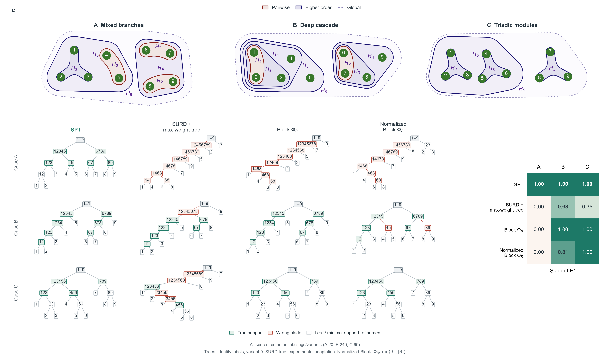

# SURD 全部案例比较与最大权重树的含义

2026-10-15。范围为原图的全部 A/B/C 条件：A 的 1 种结构 × 20 种标签、B 的 12 种结构 × 20 种标签、C 的 3 种结构 × 20 种标签，共 320 条记录。此前仅覆盖三种结构的原标签案例，但每例已经计算全部九源组合；本次补全结构与标签覆盖，并提高目标积分精度。

## 完整结果

| 方法 | A（20） | B（240） | C（60） |
|---|---:|---:|---:|
| SPT | 1.000 | 1.000 | 1.000 |
| SURD + 最大权重树 | 0.000 | 0.631 | 0.348 |
| Block ΦR | 0.000 | 1.000 | 1.000 |
| 归一化 Block ΦR | 0.000 | 0.808 | 1.000 |

每格为该类全部标签／结构变体的等权平均 Support F1，各方法覆盖完全相同的条件。SURD 的 B 类逐条件 F1 范围为 0.429–0.857，C 类为 0.200–0.444，三类正确根划分率均为 0。原先三例代表条件的 SURD 分数仍为 0、0.857、0.400；完整均值下降来自纳入其它结构变体，不能把代表条件当作整个类别的表现。



顶部机制与下方树固定显示原标签、variant 0，右侧分数汇总全条件，因此展示树的单例 F1 不必等于该类平均分。原图所有 HAC 列已移除；此次保留其它方法原来的完整汇总口径，SURD 一行也改为同范围汇总，不再使用仅三例的 † 标记。

## 最大权重树优化什么

对变量组合 $A$，记 $s(A)$ 为 SURD 分配给这个**确切组合**的协同贡献，单位为 nats。$s(A)$ 不等于其全部子集贡献的加和。我们将变量放在叶子上，将变量组合放在内部节点上；每个节点的叶子后代必须恰好组成该变量组合。

一棵合法的层级树只能同时包含互不相交或彼此包含的组合。例如，123 与 456 可以同时出现，123 与 12 也可以；12 与 23 相互交叉，不能同时成为树节点。SURD 可以给这两种交叉组合都分配正权重，构树规则必须作出取舍。

令 $V=\{1,\ldots,9\}$，$\mathcal T(V)$ 为以这九个变量为叶子的全部完整二叉树，$\mathcal I(T)$ 为树 $T$ 的内部节点集合。这里的“最大权重”定义为

$$
T^\star\in\operatorname*{arg\,max}_{T\in\mathcal T(V)}
\sum_{A\in\mathcal I(T)}s(A).
\tag{1}
$$

九叶完整二叉树均有八个内部节点，因此式（1）的比较不会靠增加节点数量提高得分。根节点 $V$ 的 $s(V)$ 在所有候选树中相同，保留或删去这一常量不影响最优树。叶子不带协同权重。落在树外的交叉组合不会被自动归入祖先节点，也不因此被判定为协同为零。

四个变量时，平衡树 `((1,2),(3,4))` 的得分是 $s(1234)+s(12)+s(34)$，链状树 `(((1,2),3),4)` 的得分是 $s(1234)+s(123)+s(12)$。构树需要权衡整套兼容组合的总分，不是依次选取当前最大的单个组合。

## 怎样求出全局最优树

定义 $G(A)$ 为变量集合 $A$ 内可以达到的最大树得分。单变量不能再划分，因此 $G(\{i\})=0$。对于任意非单变量集合，递推为

$$
G(A)=s(A)+\max_{L\mathbin{\dot\cup}R=A}
\left[G(L)+G(R)\right].
\tag{2}
$$

式（2）枚举当前集合的全部无序、非平凡二分，并缓存每个子集的最优分数和子树。最后从 $G(V)$ 回溯整棵树。九个变量只需 511 个非空子集状态和 9,330 个候选二分。分数平局时使用源标签字典序，递归终止于单变量。这个动态规划对式（1）求全局最优，不读取真实模块、真实模块数量或正确根划分。

这里的权重位于变量组合节点上；它不同于把变量作为图顶点、最大化连接边权的通常最大生成树。它也是我们为 SURD 增加的层级适配，不是 [SURD 作者实现](https://github.com/ALD-Lab/SURD/blob/main/utils/surd.py)自带的输出。原方法输出冗余、独有与协同贡献及各组合 MI。

SPT 则在每个节点选择保留子组 $\Xi$ 总和最大的二分，并递归计算跨子组 residual。它与式（1）既使用不同的节点信息量，也使用不同的优化目标。本次比较始终保留同一版最大权重树定义，没有根据完整比较的 F1 修改规则；这一适配最初在三例试算中作为追加分析提出，因此完整比较仍属于既定适配的探索性评估。

B 的原标签、variant 0 提供了实际例子。主积分下 $s(12345678)=0.263623$ nats，而真实支持 $s(6789)=0.043523$ nats。最大权重树选中错误组合 12345678，保留其它六个真实非根组合，舍去 6789。与全部真实支持构成的树相比，其目标函数提高约 0.220100 nats，但支持 F1 只有 6/7，约为 0.857。这说明全局最优保证针对式（1）的 SURD 权重目标，不保证作用模块恢复最准确。

## 完整计算协议

- 共同源与目标：九个原始节点块；一步后的完整联合未来状态。A 保持 126 维独立标准高斯干预，B/C 保持 81 维独立圆周均匀干预。模型及参数不变。
- 阶数覆盖：每条记录计算全部 511 个非空源子集的目标状态特定 KL，保留全部 502 个二至九阶 SURD 协同原子，以及冗余／独有项。
- 分配顺序：在每个目标实现上先执行 SURD 分配，再对目标分布积分，不将已平均的 MI 直接分配为原子。
- 目标积分：主结果为 16,384 个 scrambled Sobol 目标点、seed 20261015；检查为同一序列前 4,096 点，以及 seed 20261016 的 16,384 点。B/C 保留 512 点周期密度积分。
- 标签处理：复用原图共同的 20 个标签双射。每个双射重新排列具体源子集后重新分配 SURD，再独立构树；不把单个树或原子表简单重标为 20 个结果。同一物理结构的标签条件共享实际目标积分点。
- 计分：同一非根作用支持 F1，忽略叶子、根节点及最小真实支持内部的严格细分。真实支持只在最终计分时使用。
- 数值有效性：原生非负容差为 1e-8 nats；原始容差内负值记录，不裁剪。显著负 KL、原子或闭合误差会显式失败。批量分配已与原逐目标实现核对，包括精确平局及源标签置换。

16 种物理结构与 20 种标签构成结构／标签敏感性条件，不是 320 次独立物理重复；两次随机化用于数值积分检查，也不提供总体准确率置信区间。本次完整是指所给已知模型比较网格的全部覆盖，不代表已经完成有限数据学习或自然轨迹下的 SURD 验证。

计算用时 342.7 秒，约 5.7 分钟。三种积分设置下，全部 320 条记录的 F1 与完整树 clade 集合均保持一致。这是对本次积分精度的稳定性检查，不证明积分误差严格为零。主设置相对原精确信息 oracle 的最大子集 MI 偏差为 A 1.45e-4、B 5.79e-6、C 4.49e-6 nats；两次 16,384 点随机化之间的最大单原子差分别为 2.90e-4、1.03e-3、8.46e-4 nats。

全部积分设置的协同原子最小值为 0，容差内负原子及显著违例均为 0，积分后 R/U/S 闭合误差最大为 1.87e-14 nats。另对全部 320 棵树逐一核对完整二叉结构、所选节点权重之和与动态规划得分一致、F1 重算一致。九项测试通过，包含批量／逐目标分配等价、标签置换及四叶树全部 15 种结构的全局最优核验。原 PEID 条件均复用已通过其原生非负和闭合审计的记录，不裁剪原始 residual。

## 文献与实现来源

本次通过 Zotero 重新核验 *Emergent hierarchical organization of causal interactions in complex systems*，父项 `P6UJCVG8`。重新列出并读取唯一正文 `DXGC7JEA`（Methods pp15–17，式 5–12）与补充 `MWIWKSVG`（S1.2、S5/Algorithm S1、S9.3）的相关全文。附件仍无明确稿件日期或修订号，版本歧义保留。S9.3 是观测轨迹二源 SURD；本次共同干预、九源、完整联合 target 的设置属于明确新增的对照适配。

SURD 参考为 Martínez-Sánchez、Arranz 与 Lozano-Durán（2024），[Decomposing causality into its synergistic, unique, and redundant components](https://www.nature.com/articles/s41467-024-53373-4)，Zotero 父项 `K69ZCNZG`，补充全文 `KNU3AJTZ` 的 S1.2、式 S12–S16、pp3–5；并重新核对作者分配代码。证据为相关全文。

实现：[完整比较](../../scripts/compare_spt_surd_full.py)、[批量分配](../../scripts/surd_batch_allocation.py)、[原逐目标分配与树算法](../../scripts/compare_spt_surd_three_cases.py)、[绘图](../../scripts/plot_spt_surd_panel.py)。按结构保存 NPZ 原子表与带输入指纹的 JSON 汇总，便于复用并防止混用不同配置。

[完整结果与数值审计](../../results/spt_surd_full_benchmark/summary.json)保存每条条件的主树与积分检查；同目录 16 个 NPZ 保存各积分设置、标签及源组合的全部冗余／独有、协同和 MI 表。

```bash
OPENBLAS_NUM_THREADS=1 OMP_NUM_THREADS=1 .venv/bin/python scripts/compare_spt_surd_full.py
OPENBLAS_NUM_THREADS=1 OMP_NUM_THREADS=1 .venv/bin/python scripts/plot_spt_surd_panel.py --surd-input results/spt_surd_full_benchmark/summary.json
OPENBLAS_NUM_THREADS=1 OMP_NUM_THREADS=1 .venv/bin/python -m pytest tests/test_spt_surd_three_cases.py -q
```
