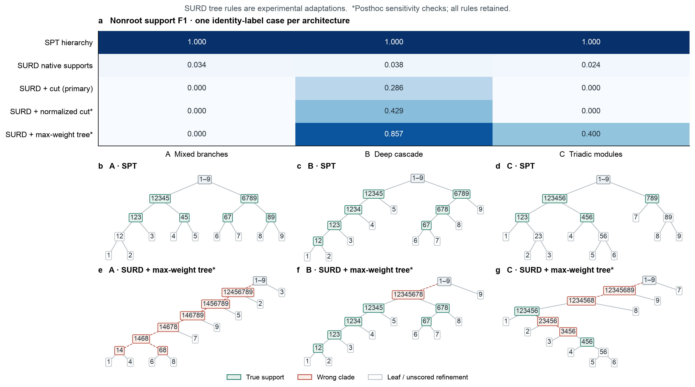

# 截图三个案例的 SURD 轻量比较

2026-10-15。按用户批准的范围，仅计算截图版本 A/B/C 各一个原标签、variant 0 条件。A 为九节点 Gaussian public readout，B/C 为九节点 phase/sharing 模型；未替换成后来有限数据 TM 的 B/C，也未运行全部 320 条标签／变体记录。

SURD 能计算各源组合的协同贡献，但这些组合可以相互交叉，不能直接视为一个层级划分。本次保留相同干预、完整未来目标和支持计分规则，分别评价其原生非零组合与三种明确标注的构树适配。



图中 F1 均为非根作用支持的恢复分数，忽略叶子及最小真实支持内部的严格细分。上方第二行评价 SURD 输出的组合集合，其余行评价树的 clade 集合；两种输出不具有相同的候选数量约束。下方展示 SPT 和全局最大权重树的实际结果。绿色表示真实支持，红色表示错误 clade，灰色细分不计分。星号为观察初始结果后追加的敏感性检查，所有检查均保留。

| 输出／构树规则 | A Mixed branches | B Deep cascade | C Triadic modules |
|---|---:|---:|---:|
| SPT 层级 | 1.000 | 1.000 | 1.000 |
| SURD 原生非零组合，阈值 1e-8 nats | 0.034 | 0.038 | 0.024 |
| SURD + 未归一化超图切分，预先固定 | 0.000 | 0.286 | 0.000 |
| SURD + 规模归一化超图切分，追加检查 | 0.000 | 0.429 | 0.000 |
| SURD + 全局最大权重嵌套树，追加检查 | 0.000 | 0.857 | 0.400 |

原生组合中，A 检出 348 个计分支持，包含全部 6 个真实支持及 342 个额外组合；B 为 365 个，包含全部 7 个真实支持及 358 个额外组合；C 为 334 个，包含全部 4 个真实支持及 330 个额外组合。三例的原生组合集合均不满足层级嵌套条件。因此低 F1 主要反映额外组合多，不能解释为没有检测到真实组合。按最大权重构树，B 保留 6/7 个真支持、C 保留 2/4 个，但三例根划分仍全部错误。

## 比较口径与构树定义

九个原始节点块分别作为九个 SURD sources。A 保持全部 126 个当前坐标上的独立标准高斯干预；B/C 保持全部 81 个当前坐标上的独立均匀圆周干预。所有方法的时距为一步，SURD 和 SPT 都以完整未来状态作为同一个联合 target。没有按真实机制拆开 target 通道后分别运行 SURD。向量联合目标上的分解与逐坐标目标分解通常不同，本次结论仅对应前者。

对每个目标实现 $\mathbf{y}$，先计算全部 511 个非空源子集的 specific information $i_S(\mathbf{y})=D_{\mathrm{KL}}[q(\mathbf{x}_S\mid\mathbf{y})\Vert q(\mathbf{x}_S)]$，执行 SURD 分配后再对目标分布积分。没有直接将平均后的 MI 表分配为 SURD 原子。采用已有 `assign_surd_specific`，其平局约定为信息值、阶数、source mask 升序；原作者实现中的同阶筛除属于 SURD 定义规则，不是对 PEID Syn 的数值投影。

A 的各通道观测平均值是充分统计量。令 $r_{Sg}$ 为选中源的信号方差占第 $g$ 个目标通道总方差的比例，$z_g$ 为该通道标准化目标，则

$$
i_S(\mathbf{y})=\frac12\sum_g\left[-\log(1-r_{Sg})+r_{Sg}(z_g^2-1)\right].
$$

这是已知高斯联合的精确后验 KL，与其精确 Cholesky TM 密度一致。B/C 使用已知条件圆周密度和 512 点周期积分；不同机制使用相互独立的源坐标，因此完整支持通道的 specific KL 与被选局部通道的常量 KL 在分配前相加。这与原信息 oracle 的边缘化规则相同，不是将非高斯模型近似成高斯。

令 $s_E$ 为 SURD 分配给组合 $E$ 的协同权重，$F(A)=\sum_{E\subseteq A}s_E$。预先固定的适配在当前节点 $A=L\mathbin{\dot\cup}R$ 最小化 $F(A)-F(L)-F(R)$，即切开组合的总权重，并递归到单节点。追加的归一化检查将该代价除以 $\min(|L|,|R|)$。全局最大权重树以动态规划最大化所有入选树节点的 $s_E$ 总和。三个适配均枚举所有合法二分，以源标签字典序处理平局，不读取真实支持、真实支持数量或期望块大小；真实支持仅用于事后计分。这些规则均为本实验适配，不是 SURD 论文自带的层级算法。未归一化切分可能偏好单节点分支，因此不能用它的一行分数概括 SURD 的恢复能力。

原生组合的 1e-8 nats 阈值表示数值零，不表示统计显著性，也未按 F1 调节。作为观察结果后的敏感性检查，保留其它阈值的 F1：

| 原生权重阈值（nats） | A | B | C |
|---|---:|---:|---:|
| 1e-6 | 0.036 | 0.038 | 0.024 |
| 1e-4 | 0.048 | 0.043 | 0.026 |
| 1e-3 | 0.068 | 0.056 | 0.031 |
| 1e-2 | 0.214 | 0.108 | 0.074 |

这些数值表明原生组合 F1 依赖提取阈值。没有从中选择一个“最优阈值”作为测试结果。

## 数值检查与解释边界

主结果使用 8192 个 scrambled Sobol 目标积分点、seed 20261015。另检查同一序列的前 2048 点和独立 scramble 20261016 的 8192 点。三种构树规则的 F1 在这三次积分检查中均保持上表数值。预先固定的切分树三例均逐 clade 一致；最大权重树 A 的部分错误细分发生变化，B/C 的 clade 集合一致。这些是数值积分检查，不是独立物理系统重复或总体置信区间。

相对原精确信息 oracle，8192 点两次积分的最大子集 MI 偏差为：A 4.65e-4、B 1.88e-5、C 4.46e-6 nats。SURD 每目标状态分配的最大闭合误差为 8.88e-16 nats，specific KL 最小值为 0，负值及显著违例计数均为 0。原生支持数量对稀有目标事件敏感：两次 8192 点积分中 A 为 348／336、B 为 365／366、C 为 334／334，故不将主结果的小数尾位视为已精确收敛。构树使用原始权重，包括小于提取阈值的正权重，没有对权重做截断。

SPT 复用截图对应的已审计结果，原生 Syn 容差为 1e-8 nats，显著违规均为 0，原始容差内负 residual 保留，不做 clipping，树闭合检查通过。没有重新训练任何密度模型。主运行约 24 秒；可重算的完整原子表暂存于运行输出，仓库只保留脚本、图与本报告，未新增结果缓存或 CSV。

一个直接说明定义差异的例子是：独立公平比特 $X_1,X_2$，联合目标 $\mathbf{y}=(X_1,X_2)^\top$。SURD 在每个目标状态给出 $R_{12}=1$ bit、$S_{12}=1$ bit，而 PEID 的 $\Xi(12)=2-1-1=0$。因此，完整多输出目标上的 SURD 协同不能直接等同于 PEID 的机制整合量，非零组合也不必是一个真实作用模块。

本次结果支持：SURD 可提供组合信息，但得到层级还需要额外规则，且恢复效果依赖该规则与目标定义。它不证明 SURD 在其它 target、提取规则、参数或有限样本条件下不能恢复层级，也不构成 SPT 的普适优越性证明。

## 文献核对与复现

本次重新通过 Zotero 核验 *Emergent hierarchical organization of causal interactions in complex systems*，父项 `P6UJCVG8`，重新列出并读取当前唯一正文 `DXGC7JEA`（19/19 页索引，Methods 式 5–12，pp15–17）和补充 `MWIWKSVG`（28/28 页索引，S1.2、S5/Algorithm S1、S9.3）。正文及补充没有明确稿件日期或版本号；附件入库／修改时间不足以判定新稿版本，歧义保留。S9.3 描述的是观测轨迹下的二源 SURD；本次九源、共同干预、完整联合 target 的比较是明确新增的实验适配，不能视为该节原有结果的复现。

SURD 依据为 Martínez-Sánchez、Arranz 与 Lozano-Durán（2024），[原论文](https://www.nature.com/articles/s41467-024-53373-4)，Zotero 父项 `K69ZCNZG`。本次读取其补充全文 `KNU3AJTZ`（38/38 页索引），相关位置为 S1.2、式 S12–S16、pp3–5，并核对[作者实现](https://github.com/ALD-Lab/SURD/blob/main/utils/surd.py)的 specific-information 分配步骤。文献证据为全文，而非仅摘要或元数据。

实现：[比较脚本](../../scripts/compare_spt_surd_three_cases.py)。验证：[六项独立检查](../../tests/test_spt_surd_three_cases.py)，覆盖直接后验 KL、全部子集 MI、圆周积分、独立复制反例、层级切分与全局权重目标；6 passed。

```bash
OPENBLAS_NUM_THREADS=1 OMP_NUM_THREADS=1 .venv/bin/python scripts/compare_spt_surd_three_cases.py
OPENBLAS_NUM_THREADS=1 OMP_NUM_THREADS=1 .venv/bin/python -m pytest tests/test_spt_surd_three_cases.py -q
```

## 按原图版式替换 HAC 列（现已更新为完整比较）

按用户后续要求，移除原图中的 Pair ΦR + HAC、Pair Ξ + HAC、Future MI + HAC 三组树及评分，加入 SURD + maximum-weight tree，保留 SPT、Block ΦR 与归一化 Block ΦR。顶部三个机制示意图复用原绘图逻辑与原支持，比较树仍固定为原标签、variant 0。此次只重排并绘制已有结果，没有新增动力学拟合或 SURD 积分。


初版替换图中，其余方法汇总 A/B/C 的 20／240／60 条标签与变体记录，SURD 一行仅使用此前三个原标签案例，并以 † 标出范围差异。按用户后续要求，现已补齐全部 320 条 SURD 条件并更新上述图：SURD 全条件平均 F1 为 0、0.631、0.348，移除 †。本报告前面的三案例表与独立三案例图保留为试算记录，0、0.857、0.400 仍只表示对应原标签案例。完整协议、数值检查及最大权重树推导见[完整比较报告](spt_surd_full_comparison.md)。

本次再次通过 Zotero 重新定位父项 `P6UJCVG8`、当前唯一正文 `DXGC7JEA` 与补充 `MWIWKSVG`，重读正文式（10）–（12）及补充 S5/Algorithm S1；无明确稿件日期／版本号的歧义保持不变。此次不修改方法或解释口径。

绘图入口：[plot_spt_surd_panel.py](../../scripts/plot_spt_surd_panel.py)。默认优先读取已完成的完整比较；重绘原三案例评分版本时，先运行上面的试算脚本，再显式指定临时输入：

```bash
OPENBLAS_NUM_THREADS=1 OMP_NUM_THREADS=1 .venv/bin/python scripts/plot_spt_surd_panel.py --surd-input /tmp/eisyn_spt_surd_three_cases.json --output docs/reports/assets/kuramoto_hierarchy/spt_hierarchy_surd_three_case_scores.png
```
