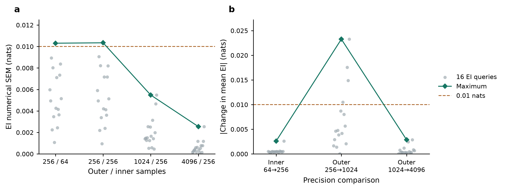

# SPT 三案例：监督、对照条件与下一步

文献筛选更新：MI＋average并非无先例，已核对Song等2012、Yu与Peng2013、Ma等2011的明确组合使用。主表保留10项、增量表示9项作为敏感性；CKA＋average有2026年预印本先例，单列新近参考。自定MI谱图／对称滞后MI组合移出正式主表，原49组及成功结果全部保留；没有新计算。见[文献核对与筛选](spt_hierarchical_clustering_literature_audit.md)。

最新轻量对照（2026-10-16）：按用户要求试算直接数据层次聚类，49组预登记配置×三例×完整训练／四个链子集全部完成，735棵树，正式重跑20.58秒。KSG互信息＋average／complete／weighted及MI递归Ncut在三个完整训练集上均模块F1=1；不能用当前三例证明直接聚类普遍失败。MI＋average在两例Kuramoto的四子集仍均为1，LV四子集均为.5。旧SPT分数没有搬入新的MLP对照；未训练新MLP或新增EI。详情、全部配置和代表树见[自然数据层次聚类筛查](spt_hierarchical_clustering_screen.md)。

用户最新入选条件（2026-10-16）：必须先从数据拟合MLP，再基于冻结MLP及显式残差条件模型，在登记的因子化干预分布上估计EI／Syn并构建SPT；动力学须含LV／Kuramoto这类本体非线性，单纯Gaussian公共读出或可逆非线性读出不满足。以下旧图保留为历史结果，不能冒称这一MLP管线的结果。当前Kuramoto A/B实际使用Fourier候选字典／Lasso拟合的流模型，LV使用指数特征字典／Lasso，均不是MLP。现有[自然数据MLP试算](spt_natural_mlp_pilot.md)只接通接口，未生成SPT／Block完整树或F1；按新条件尚未找到已完成且SPT F1明显超过普通Block-ΦR的案例。

最新展示按用户参考图组合：上方仅编号网络A/B，下方为三个案例×五方法的原生层级树，右侧为同一结果的模块F1。图中B对应原始实验键C，仅改变展示名，冻结输入、缓存、评分参考和节点身份不变。组合图使用保存的均值树，SURD暂定树采用全部两份合规完整表。按用户最新授权，原三项N/A现展示完整诊断输出：LV Block粗档为1‡，Kuramoto A/B的旧WMS均为0‡；原精度失败状态保留，不以这些诊断分数认定可靠优势。没有重启或补算实验。主图见[完整案例与结果](assets/kuramoto_hierarchy/spt_matched_cases_composite.png)，可编辑版本为同名SVG。

2026-10-16 最终更新。两个原实验会话和本轮新增实验均已停止，小时巡检已删除。最终三个案例为Kuramoto简化A、同权同超边的高阶LV简化A、Kuramoto简化C，SPT模块F1均为1，最高档评分模块结构均4/4一致。按用户允许并列的综合评价口径，SPT达到三例的指标上限；完整五法精度比较仍有缺口，不能称全部方法已通过。

本轮已补齐简化A **相同超边及权重**的两类动力学对照，保留Kuramoto A/C的结构对照。旧高阶LV原A使用不同的嵌套超边，不冒充同网络案例。模型、评分和数值门槛均保留，未开展按F1挑选网络或数据种子的搜索。最终图表和逐方法来源见[同网络三案例五法比较](spt_matched_three_case_comparison.md)。

新增LV的SHAP F1=1、自然WMS F1=0*；SURD只有截止前2/4份完整表，均值暂定F1=0†，树不稳定；普通Block高档未完成，现仅展示已完成粗档1‡。Kuramoto两例新增WMS复核未启动，旧结果继续数值未分辨，以0‡展示。下一步应先补齐这些数值缺口，再用独立物理数据种子验证；并列本身不构成重设计网络的理由。

绝对截止为15:57:47。Block和调度器按时终止，但SURD截止保护失效，16:06:41巡检确认完整命令后立即强制停止，越时约8分54秒。35份越时specific缓存及其对应中间计算不进入本轮结果；两份用于暂定汇总的完整表全部早于截止。原始检查点、启动记录、缓存时间核对及异常说明均保留在新目录；留存日志不足以确认保护失效根因。预算未重置，也未继续新计算。

## 历史 SPT 与普通 Block-ΦR 差距核对（2026-10-16）

本节为历史分数检索，以下五项均不符合用户随后明确的“MLP拟合＋动力学本体非线性”入选条件，只保留作方法反例。此前MLP Kuramoto粗网格及局部加密比较的是SPT与pair-Ξ／HAC或自身层级变化，没有普通Block-ΦR的配对F1；不得移用这些基线分数。[共同MLP训练约束](../log/spt_natural_mlp_training_contract.md)记录了旧三案例的拟合族差异及当前仅完成的接口试算。

当前三个Kuramoto／高阶LV案例没有显示SPT对普通Block的F1优势：两例Kuramoto均为1对1，LV为1对粗档诊断1‡。只读检查既有JSON后，找到以下已完成的历史连续公共读出案例；它们不属于当前单相位Kuramoto或单丰度高阶LV。

| 历史案例 | 结果来源 | SPT模块F1 | 普通Block-ΦR模块F1 | 配对差值 | 证据范围 |
|---|---|---:|---:|---:|---|
| 九节点嵌套Gaussian公共读出 A | [有限数据缓存](../../results/spt_finite_data_tm/summary.json)，仅case=A | 1.000 | 0.000 | +1.000 | N=16384、65536，seed=0/1/2分别均一致 |
| 九节点Gaussian级联公共读出 B | [替换B/C有限数据缓存](../../results/spt_finite_replacement_bc/summary.json)，仅case=B | 1.000 | 0.000 | +1.000 | N=4096、16384、65536，seed=101/102/103分别均一致 |
| 九节点单调非线性三元公共读出 C | 同上，仅case=C | 1.000 | 0.400 | +0.600 | 同上各规模、各seed均一致；非线性为可逆arsinh读出 |
| 四节点不等强度Gaussian公共读出 | [精确联合结果](../../results/spt_normalized_block_counterexample/summary.json) | 1.000 | 0.000 | +1.000 | 全24个节点标签双射；不是24次物理重复 |
| 四节点等强度Gaussian公共读出 | [精确联合结果](../../results/spt_continuous_broadcast_case/summary.json) | 1.000 | 0.500 | +0.500 | 全24个节点标签双射；不是24次物理重复 |

九节点A还有[已知联合的精确TM核验](../../results/spt_nested_broadcast_case/summary.json)：全部20个共同标签均为1对0，4599项TM／独立信息公式最大差4.89e-15 nats，全9330二分Syn审计无显著违规。因此其Block低分不能用本轮LV的嵌套积分精度故障解释。有限数据A在N=4096时，三个seed均为SPT=5/6、Block=0；上表并未隐去这个较低样本规模。

有限数据A、B、C均完成采样、拟合同一完整条件TM及两方法的一致边缘查询；每个模型内共用训练数组和冻结拟合联合，SPT固定完整未来，Block按自身定义改变局部target。所有上表有限数据设置均为valid；原生Syn容差1e-8 nats，显著违规均为0，无裁剪。N的三个规模采用嵌套前缀，B/C的20次标签检查在每个拟合内部平均，不扩大独立重复数。每个固定生成模型只有三个独立采样数据集，未做确认性显著性检验；这些是构造性开发验证，不是跨随机动力学总体的统计显著结论。历史B/C名称也不指当前展示网络B。

最简洁的分歧机制见四节点不等强度案例：真实根12|34的SPT residual为0，切开一组为.0384805 nats；普通Block对真实根给.3900793，而对错误的剥离弱输入切分给.1176738，最小化时严格选择错误根。它比较的是固定完整未来的源协同与局部源—未来分区目标，结果分歧不依赖数值平局。适用结论仅限这里的递归未归一化MMI Block适配；不推广到所有ΦID分区或归一化版本。

详细模型、系数、评分与拟合误差见[连续层级报告第9、11、13–14节](spt_continuous_hierarchy_refinement.md)。九节点A的精确联合及有限数据结果可作为独立机制反例保留，但不进入最新MLP非线性动力学主比较；不替换当前已固定的Kuramoto／LV对照，不将不同状态维数和模型混合成总体平均。此次只读取已有结果，没有新实验。

方法依据已于本次重新经Zotero核对父项P6UJCVG8题名及其全部附件，并重新获取唯一主文DXGC7JEA（19/19页）和SI MWIWKSVG（28/28页）全文；相关位置为主文Methods式（10）–（12）、SI S5.1式（S49）–（S50）。仍无明确稿件版本日期。历史公共读出模型及条件拟合EI是项目验证／估计适配，不宣称就是手稿原估计器。

## 监督对象与结束条件

- [简化 Kuramoto SPT 网络设计](thread://01a13e3e-7aa4-7920-aa6f-fb1f16d10dcd?hostId=local)：A/C 保留计算已结束，接续进程已结束，原会话整理总表。
- [开展SPT连续层级细化实验](thread://01a135b2-65af-7810-88f1-66ed34ea6234?hostId=local)：唯一原截止为北京时间 2026-10-15 23:09:18。主进程已终止，SURD 最终保留两份完整表，普通 Block-PhiR 未完成，原会话整理终止说明。

原两会话监督已收束。新增阶段按用户要求每小时巡检，当前全部工作进程已核验退出，临时监督已删除。巡检同时核对完整命令与原生缓存；未更改原会话进程、代码或预算，未向其他会话发送消息。所有新产物仅使用本会话目录。

## 三案例应该控制什么

| 最终案例 | 动力学 | 超边网络 | 当前结果 |
|---|---|---|---|
| 1 | Kuramoto | 简化 A | 已有 |
| 2 | 高阶 LV | 简化 A，与案例 1 逐边同权 | 完整SPT/SHAP/WMS结束；SURD暂定，Block未完成 |
| 3 | Kuramoto | 简化 C | 已有 |

案例 1–2 比较同网络的两类动力学，案例 1–3 比较同动力学的两种网络。这是两个条件对照，缺少“高阶 LV × 简化 C”，因此不能估计完整的动力学×网络交互。

以下数字串均表示超边成员。已同时核对生成器和冻结缓存：高阶 LV 的 `pilot.json` 中 A 的 `generator`，以及 Kuramoto A/C 的 `frozen_model.json` 中 `network`。

| 网络 | 权重 1 | 权重 .5 | 权重 .25 |
|---|---|---|---|
| 现有高阶 LV 原 A | 123、45、67、89 | 12345、6789 | 123456789 |
| 简化 A | 123、45、67、89 | 34、78 | 56 |
| 简化 C | 123、456、789 | 34 | 67 |

原 A 与简化 A 共有四条底层超边，另外三条不同。相同模块参考树不等于相同物理网络。简化 A 与 C 同时改变了超边数量、阶数构成和连边，这是网络整体方案的对照，不能单独解释某一结构特征的效应。

## 已有结果与解释边界

下表已按原计算终止后的原生文件复核，通过原汇总器的只读 `records()` 适配读取。原总表同步见[三例五法原报告](spt_glv_kuramoto_five_methods.md)。这里的高阶 LV 仍是**原 A**，与本轮同网络案例2区分。

| 方法 | 高阶 LV 原 A | Kuramoto 简化 A | Kuramoto 简化 C |
|---|---:|---:|---:|
| SPT | 1.0000 | 1.0000 | 1.0000 |
| SURD + maximum-weight tree | 0.0000† | 0.3077* | 0.0000* |
| 普通 Block-PhiR | N/A：原预算内未完成 | 1.0000 | 1.0000 |
| WMS 自然采样树 | 0.0000* | N/A | N/A |
| SHAP 输出归因模式树 | 1.0000 | 0.6154* | 0.0000* |

指标为模块参考 F1，忽略最底层三元模块内部的任意二叉细化，不是完整物理超边恢复率。高阶 LV 的 SPT 和 SHAP 严格 clade F1 都为 12/13，模块 F1 都为 1。* 表示数值或树结构敏感性未完全解决；† 是完整 511 子集表构成的暂定结果，最终只有 2/4 个完整积分重复，预定完整精度未确认。N/A 表示未完成或数值未分辨，与实测 0 区分。

高阶 LV 的 SURD 在最高登记档 outer/posterior/inner=128/128/256 下，使用两个完整重复 `[0,1]` 的平均原子构树，模块 F1 仍为 0。两份表 specific/atom 显著非负违规均为 0，最大逐状态闭合误差均为 7.11e-15 nats，未裁剪。两表平均的根与仅首表的根不同，不能称树跨重复稳定。主进程最初以 `cancelled` 结束，所属会话随后将预算到期的主结果和 SURD 检查点核定为 `budget_exhausted`。本会话只读取原生结果。

SPT 在已评价模块指标上达到最高分，同时 Kuramoto 两例与普通 Block-PhiR 并列，高阶 LV 与 SHAP 并列。当前证据支持这些具体案例的模块恢复，不能据此声称独占第一或跨系统统计显著。每例只有一个拟合数据种子，四次积分重复或 SHAP 背景子样本不构成四份独立物理实验。

Kuramoto WMS A/C 最大 MI 积分 SEM 分别为 .0273506/.0128516 nats，均超过原 .01 门槛；A 还存在重要性权重问题。计算完成不等于数值通过，这两项不能进入有效排名。SURD 和 SHAP 的树均为已声明的实验适配，适配选择属于比较条件。

## 最小改进方案与已批准的试算

先补结构控制，再评估是否值得扩大搜索。拟议新增项只包括高阶 LV 的简化 A，不重算已有 Kuramoto A/C，也不恢复已取消的归一化 Block-PhiR 或旧 HAC 基线。

第一步已获批并完成 **15 分钟硬上限的可行性试算**。采用原数据规模 16384/4096/4096、开发 seed 0、坐标干预、噪声 .08、预测时距 .20、步长 .0025、TM 估计和原 .01 nats 非负容差。原样继承简化 A 每条边的权重，按新的超边重新计算高阶 LV 系数和中心化补偿，不能只替换 `supports` 而保留原 A 的丰度方程参数。拟合器继续只接收数据，不接收真实超边。

试算先检查精确成员/权重、正丰度、步长、拟合及代表性 EI 的积分可行性。通过后依据实测速率提出完整 511 子集、切分稳定性和五法比较的追加预算。轻量替代是只交付现有结果与对照缺口，不新增任何计算。第一步不能保证覆盖全部查询，也不能产出可认证的最终三案例排名。

独立入口为 `scripts/spt_glv_simplified_a_pilot.py`，输出限定为 `results/spt_matched_three_case/glv_simplified_A/`。启动器检查原两个流程的终态及实际进程，满足条件后才登记一次绝对截止，并在截止时终止自己的子进程。已有预算或结果时拒绝覆盖，禁止重置预算。四项针对性检查通过，覆盖同权网络、重新计算后的丰度方程与 Itô 换算、禁止桥权重重分配、原生 Syn 容差计数与显著违规失败、缺失查询不补零。

试算已于北京时间 23:14:42 启动，唯一截止 23:29:42。首轮检查确认实际子进程和原生结果可读。dt=.0025→.00125 的配对 RMS 为 3.5402e-5，小于 1e-4；重新生成的 Kuramoto 训练/验证转移摘要与冻结缓存逐项匹配，共同源数组 SHA256 为 `718fffd5e77c697cc4c5794f3b102a9c3342dd383830f78949e583bc0ae76168`。这只证明数据配对和步长检查通过，尚不代表 EI 或层级恢复通过。

### 试算结论：修复少数后验提议后，代表性 EI 通过

初始全套 16 查询×4 档×4 积分重复在 276.36 秒内结束，拟合的九个输出都在 2500 次迭代上限前收敛。初始结果为 `precision_failed`：最高档 scramble 1 的三个 source 查询 {8}、{7,8,9}、{6,7,8,9} 均在同一个 outer 行 1234 权重退化，最低 ESS=1.086，最大权重=.959。单纯沿原提议增加到 65536 个内层点仍未通过，失败原值完整保留。

在同一绝对截止内，对这三个失败行复用仓库已有的 `real-group-v4` 有界优化与 80% 局部、15% 宽提议、5% 均匀防御混合，采用精确 prior/proposal 权重。模型、干预、source/target、外层样本和门槛均未改变，修改的是数值积分的提议分布。新提议在每行 1024 点即通过；其余查询和 outer 行复用原结果。重放核验确认原逐点积分与原缓存一致，原 `pilot.json` 未被覆盖。

| 检查 | 修复后的结果 | 原门槛 |
|---|---:|---:|
| 完成的代表性 EI 查询数 | 16，四档各四次积分重复 | 预声明范围完整 |
| 256 外层下，inner64→256 最大 EI 均值变化 | .0026024 nats | <.01 |
| 1024→4096 外层最大 EI 均值变化 | .0028670 nats | <.01 |
| 最高档最大积分 SEM | .0025472 nats | <.01 |
| 最高档全部已查积分的最小 ESS | 20.1409 | ≥10 |
| 最高档全部已查积分的最大归一化权重 | .183643 | <.25 |
| 最高档最大投影优化剩余步 | .00026883 | <.001 |
| 两初值逆解最大差 / 非正 Jacobian 数 | 1.78e-15 / 0 | <1e-4 / 0 |
| 最高档五个可用切分、四重复的最小 raw Syn | .00041444 nats | ≥−.01 |

最高档的 20 个 raw Syn 无容差内负值或显著违规，未裁剪。初始全部粗细档共 80 个可用 raw Syn 中有 10 个容差内负值、0 个显著违规，均保留原值；这不构成负 Syn 的证据。粗 outer256→1024 的最大变化仍为 .023272 nats，超过 .01，保留为粗档诊断，最终判据使用已预声明的最高两档。

随后将三个修复行的 inner1024 再复核至4096，单行对数边缘变化为 .0101–.0201 nats，对完整外层 EI 均值的影响为 2.46e-6–4.90e-6 nats，权重检查均通过。这是针对修复行的内层数值复核，不是新增物理数据重复。最后的计算结果于首个试算启动后 848.55 秒内保存，早于 900 秒硬截止；三个阶段子进程均已退出。

图 a 为四次积分随机化形成的数值 SEM，灰点为16个查询，绿线为最大值。图 b 为相邻档位的 EI 均值变化，保留了未过 .01 的粗外层比较。最高档使用修复后的三个积分行。图例位于坐标轴外侧，已检查无数据遮挡或裁切。

这次15分钟试算仅证明这一拟合数据集和16个代表性 source 查询的可行性，未覆盖全部511子集、9330切分、树排名、普通 Block-PhiR、SURD、自然 WMS 或 SHAP。它本身不产生完整SPT F1；后续新增阶段的完整SPT结果另见下文和最终报告。

数值证据分别保存在 `pilot.json`（初始失败）、`proposal_refinement.json`（单纯加样本仍失败）、`proposal_refinement_polished.json`（提议修复通过）、`proposal_refinement_confirmation.json`（加密复核）。两次修复均沿用原 `budget.json` 的唯一截止，未重置或追加额度。

### 已批准的完整比较：最多8小时

建议冻结当前三案例结构和已拟合模型，复用正确缓存，新增最多 **8 小时**墙钟计算额度，按数值完整性推进完整三案例五法比较。先补新 LV 的全部511 EI、9330切分审计和标准精确 SPT，再完成普通 Block-PhiR、共用自然数据的 SHAP/WMS 及完整逐状态 SURD 表。对已有 Kuramoto WMS 的未分辨项仅在同一额度内做数值修复，保持现有模型、自然数据、源分布近似、固定完整未来和门槛。记录逐方法成本、覆盖、失败和树稳定性，达到完整终态即提前结束，额度到期则保留 N/A 或合规的暂定标记，不用未完成结果证明 SPT 优势。

新增额度已于2026-10-16获得明确批准，原实验及15分钟试算预算不修改。新预算登记为北京时间 2026-10-16 07:57:47 至15:57:47，唯一截止 epoch1792137467.2160041，包含入口准备及所有阶段，不能因修复、恢复或后启动的阶段重置。按试算16查询的实测速率，四次重复全511 EI 的粗档1024/256线性外推约26分钟，高档4096/256约105分钟；这未计稳健提议、困难外层行、额外target和并行资源竞争，属于粗略估计，不能当成五法总时长保证。

新结果均写入 `results/spt_matched_three_case/full_comparison/`，新汇总见[同网络三案例五法比较](spt_matched_three_case_comparison.md)。完整计算分成两个执行序列：主序列完成新LV全部EI/SPT后，运行普通Block，再复核Kuramoto A/C的WMS；第二序列完成新LV共用自然轨迹及SHAP/WMS后，运行完整逐状态SURD。两个序列最多同时各执行一个计算阶段，采用一份共享硬截止，并非每个阶段各有8小时。

SPT预声明完整N1024/4096、P256、四scramble，全511子集及全部9330二分非负审计。Block预声明N256/P256与N512/P512的普通未归一化目标，按每节点完整候选枚举。SURD先做outer/posterior/inner分辨率pilot，使用已有稳健实数提议与正确重要性权重；只有pilot通过才扩展完整511组合逐状态分配。自然SHAP和WMS共用新网络生成的64链、burn256、保留512步相邻转移；保留原Gaussian源TM近似并诊断，不更换冻结预测模型。Kuramoto WMS保留原自然轨迹及周期源密度，数值触发逐行加密与outer1024/4096/8192，禁止修改物理样本、源模型或按排名选设置。

九项针对性检查已通过，包含原配对生成器、显著负Phi失败、独立通道的raw Block目标、实数截断正态的specific-KL解析对照、相关周期自然源的原积分与逐行修复重放一致性，以及 NumPy 审计标量的无损保存。软件检查不替代科学结果的完整性和数值门槛。已验证实际计算子进程、日志和原生检查点可读；每小时监督任务已启用。

2026-10-16 09:00 前后的首次小时巡检确认，SPT 已完成 N1024 的511子集及非负审计，正推进 N4096；SURD 的16项pilot均通过，已进入完整逐状态表。自然采样阶段首次运行实际退出码1，原因是完整 WMS 表计算后的 NumPy `int64` 审计计数不能被严格 JSON 保存，而不是数值计算失败。四份511子集 MI 表和积分缓存均完整。原 `natural.json` 因错误处理也遇到同一保存错误而滞留 `running`，工作流历史也读到了该旧状态；两者不能证明进程活跃。

确认原子进程17269退出后，仅修复新比较目录所用的数值类型保存，并在同一截止内以 `--resume` 复用全部缓存。标量转换不改变数值，原始负数保留，非有限数继续拒绝；针对性检查通过。第二次自然阶段于09:02:26以退出码0完成，原失败日志、两次启动历史和 `natural_serialization_repair.json` 均保留。共享预算未改，未重生成物理数据。已在正常推进的 SPT/SURD 未重启。

新 LV 的 SHAP 模块 F1=1，四背景子样本评分结构一致；自然 WMS 的四积分重复模块 F1均为0，完整树只有1/4与均值树一致，故保留敏感性标记。WMS 最大 MI SEM=.00489665 nats、代表查询 inner64→256最大变化=.000166846 nats、最小ESS=63.922、最大权重=.0183498；组成 MI/源包含审计通过。这是该冻结数据集上数值通过但恢复较差的结果，不追加按 F1 选参。汇总图已刷新并视检，标签和注释无重叠、裁切；新 LV 的完整 SPT、Block、SURD 仍未完成。

更轻的选择是仅新增最多2小时，先补新 LV 的完整 SPT 与排名核验，五法比较延后。该选择能先判断第三个对照案例是否可用，但不能完成全部基线比较。两种方案均固定开发 seed 0，不开展网络/种子/F1 搜索；若后续需要泛化结论，再另行设计未参与选择的独立数据重复。

完整评估必须同时报告模块 F1、根恢复、数值状态及独立数据重复。若还要寻找 SPT 更有辨识力的条件，应在预先声明的小范围网络/耦合/噪声域做探索，再以未参与选择的数据种子验证。探索中各方法使用相同预声明模块参考和相应公平预算，保留并列、失败和反例，不以测试集 F1 挑选种子或更换真值。独占最优是否成立由结果决定。

### 完整 SPT 通过，三案例对照已补齐

2026-10-16 13:21:02，新 LV 完整 SPT 以退出码0结束；14:10小时巡检核验两档均为511子集、四积分重复和均值的全部9330切分审计完整。N1024/4096 的最大 MI SEM 分别为 .00663246/.00264777 nats，两档最大 EI 均值差 .00372632 nats，均小于 .01 门槛，查询权重和内层检查无失败。最高档四重复模块 F1 均为1，均值树模块 F1=1、严格 clade F1=12/13，根正确；评分模块结构4/4一致，primitive三元组内部细化仍允许变化。

非负容差仍为 .01 nats，均值和四重复逐项原始值均未裁剪。N1024 的 Syn 最小值−.00101039 nats、容差内负值累计1872项，Xi最小值−.000575345 nats、容差内负值122项；N4096 的 Syn 最小值−.000416904 nats、容差内负值1029项，Xi最小值−.000356480 nats、容差内负值73项。每档统计均包含五张表的重复检查项；所有显著 Syn/Xi 违规数为0。这是数值容差统计，不是负Syn证据。

至此，Kuramoto简化A、同权同超边HO-LV简化A、Kuramoto简化C的SPT模块F1均为1，已满足两组结构/动力学对照的配对条件。Kuramoto两例与普通Block并列，新LV与SHAP并列；不能称独占第一，未完成项也不参与有效排名。

14:10时，Block已接续并完成N256/P256粗档，正推进N512/P512复核；SURD最高登记档仅scramble0完成511子集，scramble1推进中，其余未完成。完整SURD表specific和atom显著非负违规均0、最大逐状态闭合误差7.11e-15 nats；使用全部已完成表的暂定模块F1=0†，不代表四重复精度通过。Kuramoto WMS数值复核尚未启动。所有阶段仍共用15:57:47截止，未追加计算。已刷新汇总图并视检无重叠、裁切；局部修正了报告中不足四重复时的稳定性分母，明确仅在已完成重复间比较，四重复完成门槛不变。

14:12进一步核验发现原调度进程22286已退出，其执行会话不再可读，未留下可定位原因的终态日志；Block和SURD的阶段守护父进程仍在，各自硬截止有效。只给本聊天的新调度器增加 `--resume`，保存旧启动记录及 `workflow_resume_repair.json`，确认两个现有工作进程命令匹配后恢复依赖调度。恢复过程接管既有启动记录，未重复启动SPT、natural、Block或SURD；尚未启动的WMS仅在原前置阶段结束且未到共享截止时接续。该恢复不改变科学设置或预算。

用户随后明确：无需SPT在每个案例独占最优，以三个案例的综合表现评价，允许并列。相应汇总图已改成横向三案例矩阵，明确相同网络/不同动力学、相同动力学/不同网络，并突出SPT三例模块F1均为1。保留Block和SHAP的并列满分、敏感性星号、SURD暂定标记、pending与N/A，不把缺失值计为0或据此计算有偏的总平均。该调整只涉及展示与结论口径，实验和8小时截止不变。制图时重新查询Zotero父项和全部附件并取得全文，读取SI S5.1/Algorithm S1；仍只有原正文/补充附件组，无明确稿件日期版本。新图已实际视检，标签、数值和图下注释无重叠或裁切。

## 当前手稿与实现

本任务重新通过 Zotero 本地 API 按题名核对 *Emergent hierarchical organization of causal interactions in complex systems*，父项 `P6UJCVG8`。当前仅发现主文 `DXGC7JEA`（19/19 页全文）和 SI `MWIWKSVG`（28/28 页全文）。附件无明确稿件日期/版本，2026-10-04 的元数据修改时间不能确定新稿；“当前唯一可用附件组”是本次版本证据的上限。

已重读主文 Methods 式（4）–（12）、SI S1.2 式（S7）–（S15）、S5.1 式（S49）–（S50）、S7 式（S67）–（S71）、S9.1/S9.3/S9.4。固定共同因子化干预、完整未来 target、时距和 EI 定义是 SPT 比较的条件。精确二分在每个节点最优，整棵树仍是递归贪心；不能将“最优方向”解释为已证明全局最优树。

现有代码采用模型介导的非线性条件 TM 和重要性积分，区别于 SI S1.2 的 affine TM/Wishart 修正路径。Kuramoto 的完整未来相位也不同于 SI S7 的相位增量 target。高阶 LV 使用对数丰度坐标及实数条件模型，Kuramoto 使用周期条件模型，跨动力学比较需公开这些必要差异。现有 SURD 使用干预联合，区别于 SI S9.3 的自然轨迹口径；SHAP 使用完整联盟归因模式树，区别于 SI S9.4 的替换差分。这些是实验适配，不宣称逐项复现手稿全部基线。

原生 Syn 保留符号，容差 .01 nats；低于 -.01 的估计须显式失败并记录最小值、阈值与数量。WMS 是有符号净信息余额，其负残差不属于 Syn 非负违规。现阶段不修改上述定义、门槛或估计器。

证据入口：[高阶 LV 原报告](spt_glv_kuramoto_parallel.md)、[简化网络和模块参考](spt_kuramoto_simplified_ac.md)、[五法汇总](spt_glv_kuramoto_five_methods.md)。本次仅作针对性的对照核对，不声称完成全部科学代码审计。
